# SPA 網頁小工具使用者操作手冊

本專案提供七十一個可在瀏覽器中直接使用的單頁網頁工具，涵蓋決策沙盤推演（多準則加權計分、TOPSIS 排名、權重情境與蒙地卡羅模擬、決議快照與決策報告）、AI Agent YAML 狀態與交接檔、結構化提示詞工程工作台、專案排程（動態甘特圖與 WBS 甘特排程器）、專案時程與處理流程紀錄（事件、流程紀錄、附件與到期提醒）、任務看板（ProTrack 的多專案看板、清單、統計儀表板與 JSON 備份）、專案工作台（栖序的專案任務看板、總覽、逾期追蹤與備份）、會議人力成本即時看板（燃燒速率與產出 vs 成本評估卡）、臺灣 LCR／NSFR 試算、銀行信用風險與資本適足情境試算、銀行業信用風險標準法（SA-CR）資本分析與 RAROC 壓力測試、信用風險標準法暴險分析（CSV 匯入、風險權重／CCF／CRM 規則與 JSON 備份）、大額曝險與關聯戶圖譜速算、金融金額中文大寫轉換、核心主機固定長度電文解析與規格管理、核心系統與電文錯誤碼排查對照、雙邊資料對帳與平帳差額探索（欄位對齊、鍵值配對、金額與日期容差、人工配對與稽核底稿）、信用卡防阻詐騙異常模式沙盒（案件情境注入、規則引擎異常模式偵測、世界地圖交易軌跡與風險評分、處置與稽核通報）、消金逾期戶還款協議試算（債權明細整理、協商方案模擬、核決層級與清償協議草稿）、聯徵報告與財務報表速讀解析（信用卡／授信／查詢／退票明細、DBR、循環使用率與財務比率）、稽核缺失知識庫（內外稽與金檢缺失的全文檢索、統計儀表板、Excel 報表與批次匯入）、稽核抽樣工作站（CSV／XLSX 母體匯入、品質檢核與排除軌跡、可重現種子的簡單隨機／系統／分層／確定性抽樣與工作底稿匯出）、會議簡報濃縮（授信案件 PDF／DOCX／DOC 匯入、欄位擷取、風險規則檢核與會議摘要）、違約熱區地圖（期別／縣市／產業違約資料、RR／A/E／Gi* 空間統計、熱區地圖與矩陣）、預期信用損失變動分析（前期／本期 ECL 快照拆解、Stage 矩陣、IFRS 7 調節表與情境權重）、PD 遷移解釋（評等遷移矩陣、PD 變動拆解、SICR 篩選與白話說明）、資訊圖表產生（文字拆分、版型主題、對比與溢出檢查、PNG／JSON 匯出）、SVG 背景紋理生成（9 種可參數化圖樣、配色預設、平鋪／Hero／卡片預覽與 SVG／CSS／PNG 匯出）、社群圖卡設計（30 款風格範本、三種畫布比例、即時 Canvas 預覽與 PNG／JSON 匯出）、靈感素材收藏（圖片／連結／文字、標籤與看板、主色統計與 JSON／CSV 備份）、公文簽／函排版與 Word 匯出、Markdown 卡片簡報、剪貼簿文字洗滌與個資脫敏、文件字數與閱讀時間統計、沉浸式打字機心流寫作（打字機聲效、Markdown 即時預覽、段落聚焦與文稿庫）、資料夾路徑轉目錄樹與格式輸出（Unicode／ASCII 樹狀文字、Markdown 清單、對齊註解與 JSON）、規格書版本比對與審查、園遊會摸彩券管理（期別、人員與券號維護及報表匯出）、離線速記便箋、色彩故事盤、語意化色彩與 Design Tokens 產生器（OKLCH 色階、語意對應、UI 沙盒與 CSS／Tailwind／DTCG JSON／YAML 匯出）、設計債務分析（Figma／CSS／SCSS／Design Tokens／截圖匯入、七大維度 Debt Score、整併建議與快照趨勢）、設計決策解釋（設計稿元素分析、客戶／主管／設計師三種語氣決策卡、風險清單與提案 Q&A、DOCX／PDF 匯出）、Bento Grid 版型排版（可拖曳縮放卡片、10 種視覺主題、自訂色碼與 Tailwind／CSS／JSON 匯出）、UI 狀態徽章與微標籤（形態槽位、幾何外觀、語意配色、動態特效、WCAG 對比與 Tailwind／CSS／React／Design Tokens 匯出）、狀態機與業務流程拓撲建模與模擬、VBA 巨集依賴關係分析與視覺化（程序呼叫圖、循環依賴與孤島偵測）、表格矩陣轉置與格式轉換、CSV 格式清理（支援 Big5／CP950 讀寫）、API Mock 與 cURL 雙向轉換、資料品質稽核（CSV／Excel 匯入、欄位剖析與六構面規則檢核）、資料關聯探索（CSV／TSV 匯入、自動推測主外鍵與 ER 圖）、Excel 公式地圖（活頁簿公式解析、依賴圖、格線熱區、循環參照與風險掃描）、PDF 表格救援（PDF 表格框選與欄線列線校正、掃描頁 OCR、範本與批次處理）、Power Query M 除錯（步驟結構、欄位與型別等 12 條規則檢查、流程圖與修正建議）、截圖 OCR 知識庫（截圖貼上、Tesseract OCR 與全文檢索）、單頁音樂創作工作台（順階和弦盤與和弦進行公式、16 步旋律／鼓機音序器、雙八度虛擬鋼琴、歌詞結構筆記與哼唱錄音、專案庫與 WAV／JSON 匯出）、SoundCraft 音樂創作與靈感工作台（順階和弦盤與經典進行預設、帶和弦標註的歌詞稿紙、16 步鼓機、麥克風靈感錄音與多專案庫備份）、琴日常小提琴練習夥伴（每日練習計時與四步驟檢核、麥克風調音器、節拍器與點按穩定度測試、8 堂初學課程與練習紀錄）、烏克麗麗練習室（74 個和弦指法、節拍器與刷弦節奏、可移調歌本、進行練習與抽考、練習日誌與熱力圖）、和弦進行工坊（順階與自由和弦編排、常見進行範本、拍數與 BPM 調整、播放與 WAV／JSON 匯出）、單檔鼓機（8 軌合成鼓、8／16／32 步格線、BPM 與 Swing、節奏庫與 MIDI／JSON 匯出），以及 SQL 目錄、比對、格式化、個資清除、欄位血緣分析、SQL 沙箱測試與 SQL 欄位映射。工具不需要本專案專用後端；建議從根目錄的入口大廳 [`index.html`](./index.html) 依分類進入，或直接開啟對應的 HTML 入口。

## 目錄

- [快速開始](#快速開始)
- [專案結構](#專案結構)
- [整體使用流程](#整體使用流程)
- [工具總覽](#工具總覽)
- [Agent YAML Maker](#agent-yaml-maker)
- [Prompt Studio 結構化提示詞工作台](#prompt-studio-結構化提示詞工作台)
- [動態甘特圖與專案倒數看板](#動態甘特圖與專案倒數看板)
- [WBS 甘特排程器](#wbs-甘特排程器)
- [專案時程暨處理流程紀錄系統](#專案時程暨處理流程紀錄系統)
- [ProTrack 輕量專案與任務管理系統](#protrack-輕量專案與任務管理系統)
- [栖序 專案工作台](#栖序-專案工作台)
- [離線速記便箋](#離線速記便箋)
- [臺灣 LCR Mapping 與試算](#臺灣-lcr-mapping-與試算)
- [臺灣 NSFR 淨穩定資金比率與試算](#臺灣-nsfr-淨穩定資金比率與試算)
- [銀行信用風險與資本適足模擬器](#銀行信用風險與資本適足模擬器)
- [SA-CR 信用風險標準法資本分析平台](#sa-cr-信用風險標準法資本分析平台)
- [信用風險標準法分析工具](#信用風險標準法分析工具)
- [大額曝險與關聯戶圖譜速算器](#大額曝險與關聯戶圖譜速算器)
- [金融金額中文大寫轉換器](#金融金額中文大寫轉換器)
- [銀行核心系統固定長度電文解析與管理中心](#銀行核心系統固定長度電文解析與管理中心)
- [核心系統與電文錯誤碼排查對照台](#核心系統與電文錯誤碼排查對照台)
- [雙邊資料對帳與平帳差額探索器](#雙邊資料對帳與平帳差額探索器)
- [信用卡防阻詐騙異常模式沙盒](#信用卡防阻詐騙異常模式沙盒)
- [消金逾期戶還款協議試算](#消金逾期戶還款協議試算)
- [聯徵與財報速讀解析器](#聯徵與財報速讀解析器)
- [稽核缺失知識庫](#稽核缺失知識庫)
- [稽核抽樣工作站](#稽核抽樣工作站)
- [會議簡報濃縮器](#會議簡報濃縮器)
- [違約熱區地圖 Default Hotspot Map](#違約熱區地圖-default-hotspot-map)
- [預期信用損失變動分析器 ECL Movement Analyzer](#預期信用損失變動分析器-ecl-movement-analyzer)
- [PD Migration 解釋器](#pd-migration-解釋器)
- [SQL Catalog](#sql-catalog)
- [Oracle SQL Compare](#oracle-sql-compare)
- [Oracle SQL Formatter Studio](#oracle-sql-formatter-studio)
- [SQL／TXT 個資掃描與清除](#sqltxt-個資掃描與清除)
- [SQL Column Lineage Analyzer](#sql-column-lineage-analyzer)
- [SQL Lab](#sql-lab)
- [Schema Studio — SQL 欄位映射](#schema-studio--sql-欄位映射)
- [MatrixPivot 表格矩陣轉置器](#matrixpivot-表格矩陣轉置器)
- [CSV 格式清理器](#csv-格式清理器)
- [API Mock & cURL 格式轉換工作室 (API Mock Studio)](#api-mock--curl-格式轉換工作室-api-mock-studio)
- [截圖 OCR 知識庫](#截圖-ocr-知識庫)
- [資料品質稽核中心](#資料品質稽核中心)
- [資料關聯探索器](#資料關聯探索器)
- [Excel 公式地圖](#excel-公式地圖)
- [PDF 表格救援站](#pdf-表格救援站)
- [PQ Debugger（Power Query M 除錯工具）](#pq-debuggerpower-query-m-除錯工具)
- [Markdown 卡片簡報工具 (Card Presenter)](#markdown-卡片簡報工具-card-presenter)
- [公文簽／函排版與 Word 匯出 (DocuFormatter)](#公文簽函排版與-word-匯出-docuformatter)
- [剪貼簿洗滌器 (Text Scrubber)](#剪貼簿洗滌器-text-scrubber)
- [文件字數與閱讀時間統計](#文件字數與閱讀時間統計)
- [會議燃燒成本看板](#會議燃燒成本看板)
- [SpecDiff 規格書比對工具](#specdiff-規格書比對工具)
- [FolderTree Architect 路徑轉樹狀結構](#foldertree-architect-路徑轉樹狀結構)
- [園遊會摸彩券管理工具](#園遊會摸彩券管理工具)
- [決策沙盤推演系統](#決策沙盤推演系統)
- [Zen Typewriter 打字機心流編輯器](#zen-typewriter-打字機心流編輯器)
- [Palette Lore 色彩故事盤](#palette-lore-色彩故事盤)
- [Semantic Color Tokenizer 語意化色彩與 Token 產生器](#semantic-color-tokenizer-語意化色彩與-token-產生器)
- [設計債務分析器 Design Debt Analyzer](#設計債務分析器-design-debt-analyzer)
- [設計決策解釋器 Design Decision Explainer](#設計決策解釋器-design-decision-explainer)
- [Bento Studio Bento Grid 排版版型產生器](#bento-studio-bento-grid-排版版型產生器)
- [UI 狀態徽章與標籤合成器](#ui-狀態徽章與標籤合成器)
- [Infographic Builder 資訊圖表產生器](#infographic-builder-資訊圖表產生器)
- [SVG Pattern Studio 向量背景紋理生成器](#svg-pattern-studio-向量背景紋理生成器)
- [圖卡工房 — 質感社群圖卡設計](#圖卡工房--質感社群圖卡設計)
- [Moodboard 靈感素材庫](#moodboard-靈感素材庫)
- [StateFlow 動態狀態機與業務流程拓撲模擬器](#stateflow-動態狀態機與業務流程拓撲模擬器)
- [VBA Dependency Explorer 依賴關係分析與視覺化](#vba-dependency-explorer-依賴關係分析與視覺化)
- [MuseBox Studio 單頁音樂創作工作台](#musebox-studio-單頁音樂創作工作台)
- [和聲工房 Chord Studio](#和聲工房-chord-studio)
- [Groovebox 單檔鼓機](#groovebox-單檔鼓機)
- [SoundCraft 音樂創作與靈感工作台](#soundcraft-音樂創作與靈感工作台)
- [琴日常小提琴練習夥伴](#琴日常小提琴練習夥伴)
- [烏克麗麗練習室 Uke Lab](#烏克麗麗練習室-uke-lab)
- [資料保存、匯出與隱私](#資料保存匯出與隱私)
- [技術棧與離線範圍](#技術棧與離線範圍)
- [常見問題](#常見問題)
- [維護者驗證](#維護者驗證)

## 快速開始

1. 下載或複製本專案。
2. 建議先開啟根目錄的入口大廳 [`index.html`](./index.html)，以分類卡片瀏覽並進入全部工具；也可直接開啟下列任一入口：
   - [`agent/agent-yaml-maker/index.html`](./agent/agent-yaml-maker/index.html)
   - [`agent/prompt-studio/prompt-studio.html`](./agent/prompt-studio/prompt-studio.html)
   - [`docs/project-gantt/dynamic_gantt_project_countdown.html`](./docs/project-gantt/dynamic_gantt_project_countdown.html)
   - [`docs/wbs-gantt/wbs-gantt.html`](./docs/wbs-gantt/wbs-gantt.html)
   - [`docs/project-tracker/project-tracker.html`](./docs/project-tracker/project-tracker.html)
   - [`docs/protrack/protrack.html`](./docs/protrack/protrack.html)
   - [`docs/kiseq-workspace/kiseq-workspace.html`](./docs/kiseq-workspace/kiseq-workspace.html)
   - [`docs/scratchpad/scratchpad.html`](./docs/scratchpad/scratchpad.html)
   - [`finance/lcr-mapping-calc/LCR_Mapping_SPA.html`](./finance/lcr-mapping-calc/LCR_Mapping_SPA.html)
   - [`finance/nsfr-mapping-calc/NSFR_Mapping_SPA.html`](./finance/nsfr-mapping-calc/NSFR_Mapping_SPA.html)
   - [`finance/basel-creditrisk-calc/bank_credit_risk_capital_adequacy_simulator.html`](./finance/basel-creditrisk-calc/bank_credit_risk_capital_adequacy_simulator.html)
   - [`finance/sa-cr-credit-risk-studio/sa-cr-credit-risk-studio.html`](./finance/sa-cr-credit-risk-studio/sa-cr-credit-risk-studio.html)
   - [`finance/credit-risk-analyse/credit-risk-analyse.html`](./finance/credit-risk-analyse/credit-risk-analyse.html)
   - [`finance/large-exposure-analyzer/large-exposure-analyzer.html`](./finance/large-exposure-analyzer/large-exposure-analyzer.html)
   - [`finance/chinese-amount-uppercase/chinese-amount-uppercase.html`](./finance/chinese-amount-uppercase/chinese-amount-uppercase.html)
   - [`finance/fixed-width-telegram-parser/fixed-width-telegram-parser.html`](./finance/fixed-width-telegram-parser/fixed-width-telegram-parser.html)
   - [`finance/bank-error-code-resolver/bank-error-code-resolver.html`](./finance/bank-error-code-resolver/bank-error-code-resolver.html)
   - [`finance/reconciliation-analyzer/reconciliation-analyzer.html`](./finance/reconciliation-analyzer/reconciliation-analyzer.html)
   - [`finance/credit-card-fraud-sandbox/credit-card-fraud-sandbox.html`](./finance/credit-card-fraud-sandbox/credit-card-fraud-sandbox.html)
   - [`finance/debt-restructuring-calculator/debt-restructuring-calculator.html`](./finance/debt-restructuring-calculator/debt-restructuring-calculator.html)
   - [`finance/credit-report-parser/credit-report-parser.html`](./finance/credit-report-parser/credit-report-parser.html)
   - [`finance/audit-finding-kb/audit-finding-kb.html`](./finance/audit-finding-kb/audit-finding-kb.html)
   - [`finance/audit-sampling-studio/audit-sampling-studio.html`](./finance/audit-sampling-studio/audit-sampling-studio.html)
   - [`finance/meeting-deck-condenser/meeting-deck-condenser.html`](./finance/meeting-deck-condenser/meeting-deck-condenser.html)
   - [`finance/default-hotspot-map/default-hotspot-map.html`](./finance/default-hotspot-map/default-hotspot-map.html)
   - [`finance/ecl-movement-analyzer/ecl-movement-analyzer.html`](./finance/ecl-movement-analyzer/ecl-movement-analyzer.html)
   - [`finance/pd-migration-explainer/pd-migration-explainer.html`](./finance/pd-migration-explainer/pd-migration-explainer.html)
   - [`sql/sql-catalog/SQL_Catalog.html`](./sql/sql-catalog/SQL_Catalog.html)
   - [`sql/sql-compare/sql-compare.html`](./sql/sql-compare/sql-compare.html)
   - [`sql/oracle-sql-formatter/OracleSqlFormatter.html`](./sql/oracle-sql-formatter/OracleSqlFormatter.html)
   - [`sql/sql-pii-cleaner/sql-pii-cleaner.html`](./sql/sql-pii-cleaner/sql-pii-cleaner.html)
   - [`sql/sql-lineage-analyzer/SQL_Column_Lineage_Analyzer.html`](./sql/sql-lineage-analyzer/SQL_Column_Lineage_Analyzer.html)
   - [`sql/sql-lab/sql-lab.html`](./sql/sql-lab/sql-lab.html)
   - [`sql/schema-studio/schema-studio.html`](./sql/schema-studio/schema-studio.html)
   - [`data/matrix-pivot/matrix-pivot.html`](./data/matrix-pivot/matrix-pivot.html)
   - [`data/csv-cleaner/csv-cleaner.html`](./data/csv-cleaner/csv-cleaner.html)
   - [`data/api-mock-studio/api-mock-studio.html`](./data/api-mock-studio/api-mock-studio.html)
   - [`data/screenshot-ocr-kb/screenshot-ocr-kb.html`](./data/screenshot-ocr-kb/screenshot-ocr-kb.html)
   - [`data/data-quality-audit/data-quality-audit.html`](./data/data-quality-audit/data-quality-audit.html)
   - [`data/data-relationship-explorer/data-relationship-explorer.html`](./data/data-relationship-explorer/data-relationship-explorer.html)
   - [`data/excel-formula-map/excel-formula-map.html`](./data/excel-formula-map/excel-formula-map.html)
   - [`data/pdf-table-rescue/pdf-table-rescue.html`](./data/pdf-table-rescue/pdf-table-rescue.html)
   - [`data/pq-debugger/pq-debugger.html`](./data/pq-debugger/pq-debugger.html)
   - [`docs/card-presenter/markdown_card_presenter.html`](./docs/card-presenter/markdown_card_presenter.html)
   - [`docs/docuformatter/DocuForm.html`](./docs/docuformatter/DocuForm.html)
   - [`docs/text-scrubber/text-scrubber.html`](./docs/text-scrubber/text-scrubber.html)
   - [`docs/word-counter/word-counter.html`](./docs/word-counter/word-counter.html)
   - [`docs/meeting-burn-rate/meeting-burn-rate.html`](./docs/meeting-burn-rate/meeting-burn-rate.html)
   - [`docs/spec-diff/SpecDiff.html`](./docs/spec-diff/SpecDiff.html)
   - [`docs/folder-tree-architect/folder-tree-architect.html`](./docs/folder-tree-architect/folder-tree-architect.html)
   - [`docs/lottery-ticket-manager/lottery-ticket-manager.html`](./docs/lottery-ticket-manager/lottery-ticket-manager.html)
   - [`docs/decision-sandbox/decision-sandbox.html`](./docs/decision-sandbox/decision-sandbox.html)
   - [`docs/zen-typewriter-editor/zen-typewriter-editor.html`](./docs/zen-typewriter-editor/zen-typewriter-editor.html)
   - [`design/palette-lore/palette-lore.html`](./design/palette-lore/palette-lore.html)
   - [`design/semantic-color-tokenizer/semantic-color-tokenizer.html`](./design/semantic-color-tokenizer/semantic-color-tokenizer.html)
   - [`design/design-debt-analyzer/design-debt-analyzer.html`](./design/design-debt-analyzer/design-debt-analyzer.html)
   - [`design/design-decision-explainer/design-decision-explainer.html`](./design/design-decision-explainer/design-decision-explainer.html)
   - [`design/bento-grid-studio/bento-grid-studio.html`](./design/bento-grid-studio/bento-grid-studio.html)
   - [`design/status-badge-workshop/status-badge-workshop.html`](./design/status-badge-workshop/status-badge-workshop.html)
   - [`design/infographic-builder/infographic-builder.html`](./design/infographic-builder/infographic-builder.html)
   - [`design/svg-pattern-studio/svg-pattern-studio.html`](./design/svg-pattern-studio/svg-pattern-studio.html)
   - [`design/card-workshop/card-workshop.html`](./design/card-workshop/card-workshop.html)
   - [`design/moodboard/moodboard.html`](./design/moodboard/moodboard.html)
   - [`diagram/stateflow/stateflow.html`](./diagram/stateflow/stateflow.html)
   - [`diagram/vba-dependency-explorer/vba-dependency-explorer.html`](./diagram/vba-dependency-explorer/vba-dependency-explorer.html)
   - [`music/musebox-studio/musebox-studio.html`](./music/musebox-studio/musebox-studio.html)
   - [`music/chord-studio/chord-studio.html`](./music/chord-studio/chord-studio.html)
   - [`music/groovebox/groovebox.html`](./music/groovebox/groovebox.html)
   - [`music/soundcraft/soundcraft.html`](./music/soundcraft/soundcraft.html)
   - [`music/violin-practice/violin-practice.html`](./music/violin-practice/violin-practice.html)
   - [`music/ukulele-lab/ukulele-lab.html`](./music/ukulele-lab/ukulele-lab.html)
3. 使用瀏覽器頁面中的表單、按鈕與分頁完成操作。

本專案沒有建置或打包步驟，也沒有根目錄 `package.json`。若瀏覽器限制 `file://` 頁面的部分功能，可在專案根目錄啟動任一靜態檔案伺服器，例如：

```powershell
python -m http.server 8080
```

再開啟 `http://localhost:8080/`，並進入上述子目錄。Agent YAML Maker、Prompt Studio、甘特圖、銀行信用風險模擬器、大額曝險與關聯戶圖譜速算器、銀行核心系統固定長度電文解析與管理中心、核心系統與電文錯誤碼排查對照台、Markdown 卡片簡報工具、公文簽／函排版工具、剪貼簿洗滌器、MatrixPivot 表格矩陣轉置器、CSV 格式清理器、API Mock Studio、PDF 表格救援站、色彩故事盤、Semantic Color Tokenizer 與 Bento Studio 會從 CDN 載入部分樣式或函式庫；若要完整使用，首次開啟時請保持網路連線。LCR、NSFR、金融金額中文大寫轉換器、WBS 甘特排程器、專案時程暨處理流程紀錄系統、ProTrack 輕量專案與任務管理系統、栖序 專案工作台、資料品質稽核中心、資料關聯探索器、離線速記便箋、文件字數與閱讀時間統計工具、Zen Typewriter 打字機心流編輯器、FolderTree Architect 路徑轉樹狀結構、會議燃燒成本看板、VBA Dependency Explorer 依賴關係分析與視覺化、StateFlow 動態狀態機與業務流程拓撲模擬器、SpecDiff 規格書比對工具、決策沙盤推演系統、雙邊資料對帳與平帳差額探索器、信用卡防阻詐騙異常模式沙盒、消金逾期戶還款協議試算、聯徵與財報速讀解析器、稽核缺失知識庫、稽核抽樣工作站、Excel 公式地圖、PQ Debugger、截圖 OCR 知識庫、SQL Catalog、Schema Studio、會議簡報濃縮器、違約熱區地圖、預期信用損失變動分析器、PD Migration 解釋器、Infographic Builder 資訊圖表產生器、SVG Pattern Studio 向量背景紋理生成器、圖卡工房、Moodboard 靈感素材庫、設計決策解釋器、設計債務分析器與 UI 狀態徽章與標籤合成器、MuseBox Studio 單頁音樂創作工作台、和聲工房 Chord Studio、Groovebox 單檔鼓機、SoundCraft 音樂創作與靈感工作台、琴日常小提琴練習夥伴與烏克麗麗練習室不依賴外部函式庫，可直接離線開啟（截圖 OCR 知識庫首次使用需先匯入一次本機的 Tesseract 引擎檔，之後即完全離線；設計債務分析器的 Excel 匯出若無法載入 SheetJS，會自動改匯出 CSV，Figma API 直連則需連網）；SQL Catalog 的「選擇目錄」功能建議使用 Chrome 或 Edge。

本專案的「免建置」不等於每個頁面都能在完全斷網下完整使用：Agent YAML Maker 需要從 CDN 載入 Tailwind CSS、js-yaml 與 JSZip，Prompt Studio 需要從 CDN 載入 Tailwind CSS 與 Font Awesome 圖示，甘特圖與 Markdown 卡片簡報工具需要從 CDN 載入 Tailwind CSS，公文簽／函排版工具需要從 CDN 載入 Tailwind CSS 與 docx.js，大額曝險與關聯戶圖譜速算器需要從 CDN 載入 Tailwind CSS 與 Google Fonts，銀行核心系統固定長度電文解析與管理中心需要從 CDN 載入 Tailwind CSS 與 Font Awesome 圖示，核心系統與電文錯誤碼排查對照台需要從 CDN 載入 Tailwind CSS、Phosphor Icons 與 SheetJS，剪貼簿洗滌器需要從 CDN 載入 Tailwind CSS、Phosphor Icons 與 Google Fonts，MatrixPivot 表格矩陣轉置器需要從 CDN 載入 Tailwind CSS 與 Google Fonts，CSV 格式清理器需要從 CDN 載入 iconv-lite（僅 Big5／CP950 功能需要），API Mock Studio 需要從 CDN 載入 Tailwind CSS 與 Google Fonts，色彩故事盤需要從 CDN 載入 Tailwind CSS 與 Google Fonts，Bento Studio 需要從 CDN 載入 Tailwind CSS（Play CDN）與 Google Fonts（Plus Jakarta Sans、JetBrains Mono），Semantic Color Tokenizer 需要從 CDN 載入 Tailwind CSS、Phosphor Icons 與 culori，PDF 表格救援站需要從 CDN 載入 pdf.js、SheetJS（xlsx）與 Tesseract.js（僅掃描頁 OCR 時載入），SQL Lab 選用 SQLite 引擎時需要從 CDN 載入 sql.js 與其 wasm 檔（內建引擎可離線使用）。若這些資源尚未載入，頁面可能缺少樣式或部分功能；請改用可連線的環境，或先以瀏覽器快取及靜態伺服器測試。SQL 比對、SQL 格式化、SQL／TXT 個資清除、Schema Studio、雙邊資料對帳與平帳差額探索器、聯徵與財報速讀解析器、稽核缺失知識庫、稽核抽樣工作站、文件字數與閱讀時間統計工具與 PQ Debugger 則以瀏覽器本機處理檔案，不會將內容上傳至本專案後端。設計債務分析器與設計決策解釋器同樣只在瀏覽器端解析檔案（設計債務分析器僅在 Excel 匯出時臨時載入 SheetJS，Figma API 直連會將 Token 送至 Figma API），Bento Studio 的版型資料也只儲存在瀏覽器 IndexedDB，UI 狀態徽章與標籤合成器的設計設定與自訂預設同樣只留在瀏覽器端，都不會上傳至本專案後端。

## 專案結構

```text
my-spa-tools/
├─ index.html                    入口大廳（分類卡片、搜尋、連結使用手冊）
├─ README.md                     本使用手冊
├─ agent/
│  ├─ agent-yaml-maker/          Agent YAML Maker（index.html + app.js + styles.css）
│  └─ prompt-studio/             Prompt Studio 結構化提示詞工作台
├─ finance/                      金融試算、核心電文解析、稽核工具、會議簡報濃縮、信用風險熱區與 ECL／PD 分析
│  ├─ lcr-mapping-calc/
│  ├─ nsfr-mapping-calc/
│  ├─ basel-creditrisk-calc/
│  ├─ sa-cr-credit-risk-studio/   SA-CR 信用風險標準法資本分析平台（暴險帳簿、RWA／資本適足、RAROC 四象限、壓力測試與法規權數速查）
│  ├─ credit-risk-analyse/       信用風險標準法分析工具（15 欄 CSV 匯入、風險權重／CCF／CRM、儀表板與集中度）
│  ├─ large-exposure-analyzer/
│  ├─ chinese-amount-uppercase/  金融金額中文大寫轉換器
│  ├─ fixed-width-telegram-parser/
│  ├─ bank-error-code-resolver/  核心系統與電文錯誤碼排查對照台
│  ├─ reconciliation-analyzer/   雙邊資料對帳與平帳差額探索器（鍵值配對、容差、人工配對與稽核底稿）
│  ├─ credit-card-fraud-sandbox/ 信用卡防阻詐騙異常模式沙盒（案件情境注入、規則引擎、地圖軌跡與風險評分）
│  ├─ debt-restructuring-calculator/ 消金逾期戶還款協議試算（債權整理、協商方案模擬、核決層級與協議草稿）
│  ├─ credit-report-parser/      聯徵與財報速讀解析器（風險訊號、DBR、循環使用率與財務比率）
│  ├─ audit-finding-kb/          稽核缺失知識庫（全文檢索、儀表板、報表、批次匯入與備份）
│  ├─ audit-sampling-studio/     稽核抽樣工作站（母體匯入、品質檢核、排除軌跡與可重現抽樣）
│  ├─ meeting-deck-condenser/    會議簡報濃縮器（授信案件匯入、欄位擷取、風險規則與會議摘要）
│  ├─ default-hotspot-map/       違約熱區地圖（階段／縣市／產業彙總、RR／A/E／Gi*、熱區地圖與矩陣）
│  ├─ ecl-movement-analyzer/     預期信用損失變動分析器（ECL 橋接、Stage 矩陣、IFRS 7 與情境權重）
│  └─ pd-migration-explainer/    PD Migration 解釋器（評等遷移矩陣、PD 變動拆解、SICR 與白話解釋）
├─ sql/                          SQL 工具
│  ├─ sql-catalog/
│  ├─ sql-compare/
│  ├─ oracle-sql-formatter/
│  ├─ sql-pii-cleaner/
│  ├─ sql-lineage-analyzer/
│  ├─ sql-lab/                    SQL Lab 離線 SQL 測試工具（沙箱、匯入與測試案例）
│  └─ schema-studio/             Schema Studio SQL 欄位映射與 DDL 產生器
├─ data/                         資料工具
│  ├─ matrix-pivot/
│  ├─ csv-cleaner/
│  ├─ api-mock-studio/
│  ├─ data-quality-audit/         資料品質稽核中心（CSV／Excel 匯入、欄位剖析與規則檢核）
│  ├─ data-relationship-explorer/ 資料關聯探索器（主外鍵推測、ER 圖與路徑／影響分析）
│  ├─ excel-formula-map/          Excel 公式地圖（公式解析、依賴圖、熱區與風險掃描）
│  ├─ pdf-table-rescue/          PDF 表格救援站（表格框選、欄線校正、OCR 與批次匯出）
│  ├─ pq-debugger/               PQ Debugger Power Query M 除錯工具（12 條規則與流程圖）
│  └─ screenshot-ocr-kb/          截圖 OCR 知識庫（Tesseract OCR、集合與操作流程）
├─ docs/                         文書與簡報
│  ├─ project-gantt/
│  ├─ card-presenter/
│  ├─ docuformatter/
│  ├─ text-scrubber/
│  ├─ word-counter/              文件字數與閱讀時間統計
│  ├─ wbs-gantt/                 WBS 甘特排程器（WBS 相依、假日／補班日）
│  ├─ project-tracker/           專案時程暨處理流程紀錄系統（事件、流程紀錄、附件與提醒）
│  ├─ protrack/                  ProTrack 輕量專案與任務管理系統（多專案看板、清單、統計與 JSON 備份）
│  ├─ kiseq-workspace/           栖序專案工作台（專案任務看板、總覽、逾期追蹤與 JSON 備份）
│  ├─ scratchpad/                離線速記便箋（Markdown 便箋、標籤與回收筒）
│  ├─ meeting-burn-rate/         會議燃燒成本看板（即時人力成本與產出評估卡）
│  ├─ spec-diff/                 SpecDiff 規格書比對工具（版本比對與審查標註）
│  ├─ folder-tree-architect/     FolderTree Architect 路徑轉樹狀結構（Unicode／ASCII／Markdown／JSON 目錄樹）
│  ├─ lottery-ticket-manager/   園遊會摸彩券管理工具（期別、人員、券號與報表匯出）
│  ├─ decision-sandbox/         決策沙盤推演系統（多準則計分、TOPSIS、情境與蒙地卡羅模擬、決議快照）
│  └─ zen-typewriter-editor/    Zen Typewriter 打字機心流編輯器（打字機聲效、Markdown 預覽與文稿庫）
├─ design/                       設計工具
│  ├─ bento-grid-studio/         Bento Studio 版型產生器（拖曳縮放、10 種主題與 Tailwind／CSS／JSON 匯出）
│  ├─ design-debt-analyzer/      設計債務分析器（Figma／CSS／Design Tokens 匯入、Debt Score、整併建議與趨勢）
│  ├─ design-decision-explainer/ 設計決策解釋器（設計稿元素分析、三種語氣決策卡、風險與 Q&A、DOCX／PDF 匯出）
│  ├─ palette-lore/
│  ├─ semantic-color-tokenizer/  Semantic Color Tokenizer 語意化色彩與 Token 產生器（OKLCH 色階、語意對應、UI 沙盒與 Token 匯出）
│  ├─ status-badge-workshop/     UI 狀態徽章與標籤合成器（形態／幾何／配色／動態、WCAG 對比與多格式程式碼）
│  ├─ infographic-builder/       Infographic Builder 資訊圖表產生器（文字拆分、5 種版型、6 套主題與 PNG／JSON 匯出）
│  ├─ svg-pattern-studio/        SVG Pattern Studio 向量背景紋理生成器（9 種圖樣、配色與 SVG／CSS／PNG 匯出）
│  ├─ card-workshop/             圖卡工房（30 款風格範本、三種畫布、即時預覽與 PNG／JSON 匯出）
│  └─ moodboard/                 Moodboard 靈感素材庫（圖片／連結／文字、標籤看板、主色統計與備份）
├─ diagram/                      流程與圖表建模
│  ├─ stateflow/                 StateFlow 動態狀態機與業務流程拓撲模擬器（DSL、拓撲圖、模擬與診斷）
│  └─ vba-dependency-explorer/   VBA Dependency Explorer 依賴關係分析與視覺化（程序呼叫圖、循環依賴與孤島偵測）
└─ music/                        音樂創作
   ├─ musebox-studio/            MuseBox Studio 單頁音樂創作工作台（和弦進行、音序器、虛擬鋼琴、詞曲筆記與 WAV 匯出）
   ├─ chord-studio/              和聲工房 Chord Studio（順階／自由和弦編排、節奏與拍數設定、WAV／JSON 匯出）
   ├─ groovebox/                 Groovebox 單檔鼓機（8 軌合成鼓、8／16／32 步格線、Swing、節奏庫與 MIDI／JSON 匯出）
   ├─ soundcraft/                SoundCraft 音樂創作與靈感工作台（和弦進行、歌詞和弦稿紙、16 步鼓機、靈感錄音與專案 JSON 備份）
   ├─ violin-practice/           琴日常小提琴練習夥伴（每日練習計時、調音器、節拍與點按測試、初學課程與練習紀錄）
   └─ ukulele-lab/               烏克麗麗練習室 Uke Lab（和弦庫、節拍與刷弦、調音器、進行練習與抽考、歌本與練習日誌）
```

各工具以獨立子資料夾存放單一入口 HTML；`agent-yaml-maker` 另含 `app.js` 與 `styles.css`，`screenshot-ocr-kb` 另含 `download_ocr_engine.bat`（OCR 引擎檔下載輔助，非執行必要）。資料夾依「Agent／金融試算／SQL／資料工具／文書與簡報／設計工具／流程與圖表建模／音樂創作」八類歸類，HTML 檔名維持工具原名。

## 整體使用流程

```mermaid
flowchart TD
    A[選擇網頁工具] --> B{工具類型}
    B -->|Agent 狀態與交接| C[填寫 YAML 表單]
    B -->|提示詞工程| AE[選擇框架並填寫結構區塊]
    B -->|專案排程| D[建立專案與任務]
    B -->|WBS 排程| WG[設定 WBS 任務 工期與前置相依]
    B -->|專案時程與流程紀錄| PT[建立專案 事件與處理流程紀錄]
    B -->|任務看板| PKS[建立專案與任務並在看板拖曳換狀態]
    B -->|專案工作台| KSW[建立專案 任務 優先級與負責人]
    B -->|LCR 試算| E[輸入 HQLA 與業務明細]
    B -->|NSFR 試算| K[輸入 ASF 與 RSF 明細]
    B -->|信用風險壓力試算| U[設定資本 資產與壓力情境]
    B -->|SA-CR 標準法資本分析| SCS[維護暴險帳簿 評等 擔保與利差]
    SCS --> SCT2[檢視 EAD RWA 資本適足率與 33-3 限額]
    SCT2 --> SCU2[評估 RAROC 四象限並執行情境壓力測試]
    SCU2 --> SCV[匯出 CSV JSON 或列印風委會報表]
    B -->|信用風險標準法暴險分析| CRA[匯入 15 欄暴險 CSV 或載入示範資料]
    CRA --> CRB[調整風險權重 CCF CRM 與資本要求比率]
    CRB --> CRC[檢視 KPI 類別評等分佈 集中度與資料檢核]
    CRC --> CRD[匯出結果 CSV 或 JSON 備份]
    B -->|大額曝險與關聯戶試算| AL[設定集團 關聯戶與曝險明細]
    B -->|金額中文大寫轉換| MA[輸入阿拉伯數字金額並選擇幣別抬頭]
    B -->|核心電文解析與組裝| TP[選擇電文規格並貼上多筆電文]
    B -->|電文錯誤碼排查| ER[搜尋或匯入錯誤碼並查閱處置 SOP]
    B -->|雙邊資料對帳| RA[匯入兩邊資料並對齊欄位 鍵值與容差]
    B -->|信用卡防詐沙盒| CF[載入內建模板或自建交易案件並調整門檻]
    B -->|消金還款協議試算| DRS[輸入客戶債權明細並選擇協商方案]
    B -->|聯徵與財報速讀| CRP[貼上報告文字或匯入 TXT CSV TSV]
    B -->|稽核缺失知識庫| AFK[搜尋 篩選或批次匯入缺失資料]
    B -->|稽核抽樣| ASS[匯入 CSV 或 XLSX 母體並定義識別鍵]
    ASS --> AST[設定排除範圍 抽樣方法與種子]
    AST --> ASU[覆核樣本並匯出工作底稿 CSV XLSX 或專案 JSON]
    B -->|會議簡報濃縮| MDC[建立場次並匯入授信案件 PDF DOCX 或 DOC]
    MDC --> MDD[檢視擷取欄位 風險命中與會議摘要]
    MDD --> MDE[匯出 Excel 案件 PDF DOCX 或備份 JSON]
    B -->|違約熱區分析| DHM[匯入期別 縣市 產業與違約戶數資料]
    DHM --> DHN[檢視熱區地圖 矩陣 KPI 與自動敘述]
    DHN --> DHO[匯出 PNG SVG CSV Markdown 或設定 JSON]
    B -->|ECL 變動分析| ECL[匯入前期與本期帳戶 ECL 快照並對應欄位]
    ECL --> ECM[檢視瀑布圖 Stage 矩陣 IFRS 7 與情境權重]
    ECM --> ECN[匯出 Excel 報表]
    B -->|PD 遷移解釋| PDM[上傳前期與本期借戶評等資料]
    PDM --> PDN[檢視遷移矩陣 PD 拆解與 SICR 篩選]
    PDN --> PDO[匯出 Excel Markdown PNG 或專案 JSON]
    B -->|SQL 管理| I[選擇 SQL 根目錄]
    B -->|SQL 版本比對| M[貼上或開啟舊版與新版 SQL]
    B -->|SQL 格式化與健檢| N[選擇 SQL 資料夾]
    B -->|SQL 個資清除| Q[選擇 SQL／TXT 資料夾]
    B -->|SQL 欄位血緣分析| S[載入或貼上 SQL]
    B -->|SQL 沙箱測試| SL[建立工作區並匯入 CSV SQL 或 SQLite]
    B -->|SQL 欄位映射| SS[並排比對來源與目標結構並建立欄位映射]
    B -->|表格轉置與格式轉換| AP[貼上或匯入 CSV TSV 表格文字]
    B -->|CSV 格式清理| CC[匯入 CSV 或貼上 Excel 內容並勾選清理規則]
    B -->|API 測試與 Mock 模擬| AR[貼上 cURL 或手動編輯端點]
    B -->|截圖 OCR 知識庫| OK[貼上 拖曳或匯入截圖並辨識文字]
    B -->|資料品質稽核| DQ[匯入 CSV 或 Excel 並選擇稽核範本]
    B -->|資料關聯探索| DR2[匯入多個 CSV 或 TSV 並按分析]
    B -->|Excel 公式依賴分析| EFM[載入 xlsx 或 xlsm 活頁簿]
    B -->|PDF 表格擷取| PTR[拖入 PDF 並框選或偵測表格]
    B -->|Power Query 除錯| PQD[貼上 M Code 並按檢查]
    B -->|文字洗滌與個資脫敏| Y[貼上雜亂文字並勾選洗滌規則]
    B -->|便箋速記| SP[新增便箋 標籤與 Markdown 內容]
    B -->|字數統計與閱讀時間| WC[貼上或匯入純文字檔並選擇編碼]
    B -->|規格書版本比對| SD[匯入舊版與新版規格書]
    B -->|路徑轉目錄樹| FT[貼上或拖曳資料夾掃描路徑]
    B -->|摸彩券管理| LT[建立期別 人員與摸彩券號]
    B -->|會議成本看板| MC[設定人數 時薪級距 預計時長與議程檢核]
    B -->|沉浸寫作| ZT[開啟文稿庫並新增或切換草稿]
    B -->|配色設計| W[輸入意境文字生成色盤]
    B -->|語意化色彩 Token| SCT[設定種子色 語意對應與色階]
    SCT --> SCU[檢視 UI 沙盒與 WCAG 對比 並複製或匯出 CSS Tailwind DTCG JSON YAML]
    B -->|設計債務稽核| DDA[匯入 Figma JSON CSS SCSS Design Tokens 或截圖]
    DDA --> DDB[檢視七維度 Debt Score 債務清單與整併建議]
    DDB --> DDC[比較快照趨勢 並匯出 Excel Markdown JSON 或建議 Tokens]
    B -->|設計決策說明| DDE[匯入設計稿並框選或自動偵測元素]
    DDE --> DDF[執行色彩 對比 動線與對齊分析]
    DDF --> DDG[產生三種語氣決策卡 風險清單與提案 Q&A]
    DDG --> DDH[匯出 DOCX PDF Markdown 或專案 JSON]
    B -->|Bento 版型排版| BGS[設定欄數 間距 高度與圓角]
    BGS --> BGT[拖曳縮放卡片並套用主題或自訂色碼]
    BGT --> BGU[匯出 Tailwind CSS 原生 CSS Grid 或 JSON]
    B -->|狀態徽章合成| SBW[組合形態槽位 幾何外觀 語意配色與動態特效]
    SBW --> SBX[檢視多情境矩陣與 WCAG 對比]
    SBX --> SBY[匯出 Tailwind CSS React TSX 或 W3C Design Tokens]
    B -->|資訊圖表產生| IGB[貼上文字並選擇版型與畫布尺寸]
    IGB --> IGC[調整主題 色票 字級 圓角與間距]
    IGC --> IGD[檢查對比與文字溢出並匯出 PNG 或專案 JSON]
    B -->|SVG 背景紋理| SPS[選擇圖樣類型並調整平鋪尺寸 筆觸 角度與種子]
    SPS --> SPT[套用配色並切換平鋪 Hero 或卡片預覽]
    SPT --> SPU[複製 SVG 或 CSS URI 下載 SVG PNG 或備份 JSON]
    B -->|社群圖卡設計| CWS[選擇風格範本與畫布比例]
    CWS --> CWT[編輯眉標 主標題 內文與字級]
    CWT --> CWU[調整背景色與點綴色並即時預覽]
    CWU --> CWV[自動保存草稿並匯出 PNG 或 JSON]
    B -->|靈感素材收藏| MBD[新增圖片 連結或文字並加上標籤與狀態]
    MBD --> MBE[以卡片 清單或看板檢視並拖曳改狀態]
    MBE --> MBF[搜尋 排序 收藏 回收筒與主色統計]
    MBF --> MBG[匯出完整或輕量 JSON CSV 或匯入備份]
    B -->|狀態機與流程拓撲建模| HG[以 DSL 定義狀態 轉換 動作與條件]
    B -->|VBA 程式碼依賴分析| VB[匯入 VBA 模組並選擇程序或模組檢視]
    B -->|音樂創作與編曲| MBX[選擇調性與音階並載入或排列和弦進行]
    MBX --> MBY[編排 16 步旋律與鼓機或使用虛擬鋼琴試彈]
    MBY --> MBZ[記錄歌詞結構與哼唱備忘並儲存專案]
    MBZ --> MBW[匯出 WAV 音訊或 JSON 備份]
    B -->|和弦進行工坊| CSX[選擇調性 音階與和弦編排方式]
    CSX --> CSY[套用常見進行或自由加入和弦並設定拍數]
    CSY --> CSZ[調整 BPM 播放方式與音量並試聽]
    CSZ --> CSW[儲存作品或匯出 WAV JSON]
    B -->|單檔鼓機| GBX[選擇節奏範本或清空格子]
    GBX --> GBY[在 8 軌格線設定輕音 重音與步數]
    GBY --> GBZ[調整 BPM Swing 主音量與逐軌混音]
    GBZ --> GBW[儲存節奏至節奏庫或匯出 MIDI JSON CSV Markdown]
    B -->|創作工作台| SCX[開啟或新建 SoundCraft 專案並設定調性 BPM 與音色]
    SCX --> SCY[排列順階和弦或套用經典進行並以鍵盤試聽]
    SCY --> SCZ[在歌詞稿紙標註和弦 或編排 16 步鼓機與錄音備忘]
    SCZ --> SCW[儲存專案至 IndexedDB 或匯出匯入 JSON 備份]
    B -->|提琴練習| VNX[設定今日練習分鐘並開始計時]
    VNX --> VNY[依序完成調音 認弦 空弦與節奏四步驟]
    VNY --> VNZ[用調音器與節拍器練習並記錄課程進度]
    VNZ --> VNW[新增或編輯練習紀錄並檢視本週足跡]
    B -->|烏克麗麗練習| UKX[設定調弦 A4 與指法方向並瀏覽和弦庫]
    UKX --> UKY[用節拍器與刷弦節奏練習 或開啟調音器]
    UKY --> UKZ[跟著範本進行或歌本伴奏 用抽考找出弱點]
    UKZ --> UKW[記錄練習分鐘與最快 BPM 並檢視熱力圖]
    C --> F[預覽並下載 YAML 或 ZIP]
    AE --> AF[填入變數並複製組裝結果]
    D --> G[查看甘特圖與里程碑倒數]
    WG --> WH[檢視工作天排程與甘特圖 並匯出 CSV JSON]
    PT --> PU[檢視列表 甘特 月曆並維護流程紀錄 附件與提醒]
    PT --> PV[匯出備份 JSON 與匯出 ics 提醒]
    PKS --> PKT[切換清單與統計檢視並匯出 JSON 備份]
    KSW --> KSX[追蹤逾期 封存專案並匯出 JSON 備份]
    E --> H[查看流出 流入與 LCR]
    K --> L[查看 ASF RSF 與 NSFR]
    U --> V[查看預期損失 RWA 與 CAR]
    AL --> AM[檢核集中度 股權穿透與 What-If 壓力]
    MA --> MB[複製中文大寫 純中文或英文金額]
    TP --> TQ[依規格拆解欄位或反向組裝電文並匯出 JSON CSV]
    ER --> ES[檢視原因 SOP 與對客話術並匯出 Excel]
    RA --> RB[檢視平帳率 分類未平帳 人工配對並匯出 CSV 或專案 JSON]
    CF --> CG[檢視地圖軌跡 時序波形 交易明細與風險評分]
    CG --> CH[執行鎖卡 照會 白名單或匯出稽核報告]
    DRS --> DRT[檢視月付 減免比率 核決層級與還款能力]
    DRT --> DRU[產生協議草稿 複製簡訊摘要或列印匯出 PDF]
    CRP --> CRQ[檢視風險提示 摘要指標 財務比率與明細]
    CRQ --> CRR[複製 Markdown 摘要或匯出遮罩後 JSON]
    AFK --> AFL[檢視儀表板 報表並匯出 Excel 或備份 JSON]
    I --> J[掃描 檢索與編輯說明]
    M --> O[查看逐行與結構差異]
    N --> P[預覽格式化 健檢並匯出或寫回]
    Q --> R[掃描命中並匯出清除副本或寫回]
    S --> T[分析血緣圖、欄位對照與上下游追溯]
    SL --> SM[執行查詢 檢視結果並執行測試案例]
    SS --> SU[檢視 SQL DDL Pandas dbt 與 MyBatis 輸出並匯出 JSON]
    AP --> AQ[轉置矩陣並複製或下載 Markdown JSON SQL HTML CSV]
    CC --> CD[預覽清理結果並選擇 UTF-8 或 Big5／CP950 下載]
    AR --> AS[模擬延遲 回應狀態 產生 Dummy 與匯出代碼 OpenAPI]
    OK --> OL[全文檢索截圖並匯出流程 Word 或備份 ZIP]
    DQ --> DR[檢視問題明細與評等並匯出報告 原始列或清理後資料]
    DR2 --> DS2[檢視主外鍵 欄位相依與 ER 圖並匯出 DDL Mermaid 或報表]
    EFM --> EFN[檢視工作表地圖 依賴圖 熱區 風險與循環並匯出報告]
    PTR --> PTS[校正欄線列線並匯出 Excel CSV JSON 或 Markdown]
    PQD --> PQE[檢視問題 步驟與流程圖並匯出修正版程式碼]
    W --> X[檢視 WCAG 對比並匯出色碼或收藏]
    HG --> HH[檢視拓撲圖 執行流程模擬並診斷死胡同 孤島與黑洞循環]
    VB --> VC[檢視呼叫圖 循環依賴與孤島程序 並匯出 SVG Mermaid 或專案 JSON]
    Y --> Z[複製洗滌後的乾淨文字]
    SP --> SQ[全文搜尋 標籤篩選 預覽並匯出 JSON]
    WC --> WD[檢視中英字數 段落句數 閱讀時間與高頻詞]
    SD --> SE[檢視差異並逐筆標註審查狀態 影響模組與備註]
    FT --> FU[檢視樹狀結構並複製 Markdown 純文字或下載檔案]
    LT --> LU[篩選 批次修改或範圍刪除 並匯出報表 CSV Excel 或備份 JSON]
    MC --> MC2[開始計時 即時累積成本並勾選議程產出]
    MC2 --> MC3[產生評估卡 PNG 與文字摘要並寫入歷史]
    ZT --> ZU[以打字機聲效與置中捲動書寫 並檢視 Markdown 預覽或雙欄對照]
    ZU --> ZV[自動保存至文稿庫並匯出 Markdown]
    B -->|決策沙盤推演| DS[建立議題 方案 評估因子與評審評分矩陣]
    DS --> DT[以加權總分法或 TOPSIS 排名 並用情境 敏感度與蒙地卡羅檢驗穩健度]
    DT --> DU[記錄決議快照並列印報告或匯出 JSON CSV Excel]
```

## 工具總覽

| 工具 | 入口 | 適合用途 | 資料保存方式 |
| --- | --- | --- | --- |
| Agent YAML Maker | [`agent/agent-yaml-maker/index.html`](./agent/agent-yaml-maker/index.html) | 建立 `progress.yaml`、`handoff.yaml`、範本與快照 | 瀏覽器 IndexedDB；主題偏好使用 `localStorage` |
| Prompt Studio 結構化提示詞工作台 | [`agent/prompt-studio/prompt-studio.html`](./agent/prompt-studio/prompt-studio.html) | 以 10 種經典框架模組化組裝提示詞，抽取 `{{變數}}`、估算 Token 並保存版本快照 | 瀏覽器 IndexedDB（`PromptStudioDB`：`prompts` 專案與 `versions` 版本快照） |
| 動態甘特圖與專案倒數 | [`docs/project-gantt/dynamic_gantt_project_countdown.html`](./docs/project-gantt/dynamic_gantt_project_countdown.html) | 管理多個專案、任務、進度與重大里程碑 | 瀏覽器 IndexedDB |
| 專案時程暨處理流程紀錄系統 | [`docs/project-tracker/project-tracker.html`](./docs/project-tracker/project-tracker.html) | 以專案為單位管理事件、處理流程紀錄、附件與連結，提供列表／甘特／月曆三種檢視、逾期與到期提醒（可匯出 `.ics`），並支援人員管理與 CSV 匯出入 | 瀏覽器 IndexedDB（`ProjectTrackerDB`：`projects`、`persons`、`events`、`processLogs`、`attachments`、`reminderLogs`、`settings`）；提供整庫與單一專案 JSON 匯出／匯入 |
| ProTrack 輕量專案與任務管理系統 | [`docs/protrack/protrack.html`](./docs/protrack/protrack.html) | 以看板／清單／統計儀表板管理多專案任務，支援子任務、標籤、優先級、到期日、拖曳換狀態、專案色彩與深／淺色主題，並可匯出／匯入 JSON 備份 | 瀏覽器 IndexedDB（`ProTrackDB`：`projects`、`tasks`）；主題偏好使用 `localStorage`（鍵值 `protrack_theme`）；提供 JSON 備份匯出／匯入與重設示範資料 |
| 栖序 專案工作台 | [`docs/kiseq-workspace/kiseq-workspace.html`](./docs/kiseq-workspace/kiseq-workspace.html) | 以專案為單位建立任務，提供總覽儀表板、待辦／進行中／已完成看板與清單檢視，可拖曳改狀態、設定優先級與負責人、追蹤逾期、封存專案，並匯出／匯入 JSON 備份 | 瀏覽器 IndexedDB（`kiseq-project-workspace`：`projects`、`tasks`）；提供整庫 JSON 備份匯出／匯入 |
| WBS 甘特排程器 | [`docs/wbs-gantt/wbs-gantt.html`](./docs/wbs-gantt/wbs-gantt.html) | 以 WBS 與前置任務相依推算工作天排程，自動跳過假日／補班日並繪製甘特圖，支援多專案與 CSV／JSON 匯出入 | 瀏覽器 IndexedDB（`wbsGanttDB`：`kv`）；支援匯出 CSV／JSON 備份 |
| 離線速記便箋 | [`docs/scratchpad/scratchpad.html`](./docs/scratchpad/scratchpad.html) | 以卡片管理便箋、標籤與全文搜尋，內建 Markdown 編輯／雙欄即時預覽、置頂、卡片配色、回收筒、圖片貼上與 JSON 備份 | 瀏覽器 IndexedDB（`OfflineScratchpadDB`）；支援匯出／匯入 JSON 與批次匯出 Markdown |
| 臺灣 LCR Mapping 與試算 | [`finance/lcr-mapping-calc/LCR_Mapping_SPA.html`](./finance/lcr-mapping-calc/LCR_Mapping_SPA.html) | 查詢業務係數並計算現金流與 LCR | 僅保留在目前頁面，重新整理會清除 |
| 臺灣 NSFR 淨穩定資金比率與試算 | [`finance/nsfr-mapping-calc/NSFR_Mapping_SPA.html`](./finance/nsfr-mapping-calc/NSFR_Mapping_SPA.html) | 查詢 ASF／RSF 係數並計算 NSFR | IndexedDB 優先，必要時退回 `localStorage` 或僅保留於目前頁面 |
| 銀行信用風險與資本適足模擬器 | [`finance/basel-creditrisk-calc/bank_credit_risk_capital_adequacy_simulator.html`](./finance/basel-creditrisk-calc/bank_credit_risk_capital_adequacy_simulator.html) | 編輯信貸資產組合，觀察壓力情境下預期損失、RWA 與 CAR 敏感度 | 只保留在目前頁面；可匯出／匯入 JSON 模型 |
| SA-CR 信用風險標準法資本分析平台 | [`finance/sa-cr-credit-risk-studio/sa-cr-credit-risk-studio.html`](./finance/sa-cr-credit-risk-studio/sa-cr-credit-risk-studio.html) | 依巴塞爾信用風險標準法維護授信暴險帳簿，計算 CCF／CRM 後 EAD、風險權數 RWA、資本適足率與銀行法 33-3 限額，分析 RAROC 四象限與資本優化建議，並執行多情境壓力測試與法規權數速查 | 瀏覽器 IndexedDB（`CreditRiskSaDb`，version 2：`exposures` 暴險帳簿、`settings` 參數、`scenarios` 自訂壓力情境）；主題偏好使用 `localStorage`（鍵值 `sa_cr_theme`）；可匯出 CSV 分析報表、JSON 完整備份與列印風委會報告 |
| 信用風險標準法分析工具 | [`finance/credit-risk-analyse/credit-risk-analyse.html`](./finance/credit-risk-analyse/credit-risk-analyse.html) | 匯入 15 欄暴險明細 CSV（自動偵測 UTF-8／Big5、分隔符號與欄位同義詞），依可調整的風險權重、CCF 與 CRM 規則計算 EAD、RWA 與資本需求，提供 KPI 儀表板、類別／評等分佈、借戶／集團集中度 Top N、資料品質檢核與明細篩選，並匯出結果 CSV 或完整 JSON 備份 | 瀏覽器 IndexedDB（`credit-risk-analyse`，version 1：`exposures` 暴險明細、`meta` 規則表與參數）；主題偏好使用 `localStorage`（鍵值 `credit-risk-theme`）；無法使用 IndexedDB 時退回頁面記憶體；可匯出結果 CSV、錯誤列 CSV 與 JSON 備份／還原 |
| 大額曝險與關聯戶圖譜速算器 | [`finance/large-exposure-analyzer/large-exposure-analyzer.html`](./finance/large-exposure-analyzer/large-exposure-analyzer.html) | 檢核集團授信集中度、關係人股權穿透與 What-If 壓力情境下的大額曝險，並匯出審查底稿 | 只保留在目前頁面；可匯出案卷 JSON，主題偏好使用 `localStorage` |
| 金融金額中文大寫轉換器 | [`finance/chinese-amount-uppercase/chinese-amount-uppercase.html`](./finance/chinese-amount-uppercase/chinese-amount-uppercase.html) | 將阿拉伯數字金額即時轉為繁體中文大寫，切換新臺幣／美金／人民幣／日圓／歐元抬頭，並輸出純中文大寫與英文大寫金額 | 只保留在目前頁面記憶體；輸出為複製到剪貼簿的文字，重新整理後需重新輸入 |
| 銀行核心系統固定長度電文解析與管理中心 | [`finance/fixed-width-telegram-parser/fixed-width-telegram-parser.html`](./finance/fixed-width-telegram-parser/fixed-width-telegram-parser.html) | 依電文規格解析或反向組裝銀行核心主機固定長度電文，以 Big5／UTF-8 計算位元組並維護規格 | 瀏覽器 IndexedDB（`BankTelegramParserDB`：`schemas` 規格、`history` 解析歷程） |
| 核心系統與電文錯誤碼排查對照台 | [`finance/bank-error-code-resolver/bank-error-code-resolver.html`](./finance/bank-error-code-resolver/bank-error-code-resolver.html) | 集中維護核心主機、財金跨行（FISC）、SWIFT 與批次錯誤碼，查閱處理 SOP、對客話術與權責窗口，並支援 Excel 匯入匯出與系統類別管理 | 瀏覽器 IndexedDB（`BankErrorCodesDB`：`error_codes` 錯誤碼、`system_categories` 系統類別）；可匯出 Excel |
| 雙邊資料對帳與平帳差額探索器 | [`finance/reconciliation-analyzer/reconciliation-analyzer.html`](./finance/reconciliation-analyzer/reconciliation-analyzer.html) | 匯入兩邊帳務資料（CSV／TSV／TXT／Excel）並對齊欄位，依鍵值、金額與日期容差自動配對，分類完全平帳、容差平帳與單邊／配對差異未平帳，支援人工配對、分群彙總與稽核底稿匯出 | 只保留在目前頁面記憶體；可匯出未平帳／全量對帳 CSV 與專案 JSON（可匯入還原），主題偏好使用 `localStorage`（鍵值 `recon_theme`） |
| 信用卡防阻詐騙異常模式沙盒 | [`finance/credit-card-fraud-sandbox/credit-card-fraud-sandbox.html`](./finance/credit-card-fraud-sandbox/credit-card-fraud-sandbox.html) | 以 10 組內建模板或自建案件注入交易情境，透過規則引擎偵測不可能位移、低額試刷後大額、深夜高頻連刷、CVV 連錯與 3DS 降級等異常模式，並以世界地圖軌跡、時序波形與時間軸回放檢視風險評分與處置建議 | 瀏覽器 IndexedDB（`cfs-sandbox`：`templates` 模板、`cases` 目前案件與鎖卡／白名單標記、`auditLogs` 稽核軌跡、`settings` 門檻與主題）；可匯出模板 JSON、交易 CSV 與稽核報告 JSON |
| 消金逾期戶還款協議試算 | [`finance/debt-restructuring-calculator/debt-restructuring-calculator.html`](./finance/debt-restructuring-calculator/debt-restructuring-calculator.html) | 整理客戶信用卡／信貸／循環現金卡欠款，模擬零利率、固定利率、階梯利率與一次清償等協商方案，即時試算月付、減免比率、核決層級與還款能力，並產生清償協議書草稿與完整攤還明細 | 瀏覽器 IndexedDB（`consumer-restructure-prototype`：`cases`，以案件編號為鍵）；未使用 `localStorage`，可列印或匯出 A4 PDF 並複製簡訊摘要 |
| 聯徵與財報速讀解析器 | [`finance/credit-report-parser/credit-report-parser.html`](./finance/credit-report-parser/credit-report-parser.html) | 貼上聯徵報告或財務報表文字，擷取信用卡、授信、查詢與退票明細，計算 DBR、循環信用使用率與財務比率並標示風險訊號，支援個資遮罩與 Markdown／JSON 匯出 | 瀏覽器 IndexedDB（`credit-report-fast-parser`：`workspace`）保存原文、月收入、解析模式與摘要；未使用 `localStorage` |
| 稽核缺失知識庫 | [`finance/audit-finding-kb/audit-finding-kb.html`](./finance/audit-finding-kb/audit-finding-kb.html) | 彙整內稽、外稽、金檢與會計師查核缺失，提供全文檢索與多維篩選、統計儀表板與重複缺失分析、Excel 多工作表報表、批次匯入（xlsx／xls／csv／docx／doc／json）、代碼表／同義詞／標籤維護與 JSON 備份 | 瀏覽器 IndexedDB（`AuditKB`，version 1：`findings`、`codes`、`synonyms`、`searchIndex`、`settings`、`searchHistory`）；未使用 `localStorage` |
| 稽核抽樣工作站 | [`finance/audit-sampling-studio/audit-sampling-studio.html`](./finance/audit-sampling-studio/audit-sampling-studio.html) | 匯入 CSV／XLSX 稽核母體並檢核識別鍵、重複與金額／日期格式，套用可留痕的篩選排除條件，以可重現種子執行簡單隨機、系統、分層或確定性加隨機抽樣，覆核樣本後匯出 CSV／XLSX 工作底稿與 JSON 專案設定 | 可選擇啟用瀏覽器 IndexedDB（`AuditSamplingStudio`：`cases` 案件、`prefs` 設定）；未啟用時只保留在目前頁面記憶體，未使用 `localStorage` |
| 會議簡報濃縮器 | [`finance/meeting-deck-condenser/meeting-deck-condenser.html`](./finance/meeting-deck-condenser/meeting-deck-condenser.html) | 建立會議場次並匯入文字型 PDF／DOCX／DOC，擷取公司名稱、統一編號、額度、授信種類、擔保品與財務等欄位，依可調整的風險規則標示原文位置、產生摘要，並匯出 Excel 案件總覽、案件 PDF／DOCX 與整庫備份 | 瀏覽器 IndexedDB（`DeckCondenserDB`，version 1：`sessions`、`cases`、`files`、`segments`、`fields`、`risks`、`summaries`、`notes`、`auditLog`、`rules`、`settings`、`meta`）；未使用 `localStorage`，提供整庫 JSON 備份與還原 |
| 違約熱區地圖 Default Hotspot Map | [`finance/default-hotspot-map/default-hotspot-map.html`](./finance/default-hotspot-map/default-hotspot-map.html) | 匯入期別／縣市／產業／業務別／評等／戶數／違約戶數／曝險等資料，計算 ODR、ADR、RR、A/E、兩期變動與 Gi* 空間統計，以等大方格地圖、縣市×產業矩陣、熱區清單與明細面板呈現，支援信賴區間、信度收縮、資料驗證與自動敘述 | 資料只在目前頁面記憶體；設定值（收縮強度、門檻、鄰接關係、主題）以 `localStorage`（鍵值 `dhm_settings_v1`）保存；可匯出 PNG／SVG／CSV／Markdown／JSON |
| 預期信用損失變動分析器 ECL Movement Analyzer | [`finance/ecl-movement-analyzer/ecl-movement-analyzer.html`](./finance/ecl-movement-analyzer/ecl-movement-analyzer.html) | 匯入前期與本期帳戶級 ECL 快照（CSV／XLSX），自動對應帳號、Stage、EAD、PD、LGD 與 ECL 欄位，拆解新增／除列／轉銷／Stage 轉換／PD／LGD／EAD／模型效果，產出瀑布圖、Stage 矩陣、維度分析、Top Movers、評等轉移、IFRS 7 調節表、情境權重、多期趨勢與資料品質檢核 | 資料只在目前頁面記憶體；設定與欄位對應以 `localStorage`（鍵值 `eclSettings`、`eclMap`）保存；可匯出 Excel 多工作表 |
| PD Migration 解釋器 | [`finance/pd-migration-explainer/pd-migration-explainer.html`](./finance/pd-migration-explainer/pd-migration-explainer.html) | 上傳前期與本期借戶評等資料（CSV／XLSX，可分段或合併），產出評等遷移矩陣、PD 變動六項效果拆解（退出、曝險結構、評等遷移、主尺度校準、個別調整、新增）、Top Movers、分群分析、SICR 篩選與白話解釋 | 專案設定與 UI 偏好以 `localStorage`（鍵值 `pdm_settings_v1`）保存；原始資料與分析結果只在目前頁面記憶體；可匯出 Excel／Markdown／PNG／專案 JSON |
| SQL Catalog | [`sql/sql-catalog/SQL_Catalog.html`](./sql/sql-catalog/SQL_Catalog.html) | 掃描 SQL 根目錄、搜尋內容、維護用途與標籤、匯出清冊 | 根目錄 `sql_catalog.json`；瀏覽器 IndexedDB 作為快取與設定保存 |
| Oracle SQL Compare | [`sql/sql-compare/sql-compare.html`](./sql/sql-compare/sql-compare.html) | 比對兩份 Oracle SQL 的逐行內容與結構差異 | SQL 只在目前頁面處理；比對選項保存於瀏覽器 `localStorage` |
| Oracle SQL Formatter Studio | [`sql/oracle-sql-formatter/OracleSqlFormatter.html`](./sql/oracle-sql-formatter/OracleSqlFormatter.html) | 批次格式化 SQL／PL/SQL、執行健檢、預覽差異並匯出或寫回 | 檔案在瀏覽器本機處理；設定與健檢規則保存於 `localStorage` |
| SQL／TXT 個資掃描與清除 | [`sql/sql-pii-cleaner/sql-pii-cleaner.html`](./sql/sql-pii-cleaner/sql-pii-cleaner.html) | 掃描常見身分證字號、帳號、統編與擔保品編號，產生清除副本或寫回 | 檔案只在目前頁面記憶體處理，不保存掃描結果 |
| SQL Column Lineage Analyzer | [`sql/sql-lineage-analyzer/SQL_Column_Lineage_Analyzer.html`](./sql/sql-lineage-analyzer/SQL_Column_Lineage_Analyzer.html) | 分析 Oracle SQL 欄位來源、轉換、上下游影響與 CTE 結構，匯出血緣資料 | SQL 與分析結果只在目前頁面記憶體處理，不保存或上傳 |
| SQL Lab | [`sql/sql-lab/sql-lab.html`](./sql/sql-lab/sql-lab.html) | 在瀏覽器內開 SQL 沙箱：內建引擎或 SQLite（sql.js）、多工作區、查詢與執行計畫、結構瀏覽、CSV／SQL／SQLite 匯入、片段與歷史，並可建立比對預期結果的測試案例 | 瀏覽器 IndexedDB（`sql-lab`：`workspaces`、`history`、`snippets`、`testcases`、`testruns`、`settings`）；提供完整備份 JSON 匯出／匯入 |
| Schema Studio — SQL 欄位映射 | [`sql/schema-studio/schema-studio.html`](./sql/schema-studio/schema-studio.html) | 並排比對來源與目標資料表結構，以拖拉端點或自動配對建立欄位映射並設定轉換規則，即時產生 SQL SELECT／DDL、Pandas、dbt 與 MyBatis 程式碼 | 瀏覽器 `localStorage`（鍵值 `schema-studio-state-v1`）；提供設定 JSON 匯出／匯入 |
| MatrixPivot 表格矩陣轉置器 | [`data/matrix-pivot/matrix-pivot.html`](./data/matrix-pivot/matrix-pivot.html) | 貼上或匯入 CSV／TSV 表格，即時轉置矩陣、清理空白與 Trim，並輸出 Markdown、JSON、SQL INSERT、HTML 或 CSV | 內容與輸出只保留在目前頁面記憶體；可複製代碼或下載 CSV |
| CSV 格式清理器 | [`data/csv-cleaner/csv-cleaner.html`](./data/csv-cleaner/csv-cleaner.html) | 清理 CSV 的空白、不可見字元、全形英數、金額千分位與民國／西元日期，支援 UTF-8、UTF-16、Big5 與 CP950 讀寫 | 內容與輸出只保留在目前頁面記憶體；可下載 CSV 檔 |
| API Mock & cURL 格式轉換工作室 | [`data/api-mock-studio/api-mock-studio.html`](./data/api-mock-studio/api-mock-studio.html) | 貼上 cURL 雙向解析、純前端 Mock 模擬與延遲測試、臺灣金融 Dummy 假資料生成、產生多語言程式碼並匯出 OpenAPI 3.0 與 Postman 集合 | 端點清冊與當前設定保存在瀏覽器 `localStorage`；支援 JSON 匯入／匯出 |
| 截圖 OCR 知識庫 | [`data/screenshot-ocr-kb/screenshot-ocr-kb.html`](./data/screenshot-ocr-kb/screenshot-ocr-kb.html) | 貼上、拖曳或匯入截圖並以 Tesseract OCR 辨識文字，建立可全文檢索的截圖知識庫，支援標籤、集合、操作流程文件（Word／PDF）與時間軸 | 瀏覽器 IndexedDB（`snap-ocr-kb`：`images`、`thumbs`、`notes`、`collections`、`workflows`、`assets`、`settings`）；可匯出 ZIP 備份 |
| 資料品質稽核中心 | [`data/data-quality-audit/data-quality-audit.html`](./data/data-quality-audit/data-quality-audit.html) | 匯入 CSV／Excel（自動偵測編碼與分隔符號）並剖析欄位，以六大品質構面規則稽核，產生問題明細、維度分數與 A–E 評等，支援例外清單、批次趨勢比對與報告／清理後資料匯出 | 瀏覽器 IndexedDB（`dqa_center`：`datasets`、`rows`、`profiles`、`templates`、`runs`、`issues`、`holidays`、`settings`）；提供完整備份 JSON 匯出／匯入 |
| 資料關聯探索器 | [`data/data-relationship-explorer/data-relationship-explorer.html`](./data/data-relationship-explorer/data-relationship-explorer.html) | 匯入多個 CSV／TSV（自動偵測編碼與分隔符號），推測主鍵、外鍵關聯與欄位相依，繪製互動式 ER 圖，並提供資料表路徑查詢、影響分析、代碼字典與 JOIN／孤兒值 SQL 產生 | 瀏覽器 IndexedDB（`DataRelationshipExplorer`：`workspaces`、`tables`、`rows`、`profiles`、`relations`、`fds`、`layouts`）；主題與上次工作區使用 `localStorage`，並提供工作區 JSON 匯出／匯入 |
| Excel 公式地圖 | [`data/excel-formula-map/excel-formula-map.html`](./data/excel-formula-map/excel-formula-map.html) | 載入 `.xlsx`／`.xlsm` 活頁簿並在本機解析公式，繪製工作表地圖與互動依賴圖，以格線熱區、風險掃描與循環路徑追蹤公式來源與風險，並匯出 Markdown 稽核報告、依賴 JSON 與 SVG／PNG | 瀏覽器 IndexedDB（`excel-formula-map`：`analyses` 分析快取、`meta` 檔名與時間）；主題偏好使用 `localStorage`（鍵值 `efm-theme`）；可匯出 Markdown、JSON、SVG 與 PNG |
| PDF 表格救援站 | [`data/pdf-table-rescue/pdf-table-rescue.html`](./data/pdf-table-rescue/pdf-table-rescue.html) | 拖入 PDF 並框選或自動偵測表格，拖曳欄線／列線校正後轉成結構化表格，支援掃描頁 OCR、加總檢查、範本套用與同格式多份 PDF 批次處理，並匯出 Excel／CSV／JSON／Markdown | 瀏覽器 IndexedDB（`pdf-table-rescue`：`projects`、`tables`、`templates`、`settings`）；PDF 只在瀏覽器內解析，不上傳；需 CDN 載入 pdf.js、SheetJS 與 Tesseract.js |
| PQ Debugger（Power Query M 除錯工具） | [`data/pq-debugger/pq-debugger.html`](./data/pq-debugger/pq-debugger.html) | 貼上 Power Query M 程式碼，以 12 條規則檢查步驟結構、未使用步驟、欄位改名與型別誤判等常見錯誤，並提供步驟說明、流程圖、Excel 錯誤訊息對照與一鍵修正 | 瀏覽器 IndexedDB（`PQDebugger`：`kv` 設定／草稿／主題、`history` 最多 10 筆檢查紀錄）；頁面以 CSP 禁止對外連線；可匯出 Markdown、流程圖 SVG／PNG 與修正後 `.pq` |
| Markdown 卡片簡報工具 | [`docs/card-presenter/markdown_card_presenter.html`](./docs/card-presenter/markdown_card_presenter.html) | 以 Markdown 撰寫卡片式投影片、即時預覽、全螢幕播放，並匯出離線單一 HTML | 瀏覽器 IndexedDB（範本與草稿）；主題偏好使用 `localStorage` |
| 公文簽／函排版與 Word 匯出 (DocuFormatter) | [`docs/docuformatter/DocuForm.html`](./docs/docuformatter/DocuForm.html) | 以表單或 Markdown 撰寫簽／函公文、校正標點與中英間距，並匯出 Word 文件 | 只保留在目前頁面記憶體；輸出為剪貼簿或 `.docx` 檔 |
| 剪貼簿洗滌器 (Text Scrubber) | [`docs/text-scrubber/text-scrubber.html`](./docs/text-scrubber/text-scrubber.html) | 修復 PDF 斷行與隱形字元、統一標點與清單符號，並遮罩身分證、電話、統編與電子郵件等敏感資訊 | 文字與勾選規則只在目前頁面記憶體處理，不保存 |
| 文件字數與閱讀時間統計 | [`docs/word-counter/word-counter.html`](./docs/word-counter/word-counter.html) | 統計中英字數、字元、段落與句數，估算閱讀時間並列出英文高頻詞，支援多種檔案編碼 | 內容只在目前頁面記憶體處理；閱讀速度與編碼偏好使用 `localStorage` |
| 會議燃燒成本看板 | [`docs/meeting-burn-rate/meeting-burn-rate.html`](./docs/meeting-burn-rate/meeting-burn-rate.html) | 依與會者人數與時薪級距即時累積會議人力成本，搭配議程產出檢核，會後產生「產出 vs 成本」PNG 評估卡與歷史比較 | 設定與常用組合使用 `localStorage`；會議紀錄使用瀏覽器 IndexedDB（`MeetingBurnRateDB`：`meetings`），並可匯出 CSV／JSON 備份 |
| SpecDiff 規格書比對工具 | [`docs/spec-diff/SpecDiff.html`](./docs/spec-diff/SpecDiff.html) | 匯入 docx／txt／Markdown 規格書的舊版與新版，比對新增、修改、刪除與搬移的段落，逐筆標註審查狀態、影響模組與備註，並匯出 HTML 差異報告與 CSV | 瀏覽器 IndexedDB（`SpecDiffDB`：`documents`、`projects`、`reviews`、`settings`）；無法使用時退回記憶體，並提供整庫備份 JSON 匯出／還原 |
| FolderTree Architect 路徑轉樹狀結構 | [`docs/folder-tree-architect/folder-tree-architect.html`](./docs/folder-tree-architect/folder-tree-architect.html) | 貼上路徑清單或拖入資料夾掃描，產生 Unicode／ASCII 目錄樹、Markdown 清單、對齊註解或 JSON 樹，並可設定忽略樣式、深度與排序 | 內容與輸出只保留在目前頁面記憶體；主題與 `file://` 提示偏好使用 `localStorage`（鍵值 `fta-theme`、`fta-file-hint`） |
| 園遊會摸彩券管理工具 | [`docs/lottery-ticket-manager/lottery-ticket-manager.html`](./docs/lottery-ticket-manager/lottery-ticket-manager.html) | 以「期別 → 人員 → 摸彩券」管理 5 位數摸彩券編號與存根人／代抽人，支援單筆與起訖批次新增、篩選、批次修改與範圍刪除，並匯出 CSV／Excel 報表與 JSON 備份還原 | 瀏覽器 IndexedDB（`LotteryTicketDB`：`meta`、`events`、`people`、`tickets`）；提供整庫 JSON 備份匯出／匯入 |
| 決策沙盤推演系統 | [`docs/decision-sandbox/decision-sandbox.html`](./docs/decision-sandbox/decision-sandbox.html) | 以議題、方案、評估因子與多位評審的評分矩陣量化決策，提供加權總分法與 TOPSIS 排名、權重情境比較、敏感度與翻盤點分析、蒙地卡羅模擬，並將決議鎖成快照、輸出決策報告 | 瀏覽器 IndexedDB（`DecisionLabDB`：`topics`、`options`、`criteria`、`reviewers`、`scores`、`scenarios`、`decisions`、`attachments`）；目前檢視與選取的議題使用 `localStorage`，並提供單一議題與整庫 JSON 匯出／匯入 |
| Zen Typewriter 打字機心流編輯器 | [`docs/zen-typewriter-editor/zen-typewriter-editor.html`](./docs/zen-typewriter-editor/zen-typewriter-editor.html) | 以復古打字機敲擊聲效與視線置中捲動營造沉浸寫作環境，支援 Markdown 即時預覽、左右雙欄對照、段落聚焦、十款紙張主題與多份草稿的文稿庫，並可匯出 `.md` 檔 | 瀏覽器 IndexedDB（`ZenTypewriterDB`：`documents`）；紙張主題偏好使用 `localStorage`（鍵值 `zen_typewriter_theme`） |
| Palette Lore 色彩故事盤 | [`design/palette-lore/palette-lore.html`](./design/palette-lore/palette-lore.html) | 以抽象意境文字生成五色配色盤，附實境 UI 模擬、WCAG 對比評測與 CSS／Tailwind／JSON 匯出 | 瀏覽器 IndexedDB（`PaletteLoreDB`：`palettes` 典藏與 `app_state` 工作階段／主題） |
| Semantic Color Tokenizer 語意化色彩與 Token 產生器 | [`design/semantic-color-tokenizer/semantic-color-tokenizer.html`](./design/semantic-color-tokenizer/semantic-color-tokenizer.html) | 以 Primary／Secondary 種子色經 OKLCH 內插產生 11 階色票與語意 Token，搭配 UI 沙盒即時預覽、WCAG 對比檢核，並匯出 CSS、Tailwind、DTCG JSON 與 YAML | 只保留在目前頁面記憶體；設定會同步到網址雜湊（`#p=…&s=…&n=…`）以便分享連結，重新整理可由網址還原 |
| 設計債務分析器 Design Debt Analyzer | [`design/design-debt-analyzer/design-debt-analyzer.html`](./design/design-debt-analyzer/design-debt-analyzer.html) | 匯入 Figma JSON、CSS／SCSS、W3C DTCG／Tokens Studio JSON 或截圖，量化色彩、字型、間距、圓角、陰影、元件變體與脫鉤七大設計債務，提供問題清單、整併建議、快照趨勢與建議 Tokens | 瀏覽器 IndexedDB（`DesignDebtDB`：`projects`、`snapshots`、`issues`、`tokens`、`settings`）；Figma File Key 以 `localStorage`（鍵值 `dda_fk`）記憶；Excel 匯出需 CDN 載入 SheetJS，失敗時改匯出 CSV |
| 設計決策解釋器 Design Decision Explainer | [`design/design-decision-explainer/design-decision-explainer.html`](./design/design-decision-explainer/design-decision-explainer.html) | 匯入設計稿並框選或自動偵測元素，分析色彩、WCAG 對比、閱讀動線、對齊與視覺層級，以客戶／主管／設計師三種語氣產生決策卡、風險清單與提案 Q&A，支援版本比較與 DOCX／PDF／Markdown 匯出 | 瀏覽器 IndexedDB（`DDE_DB`，version 1：`projects`、`artboards`、`elements`、`analyses`、`decisions`、`risks`、`principles`、`settings`、`qa`）；未使用 `localStorage`，提供完整備份與專案 JSON 匯出／匯入 |
| Bento Studio Bento Grid 排版版型產生器 | [`design/bento-grid-studio/bento-grid-studio.html`](./design/bento-grid-studio/bento-grid-studio.html) | 以拖曳與縮放配置 Bento Grid 卡片版型，調整欄數、間距、基準高度與圓角，套用 10 種視覺主題或自訂色碼，並匯出響應式 Tailwind CSS、原生 CSS Grid 與 JSON 規格 | 瀏覽器 IndexedDB（`BentoStudioDB`，object store `layouts`，自動儲存多個版型）；未使用 `localStorage`，可下載 JSON 規格檔 |
| UI 狀態徽章與標籤合成器 | [`design/status-badge-workshop/status-badge-workshop.html`](./design/status-badge-workshop/status-badge-workshop.html) | 以形態槽位、幾何外觀、語意配色與動態特效組合狀態徽章／微標籤，即時預覽淺色、深色、漸層與淡柔背景及真實 UI 載體，附 WCAG 對比檢測，可匯出 Tailwind、純 CSS、React TSX 與 W3C Design Tokens | 瀏覽器 IndexedDB（`StatusBadgeWorkshopDB`，object store `custom_presets`）保存自訂預設；設定同步至網址雜湊（`#badge=…`）以便分享，未使用 `localStorage` |
| Infographic Builder 資訊圖表產生器 | [`design/infographic-builder/infographic-builder.html`](./design/infographic-builder/infographic-builder.html) | 貼上文字規則拆分主標題、摘要與重點，套用三大重點／步驟／時間軸／雙欄比較／KPI 五種版型與六套主題，調整色票、字級、圓角、間距與邊距，即時預覽並檢查 WCAG 對比與文字溢出，匯出 PNG 或專案 JSON | 瀏覽器 IndexedDB（`infographic-builder`，version 2：`projects` 專案庫、`meta` 目前專案）；`file://` 或瀏覽器不支援時退回頁面記憶體，未使用 `localStorage`，並提供 `.infographic.json` 匯出／匯入 |
| SVG Pattern Studio 向量背景紋理生成器 | [`design/svg-pattern-studio/svg-pattern-studio.html`](./design/svg-pattern-studio/svg-pattern-studio.html) | 以 9 種可參數化 SVG 圖樣（點陣、方格、蜂巢、十字、正弦波、同心圓、孟菲斯、斜紋、人字紋）產生無縫背景，調整平鋪尺寸、元素尺寸、筆觸、旋轉、透明度、密度與亂數種子，套用 6 組配色，在平鋪／Hero／卡片情境預覽並匯出 SVG、CSS Data URI、PNG 或 JSON | 瀏覽器 IndexedDB（`SVGPatternStudioDB`，version 1，object store `patterns`）；首次開啟自動寫入 6 組預設圖樣，未使用 `localStorage`，提供整庫 JSON 匯出／匯入 |
| 圖卡工房 — 質感社群圖卡設計 | [`design/card-workshop/card-workshop.html`](./design/card-workshop/card-workshop.html) | 以 30 款風格範本（簡約、深色、暖色、活力、商務）製作社群圖卡，編輯眉標／主標題／內文、四段字級、背景與點綴色及 7 組快速配色，支援方形 1080×1080、限動 1080×1920 與橫式 1200×627 畫布，即時 Canvas 預覽並匯出高畫質 PNG 或專案 JSON | 瀏覽器 IndexedDB（`card-workshop`，version 1，object store `projects`）；編輯後約 320ms 自動儲存草稿，未使用 `localStorage`；提供單一專案 JSON 匯出／匯入、複製副本與刪除 |
| Moodboard 靈感素材庫 | [`design/moodboard/moodboard.html`](./design/moodboard/moodboard.html) | 收藏圖片、連結與文字靈感，加上標籤、狀態（待看／參考中／已使用）、收藏與備註；提供卡片／清單／看板三種檢視、拖曳改狀態、全文搜尋、排序、回收筒，並自動擷取圖片主色與統計色相分布 | 瀏覽器 IndexedDB（`moodboard-db`，version 1；object stores：`items`、`blobs`、`meta`）保存靈感、圖片與設定；主題偏好使用 `localStorage`（鍵值 `moodboard-theme`）；提供完整／輕量 JSON、CSV 匯出與 JSON 匯入（可合併或取代） |
| StateFlow 動態狀態機與業務流程拓撲模擬器 | [`diagram/stateflow/stateflow.html`](./diagram/stateflow/stateflow.html) | 以極簡 DSL 定義狀態、轉換、動作與條件，繪製可分層佈局的流程拓撲圖，執行互動式流程模擬並診斷死胡同、孤島與黑洞循環，匯出 SVG 向量圖 | 編輯中的 DSL 草稿與自訂範本使用瀏覽器 `localStorage`；提供範本庫 JSON 匯出／匯入 |
| VBA Dependency Explorer 依賴關係分析與視覺化 | [`diagram/vba-dependency-explorer/vba-dependency-explorer.html`](./diagram/vba-dependency-explorer/vba-dependency-explorer.html) | 匯入或貼上 VBA（`.bas`／`.cls`／`.frm`）模組，繪製程序級與模組級依賴拓撲圖，偵測循環呼叫與孤島程序，並檢視屬性與呼叫關係、匯出 SVG／Mermaid／專案 JSON | 瀏覽器 IndexedDB（`VBADepExplorerDB`，object store `projects`）；主題偏好使用 `localStorage`（鍵值 `vba_theme`），並提供專案 JSON 匯出／匯入 |
| MuseBox Studio 單頁音樂創作工作台 | [`music/musebox-studio/musebox-studio.html`](./music/musebox-studio/musebox-studio.html) | 以順階和弦盤與 4 小節和弦進行公式、16 步旋律／鼓機音序器、雙八度虛擬鋼琴完成編曲，搭配歌詞結構筆記、哼唱錄音、專案庫搜尋與 WAV／JSON 匯出 | 瀏覽器 IndexedDB（`MuseStudioDB`，object store `projects`）；主題偏好使用 `localStorage`（鍵值 `muse_theme`）；可匯出 WAV 音訊與整庫 JSON 備份／匯入 |
| 和聲工房 Chord Studio | [`music/chord-studio/chord-studio.html`](./music/chord-studio/chord-studio.html) | 以調性順階和弦或自由選和弦排出 4/4 和弦進行，套用常見進行範本、調整每個和弦的拍數與 BPM、切換塊狀／琶音播放、複製和弦文字，並匯出 WAV 或 JSON | 瀏覽器 IndexedDB（`ChordStudioDB`，object store `projects`）；未使用 `localStorage`；可匯出 WAV 音訊與單一作品 JSON、匯入 JSON 還原 |
| Groovebox 單檔鼓機 | [`music/groovebox/groovebox.html`](./music/groovebox/groovebox.html) | 以 8 軌 Web Audio 合成鼓編排 8／16／32 步節奏，格子可切換輕音與重音，支援 BPM、Swing、主音量與逐軌混音；內建 6 組節奏範本、隨機產生、節奏庫搜尋／標籤篩選與分頁 | 瀏覽器 IndexedDB（`groovebox`，version 1；object stores：`patterns`、`patternIndex`、`meta`），草稿自動儲存；主題偏好使用 `localStorage`（鍵值 `groovebox-theme`）；提供整庫 JSON（合併／取代匯入）、MIDI、目錄 CSV 與 Markdown 匯出 |
| SoundCraft 音樂創作與靈感工作台 | [`music/soundcraft/soundcraft.html`](./music/soundcraft/soundcraft.html) | 以順階和弦盤、和弦延伸與經典進行預設排列和弦，在可標註 `[C]`／`[Am]` 的歌詞稿紙即時對齊並點擊試聽，搭配 16 步合成鼓機、雙八度鍵盤、麥克風靈感錄音與多專案庫 | 瀏覽器 IndexedDB（`SoundCraftDB`，object stores：`projects` 專案與 `memos` 錄音）；主題與作用中專案使用 `localStorage`（鍵值 `soundcraft_theme`、`soundcraft_active_project_id`）；可匯出整庫 JSON 備份與匯入還原 |
| 琴日常小提琴練習夥伴 | [`music/violin-practice/violin-practice.html`](./music/violin-practice/violin-practice.html) | 以每日練習計時與四步驟檢核建立習慣，搭配麥克風調音器（G／D／A／E 空弦與音分提示）、40–180 BPM 節拍器與八次點按穩定度測試、8 堂可展開的初學課程及練習紀錄（新增／編輯／刪除） | 瀏覽器 IndexedDB（`qindaily-violin-practice`，version 1；object stores：`settings` 每日分鐘與 BPM、`progress` 課程進度、`logs` 練習紀錄）；未使用 `localStorage`；沒有 JSON 匯出功能，資料只留在目前瀏覽器 |
| 烏克麗麗練習室 Uke Lab | [`music/ukulele-lab/ukulele-lab.html`](./music/ukulele-lab/ukulele-lab.html) | 以 74 個和弦指法（支援左右手鏡像與 High-G／Low-G）搭配節拍器、5 組內建刷弦節奏與自訂節奏、G–C–E–A 調音器、可移調與自動加速的範本和弦進行、抽考（常用／全部／弱點），並用歌本（`[C]` 標註、移調、Capo 提示、伴奏）與練習日誌（熱力圖、BPM 趨勢）追蹤進度 | 瀏覽器 IndexedDB（`ukeLab`，version 1；object stores：`songs`、`sessions`、`progressions`、`patterns`、`chordStats`、`meta`），無法使用時退回頁面記憶體並提示；主題使用 `localStorage`（鍵值 `uke-lab-theme`）；提供整庫 JSON 匯出與合併／取代匯入 |

## Agent YAML Maker

### 建立進度看板或交接工單

1. 開啟 [`agent/agent-yaml-maker/index.html`](./agent/agent-yaml-maker/index.html)。
2. 從上方範本選單選擇內建範本：軟體開發、數據分析與 ETL、規格與安全文檔，或空白模板。
3. 在「進度看板 (`progress.yaml`)」分頁填寫專案、狀態、目前階段、里程碑、工件與阻礙事項。
4. 切換到「代理交接 (`handoff.yaml`)」分頁，填寫交接單號、交付方、接收方、交接原因、已完成工作、關鍵決策、下一步與限制條件。
5. 右側預覽會即時產生 YAML；手機版可用「編輯表單」與「即時預覽」切換檢視。

### 預覽與匯出

- 按「複製」將目前分頁的 YAML 複製到剪貼簿。
- 按「下載 `.yaml`」下載目前的 `progress.yaml` 或 `handoff.yaml`。
- 按「打包 ZIP」一次下載兩個 YAML 檔案。
- 按「匯入 YAML」貼上內容或選取既有 YAML 檔；工具會辨識檔案類型並還原至對應表單。

### 範本、草稿與快照

- 「存為範本」可將目前內容建立為自訂範本。
- 範本管理中心可套用、編輯資訊、以目前畫面覆寫、複製內建範本或刪除自訂範本。
- 編輯內容會自動保存為目前草稿；「存為快照」可建立命名版本，之後可載入、下載或刪除。
- 「資料庫」維護中心可匯出 JSON 備份，也可選擇合併匯入或覆寫還原。

### 重要注意事項

- 「覆寫還原」會清除目前 IndexedDB 中的自訂範本與歷史快照；執行前請先匯出備份。
- 「清空並重設資料庫」會刪除自訂範本、快照與未保存草稿，且無法復原。
- 主題切換會記憶在目前瀏覽器；清除網站資料後需要重新設定。

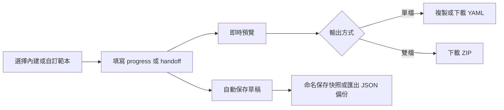

### YAML 欄位規範

**`progress.yaml`（長任務進度狀態機）**

```yaml
project: "agent-yaml-maker"                # 專案唯一識別名稱
status: "in_progress"                      # pending | in_progress | paused | completed | failed
current_phase: "phase_2_core_development"  # 當前階段識別名稱
updated_at: "2026-09-26T12:00:00.000Z"     # ISO-8601 時間戳記

milestones:                                # 階層式里程碑清單
  - id: 1
    name: "核心支付閘道串接"
    status: "in_progress"                  # pending | in_progress | completed | blocked
    completed_at: ""                       # 完成時自動填入 ISO 時間戳記
    tasks:                                 # 具體子任務 Checklist
      - task: "撰寫 Webhook 簽名驗證"
        status: "completed"                # pending | in_progress | completed | blocked
      - task: "實作冪等性交易快取"
        status: "in_progress"

artifacts:                                 # 關鍵產出檔案清單
  - path: "src/services/payment.py"
    description: "支付主處理器與回調驗證邏輯"

blockers:                                  # 阻礙與風險清單
  - issue: "第三方測試沙盒網路偶發逾時"
    severity: "medium"                     # low | medium | high | critical
    status: "investigating"                # investigating | blocked | resolved
```

**`handoff.yaml`（跨 Session／跨 Agent 移交工單）**

```yaml
handoff_id: "handoff-20260926-7f8a9b"      # 唯一交接單號
timestamp: "2026-09-26T12:00:00.000Z"      # 交接時間戳記
from_agent: "ArchitectAgent"               # 交付方角色
to_agent: "BackendDeveloperAgent"          # 接收方角色
reason: "系統架構審查完畢，交接進入編碼實作階段"

summary_of_work:                           # 已完成之關鍵工作條列
  - "完成系統架構設計與 API 規格草擬"
  - "定義資料庫 Schema 與安全存取邊界"

key_decisions:                             # 關鍵架構決策（防止後續 Agent 擅自推翻或重做）
  - "採用非同步事件隊列處理高並發 Webhook"
  - "敏感參數一律由 Vault 動態注入，禁止寫入環境設定檔"

next_steps:                                # 接手者優先執行清單
  - priority: 1                            # 數字越小優先度越高 (1~10)
    action: "依據 payment_spec.md 實作支付 Webhook 接收端點"
    target_files:
      - "src/webhooks/signature.py"
      - "src/webhooks/router.py"

constraints_and_notes:                     # 邊界約束與注意事項
  - "必須維持向前相容性，不可修改既有交易欄位型態"
  - "單元測試覆蓋率需高於 85%"
```

內建範本包含軟體開發、數據 ETL、資安合規與空白模板四種，可一鍵複製為自訂複本。

### 提示詞整合範例

可直接在給 AI Agent 的 Prompt 中要求遵循此規範：

```markdown
每次對話或任務執行前後，請嚴格遵守專案狀態機規範：
1. 讀取根目錄下的 `progress.yaml` 確認當前階段與 Milestone Checklist。
2. 任務執行完畢時，更新 `progress.yaml` 中的 tasks 狀態與 artifacts。
3. 若需切換 Session 或移交給下一位 Agent，請生成或更新 `handoff.yaml`，
   固定關鍵決策並列出接手者的 next_steps。
```

## Prompt Studio 結構化提示詞工作台

Prompt Studio 是單檔的結構化提示詞工程工作台：把提示詞拆成「情境、目標、受眾、格式」等模組化區塊個別填寫，即時組裝成標準 Markdown，並提供字元數、預估 Token 與結構區塊統計。內建 CO-STAR、CRISPE、RTF、TAG、APE、CARE、ROSES、TRACE、GRADE 與簡約三段式共 10 種經典框架，可隨任務切換。

### 組裝提示詞

1. 開啟 [`prompt-studio.html`](./agent/prompt-studio/prompt-studio.html)。
2. 在「請輸入提示詞專案名稱」欄填寫專案名稱，再從編輯區上方的「快速切換提示詞框架」或左側「常用框架 (10)」選單挑選框架。
3. 依框架顯示的結構欄位（例如 CO-STAR 的情境背景、明確目標、表達風格、語氣基調、受眾輪廓與輸出格式）逐欄輸入內容。
4. 右側「組裝結果預覽 (Markdown)」會即時產生提示詞，下方並顯示總字元數、預估 Tokens 與結構區塊數。
5. 按「一鍵複製」將組裝後的提示詞複製到剪貼簿。

### 動態變數與版本管理

- 在任一欄位以雙大括號撰寫變數，例如 `{{產品名稱}}`、`{{targetAudience}}`，支援中文、英文與底線；工具會自動抽出「偵測到動態變數」填空欄位，填入替換值後右側預覽即時更新。
- 上方「使用說明」彈窗提供變數語法與結構化提示詞四部曲說明，並可按「載入動態變數範例」直接體驗 CARE 框架的多變數範本。
- 按「儲存版本」會將目前內容寫入 IndexedDB 並產生 `v1.0`、`v2.0` 版本快照；可用右側「歷史版本快照」下拉選單還原任一版本。
- 左側「我的提示詞」列出已儲存專案，可切換載入或刪除（刪除會一併移除其版本歷史）；按「新增專案」開啟空白提示詞。
- 左下角垃圾桶按鈕會清空 IndexedDB 中的所有提示詞與歷史記錄，執行前請先確認。

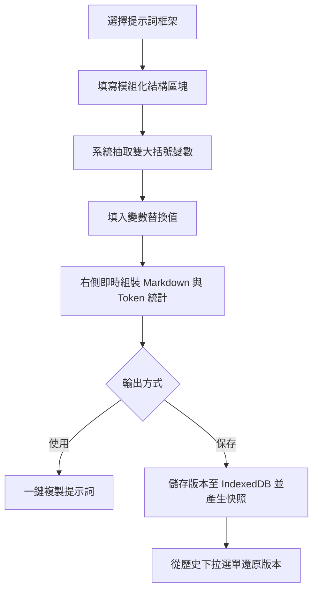

本工具從 CDN 載入 Tailwind CSS 與 Font Awesome 圖示，首次開啟需保持網路連線。所有提示詞、變數與版本快照只保存在目前瀏覽器的 IndexedDB（資料庫名稱 `PromptStudioDB`，object stores：`prompts`、`versions`），不會上傳至任何伺服器；換瀏覽器、使用無痕視窗或清除網站資料後可能無法取得，重要提示詞請先複製保存。

## 動態甘特圖與專案倒數看板

### 建立專案與任務

1. 開啟 [`dynamic_gantt_project_countdown.html`](./docs/project-gantt/dynamic_gantt_project_countdown.html)。
2. 按「新增專案」，輸入專案名稱與簡述，再按「確認儲存」。
3. 按「新增任務」，填寫任務名稱、開始日期、截止日期、負責人、狀態與完成進度。
4. 交付節點若要顯示在上方倒數區，勾選「設為重大里程碑」。
5. 按「儲存」後，可在甘特圖查看排程；點擊既有任務可編輯或刪除。

開始日期不得晚於截止日期。狀態設為「已完成」會將進度設為 100%；進度拉到 100% 也會自動改為已完成。

### 查看與篩選排程

- 以專案選單切換工作區，倒數卡片與甘特圖會同步更新。
- 用「日檢視」或「週檢視」調整時間軸密度。
- 用狀態篩選器查看未開始、進行中、已完成或已延遲的任務。
- 按「回到今天」將時間軸捲回目前日期附近。

### 備份與還原

- 「匯出備份」會下載包含所有專案與任務的 JSON 工作區檔案。
- 「匯入資料」可還原目前工具匯出的多專案備份，也相容舊版單專案任務陣列。
- 完整工作區匯入會清除目前專案與任務，再寫入備份內容。
- 「全部重設」會永久清除所有專案、任務、里程碑與甘特圖排程，並建立一個空白預設專案；執行前請先匯出備份。

### 甘特圖使用流程

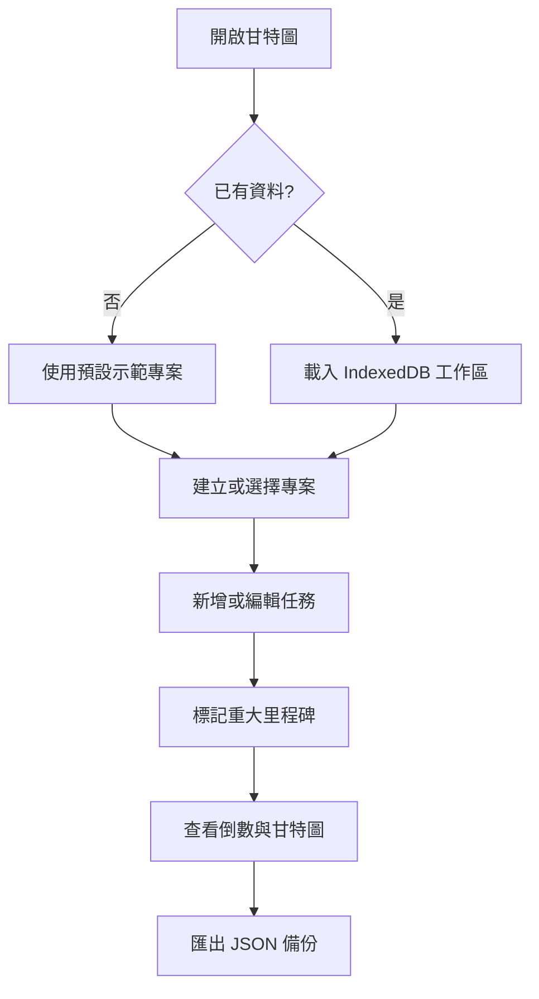

## WBS 甘特排程器

WBS 甘特排程器（離線版）是單檔、純離線的專案排程工具，以工作分解結構（WBS）搭配任務清單、工期與前置相依，推算每個任務的開始與結束日，並自動跳過週末與假日、計入補班日，最後繪製出逐日甘特圖。支援多專案管理與回收區，所有資料都存放在瀏覽器的 IndexedDB，不會上傳。

### 建立專案與任務

1. 開啟 [`wbs-gantt.html`](./docs/wbs-gantt/wbs-gantt.html)；首次載入會建立一個「範例專案」。
2. 上方工具列可切換「專案」、以「＋ 新增專案」建立新專案，並設定「專案起日」作為排程的最早起點。
3. 按「＋ 新增任務」逐列填寫 WBS 編號、任務名稱、工期（工作天）、前置ID、指定起日與負責人；工期 `0` 代表里程碑，畫面上以橙色 ◆ 標示。
4. 有前置任務時，會從前置任務結束日的「次一工作天」開始；「指定起日」為「不早於」（not earlier than）限制，不會早於該日。
5. 「更多 → 專案管理」可重新命名專案、刪除專案（移至回收區）或開啟「回收區」還原與永久刪除。

### 假日、補班日與行事曆

- 右側「假日」清單每行一個日期（`yyyy-mm-dd`）；「補班日」代表週末需上班的日期；「週六日休息」勾選與否決定週末是否計為工作日。
- 日期格式支援 `2026-10-26`、`2026/10/26`、`20261026` 等；檔案的 UTF-8／Big5 會自動判斷。
- 「📂 匯入假日檔」支援政府行政機關辦公日曆表 CSV（含「是否放假」欄）、純文字／CSV（每行含日期即視為假日，含「補班」則視為補班日）與 JSON（`{"hol":[...],"work":[...]}` 或日期陣列）；匯入時可選擇合併或取代現有清單。

### 排程計算與甘特圖

- 任務表右側的「開始」「結束」欄會即時計算；下方摘要顯示整體起始、結束日期與工作天數，並標示循環相依或前置ID錯誤的筆數。
- 甘特圖以逐日格線呈現，藍色為任務、橙色為里程碑、綠色為補班日、紅色為假日、灰色為週末，並以紅色外框標示「今天」。
- 若出現「循環相依」或「前置ID錯誤」，請檢查前置ID是否指向不存在的任務或形成迴圈。

### 匯出與備份

- 「匯出 Excel(CSV)」下載含 ID、WBS、任務名稱、工期、前置ID、負責人、開始與結束的 CSV（含 BOM，Excel 可直接開啟）。
- 「匯出目前專案 JSON」下載單一專案內容；「備份全部專案」下載所有專案的備份檔（`wbs_projects_backup.json`）。
- 「匯入 JSON」可還原單一專案或全部專案備份；「匯入 Excel(CSV)」依標準欄位新增一個專案。
- 「重設目前專案」會將目前專案的任務與排程設定還原為預設值；「回收區」的永久刪除無法復原。

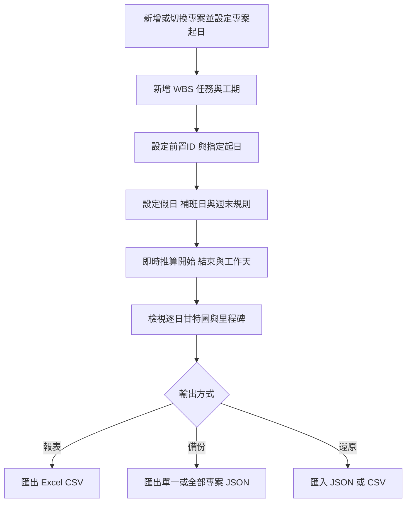

本工具完全離線，不使用任何 CDN 或外部函式庫；資料保存在目前瀏覽器的 IndexedDB（資料庫名稱 `wbsGanttDB`，object store `kv`），並以 CSV／JSON 匯出備份。排程結果為工作天推算輔助，正式專案時程仍應依團隊行事曆與資源配置人工確認。

## 專案時程暨處理流程紀錄系統

專案時程暨處理流程紀錄系統是單檔、純離線的專案追蹤工具，以「專案 → 事件 → 處理流程」三層結構管理時程，並提供列表、甘特圖與月曆三種檢視。每個事件可指派提出人與處理人員，設定狀態、優先度、標籤與提醒天數，並逐筆累積處理歷程、附件與參考連結。所有資料都存放在瀏覽器的 IndexedDB，不會上傳。

### 建立專案與事件

1. 開啟 [`project-tracker.html`](./docs/project-tracker/project-tracker.html)；首次使用可按畫面中央的「載入範例資料」快速瀏覽示範，或按「＋ 新增專案」建立自己的專案（也可用「⬆ 匯入專案」帶入先前匯出的檔案）。
2. 專案欄位包含名稱、代號、狀態、開始／結束日期、代表色與說明；左側清單可依狀態或關鍵字篩選，並以進度條顯示完成率與逾期件數。
3. 進入專案後按「＋ 新增事件」，填寫標題、狀態、優先度、開始／截止日、提出人、處理人員、說明、標籤與提醒天數。
4. 專案頁上方可切換「☰ 列表」「▤ 甘特」「▦ 月曆」三種檢視，並以狀態、處理人員、截止日區間與關鍵字篩選；列表標題可點擊排序，逾期與即將到期的事件會以顏色標示。

### 處理流程紀錄與附件

- 事件詳情提供「處理流程」分頁，可逐筆新增流程紀錄（紀錄日期、處理人員、內容與狀態變更），以時間軸形式保留事件的處理歷程。
- 「附件」分頁可拖曳上傳檔案（內容存放於 IndexedDB），或記錄本機路徑／超連結（例如 `C:\Docs\規格書.docx`、`\\server\share\專案A\`、`https://…`），並可複製路徑、開啟或下載檔案。
- 專案刪除採二次確認，並會串聯刪除其事件、處理歷程、附件與提醒紀錄；刪除前建議先匯出備份。

### 提醒與行事曆

- 每個事件可設定提醒天數（預設 7／3／1 天）；網頁開啟時會自動檢查逾期與即將到期事件（每 30 分鐘一次，切回分頁時也會檢查），頁首會顯示未讀提醒數。
- 提醒中心可將單一事件或全部未完成事件匯出為 `.ics` 行事曆檔，匯入 Outlook 後由 Outlook 負責提醒（關閉網頁後不會主動提醒）；也可用「寄提醒信」以 Outlook 開啟預填郵件。
- 專案頁的「📅 .ics」按鈕可匯出該專案未完成事件的到期提醒。

### 人員管理與匯出入

- 「👥 人員」維護姓名、公司、部門、Email、電話、備註與啟用狀態，供事件指派提出人與處理人員。
- 人員清單可用「⬇ 匯出 CSV」（含 BOM，Excel 可直接開啟）與「⬆ 匯入 CSV」批次維護。
- 「⚙ 設定／備份」提供「💾 匯出全部（JSON，含附件）」整庫備份，以及「匯入備份」（可選合併或覆蓋）；單一專案可在專案頁按「💾 匯出專案」下載，再以「⬆ 匯入專案」選擇建立為新專案或取代同 ID 專案還原。

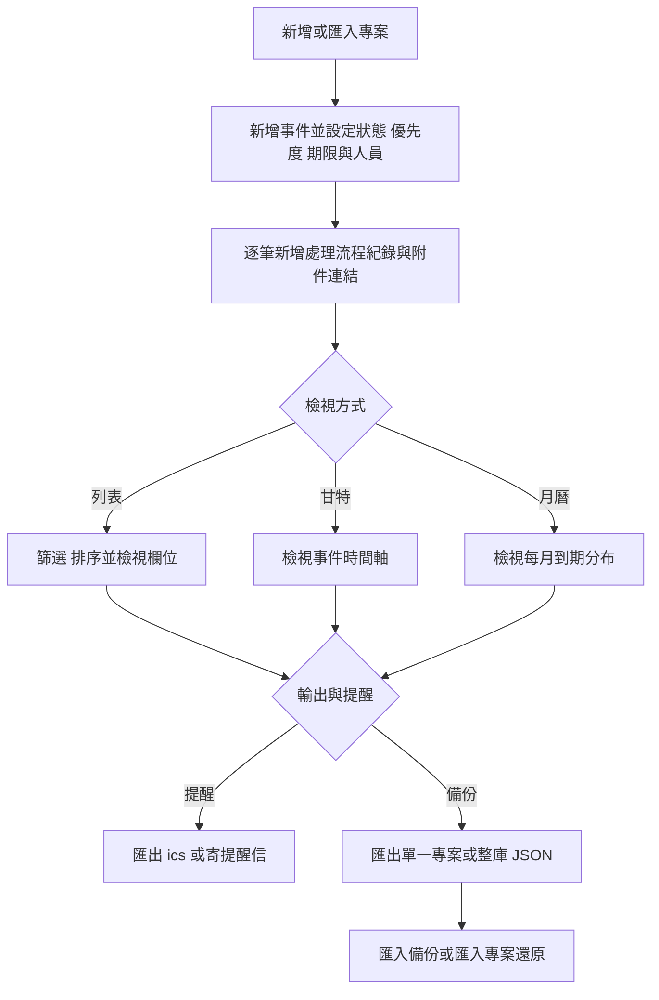

本工具完全離線，不使用任何 CDN 或外部函式庫；資料保存在目前瀏覽器的 IndexedDB（資料庫名稱 `ProjectTrackerDB`，object stores：`projects`、`persons`、`events`、`processLogs`、`attachments`、`reminderLogs`、`settings`）。若瀏覽器不支援 IndexedDB，頁面會提示改用 Chrome 或 Edge，且資料僅保留於目前頁面。換瀏覽器、使用無痕視窗或清除網站資料後資料可能無法取得，重要內容請定期以「匯出全部」保存備份。

## ProTrack 輕量專案與任務管理系統

ProTrack 是單檔、純離線的專案與任務管理工具，以「專案 → 任務 → 子任務」管理多個工作流，提供看板、清單與統計儀表板三種檢視。任務可設定狀態、優先級、截止日、標籤與子任務檢查清單，並可拖曳卡片改變狀態。所有專案與任務都存放在瀏覽器的 IndexedDB，不會上傳。

### 建立專案與任務

1. 開啟 [`protrack.html`](./docs/protrack/protrack.html)；首次開啟會載入示範資料，可先瀏覽操作方式，再按「🔄 重設示範」清空並重新載入，或直接開始建立自己的資料。
2. 按上方「⚙️ 專案管理」新增、重新命名或刪除專案；上方「專案」下拉選單可切換目前檢視的專案，或選「全部專案」。
3. 按右上「＋ 新增任務」或看板欄位標題的「＋」，填寫任務標題、所屬專案、狀態、優先級、截止日、標籤（以逗號分隔）與詳細說明。
4. 在任務視窗下方可逐筆新增子任務檢查清單，按 Enter 或「＋ 新增」加入；儲存後可在編輯視窗勾選完成。

### 看板、清單與統計

- 「📋 看板」以待處理、進行中、審核／驗收、已完成四欄呈現任務；直接拖曳卡片到其他欄位即可改變狀態。
- 「📝 清單」以表格檢視所有任務，可勾選完成、編輯或刪除，並顯示所屬專案、狀態、優先級、截止日與子任務進度。
- 「📊 統計儀表板」顯示任務狀態分佈、優先級分佈與各專案進度概覽；上方統計卡同步呈現總進度、任務總數、進行中與逾期／今日截止數量。
- 搜尋框可查詢任務標題、內容與標籤，並可依優先級與截止日（已逾期、今天到期、7 天內到期）篩選。

### 主題與備份

- 右上「🌓 主題」可切換深／淺色，偏好會記在瀏覽器 `localStorage`（鍵值 `protrack_theme`）。
- 「📥 匯出」會下載包含所有專案與任務的 JSON 備份；「📤 匯入」可選擇備份檔還原，還原前會二次確認並覆蓋目前資料。
- 「🔄 重設示範」會清空目前所有專案與任務並重新載入示範資料，執行前請先匯出備份。

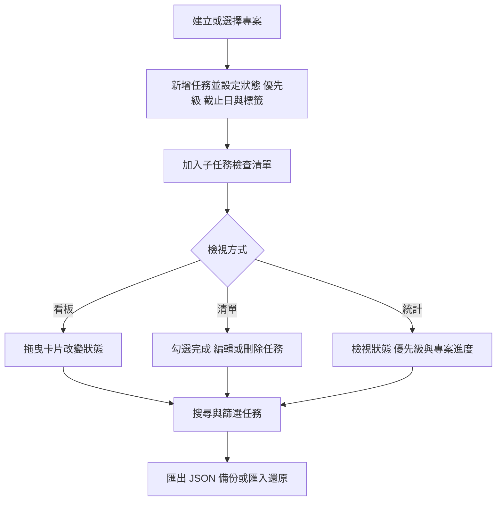

本工具完全離線，不使用任何 CDN 或外部函式庫；資料保存在目前瀏覽器的 IndexedDB（資料庫名稱 `ProTrackDB`，object stores：`projects`、`tasks`）。換瀏覽器、使用無痕視窗或清除網站資料後資料可能無法取得，重要內容請定期以「匯出」保存備份。

## 栖序 專案工作台

栖序（Kiseq）是單檔、純離線的個人專案工作台，以「專案 → 任務」整理工作，提供總覽儀表板、所有任務的看板／清單檢視，以及近期到期清單。任務可設定狀態、優先級、負責人、開始日與到期日，並可拖曳卡片改變狀態、封存專案。所有資料都存放在瀏覽器的 IndexedDB，不會上傳。

### 建立專案與任務

1. 開啟 [`kiseq-workspace.html`](./docs/kiseq-workspace/kiseq-workspace.html)；首次使用可從「＋ 新增專案」開始。
2. 專案欄位包含名稱、簡介與識別色；建立後會出現在左側「我的專案」，並顯示未完成任務數。
3. 按「＋ 新增任務」填寫任務名稱、說明、所屬專案、狀態（待辦／進行中／已完成）、優先級（高／中／低）、負責人、開始日期與到期日。
4. 任務視窗可編輯或刪除既有任務；刪除專案時會一併刪除其任務，執行前會二次確認。

### 總覽、看板與清單

- 「總覽」顯示進行中專案、未完成任務、已完成任務與逾期任務統計，並列出各專案完成進度與近期到期任務。
- 「所有任務」可切換看板與清單檢視；看板依待辦、進行中、已完成分欄，拖曳卡片即可改變狀態。
- 清單檢視以表格呈現任務、專案、狀態、優先級、負責人與到期日，可依任務或到期日排序。
- 上方可依專案、狀態、優先級篩選，並以搜尋框查詢任務名稱、說明與負責人（`Ctrl+K` 可快速聚焦搜尋）。

### 封存與備份

- 專案可「封存」或「恢復」，封存後會收在左側「封存專案」區塊，不列入進行中統計。
- 左側底部「↓ 匯出備份」會下載包含所有專案與任務的 JSON 檔；「↑ 匯入備份」可選擇栖序匯出的 JSON 還原，還原會覆蓋目前資料。
- 匯入前會檢查備份格式、專案與任務關聯及日期欄位，格式不符時不會寫入。

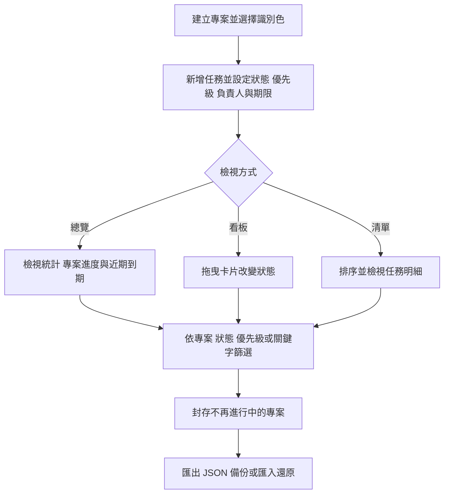

本工具完全離線，不使用任何 CDN 或外部函式庫；資料保存在目前瀏覽器的 IndexedDB（資料庫名稱 `kiseq-project-workspace`，object stores：`projects`、`tasks`）。換瀏覽器、使用無痕視窗或清除網站資料後資料可能無法取得，請定期以「匯出備份」保存。

## 離線速記便箋

離線速記便箋（Offline Scratchpad）是單檔、100% 離線的便箋與筆記工具，以卡片牆管理便箋，支援標籤、全文搜尋、置頂與卡片配色，內建 Markdown 編輯、雙欄即時預覽與字數統計；可將內容備份為 JSON 或匯出 Markdown。所有資料都存放在瀏覽器的 IndexedDB，不會上傳。

### 新增與管理便箋

1. 開啟 [`scratchpad.html`](./docs/scratchpad/scratchpad.html)。
2. 按右上「新增便箋」（或 `Ctrl+N`）開啟編輯視窗，輸入標題、標籤與內容。
3. 在編輯視窗可切換「編輯模式」、「雙欄即時預覽」與「Markdown 預覽」三種檢視；底部顯示字元、詞數與預估閱讀時間。
4. 編輯視窗上方可選擇卡片顏色（預設／琥珀／翠綠／天藍／紫／玫瑰）、置頂便箋，或將便箋「移至回收筒」。
5. 便箋卡片可置頂顯示於最前方；標籤列可點選篩選，搜尋框（或按 `/` 聚焦）可對標題、內文與標籤做全文搜尋。

### Markdown 與圖片

- 內容支援 Markdown 語法，雙欄模式會即時渲染預覽。
- 可直接拖曳或 `Ctrl+V` 貼上截圖，圖片會嵌入便箋內容。

### 匯出、備份與還原

- 右上選單「匯出備份 (JSON)」下載全部便箋的 JSON 備份；「匯入備份 (JSON)」可還原先前備份。
- 「批次匯出全部 Markdown」將所有便箋匯出為 Markdown；單一便箋也可在編輯視窗匯出 Markdown。
- 「清空資源回收筒」會永久刪除回收筒中的便箋，執行前請先確認。

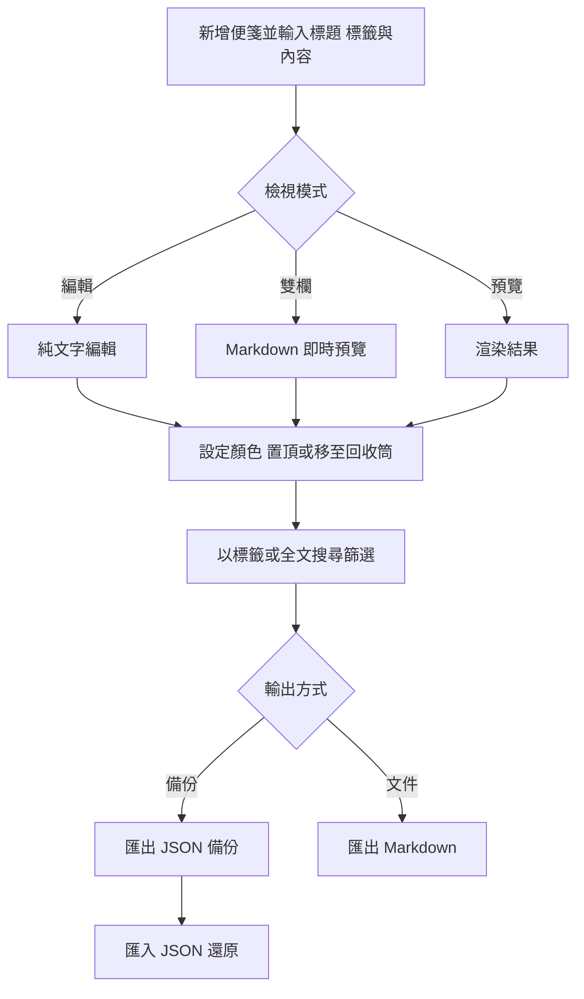

本工具完全離線，不使用任何 CDN 或外部函式庫。便箋與介面設定（含深／淺色主題）保存在目前瀏覽器的 IndexedDB（資料庫名稱 `OfflineScratchpadDB`，object stores：`notes`、`settings`）；換瀏覽器、使用無痕視窗或清除網站資料後資料可能無法取得，重要內容請使用「匯出備份 (JSON)」或匯出 Markdown 保存。

## 臺灣 LCR Mapping 與試算

### 進行試算

1. 開啟 [`LCR_Mapping_SPA.html`](./finance/lcr-mapping-calc/LCR_Mapping_SPA.html)。
2. 在「試算」頁的「HQLA 輸入」填入已完成法規上限調整後的合格高品質流動性資產總額。
3. 從業務下拉選單選擇項目，輸入餘額後按「加入明細」。係數會依 Mapping 自動帶入。
4. 在明細表檢查方向、係數與金額；不需要的項目可按刪除。
5. 查看計算結果中的總預期現金流出、總預期現金流入、可認列流入、淨現金流出、HQLA 與 LCR。

「載入示範資料」可快速填入範例；「清空明細」只會清除目前頁面的試算明細。可在「參數」頁調整 LCR 最低標準與流入認列上限。

### 查詢 Mapping 與公式

- 「Mapping 表」可用關鍵字搜尋，並依流出／流入方向及業務大類篩選。
- 「參數」頁列出預設的 LCR 最低標準 100%、流入認列上限 75%，以及第二層資產 40%、第二層 B 級 15% 的限制說明。
- 「使用說明」頁列出公式與適用限制：`LCR = HQLA ÷ 30 日淨現金流出 × 100%`。

本工具是 Mapping 摘要與試算輔助，不取代主管機關完整條文、附錄、申報表格或正式法遵判定。複合性產品仍須依對手、剩餘期間、擔保品、可取消性與重複列計規定逐案判斷，使用前請確認相關函令是否更新。

## 臺灣 NSFR 淨穩定資金比率與試算

### 進行試算

1. 開啟 [`NSFR_Mapping_SPA.html`](./finance/nsfr-mapping-calc/NSFR_Mapping_SPA.html)。頁面分成「試算」「Mapping 表」「參數」「使用說明」四個分頁。
2. 在「試算」頁的「加入明細」下拉選單選擇 ASF（可用穩定資金）或 RSF（應有穩定資金）項目，輸入帳面金額後按「加入明細」。係數會依 Mapping 自動帶入。
3. 在明細清單檢查方向、大類、係數與加權金額；可直接修改金額，或按刪除移除不需要的項目。
4. 查看計算結果中的可用穩定資金（ASF）、應有穩定資金（RSF）、淨穩定資金比率（NSFR）與資金缺口（ASF － RSF）。

「載入示範資料」可快速填入範例；「清空明細」只會清除目前頁面的明細。可在「參數」頁調整 NSFR 最低標準與內部警示門檻。

### 查詢 Mapping 與公式

- 「Mapping 表」列出全部 ASF（13 項）與 RSF（27 項）係數，可用關鍵字搜尋，並依 ASF／RSF 方向及大類篩選各項目之判斷條件與係數。
- 「參數」頁列出預設的 NSFR 最低標準 100%，以及僅供提醒使用的內部警示門檻 110%。
- 「使用說明」頁列出公式與適用限制：`NSFR ＝ 可用穩定資金（ASF） ÷ 應有穩定資金（RSF） × 100%`。

本工具是 NSFR 係數對照與試算輔助，不取代主管機關完整條文、附錄、申報表格或正式法遵判定。複合性或具選擇權之商品仍須依交易對手、剩餘期間、擔保品、風險權數、受限制狀態及是否重複列計逐案判斷；同一項目符合兩個以上類別時，應適用較高係數且不得重複計算；表外暴險、衍生性商品淨額與相互依存項目之計算較為複雜，正式申報前請回歸主管機關計算表逐項核對，並確認相關函令是否更新。係數表依金管會民國 105 年 12 月 26 日金管銀法字第 10510005801 號令訂定之版本整理；示範資料僅為操作示意，非任何實際機構資料。

### 資料保存與備份

- 明細與參數變更後會自動保存為草稿；「試算情境」可將目前明細命名後保存於瀏覽器本機（IndexedDB，資料庫名稱 `nsfr-mapping-calc`），可載入、刪除。
- 「匯出備份（JSON）」會下載包含參數、目前明細與所有情境的 `nsfr_backup_YYYYMMDDHHmmss.json`；「匯入備份（JSON）」可選擇合併或覆寫情境後還原。
- 換瀏覽器、使用無痕視窗或清除網站資料後，本機保存的資料可能無法取得，建議定期匯出備份。

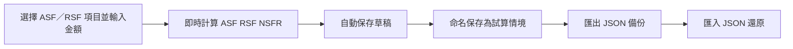

## 銀行信用風險與資本適足模擬器

此工具以資產組合參數推演不同信用壓力下的預期損失（EL）、風險性資產（RWA）與資本適足率（CAR），並提供情境比較矩陣。模型數值供情境分析與敏感度觀察，不是正式監理計算或申報結果。

### 設定資產組合與壓力情境

1. 開啟 [`bank_credit_risk_capital_adequacy_simulator.html`](./finance/basel-creditrisk-calc/bank_credit_risk_capital_adequacy_simulator.html)。
2. 輸入合格自有資本淨額、法定最低 CAR 門檻與現有提存備抵呆帳準備金。
3. 選擇「基準常態」、「經濟景氣趨緩」或「系統性金融風暴」，也可調整 PD、LGD 與 RWA 衝擊滑桿。
4. 按「新增資產組合」，輸入名稱、曝險額（EAD）、基準違約機率（PD）、違約損失率（LGD）與風險權數（RW）；既有組合可編輯或刪除，至少保留一組。
5. 查看即時更新的總覽指標、資產組合圖表、受壓後 EL 與 RWA，以及跨情境敏感度比較矩陣。

### 匯入、匯出與重設

- 按「匯出資產模型」下載目前資本、壓力因子與資產組合資料的 JSON 檔。
- 按「匯入資產模型」選擇先前匯出的 JSON；匯入後會取代目前頁面模型，請先匯出目前資料以保留副本。
- 按「還原預設」會以內建銀行信用資產模型取代目前資料。
- 模型不會自動保存；重新整理或關閉頁面後，未匯出的修改會消失。
- 頁面使用 CDN 載入 Tailwind CSS、Chart.js、Lucide 圖示與 Google Fonts，首次完整使用需能連線至這些資源。

PD、LGD、RW 與情境衝擊假設皆可調整，結果僅供內部估算及敏感度分析。正式風險衡量、資本適足判斷與監理申報，請依適用法規、銀行內部模型及核准流程覆核。

## 大額曝險與關聯戶圖譜速算器

大額曝險與關聯戶圖譜速算器是單檔的集團授信集中度檢核工具，依銀行法第 33 條之 3 的同一人、同一關係人與同一關係企業限額，將關係戶與股權關聯整理成可視化圖譜，並提供即時的法定門檻檢核、What-If 壓力試算與審查底稿輸出。所有計算都在瀏覽器端執行，不會上傳資料。

### 設定集團與關聯戶

1. 開啟 [`large-exposure-analyzer.html`](./finance/large-exposure-analyzer/large-exposure-analyzer.html)；頁面載入時會帶入「半導體」示範案例。
2. 在最上方「本行前一會計年度決算淨值 (Capital / Equity)」輸入核算基準淨值（億元）；上方法定門檻卡與右側計量錶會即時換算 5%、15% 與 40% 上限。
3. 按「集團設定」可調整集團名稱、代碼、所屬產業與行內內部預警比率。
4. 在「關聯戶成員清單」按「新增戶別」，輸入統一編號、戶名、關係身分、無擔保授信與有擔保授信金額（億元）；可用搜尋框過濾戶別，或按「清空」移除全部。
5. 在「實質控制與股權關聯」按「建立連結」，指定來源戶、目標戶、關聯類型與持股比例，建立股權穿透或實質控制關係。

### 關聯圖譜、壓力試算與底稿

- 中間「集團授信關聯圖譜 (Force-Directed Graph)」以 Canvas 力導向圖呈現戶別與關聯；可拖曳節點、滾輪縮放，並以「動力排版」暫停或恢復自動排版、「視野重設」回到初始視角。滑過節點會顯示該戶的無擔保、有擔保與合計曝險。
- 右側「What-If 壓力試算沙盒」可選擇試算對象，以滑桿模擬追加或調降無擔保／有擔保額度，即時顯示該戶模擬後總額、集團新曝險、佔淨值新比率與法規結論；按「套用至正式圖譜」把模擬結果寫回圖譜，「重設」歸零。
- 「法定門檻檢核計量錶」以長條呈現各項門檻使用率；超額時圖面下方會出現紅色警示列，可點「檢視超標明細」跳至稽核底稿。
- 底部「授信個案大額曝險審查稽核底稿 (Audit Sheet)」逐戶列出統一編號、關係身分、無擔保／有擔保／合計曝險、佔淨值比率與法規檢核狀態。
- 按「複製審查備忘錄 (Markdown)」產生含集團背景、限額基準、關聯戶明細與審查結論的底稿；按「匯出案卷 JSON」下載包含淨值、集團設定、戶別與連結的 `bank_exposure_<集團代碼>_<時間>.json` 備份。

### 匯入 CSV 與案例切換

- 按上方「匯入 CSV」可批次載入關聯戶資料，支援 Big5／CP950／UTF-8 等繁體中文編碼，也可將檔案拖放至對話框；對話框提供「下載範例 CSV」作為欄位範本。
- 案例按鈕可快速切換「半導體」「傳產家族」與「超額警戒」三種示範情境。
- 右上角可切換深／淺色外觀，主題偏好會保存在瀏覽器 `localStorage`。

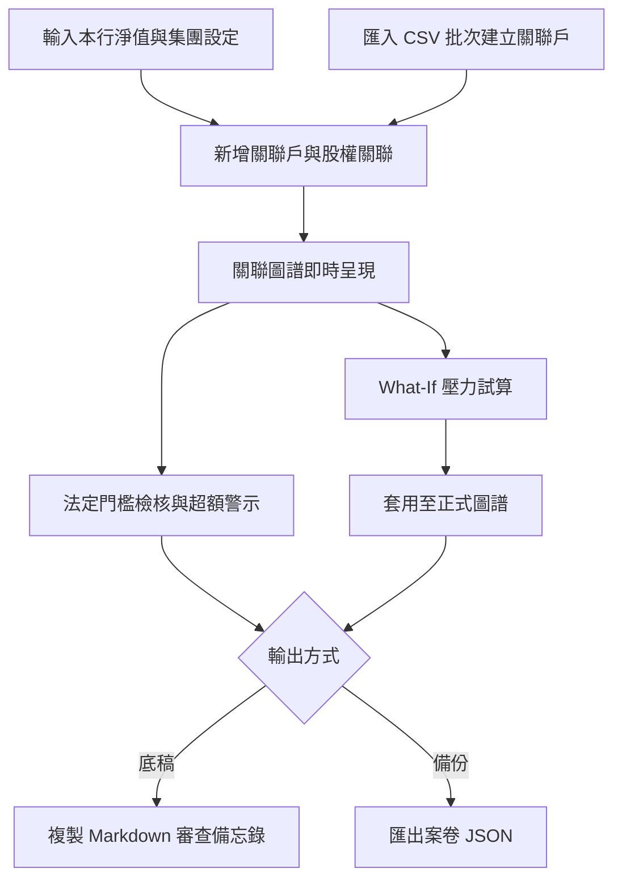

本工具使用 CDN 載入 Tailwind CSS 與 Google Fonts，首次開啟需保持網路連線。集團案卷僅保留在目前頁面記憶體，不使用 IndexedDB；重新整理或關閉頁面後需重新輸入或重新匯入。目前提供案卷 JSON 匯出但未提供 JSON 匯入，若要延續前次作業請以 CSV 重新載入戶別資料。法定限額與比率僅為試算輔助，正式授信核准仍應依銀行法、主管機關規定與內部授信政策逐案覆核。

## 金融金額中文大寫轉換器

金融金額中文大寫轉換器是單檔、100% 離線的銀行出納小工具：輸入阿拉伯數字金額，畫面會即時產生繁體中文大寫金額，並可切換新臺幣、美金、人民幣、日圓、歐元抬頭或無幣別前綴，另可同時輸出純中文大寫與英文大寫金額。適合開立支票、本票、取款條、存款憑條與內部會計傳票時使用；所有運算都在瀏覽器端完成，沒有外部網路傳輸。

### 轉換金額

1. 開啟 [`chinese-amount-uppercase.html`](./finance/chinese-amount-uppercase/chinese-amount-uppercase.html)。
2. 在最上方「幣別抬頭」下拉選單選擇新臺幣 (NTD)、美金 (USD)、人民幣 (RMB)、日圓 (JPY)、歐元 (EUR) 或「無幣別前綴」。
3. 在「輸入金額 (阿拉伯數字)」欄位鍵入金額（例如 `1234567.89`）；欄位右上方會同步顯示千分位格式，欄位內的清除圖示可一鍵清空。
4. 輸出卡片會即時更新，按卡片上的「複製」按鈕即可將該段文字放入剪貼簿（成功時顯示「已複製！」）。
5. 兩個預設勾選的選項可調整輸出：「結尾加上「整」字」控制金額是否附加「整」；「顯示英文金額」會額外產生英文大寫金額卡片。預設幣別抬頭為新臺幣 (NTD)。

金額需為有效的阿拉伯數字，且不可超過 9999 兆；格式不符或超出上限時，欄位下方會顯示對應提示。

### 幣別抬頭與輸出格式

- **中文大寫金額 (繁體正規防偽)**：主要輸出，依所選幣別加上抬頭（例如「新臺幣」），適用於銀行支票、本票、取款條、存款憑條與內部會計傳票。
- **純中文大寫 (無幣別抬頭)**：不含幣別前綴，適用於表單已預印「新臺幣」或特殊表格欄位；選擇「無幣別前綴」時不重複顯示。
- **英文大寫金額 (English Words)**：預設即會顯示（可取消「顯示英文金額」隱藏），適用於外匯水單、信用狀 (L/C) 與國際貿易匯款 (TT)。

### 快速累加與快捷鍵

- 「快速累加」提供 `+1萬`、`+5萬`、`+10萬`、`+50萬`、`+100萬` 與 `+1000萬` 按鈕，可連續點擊疊加金額；右側「清除 (Esc)」可快速歸零。
- 「常用驗證案例」提供 `10 (壹拾元)`、`10,005 (零伍)`、`1 億元` 與 `角分測試` 四個範例，方便快速核對輸出規則。
- 在任何時候按 `Esc` 可清空目前輸入。

### 防偽書寫重點

畫面下方的「臺灣金融業大寫書寫與防偽重點說明」整理四項常見規範：正字大寫防變造（一律使用「壹、貳、參、拾」）、「壹拾」規範（十元須寫「壹拾元整」）、「整」字用法（無角分或僅有角而無分時加註「整」），以及連續零處理（多個零連續出現時依法僅書寫一個「零」）。

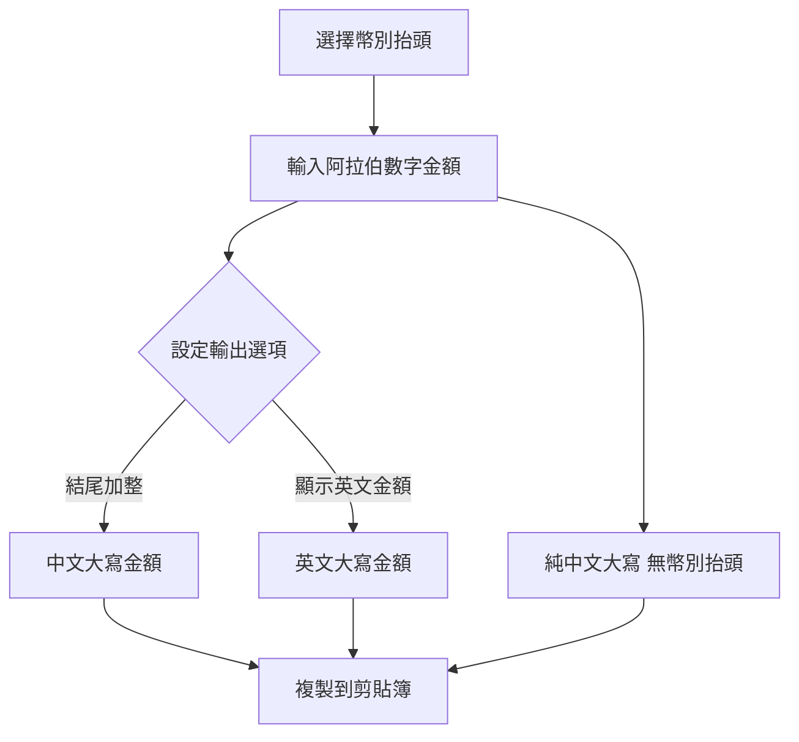

本工具完全離線，不使用任何 CDN、外部函式庫、IndexedDB 或 `localStorage`；金額與輸出只保留在目前頁面記憶體，重新整理或關閉頁面後需重新輸入。大寫轉換結果為輔助格式，正式票據與傳票開立前仍應依行內規範與主管機關規定人工覆核。

## 銀行核心系統固定長度電文解析與管理中心

銀行核心系統固定長度電文解析與管理中心（Core-Host Fixed-Width Parser）是單檔的銀行核心主機電文工具，用來把財金、核心帳務等系統輸出的固定長度（fixed-width）字串，依電文規格逐欄拆解，或反向由欄位值組裝回標準電文。工具內建財金跨行轉帳（FISC 0100）與核心活存存提交易日誌兩組範例規格，並可自行新增、修改、複製與刪除規格；所有解析與換算都在瀏覽器端完成，不會上傳電文內容。

### 電文解析 (Parser)

1. 開啟 [`fixed-width-telegram-parser.html`](./finance/fixed-width-telegram-parser/fixed-width-telegram-parser.html)。
2. 在上方「目前電文規格 (Schema)」選擇要套用的規格，右側會顯示該規格的總長度（Bytes）。
3. 在「原始電文輸入 (RAW Telegram)」貼上電文，支援每行一筆的多筆批次；也可按「載入範例」帶入示範電文，或按「清空」清除。
4. 「中文編碼計算法」可切換 Big5（繁體中文常用 2 Bytes）、UTF-8 或 Pure ASCII，游標字元數與位元組長度會即時更新，並比對是否符合規格總長度。
5. 按「執行拆解解析」後，「欄位解析明細與檢核結果」會依規格逐欄列出內容、長度、型別與備註。解析結果可「匯出 JSON」、「匯出 CSV」，或「儲存至歷史庫」保存至瀏覽器 IndexedDB。

### 反向組裝 (Builder)

- 切換至「反向組裝 (Builder)」分頁，工具會依目前規格產生各欄位輸入框；填入數值後即時預覽組裝結果。
- 系統會依欄位設定的對齊方式、填補字元與長度自動靠左／靠右補空白或補零，並以位元組計量顯示「已用 / 總長度 Bytes」。
- 超出欄位長度時會依編碼邊界自動截斷；按「複製電文」可複製組裝後的字串，「重設表單」可清空輸入。

### 規格管理 (CRUD & CSV)

1. 切換至「規格管理 (CRUD & CSV)」分頁，可檢視所有已儲存的規格，並以卡片快速切換目前規格。
2. 按「建立新規格 (Create)」新增規格，填寫規格代號、名稱、預設編碼與備註，並在「欄位清單定義」以「插入新欄位」定義欄位代碼、中文名稱、長度（Bytes）、型別（AN／N／CH 等）、對齊方式、填補字元與備註；按「儲存規格變更 (Update)」寫回 IndexedDB。
3. 「複製當前規格」可快速衍生新規格；「刪除此規格 (Delete)」會先在確認後自 IndexedDB 永久移除。
4. 「匯出規格 CSV」可下載規格書；「匯入 CSV 規格書」支援自動偵測或強制指定 Big5／CP950、Big5-HKSCS、UTF-8、UTF-16LE 與 GBK 等編碼，處理 Excel 或主機匯出的中文亂碼；另提供「下載標準 CSV 範本」作為欄位格式參考。

### 歷史紀錄

- 「歷史紀錄」分頁列出儲存於瀏覽器的解析紀錄，含儲存時間、所屬規格、原始電文摘錄與筆數／長度。
- 每筆紀錄可「還原」至解析結果面板，或「刪除」單筆；按「清空歷史儲存」可移除全部紀錄。

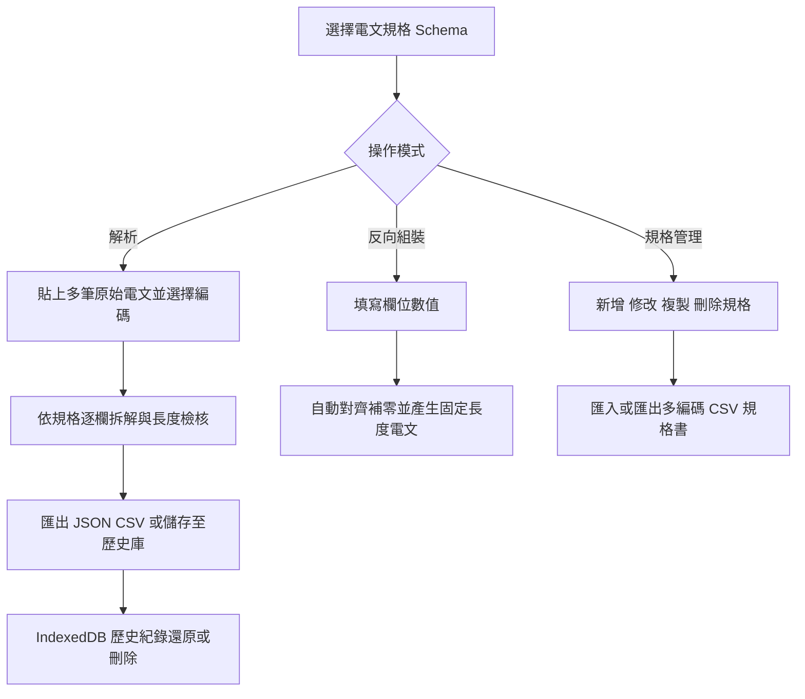

本工具從 CDN 載入 Tailwind CSS 與 Font Awesome 圖示，首次開啟需保持網路連線。電文規格與解析歷史保存在目前瀏覽器的 IndexedDB（資料庫名稱 `BankTelegramParserDB`，object stores：`schemas`、`history`）；換瀏覽器、使用無痕視窗或清除網站資料後，資料可能無法取得。位元組長度以 Big5／UTF-8 常用規則估算，若電文使用特殊轉義或非典型編碼，解析結果仍需與主機規格書人工比對。

## 核心系統與電文錯誤碼排查對照台

核心系統與電文錯誤碼排查對照台是單檔的銀行錯誤碼知識庫與排查工作台，集中整理核心主機、財金跨行（FISC）、SWIFT、票據交割（ACH）與核心批次等系統的錯誤碼、回應碼與拒絕原因，並為每個代碼附上詳細原因、維運處置 SOP、對客標準回覆話術與權責窗口。可透過 Excel 批次匯入既有錯誤碼清單，或直接在畫面上維護；所有資料都存放在瀏覽器的 IndexedDB，不會上傳。

### 查詢與檢視錯誤碼

1. 開啟 [`bank-error-code-resolver.html`](./finance/bank-error-code-resolver/bank-error-code-resolver.html)；首次載入會帶入財金、SWIFT、核心批次與票據等示範資料。
2. 在搜尋框輸入代碼（例如 `4001`、`AC01`）、電文名稱、錯誤原因、SOP 或權責窗口等關鍵字，清單會即時跨欄位比對並更新「符合篩選」筆數。
3. 使用「系統類別」與「嚴重度」下拉選單（FATAL／ERROR／WARN／INFO）縮小範圍。
4. 點選左側清單任一列，右側「詳細原因描述」、「維運處置 SOP (Runbook)」、「對客標準回覆話術」與「權責窗口」會同步顯示。
5. 按話術區的「複製話術」可將對客說明放入剪貼簿。

### 新增、編輯與 Excel 匯入匯出

- 按頁首「新增代碼」開啟表單，或點右側詳情卡的編輯圖示修改目前代碼；刪除圖示會先確認再自 IndexedDB 永久移除該筆。
- 按「匯入 Excel」可上傳 `.xlsx`、`.xls` 或 `.csv`；工具會辨識中文或英文欄位標題，遇到未知系統會自動建立類別。確認預覽筆數後按「確認寫入資料庫」。
- 頁首「下載範本」或匯入視窗的「下載匯入範本檔」可取得標準 Excel 範本；「資料庫維護」（齒輪圖示）可「匯出完整資料為 Excel」、「重設為銀行預設範例庫」或「清空本機所有錯誤碼」。

### 系統類別管理

- 按頁首「系統類別管理」可新增、編輯或刪除系統類別（識別 Key 與顯示名稱）。
- 已有代碼歸屬的類別會限制刪除，以避免資料失去關聯；類別異動後，篩選選單與匯入對應會即時更新。

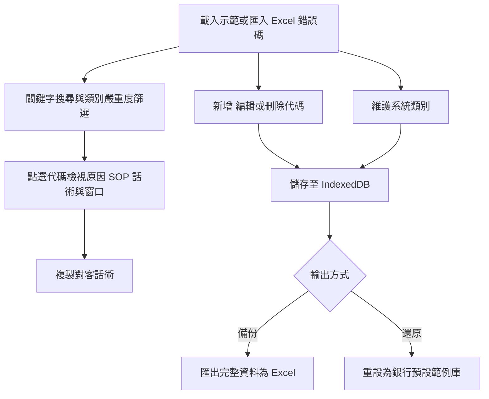

本工具從 CDN 載入 Tailwind CSS、Phosphor Icons 與 SheetJS（xlsx），首次開啟需保持網路連線。錯誤碼與系統類別保存在目前瀏覽器的 IndexedDB（資料庫名稱 `BankErrorCodesDB`，object stores：`error_codes`、`system_categories`）；換瀏覽器、使用無痕視窗或清除網站資料後，資料可能無法取得，重要資料請先匯出 Excel 備份。內建 SOP 與話術為示範內容，正式維運與對客回覆仍應依行內最新作業規範與核准口徑覆核。

## 雙邊資料對帳與平帳差額探索器

雙邊資料對帳與平帳差額探索器（Reconciliation & Break Analyzer）是單檔的雙邊帳務對帳工作台，用來把內部來源帳（Side A）與外部對帳單／清算流水（Side B）兩份資料，依識別鍵、交易金額與日期容差自動媒合，再把結果分成完全平帳、容差平帳、內部單邊、外部單邊、金額差異與日期差異等類別，逐筆追查差額成因。Excel 解析所需的 SheetJS 已內嵌於同一份 HTML，所有比對都在瀏覽器端完成，不會上傳任何帳務資料。

### 匯入雙邊資料與欄位對齊

1. 開啟 [`reconciliation-analyzer.html`](./finance/reconciliation-analyzer/reconciliation-analyzer.html)；可先從頁首「⚡ 載入範例情境...」選擇「銀行核心扣款 vs 跨行清算流水」「電商銷售訂單 vs 金流代收請款」或「企業薪資撥款 vs 銀行逐筆轉帳」，快速帶入示範資料。
2. 在「步驟 1：雙邊資料匯入與欄位對齊配置」以點擊或拖放方式匯入 Side A 與 Side B 檔案，支援 CSV、TSV、TXT、XLSX 與 XLS；也可按頁首「📋 貼入 Side A／Side B」直接貼上表格文字。檔案編碼可選自動偵測（UTF-8、Big5／CP950、UTF-16）或手動指定 UTF-8、Big5／CP950、UTF-16 LE／BE 與 GB18030。
3. 匯入後為兩邊分別指定「🔑 識別鍵 (Key)」、「💰 交易金額 (Amount)」、「📅 日期時間 (Date)」與選填的「🏷️ 次要備援鍵」；下拉選單會依實際欄位自動產生。
4. 在「配對規則」列設定鍵值清洗正則（例如 `^TXN-|^ORD-` 剔除前綴）、金額比對方向（同向、借貸對沖反向或絕對值）、手續費／差額容許值（金額或百分比）、是否啟用 1:N／N:1 彙總媒合，以及時間容差（不限時間、同日、T+1、T+2 或跨週 ±7 天）。
5. 按「⚡ 執行雙邊對帳媒合」開始比對；資料異動後需重新執行。

### 檢視結果與人工配對

- 上方 KPI 卡即時顯示平帳達成率、完全平帳與容差平帳筆數與金額、內部單邊未平帳、外部單邊未平帳、配對差異（金額差異／日期差異筆數）與淨差額（Side A 總額 - Side B 總額）。
- 「步驟 2」工作台的狀態分頁可切換全部比對項目、完全平帳、容差平帳、內部單邊帳 (A)、外部單邊帳 (B)、金額差異、日期差異與人工已平帳；表格支援關鍵字搜尋、點欄位標題排序、分頁與每頁筆數調整。
- 點任一列會開啟右側「明細對照檢閱」抽屜，並排比對 Side A 與 Side B 的欄位與媒合診斷摘要；可在「人工排查註記／處置說明」填寫歸因，或選擇候選項目執行人工配對（例如跨期補扣、線下退款、爭議款處理中）。
- 匯出可選「📥 匯出差異項目 (CSV)」（未平帳與容差項目）、「📊 匯出全部 (CSV)」（完整對帳清單）或「📄 審計報告」（產生正式平帳簽核報表，可複製 Markdown 或列印）。

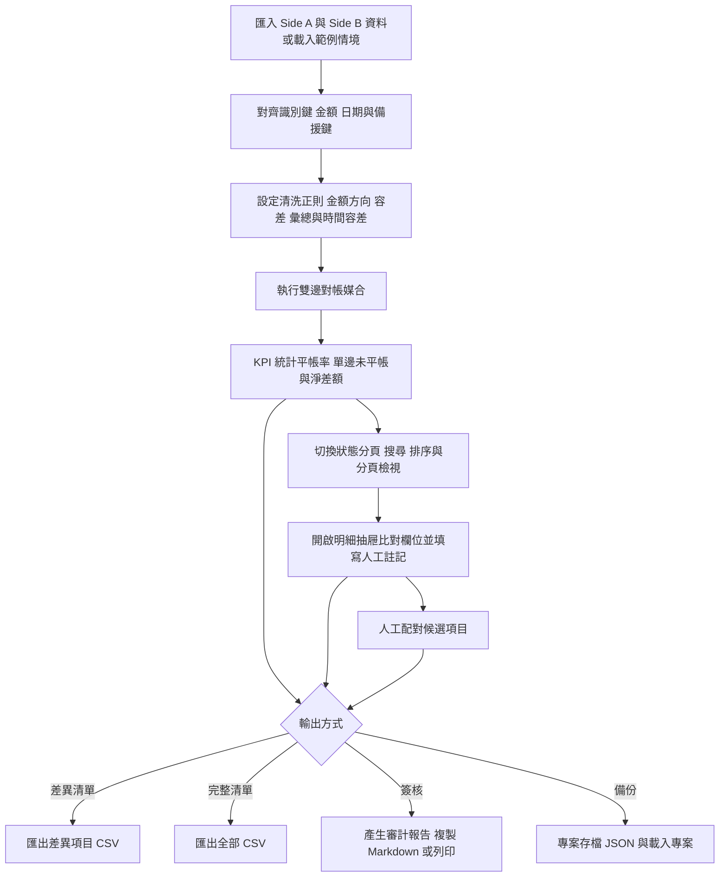

本工具完全離線，SheetJS（xlsx）已內嵌於單一 HTML，不使用任何 CDN 或外部函式庫。雙邊資料、媒合結果與人工註記只保留在目前頁面記憶體，不使用 IndexedDB；重新整理或關閉頁面後需重新匯入，請以「匯出全部 (CSV)」、「匯出差異項目 (CSV)」或「💾 專案存檔」保存。深／淺色主題偏好以 `localStorage`（鍵值 `recon_theme`）記憶。對帳結果為輔助排查工具，正式平帳簽核仍應依行內對帳規範與授權層級覆核。

## 信用卡防阻詐騙異常模式沙盒

信用卡防阻詐騙異常模式沙盒（Credit Card Fraud Sandbox）是單檔離線的信用卡盜刷情境推演與異常模式判讀工作台。它以「案件」為單位帶入同一張卡的連續授權交易，透過內建規則引擎計算整體風險分數與風險等級，標出觸發的異常模式特徵，讓風控人員在實際攔阻前先看清攻擊樣態。所有計算、地圖投影與繪圖都在瀏覽器端完成，樣式與邏輯皆內嵌於單一 HTML，不使用任何外部資源。

### 載入案件與調整門檻

1. 開啟 [`credit-card-fraud-sandbox.html`](./finance/credit-card-fraud-sandbox/credit-card-fraud-sandbox.html)；首次載入會植入 10 組內建模板，並自動載入第一個攻擊情境。
2. 左欄「📦 模板管理」提供 `⤓ 載入`（載入所選模板到沙盒）、`＋ 新增`、`✎ 編輯`、`🗑 刪除`、`⇩ 匯入`（JSON 或含表頭的 CSV 模板）、`⇧ 匯出`（全部模板 JSON）、`⧉ 另存`（把目前載入案件存成新模板）與 `↺ 還原`（重新植入 10 個內建模板）。
3. 內建攻擊情境包含柬埔寨電信詐騙洗錢鏈、跨國電商撞庫攻擊（BIN Attack）、倫敦↔台北側錄複製卡、深夜點數卡高頻連刷、3DS 連續失效後降級授權、海外博弈／虛擬資產儲值、小額試刷後爆發性大額與多卡號批次驗證（Card Testing）；另附「出國旅遊正常消費」與「日常超市／外送基線」兩組偽陽性對照，可用來確認門檻是否過度靈敏。
4. 「🎚️ 動態門檻調整器」可拖曳「警示敏感度分數」（0–100，預設 70）與「不可能位移速度限制」（100–2000 km/h，預設 800）；調整後風險評分與警示等級即時重算，設定會存入 IndexedDB。
5. 需要觀察大量資料的效能時，可按「⚡ 載入 500 筆效能測試資料」產生隨機交易。
6. 「🔍 案件搜尋」可輸入遮罩卡號、姓名或案件編號過濾左側「📋 待審清單」；清單預設依風險分數由高到低排序，每列顯示分數、風險等級、卡號與交易筆數。

### 檢視軌跡與風險診斷

- 中央「可視化沙盒核心工作區」有三種檢視：「🗺️ 地圖軌跡」以等距長方投影的世界地圖標出每筆交易的國家與城市，並以顏色區分成功、失敗、3DS 攔截／逾時與不可能位移；「📊 時序波形」以 Canvas 繪出交易金額隨時間的變化並可檢視單筆提示；「📄 交易明細清單」以表格檢視卡號、時間、金額、幣別、MCC、特店、國家、授權方式、CVV 與裝置風險。
- 下方時間軸可 `▶ 播放`／暫停、`◀◀`／`▶▶` 逐筆前後移動，或拖曳進度滑桿回放，時間讀數會同步顯示目前時間點。
- 右欄「風控診斷與處置面板」以大字顯示整體風險分數與等級（LOW 常規交易／MEDIUM 加強監控／HIGH 立即驗證／CRITICAL 建議鎖卡），下方「🧠 偵測到的模式特徵」逐條列出觸發的規則、嚴重度、說明與命中交易數。
- 內建規則引擎涵蓋跨國不可能位移、低額試刷後爆發性大額、深夜高頻連刷、高風險 MCC 突變（遊戲點數、博弈投注、虛擬資產、匯款轉帳）、3DS 連續失效後降級授權、CVV 連續驗證錯誤與海外未啟動 3DS 大額交易。

### 處置動作與稽核

- 「⚡ 快捷處置動作」提供「🛑 一鍵立即鎖卡（STOP-90）」、「📱 發送即時照會 SMS」、「🛡️ 解除並加入暫時白名單（24h）」與「📋 正式立案通報（匯出稽核報告）」。鎖卡與白名單標記會寫入 IndexedDB 的 `cases`（以 `FLAG:卡號` 為鍵），重新載入案件時仍會顯示。
- 載入、存檔、匯入匯出、鎖卡、照會、白名單與立案通報都會寫入「🧾 稽核軌跡」，並保存在 IndexedDB 的 `auditLogs`（含 `actionId`、`actionType`、`timestamp`）。
- 「正式立案通報」會先二次確認，再匯出包含完整交易軌跡、IP 歷程與規則比對結果的稽核報告 JSON；「交易明細清單」檢視另提供「⇧ 匯出案件 CSV」下載目前案件的交易紀錄。
- 操作時會播放音效並在右下角顯示 toast 提示；右上角「☀️ 淺色／🌙 深色」可切換佈景主題，選擇會保存於 IndexedDB。

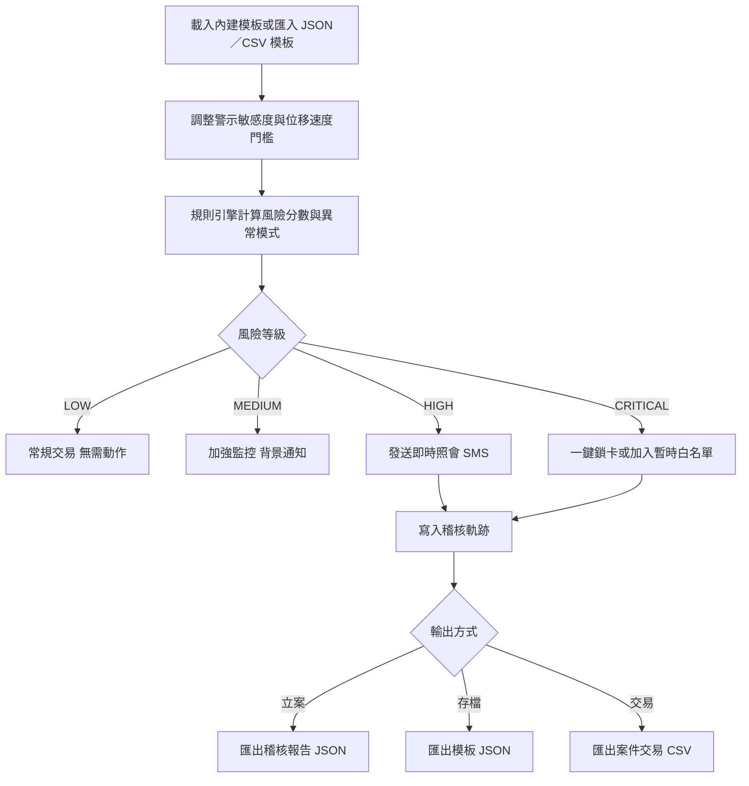

本工具完全離線，樣式、規則引擎、世界地圖（簡化多邊形）與波形圖（Canvas）皆以原生 JavaScript 實作，不使用任何 CDN 或外部函式庫。模板、目前載入案件與鎖卡／白名單標記、稽核軌跡與門檻／主題設定都保存在目前瀏覽器的 IndexedDB（資料庫名稱 `cfs-sandbox`，object stores：`templates`、`cases`、`auditLogs`、`settings`），完全不使用 `localStorage`；換瀏覽器、使用無痕視窗或清除網站資料後資料可能無法取得，重要模板與報告請先匯出備份。內建攻擊情境與規則門檻僅為示範用途，正式阻詐決策仍應依行內風控規範、國際卡組織規則與人工複核結果為準。

## 消金逾期戶還款協議試算

消金逾期戶還款協議試算（Debt Restructuring Calculator）是單檔離線的消費金融逾期債權協商試算工作台，用來把客戶的信用卡、分期信貸與循環現金卡欠款整理成債權明細，模擬不同協商方案下的月付金額、利息支出、減免比率與核決層級，並即時產生可供核閱的「債務清償協議書」草稿。所有試算、驗證與協議書排版都在瀏覽器端完成，樣式與邏輯皆內嵌於單一 HTML，不使用任何外部資源。

### 建立案件與債權明細

1. 開啟 [`debt-restructuring-calculator.html`](./finance/debt-restructuring-calculator/debt-restructuring-calculator.html)；首次載入為空白案件，可先按「載入示範」帶入 `DEMO-2026-001` 範例資料。
2. 步驟 01「客戶與債權資料」填寫案件編號、客戶姓名、身分證字號（會檢核台灣格式與檢核碼）與銀行名稱。
3. 按「＋ 新增帳戶」逐筆建立債權帳戶，選擇類別（信用卡、分期信貸、循環現金卡），並填入本金餘額、應計利息、違約金與法催費；可用 × 移除帳戶，下方總計會即時彙總本金、應計利息、費用與總欠款。

### 設定協商條件與試算

1. 步驟 02 選擇「協商方案類型」：0% 零利率本金攤還、固定年利率攤還（0%–15%）、階梯利率示範（首年 0%、次年 3%、其後 5%）或一次清償示範。
2. 以滑桿或數字欄設定「利息減免」與「違約金與法催費減免」百分比；固定利率方案另設「協商年利率」；分期方案設定「還款期數」（12–180 期，附 36／60／84／120／180 快捷鈕）；一次清償方案改設「一次清償折扣比例」（折扣套用於既有減免後的餘額）。
3. 選擇「首期預定繳款日」（限每月 1 至 28 日），並可選填「自述可月繳上限」與「還款帳號」。
4. 步驟 03 會即時更新每月應繳金額（或一次清償金額）、協議利息支出、預估總還款、總減免金額與比率，並以燈號比對自述月繳上限，顯示「月付在自述能力內」或「違約風險偏高」。
5. 「預估核決層級」依方案類型、減免程度與期數換算：一次清償折扣侵及本金、或分期方案期數超過 84 期時為 TIER 3「協理／處長權限」；違約金與法催費全數減免、利息亦全數減免、最高年利率不超過 5% 且在 84 期以內為 TIER 2「科長／主任權限」；其餘為 TIER 1「經辦權限」。第三級會提示可能需檢附清寒證明、勞保投保明細等佐證文件。

### 協議書、攤還明細與輸出

- 右側「協議書預覽」即時產生「債務清償協議書」草稿，含標的債務及減免條件、還款明細（前三期與末期）、履約及失權條款、其他約定與雙方簽章區，並附以案件編號雜湊產生的示意條碼。
- 按「展開攤還明細」可在頁面下方檢視完整各期應繳金額、本金、利息與剩餘餘額。
- 「複製簡訊摘要」依目前方案產生對客簡訊文字（含月付、期數、首期繳款日與還款帳號）並放入剪貼簿；「送主管審查」會先驗證必填欄位、保存案件並標記為本機待審狀態（不會送出至任何審批系統）。
- 勾選「遮罩個資」會將客戶姓名、身分證字號與還款帳號改以密碼欄位顯示，協議書亦同步遮罩；遮罩開啟時不可列印與複製簡訊。
- 「刪除所選」需確認後才會自 IndexedDB 永久移除案件，無法復原。

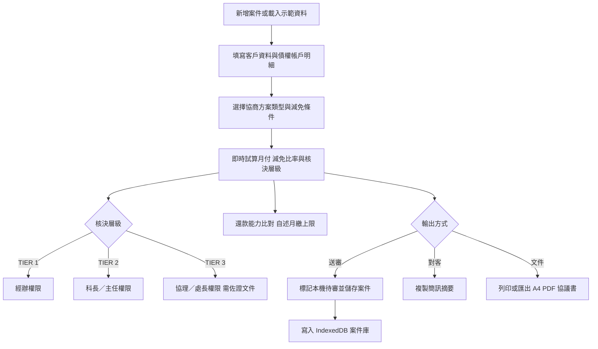

本工具完全離線，樣式、試算邏輯、身分證檢核、協議書排版與示意條碼皆以原生 JavaScript 實作，不使用任何 CDN 或外部函式庫。案件保存在目前瀏覽器的 IndexedDB（資料庫名稱 `consumer-restructure-prototype`，object store `cases`，以案件編號為鍵），內容未加密且不使用 `localStorage`；換瀏覽器、使用無痕視窗或清除網站資料後案件可能無法取得，請以「列印／匯出 PDF」留存正式文件。頁面會提醒遵守機構個資政策，避免在共用或未核准設備輸入真實資料；試算結果、核決層級與協議書皆為示範與草稿性質，不構成銀行核准、正式要約或最終法律文件，正式簽署前仍應由權責單位確認債權與准駁條件。

## 聯徵與財報速讀解析器

聯徵與財報速讀解析器（Credit Report & Financial Extractor）是單檔離線的報告速讀工作台，用來把密集的聯徵報告或財務報表文字整理成可核對的審查摘要。工具會以標籤與欄名比對擷取信用卡、借款授信、近期查詢與退票紀錄，計算 DBR、信用卡循環使用率與流動比率／負債比率／淨利率，並依門檻標示風險訊號。所有解析都在瀏覽器端完成，樣式與邏輯皆內嵌於單一 HTML，並以 CSP 禁止對外連線。

### 貼上或匯入報告文字

1. 開啟 [`credit-report-parser.html`](./finance/credit-report-parser/credit-report-parser.html)；首次載入為空白工作區，貼上聯徵報告、損益表或資產負債表文字即可即時解析。
2. 按「匯入檔案」選擇 `.txt`、`.csv` 或 `.tsv`（最大 2 MB），或直接把檔案拖曳到文字區；工具會先以 UTF-8 解碼，出現取代字元時再嘗試 Big5。
3. 「脫敏預覽」預設開啟，會遮蔽身分證號與姓名中間字元；取消「顯示遮罩內容」可檢視原文（畫面與明細同步切換）。
4. 選填「平均月收入（新台幣）」以計算 DBR 與 22 倍上限的剩餘空間，並選擇解析模式：自動辨識、聯徵報告或財務報表（切換模式會隱藏不相關的明細區塊）。

### 檢視風險訊號與明細

- 摘要指標卡顯示 DBR 倍數、無擔保債務、DBR 22 倍剩餘空間、卡片循環使用率與近三個月新業務查詢筆數，並以紅／黃／綠燈號標示。
- 風險提示會依文字比對列出停卡或特約商店風險、逾期／催收／呆帳字樣、未清償退票、近三個月查詢達 3 筆、循環使用率超過 50%、DBR 達 18／22 倍，以及流動比率低於 100%、負債比率達 65% 等條件。
- 「聯徵明細」分成信用卡帳款、借款授信、近期被查詢、退票與拒絕往來四張表；外幣項目只呈現原幣別、不換算也不計入新台幣合計。無法歸類但含風險字樣的行會列入「需人工覆核的風險文字」。
- 「財務比率」與「財報擷取欄位」會列出可辨識的營業收入、營業利益、稅後淨利、流動資產、流動負債、總負債與總資產，以及據此計算的比率。

### 匯出、保存與清除

- 工作區會自動保存到 IndexedDB（`credit-report-fast-parser`，object store `workspace`，鍵值 `current`），內容包含原文、月收入、解析模式、遮罩設定與解析摘要；重新載入會自動恢復。瀏覽器本機資料未加密，敏感內容請避免留在共用設備。
- 「複製 Markdown」輸出遮罩後的摘要（風險提示、財務比率與基本指標）；「匯出 JSON」下載 `credit-report-analysis.json`，其中原文與明細字串都已遮罩。
- 「清除工作區」需確認後才會清空畫面並刪除 IndexedDB 中的保存內容，無法復原。
- 解析結果來自通用標籤與欄位比對，版型不同或表格缺少欄名時可能無法辨識；所有數字與風險判斷都應回看原始報告人工覆核。

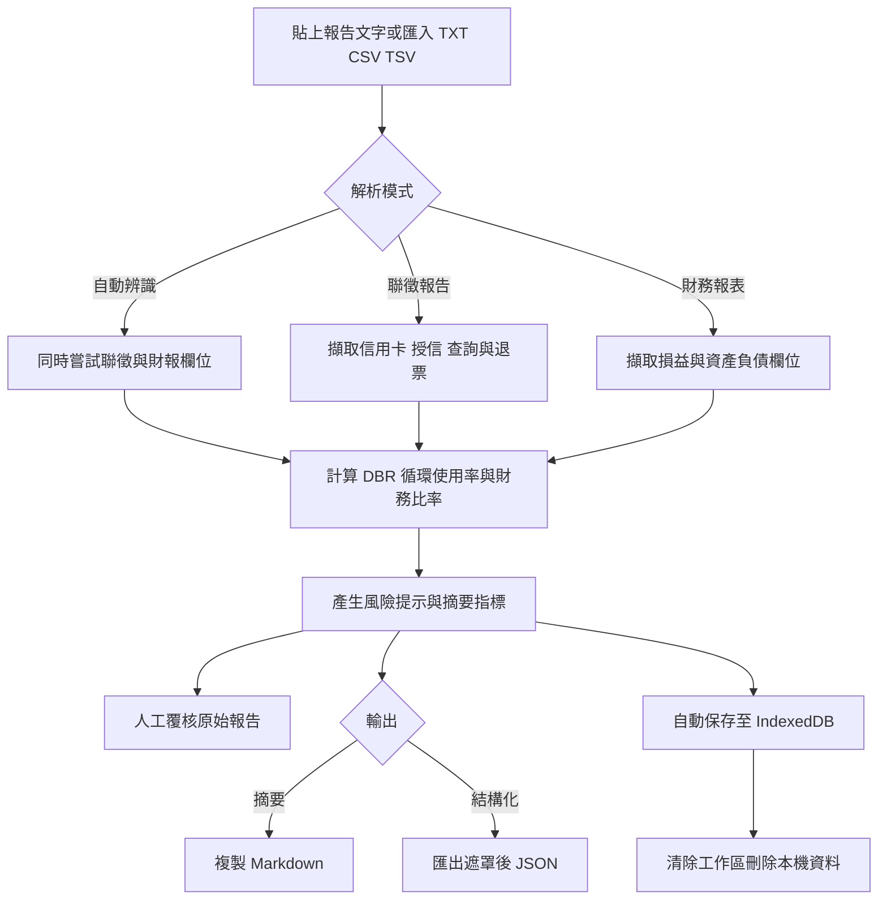

本工具完全離線，樣式、文字解析、比率計算與遮罩皆以原生 JavaScript 實作，不使用任何 CDN 或外部函式庫，並以 CSP 限制所有對外連線。工作區保存在目前瀏覽器的 IndexedDB（`credit-report-fast-parser`，object store `workspace`），未使用 `localStorage`；換瀏覽器、使用無痕視窗或清除網站資料後資料可能無法取得。頁面以文字比對輔助審查，可能誤判歷史紀錄或說明文字，不構成核貸、准駁或評分結論，正式決策仍應依機構規範與原始報告人工覆核。

## 稽核缺失知識庫

稽核缺失知識庫（Audit Finding Knowledge Base）是單檔離線的內稽缺失管理系統，用來彙整歷年內稽、外稽、金檢與會計師查核缺失，透過全文檢索與多維篩選快速找出相似案例，並以統計儀表板觀察年度趨勢、重複發生與改善狀態。工具同時提供缺失事項維護、11 種 Excel 報表、四步驟批次匯入，以及代碼表、同義詞、標籤與 JSON 備份等設定。頁面以 CSP 禁止對外連線，所有資料只存在瀏覽器本機。

### 搜尋與查詢缺失

1. 開啟 [`audit-finding-kb.html`](./finance/audit-finding-kb/audit-finding-kb.html)；首頁可直接輸入關鍵字，支援 `AND`、`OR`、排除（`-關鍵字`）、片語（`"印鑑卡"`）與同義詞擴充，並可點選熱門標籤或最近搜尋快速重查。
2. 「缺失查詢」提供年度、稽核來源、受查單位、業務類別、風險等級、改善狀態、法規依據與標籤等篩選條件，可依相關度、查核日期、更新時間或改善期限排序。
3. 點選結果卡片會開啟缺失詳情，顯示缺失事實、法規依據、根因、改善措施、改善歷程與相似案例；符合條件的清單可匯出 Excel。

### 統計儀表板

- KPI 卡呈現缺失總數、未改善、改善中、逾期與結案比例。
- 圖表包含年度缺失件數趨勢、前 10 大缺失類別、重複發生缺失排行、改善狀態分布，以及「各單位 × 風險等級」熱力圖。

### 維護與改善歷程

1. 「缺失事項維護」可新增、編輯、刪除與批次刪除缺失；表頭可排序並分頁瀏覽。
2. 編輯表單分為基本資料、缺失事實、法規依據、根因分析、改善措施、負責人、期限、狀態、標籤與附件說明；附件欄僅記錄名稱或位置，不會上傳檔案。
3. 可先「儲存草稿」再「載入草稿」續編；每次狀態調整可新增一筆改善歷程，並可將單一缺失匯出為 Word 案件卡。
4. 角色模式分為查詢者、維護者與管理者：查詢者隱藏維護與匯入功能，管理者另可進入系統設定。

### 報表與匯出

- 「缺失事項報表」提供 11 種報表：缺失明細、受查單位統計、稽核來源統計、業務類別統計、風險等級統計、年度趨勢、單位風險矩陣、逾期與即將到期、負責人改善進度、重複缺失分析與改善資訊完整度檢核。
- 可先設定查核年度區間、來源、單位、類別、風險、狀態與到期追蹤天數，預覽後匯出目前報表；「匯出全部報表（多工作表）」會產生含目錄工作表的 `.xlsx`。
- Excel 產生器與 ZIP 封裝皆內嵌於頁面，不需 SheetJS 或任何 CDN。

### 批次匯入

1. 支援 `.xlsx`、`.xls`、`.csv`（UTF-8／Big5）、`.docx`、`.doc` 與 JSON 備份；可先下載匯入範例 `.xlsx`。
2. 流程為「上傳 → 欄位對應 → 預覽驗證 → 匯入結果」，欄位對應會記住上次設定，預覽會標示必填缺漏與格式錯誤。
3. 重複缺失編號可選擇略過、覆寫或建立新編號；匯入完成後會顯示成功、略過與失敗筆數。

### 系統設定與備份

- 可維護稽核來源、受查單位、業務類別與風險等級代碼表，新增同義詞組（例如「印鑑＝留存印鑑＝印鑑卡」），並將舊標籤改名或合併。
- 「匯出 JSON 備份」包含全部缺失、代碼表、同義詞與設定；可匯入還原，或按「清空資料」刪除本機內容（無法復原）。
- 「安全與外觀」可啟用個資遮罩、深色模式與閒置 PIN 鎖定（PIN 4～12 碼、閒置 1～240 分鐘）；PIN 只以雜湊值保存在本機。

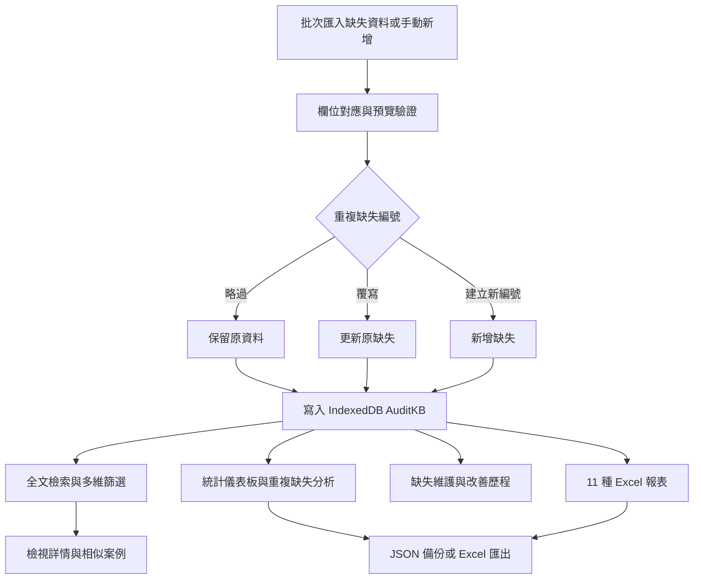

本工具完全離線，樣式、搜尋索引、同義詞擴充、圖表、Excel 產生器與 ZIP 封裝皆以原生 JavaScript 內嵌於單一 HTML，並以 CSP（`connect-src 'none'`）禁止所有網路請求。缺失、代碼表、同義詞、搜尋索引、設定與搜尋紀錄保存在目前瀏覽器的 IndexedDB（資料庫名稱 `AuditKB`，version 1；object stores：`findings`、`codes`、`synonyms`、`searchIndex`、`settings`、`searchHistory`），未使用 `localStorage`；換瀏覽器、使用無痕視窗或清除網站資料後資料可能無法取得，請定期以「匯出 JSON 備份」保存。`.doc` 舊格式只能盡力擷取文字，建議先另存為 `.docx`；附件欄位只記錄名稱或位置，不會保存檔案本體。儀表板與報表為管理參考，正式陳報前仍應人工覆核缺失內容與改善狀態。

## 稽核抽樣工作站

稽核抽樣工作站（Audit Sampling Studio）是單檔離線的抽樣設計與工作底稿工具，用來從 CSV／XLSX 稽核母體中，以可重現、可追溯的方式抽出樣本。流程固定為六步：匯入母體 → 定義與檢核 → 設定範圍 → 抽樣設定 → 抽樣覆核 → 匯出工作底稿；每一步都會保留筆數、參數與排除軌跡。頁面以 CSP 禁止對外連線，資料只在瀏覽器本機處理。

### 匯入母體

1. 開啟 [`audit-sampling-studio.html`](./finance/audit-sampling-studio/audit-sampling-studio.html)，將 CSV 或 XLSX 拖入上傳區，或按「選擇檔案」；單檔上限 50 MB。
2. CSV 可選擇「自動辨識（建議）」、UTF-8、UTF-16 LE／BE 或 Big5／CP950；自動模式會先看 BOM、UTF-16 位元組特徵與有效 UTF-8，其餘以 Big5 解碼。XLSX 可切換工作表並調整標題列（從 1 開始）。
3. 匯入後會顯示欄位、筆數與前幾列預覽；沒有快取結果的公式欄位會以空值匯入並提示。可先按「載入虛構示範資料」熟悉流程。

### 定義與檢核

1. 在「欄位映射」勾選至少一個識別鍵欄位（複合鍵最多 3 欄，選取順序即組合順序），並依需要指定金額、日期、分層與風險欄。
2. 「母體品質檢核」會統計匯入筆數、識別鍵空白、重複識別鍵與金額／日期格式錯誤；空白鍵或重複鍵會阻擋正式抽樣，請先修正來源檔。
3. 每次變更映射都會重新計算檢核結果，也可按「重新檢查」手動更新。

### 設定範圍

1. 在「篩選條件」新增條件，支援等於、不等於、包含、屬於清單、不屬於清單、介於、大小於比較與空白判斷；可組合多個條件。
2. 按「套用篩選並更新調節表」後，「母體調節」會列出匯入母體、排除筆數、可抽母體 N 與每個條件的套用前後筆數及排除數，沒有隱藏排除。
3. 修改條件後必須重新套用，抽樣母體才會更新；按「清除全部條件」可回到完整母體。

### 抽樣設定

1. 選擇方法：
   - **簡單隨機**：等機率、不放回。
   - **系統抽樣**：隨機起點等距抽樣，可指定排序欄位；排序欄若有週期性可能產生偏差。
   - **分層隨機**：指定分層欄，採比例配置或手動配置，可勾選每層至少 1 筆。
   - **確定選取＋隨機**：以條件（多條規則採 OR）挑出必選項目，其餘以簡單隨機補足。
2. 輸入目標樣本數 n 與隨機種子 seed；相同母體、設定、seed 與演算法版本（`xoshiro128**-sha256-v1`）可重現同一組樣本。
3. 按「執行抽樣」；執行前會檢查識別鍵、樣本數、分層配置與確定選取數量。大型母體會以背景 Worker 處理，可用「取消」中止。

### 抽樣覆核

- 摘要卡顯示可抽母體 N、樣本數 n、抽樣率與方法／seed，並列出 Run ID、執行時間與母體正規化 SHA-256。
- 分層抽樣另顯示各層母體、樣本與抽樣率。
- 樣本清單列出識別鍵、原始列號、抽樣原因（`RANDOM`／`CERTAINTY`）與測試結果欄，每頁 25 筆；也可按「重新執行抽樣」回到抽樣設定調整參數。

### 匯出工作底稿

1. 在「樣本欄位與遮蔽」勾選要匯出的欄位；識別鍵與抽樣必要欄位為固定必要欄位，其餘預設不選。
2. 「預設遮蔽非識別欄位」開啟時，文字欄保留末 4 碼、數字欄以 0 遮蔽；原始母體不會匯出。
3. 匯出格式：
   - **完整工作底稿 XLSX**：七張工作表，含樣本清單、母體摘要、參數、排除紀錄、分層摘要與工作底稿範本。
   - **樣本清單 CSV**：欄位會處理試算表公式與控制字元，方便後續填寫測試結果。
   - **專案設定 JSON**：欄位映射、篩選、抽樣參數與雜湊，不含原始母體或樣本明細；可再「匯入設定」帶回。
4. 「開啟列印」可列印目前抽樣摘要與工作底稿欄位。所有匯出都由使用者主動觸發。

### 本機保存

標題列的「本機保存：關」可切換是否將案件寫入瀏覽器 IndexedDB；啟用後會出現提示橫幅，「已保存案件」可載入或刪除案件，「清除全部保存資料」會刪除所有案件且無法復原。未啟用時案件只保留在目前頁面記憶體。

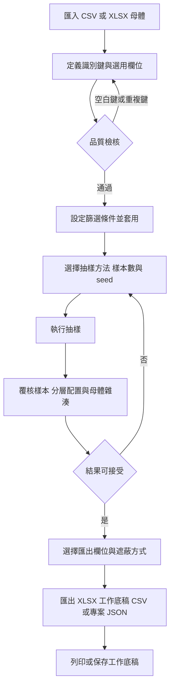

本工具完全離線，樣式、CSV／XLSX 解析與產生、抽樣演算法、SHA-256 雜湊與 Web Worker 皆以原生 JavaScript 內嵌於單一 HTML，並以 CSP（`connect-src 'none'`）禁止所有網路請求。啟用本機保存時，案件與偏好設定會存放在目前瀏覽器的 IndexedDB（資料庫名稱 `AuditSamplingStudio`，version 1；object stores：`cases`、`prefs`），未使用 `localStorage`；資料沒有加密或跨裝置備份，換瀏覽器、使用無痕視窗或清除網站資料後可能無法取得。抽樣方法、樣本數與母體範圍應由稽核人員依查核目標與統計考量核定；本工具提供可重現的抽樣與紀錄，不構成統計保證或查核結論。

## 會議簡報濃縮器

會議簡報濃縮器（Meeting Deck Condenser）是單檔、可離線使用的授信案件會議準備工具：以「場次 → 案件」整理資料，批次匯入文字型 PDF、DOCX 或 DOC 後，在瀏覽器本機解析段落、表格與章節，擷取公司名稱、統一編號、申請額度、授信種類、期間、利率、手續費、擔保品與保證人等欄位，計算財務指標，再依風險規則標示命中段落，產生重點摘要與待確認事項。所有文件、解析結果與註記都留在瀏覽器 IndexedDB，不會上傳。

### 建立場次與匯入文件

1. 開啟 [`meeting-deck-condenser.html`](./finance/meeting-deck-condenser/meeting-deck-condenser.html)。
2. 在「場次」頁按「＋ 建立場次」，輸入場次名稱（例如「115 年第 3 次授審會」）與會議日期；列表會顯示案件數、場次總額度、高風險項目數與會議日期，點擊即可進入場次總覽。
3. 進入場次後按「＋ 匯入案件」，把 PDF、DOCX、DOC 拖進框線區域或按「選擇文件」；可一次混合多種格式，單檔上限 50 MB。檔名建議採用 `場次_案號_公司名稱.pdf`，工具會依「檔名 Regex」的 `session`、`caseNo`、`company` 命名群組帶入識別資料。
4. 佇列會標示格式、大小、檔名比對結果與狀態；按「開始解析並儲存」逐檔解析，完成後可直接開啟案件。解析失敗的檔案會顯示原因，且不影響同批其他文件。
5. 純掃描（沒有文字層）的 PDF 無法解析，請先以 OCR 轉成文字型 PDF，或改匯入 DOCX；DOC 為文字級解析，表格欄位請人工複核。

### 檢視案件摘要

- **場次總覽**：上方統計卡顯示案件數、場次總額度、高風險項目與待處理件數；案件清單可依公司名稱／案號搜尋，依匯入時間、額度、公司名稱或高風險數排序，並篩選全部、有高風險、已完成或解析失敗。右側「風險分布」以長條圖呈現高／中／無風險案件數。
- **案件頁**：左側摘要卡列出九個案件欄位（低可信度欄位以黃色標示）、財務指標、前三點重點摘要、風險清單、核貸條件、待確認事項與個人註記。每筆欄位與風險都附「第 N 頁」或「章節 §段落」定位按鈕，點擊後右側原文會捲動並高亮該段落。
- **修訂欄位**：按「編輯欄位」或雙擊欄位卡修改內容；變更會寫入稽核紀錄（前值、後值、時間），並立即重算該案件的風險命中。
- **待確認事項**：會列出低可信度欄位、檔名未符合命名規則、DOC 文字級解析、追蹤修訂、隱藏文字與文件註解等提示，提醒人工覆核。
- **個人註記**：可逐案新增註記，僅保存在目前瀏覽器。

### 風險規則

- 內建九條規則：R01 負債比偏高、R02 連續虧損、R03 利息保障倍數偏低、R04 信用異常關鍵字（逾期、展延、紓困、退票、訴訟）、R05 無擔保高額授信、R06 營收年減、R07 例外核准關鍵字、R08 文件含追蹤修訂、R09 文件含隱藏文字。
- 規則可新增、編輯、停用或刪除，條件可為數值門檻或關鍵字；關鍵字比對會略過「無逾期」「未見訴訟」等常見否定語境。
- 「測試命中」可貼上不含客戶識別資料的測試文字，確認關鍵字規則是否符合預期；測試文字只在本機記憶體比對，不會寫入案件。
- 「匯出 JSON」與「匯入 JSON」可備份或交換整份規則庫，適合統一全行審查標準。

### 匯出與備份

- 場次總覽按「匯出 Excel」可下載案件總覽（場次、會議日期、案號、公司名稱、統一編號、額度、幣別、授信種類、風險命中數、高風險項目數與狀態）。
- 案件頁可「匯出 Word」或「匯出 PDF」，內容包含案件欄位、前三點摘要、風險清單與核貸條件，適合帶進會議或存查。
- 「設定與備份」頁可將整庫匯出為 JSON；可選擇是否包含原始檔案（以 Base64 內嵌，檔案會明顯變大）。還原時可選擇「合併」或「覆蓋」，覆蓋會先清空現有資料。
- 同頁可調整介面主題、自動清除天數（0 表示不自動清除）、是否保存原始檔、是否解析 DOCX 頁首／頁尾、檔名 Regex、民國年顯示與章節字典；「清除全部資料」需二次確認，執行後無法復原。

```mermaid
flowchart TD
    A[建立會議場次] --> B[匯入 PDF DOCX 或 DOC]
    B --> C[偵測格式與檔名欄位]
    C --> D[解析段落 表格與章節]
    D --> E[擷取案件欄位與財務指標]
    E --> F[套用風險規則並標示原文位置]
    F --> G[產生重點摘要與待確認事項]
    G --> H{檢視與處理}
    H -->|修訂欄位| I[儲存變更並寫入稽核紀錄]
    H -->|新增註記| J[保存個人註記]
    H -->|匯出| K[Excel 案件總覽 案件 PDF 或 DOCX]
    H -->|備份| L[整庫 JSON 或規則 JSON]
```

本工具完全離線，樣式、PDF／DOCX／DOC 解析、風險規則、摘要、圖表與 Excel／PDF／DOCX 匯出所需函式庫皆已內嵌於單一 HTML，不使用任何 CDN 或外部資源。資料保存在目前瀏覽器的 IndexedDB（資料庫名稱 `DeckCondenserDB`，version 1；object stores：`sessions`、`cases`、`files`、`segments`、`fields`、`risks`、`summaries`、`notes`、`auditLog`、`rules`、`settings`、`meta`），未使用 `localStorage`；換瀏覽器、使用無痕視窗或清除網站資料後資料可能無法取得，請定期以整庫 JSON 備份。欄位擷取與風險規則為輔助閱讀，會議前仍應由審查人員核對原文與判斷。

## 違約熱區地圖 Default Hotspot Map

違約熱區地圖是單檔、可離線使用的信用風險熱區分析工具。它把期別、縣市、產業、業務別與評等的違約戶數／曝險資料，換算成戶數違約率（ODR）、金額違約率（ADR）、相對風險（RR）、實際／預期比（A/E）、兩期變動與 Gi* 空間統計，再用等大方格地圖、縣市×產業矩陣、熱區清單與明細面板呈現。適合用在分行／區域資產品質檢視、產業集中度觀察與季度風險會議前的初步掃描。

### 匯入與驗證資料

1. 開啟 [`default-hotspot-map.html`](./finance/default-hotspot-map/default-hotspot-map.html)。
2. 按「上傳 CSV」選擇檔案、按「貼上資料」貼上從 Excel 複製的表格（含標題列），或按「載入範例資料」先體驗。也可把 CSV／TSV／TXT 直接拖進頁面。
3. 必要欄位為期別、縣市、產業、期初戶數與違約戶數；選填業務別、評等、期初暴險額、違約暴險額與 PD。期別支援 `YYYY-MM`、`YYYYQn`、`YYYYMM`；縣市可用全名或簡稱（`台` 會自動正規為 `臺`）；產業可用代碼（A–S）或名稱。
4. 檔案編碼會自動偵測，也可從右上角「編碼」手動切換；按「下載範例 CSV」可取得只有欄位名稱的範本。
5. 按「資料驗證」檢視錯誤、警告與重複鍵；重複的「期別＋縣市＋產業＋業務別＋評等」會自動加總，錯誤列不納入計算，並可下載錯誤／警告清單 CSV。

### 篩選與檢視熱區

- 上方篩選列可選本期、比較期、業務別、評等區間、產業與色階指標；勾選「信度收縮」會以收縮後的違約率判定，降低小樣本波動。
- **KPI**：組合 ODR、顯著熱區數（顯著＋空間）、前 3 大熱區違約占比與縣市違約集中度 HHI。
- **地圖視圖**：以等大方格呈現各縣市，可疊加鄰接線；顏色依所選指標（ODR、ADR、RR、A/E、兩期變動或 Gi*）著色，滑鼠移入可看戶數、違約數、信賴區間、RR、A/E 與 Gi*。
- **矩陣視圖**：縣市×產業熱區，可隱藏無資料產業並依北中南東、ODR 或違約戶數排序；點選格子或列／欄標題可下鑽。
- **熱區清單**：列出排名、熱區、等級、戶數、違約數、ODR、信賴區間、RR、A/E、變動與違約占比，可排序並勾選「顯示全部」。
- **明細面板**：顯示所選對象的指標、熱區判定依據、縣市拆解與期別趨勢。
- **自動敘述**：以文字說明整體熱區狀況、空間聚集與前三大熱區，可一鍵複製。

熱區等級分為顯著熱區、空間熱區（Gi* z ≥ 1.96）、觀察熱區、冷區、正常與樣本不足；門檻可在「設定」調整（收縮強度 k、信賴水準、最小戶數／違約數、RR 門檻與鄰接關係 JSON）。這些門檻與 Gi* 結果都是輔助判讀，實際風險判斷仍應配合業務知識與資料品質。

### 匯出與設定

- 「匯出」提供 PNG／SVG（目前視圖）、CSV 熱區清單、Markdown 報告與 JSON 設定參數。
- 設定值（主題、收縮強度、信賴水準、最小樣本、RR 門檻與鄰接關係）會保存在瀏覽器 `localStorage`（鍵值 `dhm_settings_v1`），下次開啟自動帶回；匯入的資料本身不會保存。
- 範例資料為模擬資料，報告中會標示；若只用範例資料，請勿當成實際風險結論。

```mermaid
flowchart TD
    A[上傳 CSV 貼上表格或載入範例] --> B[自動偵測編碼與欄位]
    B --> C[正規化期別 縣市與產業]
    C --> D[資料驗證與重複鍵加總]
    D --> E[選擇本期 比較期與篩選條件]
    E --> F[計算 ODR ADR RR A/E 與信賴區間]
    F --> G[計算 Gi* 空間統計與熱區等級]
    G --> H{檢視視圖}
    H -->|地圖| I[等大方格熱區地圖]
    H -->|矩陣| J[縣市×產業矩陣]
    H -->|清單與明細| K[熱區清單 明細與趨勢]
    I --> L[匯出 PNG SVG CSV Markdown 或設定 JSON]
    J --> L
    K --> L
```

本工具完全離線，樣式、CSV 解析、統計計算與 SVG 繪圖皆內嵌於單一 HTML，不使用任何 CDN 或外部資源。匯入資料只在目前頁面記憶體處理，不會上傳；只有設定值寫入 `localStorage`（`dhm_settings_v1`）。關閉或重新整理頁面後需重新匯入資料，重要結果請先匯出 CSV、Markdown 或圖片。

## 預期信用損失變動分析器 ECL Movement Analyzer

預期信用損失變動分析器（ECL Movement Analyzer）是單檔、可離線使用的 IFRS 9 備抵損失變動拆解工具。它讀取前期與本期的帳戶層級快照（CSV／XLSX），以帳號配對存續戶、新增戶與除列戶，把 ECL 變動拆成新增帳戶、除列帳戶、轉銷呆帳、Stage 轉換、PD 效果、LGD 效果、EAD 效果與模型及其他，並提供瀑布圖、Stage 矩陣、維度分析、Top Movers、評等轉移、IFRS 7 調節表、前瞻性情境權重、多期趨勢、資料品質與帳戶明細。

### 匯入前期與本期快照

1. 開啟 [`ecl-movement-analyzer.html`](./finance/ecl-movement-analyzer/ecl-movement-analyzer.html)。
2. 在「資料匯入」分頁分別匯入「前期檔案」與「本期檔案」（可點擊或拖放 `.xlsx`、`.xlsm`、`.xls`、`.csv`、`.tsv`、`.txt`），多工作表檔案可切換工作頁。
3. 工具會自動對應欄位；必填為帳號、階段（1／2／3）、EAD、PD、LGD、ECL，選填客戶 ID、產業別、地區、產品別、分行、內部評等、業務別、本期轉銷呆帳金額，以及 Upside／Downside 情境的 PD、LGD。欄位對應會記憶在 `localStorage`（鍵值 `eclMap`），下次匯入同格式檔案可直接沿用。
4. 「本期轉銷呆帳金額」請填在前期檔中、本期已除列且轉銷呆帳的帳戶（大於 0 歸入「轉銷呆帳」，否則歸入「除列（償還／結清）」）。
5. 可選填前期與本期「帳上 ECL 總額」進行總帳核對，工具會比對拆解結果與帳上金額的差異。
6. 按「開始分析」；也可按「載入範例資料」體驗，或「下載範例 Excel」取得前期／本期兩張工作表的範本。

### 拆解變動與檢視分析

- **總覽**：KPI、瀑布圖與自動變動說明，快速看出 ECL 增加或減少的主要來源。
- **瀑布圖**：逐項呈現八類效果；可在設定切換順序拆解（sequential）或 Shapley 拆解，並調整 PD／LGD／EAD 的歸因順序。
- **Stage 矩陣**：前期 Stage × 本期 Stage 的 ECL 與戶數，觀察轉入、轉出與停留。
- **維度分析**：依產業、地區、產品、分行、評等或業務別比較 ECL 變動與驅動因子。
- **Top Movers**：列出 ECL 增加與減少最多的帳戶。
- **評等轉移**：內部評等的遷移矩陣與變動貢獻。
- **IFRS 7 調節表**：依 Stage 呈現期初備抵、轉入／轉出、新增、除列、轉銷、重衡量與期末備抵的調節。
- **情境權重**：以 Base／Upside／Downside 的 PD、LGD 與權重拆解前瞻性情境對 ECL 的影響；未對應情境欄位時會提示改以 Base 替代。
- **多期趨勢**：可加入多個期別檔案，觀察 ECL、Stage 與覆蓋率隨時間的變化。
- **資料品質**：檢查必填欄位、數值格式、Stage 合法性、重複帳號、ECL 與 PD×LGD×EAD 的差異等，錯誤會影響能否分析。
- **帳戶明細**：搜尋、篩選並檢視個別帳戶的前後期資料與變動歸因。

### 匯出與注意事項

- 右上角「匯出 Excel」會產生多工作表活頁簿（含明細與各分析表）；「列印」以 A4 橫式輸出目前分頁；「？說明」提供計算方法與欄位說明。
- 設定值（單位、拆解方法、順序、顯示偏好等）保存在 `localStorage`（鍵值 `eclSettings`）；匯入的檔案與分析結果只留在目前頁面記憶體。
- 階段、PD、LGD、EAD 與 ECL 的定義應與行內 IFRS 9 模型一致；工具的拆解結果用於分析與溝通，不取代正式 ECL 系統與會計師查核。

```mermaid
flowchart TD
    A[匯入前期帳戶快照] --> C[自動對應欄位並檢核]
    B[匯入本期帳戶快照] --> C
    C --> D{資料品質是否可分析}
    D -->|否| E[修正欄位對應或資料後重新匯入]
    E --> C
    D -->|是| F[以帳號配對存續 新增與除列戶]
    F --> G[拆解八類 ECL 變動效果]
    G --> H[瀑布圖 Stage 矩陣 維度與 Top Movers]
    G --> I[評等轉移 IFRS 7 調節表與情境權重]
    H --> J[多期趨勢與帳戶明細]
    I --> J
    J --> K[匯出 Excel 或列印目前分頁]
```

本工具完全離線，樣式、CSV／XLSX 解析、ECL 拆解引擎、SVG 圖表與 Excel 產生器（內嵌 JSZip）皆已內嵌於單一 HTML，不使用任何 CDN 或外部資源。匯入檔案與分析結果只在目前頁面記憶體處理，不會上傳；只有設定與欄位對應寫入 `localStorage`（`eclSettings`、`eclMap`）。關閉或重新整理後需重新匯入，請以 Excel 匯出保存分析結果。

## PD Migration 解釋器

PD Migration 解釋器是單檔、可離線使用的評等遷移與 PD 變動分析工具。它比對前期與本期借戶評等資料，建立評等遷移矩陣，並把 EAD 加權 PD 的變動拆成退出、曝險結構、評等遷移、主尺度校準、個別調整與新增六項效果，再產出 Top Movers、分群分析、SICR 篩選與可直接放進報告或口頭簡報的白話解釋。

### 載入資料與主尺度

1. 開啟 [`pd-migration-explainer.html`](./finance/pd-migration-explainer/pd-migration-explainer.html)。
2. 在左側「① 資料載入」上傳前期與本期兩個檔案（`.csv`、`.xlsx`），或上傳含期別欄位的合併檔後選擇前期／本期；也可按「載入範例資料」直接體驗。CSV 會自動偵測 UTF-8／Big5 等編碼，必要時可手動切換重新解碼。
3. 必填欄位為借戶代號、評等與 EAD；選填 PD（實際使用 PD）、分群、階段、人工調整旗標、退出原因與期別。欄位會自動對應，也可在「欄位對應」視窗手動指定。
4. 「② 主尺度」維護各評等對應的前期／本期 PD。主尺度的變動會單獨歸入「主尺度校準效果」，避免與客戶真實遷移混在一起；可手動編輯，或匯入主尺度 CSV／JSON，並匯出備份。
5. 「驗證結果」會列出重複借戶、評等不在主尺度、PD 格式、EAD 為零、治癒戶等問題；錯誤需修正後才能得到完整結果。

### 檢視遷移矩陣與 PD 拆解

- **總覽**：EAD 加權 PD 的前後值、變動、KPI、瀑布圖與解釋摘要。
- **遷移矩陣**：前期評等 × 本期評等的戶數、EAD 或列百分比，另列退出與新增；點選儲存格可下鑽到該流向的借戶清單。
- **PD 拆解**：瀑布圖與效果明細，六項效果為退出、曝險結構、評等遷移、主尺度校準、個別調整與新增；可檢視分群分析與主尺度前後對照。
- **借戶明細**：推升與壓低 PD 的前 20 大借戶、全部借戶明細、貢獻與主因；可用類型、關鍵字與下鑽條件篩選。
- **SICR 訊號**：以相對 PD 增幅、絕對 PD 增幅（bp）與降等級數篩選信用品質顯著惡化的存續戶，可設定「符合任一」或「需全部符合」；門檻是工具預設值，實際應依行內 IFRS 9 規範調整。
- **解釋文字**：可切換正式報告／口語簡報語氣、精簡／標準／詳細長度與 bp／百分點單位，並選擇是否遮罩借戶代號；文字可複製到報告或簡報。

### 匯出與備份

- 「匯出」提供 Excel（.xlsx，含分析工作表）、Markdown（.md）、目前分頁圖表 PNG 與專案設定 JSON；「載入專案設定」可帶回主尺度、參數與顯示偏好。
- 顏色可切換色盲安全配色（橘／藍）與反轉紅綠，避免升等／降等判讀混淆。
- 主尺度、參數與顯示偏好保存在 `localStorage`（鍵值 `pdm_settings_v1`）；原始借戶資料與分析結果只留在目前頁面記憶體，不會上傳。
- 結果供分析參考，不取代正式 ECL 系統、評等模型治理與核定流程。

```mermaid
flowchart TD
    A[上傳前期與本期借戶評等資料] --> B[自動偵測編碼與欄位對應]
    B --> C[設定或匯入主尺度]
    C --> D[資料驗證與借戶配對]
    D --> E[建立評等遷移矩陣]
    E --> F[拆解 PD 變動六項效果]
    F --> G[Top Movers 分群與主尺度對照]
    G --> H[SICR 篩選與門檻調整]
    H --> I[產生正式或口語解釋文字]
    I --> J[匯出 Excel Markdown PNG 或專案 JSON]
```

本工具完全離線，樣式、CSV／XLSX 解析、遷移矩陣、PD 拆解、SVG 圖表與 Excel 產生器皆已內嵌於單一 HTML，不使用任何 CDN 或外部資源。原始資料與分析結果只在目前頁面記憶體處理，不會上傳；只有主尺度、參數與顯示偏好寫入 `localStorage`（`pdm_settings_v1`）。換瀏覽器或清除網站資料後設定需重建，請以專案 JSON 備份。

## SA-CR 信用風險標準法資本分析平台

SA-CR 信用風險標準法資本分析平台是單檔、可離線使用的授信暴險與資本管理工具。它以巴塞爾協議信用風險標準法（Standardised Approach for Credit Risk）與臺灣金管會「銀行自有資本與風險性資產之計算方法」為基準，從逐筆暴險帳簿出發，計算 CCF 轉換與 CRM 抵減後的信用約當暴險（EAD）、風險權數與加權風險性資產（RWA）、法定資本計提與資本適足率（BIS Ratio），並進一步延伸到 RAROC 資本配置效率、銀行法第 33 條之 3 大額曝險限額檢核、情境壓力測試與法規權數速查。

### 建立與維護暴險帳簿

1. 開啟 [`sa-cr-credit-risk-studio.html`](./finance/sa-cr-credit-risk-studio/sa-cr-credit-risk-studio.html)。首次開啟會自動載入 22 筆標竿示範組合，可直接操作；按「重新載入標竿樣本資料」可回復預設值。
2. 在「暴險資產明細與法規限額」分頁按「新增授信暴險項目」，填寫暴險案號（可自動編號）、交易對手／案名、標準法資產類別、外部評等（ECRA 等級 1～6 或未評等）與名目暴險金額。
3. 依交易型態選擇信用轉換係數（CCF：表內 100%、履約保證 50%、承諾額度 40%、貿易融資 20%、可撤銷信用卡承諾 10%）；房貸案件另填 LTV，逾期放款另填特定損失準備提存率，兩者都會對應階梯式風險權數。
4. 填入合格擔保品折減後抵減額（已扣 Haircut）、授信利差（Spread%）、預期損失率（EL%）與備註。視窗下方的即時試算會同步顯示信用約當 EAD、淨暴險、適用權數、RWA、8% 資本需求與試算 RAROC。
5. 清單支援關鍵字搜尋、資產類別／評等／集中度狀態篩選與欄位排序；可逐筆編輯或刪除，也可「清空資料」重新開始。

### 資本總覽與法規限額

- 「資本總覽儀表板」可調整合格自有資本淨額（NT$ 百萬元），即時算出 BIS 比率並以顏色標示是否達標；KPI 卡呈現名目暴險、CRM 後淨額、總 RWA、8% 最低資本（含 10.5% 緩衝需求）、平均風險權數與加權平均 RAROC。
- 兩張圖表分別比較各資產類別的 EAD 與 RWA，以及評等／權數層級的 RWA 佔比，用來辨識資本耗用集中的資產群。
- 集中度檢核以合格資本淨額為分母，比對銀行法第 33 條之 3 的單一法人無擔保 10%、全部授信 15% 上限（政府公債除外）；超限時會出現警示橫幅，可一鍵篩出超限清單。

### RAROC 與資本優化

- 設定全行資本成本目標（Hurdle Rate%）後，工具會把暴險分為「明星價值創造資產」（RAROC ≥ 目標）與「資本重擔／稀釋資產」（RAROC < 目標），並列出各自佔比。
- 「RAROC 策略四象限矩陣圖」以風險權數為 X 軸、RAROC 為 Y 軸、名目暴險為氣泡大小，滑鼠懸停可查看案名與數值。
- 「資本優化與釋放建議清單」會挑出 RWA 耗用前五大且 RAROC 低於目標的授信，提示調整利差、增提擔保品、移轉風險或降低額度等具體對策。

### 情境壓力測試

1. 切換到「情境壓力測試與管理」分頁，可直接載入三組內建快照：2008 金融海嘯、高息停滯性通膨、房市重度修正，或按「重設為基準情境」回到原點。
2. 以四支滑桿即時調節壓力參數：信用評等普遍降級（0～3 級）、不動產價值折損導致 LTV 惡化（0～30%）、合格擔保品折價加成（0～40%）、未評等企業轉列逾期比率（0～25%）。
3. 壓力結果會顯示基準與壓力後 RWA 對照、法定資本增額需求、BIS 比率降幅（bps），並以資產類別 RWA 增額圖表找出最脆弱的資產群。
4. 可輸入自訂名稱儲存情境快照，之後從下拉選單載入或刪除；情境資料保存在 IndexedDB 的 `scenarios` 物件倉庫。

### 匯出、備份與列印

- 「匯出 Excel/CSV 分析報表」輸出含暴險代碼、資產類別、淨暴險 EAD、風險權數、RWA、最低資本、利差、EL、RAROC、淨值佔比與限額警示的 UTF-8 CSV。
- 「下載 CSV 範本」取得標準 12 欄匯入格式（第 12 欄「特定損失準備提存率」為選填）；「下載範例 CSV」則匯出內建 22 筆標竿暴險組合，欄位與匯入格式完全一致，可下載後修改再批次匯入。
- 「批次 CSV 匯入」可一次帶入多筆暴險（需保留標題列，欄位順序需與範本一致）；舊版 11 欄檔案仍可匯入，未提供提存率時以 25% 計算。
- 「JSON 備份」與「JSON 還原」用於整庫移轉或版本留存；「風委會報告列印」會套用列印樣式，只輸出報告標頭、KPI 與分析內容，適合另存 PDF。
- 暴險帳簿、資本參數與自訂情境保存在瀏覽器 IndexedDB（`CreditRiskSaDb`，version 2：`exposures`、`settings`、`scenarios`）；深色／淺色主題偏好使用 `localStorage`（鍵值 `sa_cr_theme`）。

```mermaid
flowchart TD
    A[新增或匯入授信暴險] --> B[選擇資產類別 評等 CCF 與擔保]
    B --> C[計算淨暴險 EAD 風險權數與 RWA]
    C --> D[檢視 BIS 比率 KPI 與 33-3 限額警示]
    D --> E[設定 Hurdle Rate 並檢視 RAROC 四象限]
    E --> F[套用內建或自訂壓力情境]
    F --> G[比較壓力前後 RWA 與資本缺口]
    G --> H[匯出 CSV 報表 JSON 備份或列印風委會報告]
```

本工具完全離線，樣式、圖表繪製（原生 Canvas）、CSV 解析、風險權數對照與 Excel 相容輸出皆已內嵌於單一 HTML，不使用任何 CDN 或外部資源。所有計算在瀏覽器端完成，資料不會上傳；但權數表與限額檢核為教學與試算用途，實務申報仍應以主管機關最新法規、行內資本管理政策與正式系統為準。

## 信用風險標準法分析工具

信用風險標準法分析工具是單檔、可離線使用的暴險組合分析頁。它把逐筆暴險明細轉成風險權重調整後的 EAD、有效風險權數、RWA 與資本需求，並用儀表板檢視暴險結構、集中度與資料品質。與 SA-CR 信用風險標準法資本分析平台相比，本工具聚焦在「快速匯入、即時看盤、規則可調」，適合做投組概覽、情境比較與匯入前的資料檢核。

### 匯入或建立資料

1. 開啟 [`credit-risk-analyse.html`](./finance/credit-risk-analyse/credit-risk-analyse.html)。第一次開啟時儀表板為空，可按「載入示範資料」帶入 20 筆虛構案例，或按「下載範例 CSV」取得可直接匯入的範本。
2. 按「匯入 CSV」選擇檔案。工具會自動偵測分隔符號（逗號、分號、Tab）與編碼（UTF-8／Big5），也可手動指定編碼；標題列會以同義詞對應到標準欄位，匯入前可預覽對應結果；匯入策略可選「合併（同案件編號覆蓋）」或「取代（先清空）」。
3. 標準欄位共 15 欄：案件編號、借戶名稱、集團、暴險類別、產品、外部評等、已動用餘額、未動用額度、CCF、擔保品類型、擔保品市值、保證類型、保證金額、逾期天數、資料基準日（另可辨識備註）。其中借戶名稱、暴險類別與已動用餘額為必要欄位；金額可含千分位。
4. 暴險類別包含主權／中央政府、公營事業、銀行／金融機構、企業、零售、住宅抵押、商用不動產、股權、逾期放款與其他資產；外部評等支援 AAA～CCC 各級別與「未評等」，較細的評等等級會自動歸併到權重群組。
5. 也可以在「明細」頁按「新增」逐筆建立，或按 `N` 快速開啟新增視窗；`/` 會跳到明細搜尋框，`Esc` 關閉抽屜或對話框。
6. 若匯入有錯誤列，匯入結果會提供「下載錯誤列」CSV，修正後可只重匯失敗的資料。

### 計算規則

- 暴險約當金額：`EAD = 已動用餘額 + 未動用額度 × CCF`。未指定 CCF 時，有未動用額度會預設為「未動用額度（可取消）」；沒有未動用額度則視為表內科目。
- 基準風險權數：依「暴險類別 × 評等群組」查表；零售、住宅抵押、商用不動產、股權、逾期放款與其他資產使用「通用（ANY）」權重。查無權重時會標示「權重缺漏」並暫以 0% 計算。
- 擔保品與保證（CRM）：先以擔保品市值扣除折扣（Haircut）得到合格擔保金額，再與保證金額依序覆蓋 EAD；覆蓋部位採 `min(CRM 權重, 原權重)`，未覆蓋部位維持原權重，據此算出有效風險權數。
- `RWA = EAD × 有效風險權數`；`資本需求 = RWA × 資本要求比率`（預設 8%）。
- 「規則」頁可切換 Basel II 預設、Basel III 修訂版或還原出廠值，並可直接編輯風險權重表、新增 CCF 與 CRM 類型；變更會立即套用到儀表板與明細。這些權重是簡化示意，實務申報仍應依主管機關規定與行內規範調整。

### 儀表板與明細

- 儀表板 KPI 呈現筆數、EAD、RWA、資本需求、平均風險權數與檢核問題數；下方圖表比較暴險類別與評等分佈（依 EAD，未評等高亮）。
- 集中度 Top N 可切換「借戶」或「集團」，查看前 10／20／50 大、HHI 與前十大佔比，快速辨識集中風險。
- 資料檢核會列出類別未對照、權重缺漏、負數金額、CCF／CRM 代碼未對照、EAD 為 0、逾期天數與類別不一致、評等無法辨識等問題；僅提示，不會阻擋既有計算。
- 明細頁支援全文搜尋、類別／評等／檢核狀態篩選、欄位排序與虛擬捲動，點選任一列可開啟抽屜查看 EAD、權重、CRM 覆蓋與 RWA 的完整計算過程。

### 匯出、備份與保存

- 「備份」頁的「匯出結果 CSV」會輸出每筆明細的 CCF、EAD、基準權重、有效權重、RWA、資本與檢核旗標，可直接進 Excel 做樞紐分析。
- 「匯出 JSON」包含所有明細、風險權重表、CCF、CRM 與參數，可用「匯入 JSON」在另一台電腦還原；「清除所有資料」會刪除全部內容且無法復原，執行前請先備份。
- 明細、規則與參數保存在瀏覽器的 IndexedDB（`credit-risk-analyse`，version 1：`exposures`、`meta`）；深／淺色主題以 `localStorage`（鍵值 `credit-risk-theme`）記憶。若瀏覽器無法使用 IndexedDB（例如部分無痕模式或 `file://` 限制），資料只留在目前分頁，關閉即消失，請務必先匯出 JSON。

```mermaid
flowchart TD
    A[下載範例 CSV 或匯入暴險明細] --> B[確認編碼 分隔符號與欄位對應]
    B --> C[必要欄位與錯誤列檢核]
    C --> D[套用風險權重 CCF 與 CRM 規則]
    D --> E[計算 EAD 有效權重 RWA 與資本需求]
    E --> F[檢視 KPI 類別評等分佈與集中度 Top N]
    F --> G[調整規則或補正資料後即時重算]
    G --> H[匯出結果 CSV 或 JSON 完整備份]
```

本工具完全離線，樣式、圖表、CSV 解析與備份功能皆內嵌於單一 HTML，不使用任何 CDN 或外部資源。所有計算都在瀏覽器端完成，資料不會上傳；風險權重與 CRM 規則為分析與情境比較用途，不構成申報依據。

## SQL Catalog

SQL Catalog 是單檔離線 SQL 檔案管理工具，用來建立 SQL 檔案目錄、搜尋內容並補充用途、分類、標籤與後續待辦。它只讀取與管理索引說明，不會修改 SQL 原始檔。

### 開啟目錄與掃描

1. 開啟 [`SQL_Catalog.html`](./sql/sql-catalog/SQL_Catalog.html)。
2. 按「選擇目錄」，選取 SQL 根目錄並允許編輯權限。
3. 工具會遞迴掃描子資料夾中的 `.sql` 檔案，並在根目錄建立或讀取 `sql_catalog.json`。
4. 點選清單中的 SQL 檔案，在右側編輯用途、分類、標籤、執行頻率、到期日、後續說明與備註；內容會延遲約 1 秒自動儲存。
5. 若要重新讀取檔案狀態，按「重新掃描」。SQL 內容可在右側唯讀預覽中查看，工具也會自動判斷引用表格與語法類型。

### 搜尋、篩選與匯出

- 搜尋框可查找檔名、路徑、SQL 內容、用途與後續說明；也可依資料夾、標籤、引用表格或語法類型篩選。
- 快速篩選可查看未填用途、本次有異動、待辦逾期、待辦未完成或已遺失的檔案。
- 「批次編輯」可對選取檔案批量套用分類、標籤、頻率、到期日與後續說明；刪除已遺失紀錄前請確認不再需要該索引。
- 「分類／標籤管理」可更名、合併或刪除分類與標籤；「統計」可查看資料夾與 SQL 語法類型分布。
- 「匯出」可下載全部或目前篩選結果的 CSV、Markdown 清冊、HTML 報表與 `sql_catalog.json`；「匯入 JSON（合併）」可合併其他目錄的索引說明。
- 「打包下載」會下載 SQL 原始檔的 ZIP；請先確認檔案內容與敏感資訊的分享範圍。

### 權限與瀏覽器限制

- Chrome／Edge 支援以目錄權限讀取及寫回 `sql_catalog.json`。重新開啟頁面後，可能需要再次授權上次使用的目錄。
- 不支援 File System Access API 的瀏覽器會改用目錄檔案選取，這是唯讀模式；說明只保存於瀏覽器快取，請定期使用「匯出 → 下載 sql_catalog.json」並手動放回 SQL 根目錄。
- 儲存失敗時，工具會將資料保留在目前瀏覽器的 IndexedDB 快取；修復權限後可按「儲存」，或先匯出 JSON 備份。

```mermaid
flowchart TD
    A[選擇 SQL 根目錄] --> B[遞迴掃描 .sql]
    B --> C[搜尋與篩選]
    C --> D[編輯用途 標籤與待辦]
    D --> E{儲存方式}
    E -->|可寫目錄| F[寫回 sql_catalog.json]
    E -->|唯讀模式| G[保存於瀏覽器快取並匯出 JSON]
```

## Oracle SQL Compare

Oracle SQL Compare V2.1 是雙欄、純離線的 SQL 比對工具，適合檢查舊版與新版 Oracle SQL 的程式碼變更。可直接貼上內容、開啟檔案或將檔案拖放至「舊版／新版」窗格；支援 `.sql`、`.txt`、`.pks`、`.pkb`、`.prc`、`.fnc`、`.trg`、`.vw`、`.pls`、`.pck` 等常見副檔名。

### 比對 SQL

1. 開啟 [`sql-compare.html`](./sql/sql-compare/sql-compare.html)。
2. 將舊版 SQL 放入左側、新版 SQL 放入右側；可貼上文字、按「開啟檔案」或拖放檔案。
3. 依需求調整比對選項：忽略大小寫、空白、註解、空行，以及結尾 `;`／單獨一行的 `/`。
4. 按「比對」，在「逐行差異」查看新增、刪除、修改與移動內容。
5. 切換至「結構差異摘要」查看 SELECT、JOIN、欄位、條件、排序、GROUP BY、PL/SQL 或其他敘述的整理結果；摘要位置可點擊跳回逐行差異。

### 結果操作與快捷鍵

- 「並排」適合同時查看舊版與新版；「整合」適合依單一內容順序閱讀。
- 「僅顯示差異」可收合未變更區段；「上一個／下一個」可在差異區塊間巡覽。
- 「複製差異 (Unified)」與「複製結構摘要」會將結果放入剪貼簿；「匯出 HTML 報表」會下載可保存或分享的差異報表。
- `Ctrl+Enter` 執行比對；`F7`／`Shift+F7` 跳至下一個／上一個差異；`Alt+1`／`Alt+2` 切換逐行差異與結構摘要；`Esc` 返回編輯畫面。
- 「交換」可互換舊版與新版；「範例」會載入內建 Oracle SQL 範例；「清除」會移除目前兩側內容。

工具會將比對選項、顯示方式、編碼與目前頁籤保存於目前瀏覽器的 `localStorage`，不會上傳 SQL 內容。檔案讀取支援自動判斷 UTF-8／Big5，也可手動指定編碼；若要保留結果，請使用複製或 HTML 報表匯出。

```mermaid
flowchart LR
    A[貼上或開啟舊版 SQL] --> C[設定忽略與編碼選項]
    B[貼上或開啟新版 SQL] --> C
    C --> D[執行比對]
    D --> E[逐行差異]
    D --> F[結構差異摘要]
    E --> G[複製 Unified 或匯出 HTML]
    F --> G
```

## Oracle SQL Formatter Studio

Oracle SQL Formatter Studio v1.1 是純離線的批次 SQL／PL/SQL 格式化與健檢工具。它會遞迴掃描選定資料夾中的指定副檔名，先在瀏覽器記憶體中產生格式化預覽；只有按下「寫回檔案」並確認後，才會覆寫來源檔案。

### 掃描與格式化預覽

1. 開啟 [`OracleSqlFormatter.html`](./sql/oracle-sql-formatter/OracleSqlFormatter.html)。
2. 在「副檔名」欄確認要處理的副檔名，預設為 `.sql,.pks,.pkb,.prc,.fnc,.vw,.trg`。
3. 按「選擇資料夾」。Chrome／Edge 等支援 File System Access API 的瀏覽器可取得資料夾讀寫權限；其他瀏覽器會進入唯讀相容模式。
4. 調整檔案編碼（自動偵測 UTF-8／Big5、UTF-8 或 Big5）、縮排、識別字大小寫、SQL 關鍵字／函數大小寫與 SELECT／SET 欄位逐行排列。
5. 在左側勾選要處理的檔案，按「格式化預覽」，再從「差異預覽」逐檔檢查格式化前後內容。
6. PL/SQL 檔預設使用安全模式，只調整大小寫與行尾空白；也可選擇略過 PL/SQL，避免改變其版面。

### SQL 健檢

「SQL 健檢」會依檔案逐行列出錯誤、注意與提示，涵蓋 `= NULL`、ROWNUM 與 ORDER BY 同層、LEFT JOIN 被 WHERE 轉為 INNER、無 WHERE 的 UPDATE／DELETE、舊式逗號 JOIN、`&` 未設定 `DEFINE OFF`、PL/SQL 缺少 `/`、全形符號、不可見字元、條件欄位套用函數、`SELECT *`、`NOT IN`、CROSS JOIN、`WHERE 1=1`、高風險 DDL／DCL 與寫死的密碼等規則。

- 可依嚴重度或規則篩選問題，點擊健檢明細跳至檔案位置。
- 健檢規則可個別啟用／停用，也可調整嚴重度；「全部啟用／停用／恢復預設」會立即重新整理結果。
- 若特定行或整個檔案不需要某規則，可在 SQL 加上 `-- sqlfmt:ignore RULE_ID` 或 `-- sqlfmt:ignore-file RULE_ID`；不寫規則代碼則忽略該行或檔案的全部規則。
- 「快速測試」可直接貼上單段 SQL，立即查看格式化結果與健檢問題，不必先選擇資料夾。

### 寫回、還原與匯出

- 「寫回檔案」只會處理已勾選且預覽狀態為「有變更」的檔案。執行前會要求確認；預設先將原始檔案備份到根目錄的 `_sqlfmt_backup/<時間戳>`，完成後可用「還原本次」復原本次寫回的檔案。
- 寫回前請逐檔檢查差異與健檢結果。關閉頁面、重新整理或重新選擇資料夾後，當次「還原本次」資訊不保證保留；備份目錄才是主要復原依據。
- 「匯出 ZIP」會依原相對路徑打包勾選檔案，預覽後可取得格式化副本；唯讀相容模式只能使用此方式，不會修改來源檔案。
- 「匯出報告」會產生 HTML，包含檔案狀態、編碼、變更／失敗統計、健檢規則統計與行號明細。
- 「重新掃描」會重新讀取目前資料夾；工具會略過 `_sqlfmt_backup`、`.git`、`.svn`、`node_modules` 目錄。

```mermaid
flowchart TD
    A[選擇 SQL 資料夾] --> B[掃描指定副檔名]
    B --> C[執行格式化預覽與 SQL 健檢]
    C --> D{輸出方式}
    D -->|確認後寫回| E[建立備份並覆寫變更檔案]
    E --> F[必要時還原本次]
    D -->|不修改來源| G[匯出格式化 ZIP]
    C --> H[匯出 HTML 健檢報告]
```

若瀏覽器不支援資料夾直接寫回，工具會使用檔案選取器載入唯讀資料；此時「寫回檔案」不可用，但仍可預覽、健檢、匯出 ZIP 與報告。格式化設定與健檢規則保存於目前瀏覽器的 `localStorage`，SQL 內容與報告均在本機處理。

## SQL／TXT 個資掃描與清除

這個工具會在瀏覽器本機遞迴掃描選定資料夾中的 `.sql` 與 `.txt` 檔案，辨識常見身分證字號、存款帳號、擔保品估價彙整序號／子號與統一編號。畫面上的命中值只會以部分遮罩呈現；工具不會將檔案上傳至外部網站。

### 掃描與檢視命中

1. 開啟 [`sql-pii-cleaner.html`](./sql/sql-pii-cleaner/sql-pii-cleaner.html)。
2. 使用新版 Chrome 或 Edge 按「選擇資料夾（可寫回）」；若瀏覽器不支援資料夾寫入，改用「選擇資料夾（唯讀相容模式）」。
3. 確認身分證、帳號、統編、彙整編號，以及日期／時間排除規則；需要時設定排除資料夾或檔名。
4. 掃描完成後點選檔案，檢查編碼、命中數量與遮罩後的行號前後文。編碼不確定時，可在表格中改選 UTF-8、Big5、GB18030 或 UTF-16 後重新掃描。
5. 勾選要處理的檔案，再選擇寫回、下載清除後 ZIP 或匯出 CSV 報告。

### 掃描項目與選項

工具預設偵測下列格式：

- **身分證字號**：依格式與檢查碼判斷，可選擇是否接受第二碼 `8`、`9`，以及是否忽略大小寫。
- **帳號**：偵測 12～14 位數字；符合 14 位時間格式時，依選項排除。
- **彙整序號**：偵測以 `61` 或 `62` 開頭的 15 位數字。
- **彙整子號**：偵測以 `6` 加英文字母開頭的 15 碼值。
- **統編**：依 8 位格式與檢查碼判斷；符合日期格式 `yyyyMMdd` 時，依選項排除。

可用選項包含身分證檢查碼、含第二碼 8／9、忽略大小寫、排除 14 位時間、統編檢查碼、排除 8 位日期，以及以逗號分隔的「排除資料夾或檔案名稱」（可用 `*` 萬用字元，例如 `_backup_*,.git`）。表格欄位可點選排序；編碼不確定時可於「編碼」欄改選 UTF-8、Big5、GB18030、UTF-16LE 或 UTF-16BE 後重新掃描該檔。

### 清除與安全注意事項

- 「清除勾選檔案並寫回」只在可寫回模式可用；啟用備份時，原始檔會先保存至來源資料夾的 `_backup_YYYYMMDDHHmmss` 目錄，並保留原本的子目錄結構。
- 清除動作會直接移除命中的位元組，不是以固定字元取代；未被引號包住的命中可能造成 SQL 語法錯誤，寫回前務必檢查並保留備份。寫回前工具會檢查檔案是否被其他程式修改，已變更者會跳過並要求重新掃描。
- 「下載清除後 ZIP」不會修改來源檔案，會產生 `sql_cleaned_YYYYMMDDHHmmss.zip`，保留相對路徑與編碼的清除副本。
- 「匯出報告（CSV）」產生 `sql_pii_report_YYYYMMDDHHmmss.csv`，只輸出遮罩後的命中明細與統計，不會輸出完整個資值。大量檔案建議分批處理，避免瀏覽器記憶體不足。

```mermaid
flowchart TD
    A[選擇 SQL／TXT 資料夾] --> B[設定偵測與排除規則]
    B --> C[掃描並檢視遮罩命中]
    C --> D[勾選要處理的檔案]
    D --> E{輸出方式}
    E -->|可寫回| F[備份後清除並重新掃描]
    E -->|不修改來源| G[下載清除後 ZIP]
    E -->|保留紀錄| H[匯出遮罩 CSV 報告]
```

## SQL Column Lineage Analyzer

SQL Column Lineage Analyzer v1.5.1 是純離線的 Oracle SQL 欄位血緣分析器。它會在瀏覽器記憶體中解析載入的 SQL，建立資料表、CTE、View、寫入／結果物件與欄位之間的直接或間接關係；不需要後端，也不會上傳 SQL 內容。

### 載入 SQL 並分析

1. 開啟 [`SQL_Column_Lineage_Analyzer.html`](./sql/sql-lineage-analyzer/SQL_Column_Lineage_Analyzer.html)。
2. 以「載入檔案」選取一或多個 `.sql`、`.txt`、`.ddl` 檔案；也可以用「載入資料夾」遞迴載入子資料夾，或按「貼上 SQL」輸入內容。
3. 也可按「內建範例」快速載入範例；檔案可直接拖放到載入區。
4. 在左側檢查目前 SQL，按「分析」或使用 `Ctrl+Enter`。
5. 若要重新開始，按「全部清除」；此動作會移除目前載入的 SQL 與分析結果。

支援常見 Oracle SQL 結構，包括 `SELECT`、CTE、View、資料表定義、`INSERT`／`UPDATE`／`MERGE` 等寫入語句、JOIN、子查詢、集合運算，以及 PIVOT／UNPIVOT。解析器會盡可能建立欄位關係；語法不完整或不支援的語句會在「語句與訊息」頁顯示解析狀態與行號。

### 檢視血緣與欄位關係

- 「血緣圖」以物件卡片與連線呈現欄位來源；可用滑鼠拖曳畫布、滾輪縮放，切換「隱藏行內子查詢」、「完整」或「僅實體表與結果」顯示層級。
- 點選物件標題可聚焦物件，點選欄位可在右側查看運算式、直接來源、間接來源、最終來源實體表、直接下游、最終影響與條件欄位。
- 「只看選取欄位路徑」可收斂圖面；「適合視窗」與「100%」可調整視圖。血緣圖可匯出 SVG 或 PNG。
- 「欄位對照表」可依目標／來源物件、關係類型與關鍵字篩選，並查看目標欄位、來源欄位、直接／間接關係、轉換類型與運算式；可匯出 CSV、JSON 或 Mermaid。
- 「上下游追溯樹」可輸入欄位名稱或 `物件.欄位`，選擇上游、下游或上下游、追溯深度，以及是否包含間接來源與略過行內查詢。可全部展開、收合或清除重設。
- 「CTE 大綱」列出 CTE／結果物件的檔案行號、欄位數、上游物件、下游物件與未使用欄位；點選列可跳回血緣圖聚焦。
- 「語句與訊息」列出解析語句狀態與警告／錯誤；可勾選「只看警告／錯誤」縮小範圍。

### 使用流程

```mermaid
flowchart TD
    A[載入 檔案 資料夾或貼上 SQL] --> B[按分析或 Ctrl+Enter]
    B --> C[檢視血緣圖與欄位明細]
    C --> D{需要哪種結果?}
    D -->|欄位對照| E[篩選並匯出 CSV JSON Mermaid]
    D -->|圖形報告| F[匯出 SVG 或 PNG]
    D -->|來源追蹤| G[輸入欄位並查看上下游追溯樹]
    D -->|解析檢查| H[查看 CTE 大綱與語句訊息]
```

SQL、圖形與分析結果只保留在目前頁面記憶體；重新整理、關閉頁面或按「全部清除」後需要重新載入。匯出檔案可能包含原始欄位名稱、表名與運算式，分享前請確認 SQL 的敏感資訊範圍。

## SQL Lab

SQL Lab 是單檔的 SQL 沙箱與測試工作台：在自己的瀏覽器裡建立多個工作區（資料庫），以 SQL 建表塞資料、查詢、看執行計畫，把 CSV／SQL 腳本／SQLite 檔匯入成資料庫，並可把重要的查詢存成片段、留存執行歷史，或寫成「預期結果比對」的測試案例。資料預設在瀏覽器本機，不會上傳。

執行引擎有兩種：

- **內建引擎**：純 JavaScript 實作，開檔即用、不需要網路，支援常用 SQLite 語法（JOIN、子查詢、CTE／遞迴、GROUP BY、視窗函數、UNION、檢視、交易與日期函數等），適合邏輯驗證與教學。
- **SQLite 引擎**：從 CDN 下載官方 sql.js（SQLite 編譯成 WebAssembly），支援觸發器、`ON CONFLICT`、真實索引與執行計畫。下載一次後會快取在瀏覽器 IndexedDB，之後可離線使用；也可改用手動載入本機的 `sql-wasm.js` 與 `sql-wasm.wasm`。

### 建立工作區與資料

1. 開啟 [`sql-lab.html`](./sql/sql-lab/sql-lab.html)；首次載入會建立示範工作區，內含部門、員工、帳戶與交易等範例資料表、一個檢視與示範查詢。
2. 上方選單可切換工作區；「設定 → 工作區」可新增工作區、更名、複製、匯出、轉為 SQLite（已載入 SQLite 時）與刪除。
3. 在「編輯器」以 SQL 建立資料表與資料，或到「匯入」把檔案變成資料表。

### 編輯器與查詢

- 工具列提供「▶ 執行」（`Ctrl+Enter`／`F5`；有選取範圍時只執行選取內容）、「▷ 執行游標所在敘述」（`Ctrl+Shift+Enter`）、「執行計畫」、「格式化」（`Ctrl+Shift+F`）與「大小寫」（切換關鍵字轉大寫）。
- 左側結構樹列出資料表與檢視：單擊名稱開啟選單（插入名稱、`SELECT *`、列出全部欄位、`COUNT(*)`、INSERT 範本、複製名稱），雙擊查詢前 100 筆，點欄位名稱可插入編輯區；「◀ 收合結構」可收起側欄。
- 結果區以分頁呈現多個結果集與「訊息」分頁，可點欄位標題排序，並「匯出 CSV」、「複製（Tab 分隔）」或「複製為 INSERT」。
- 「存為片段」「存為測試案例」可把目前的 SQL（或選取範圍）保存下來；「開啟 .sql」「下載 .sql」可讀寫本機檔案。

### 匯入 CSV、SQL 與 SQLite

1. 切換到「匯入」，把 `.csv`、`.tsv`、`.txt` 或 `.sql` 拖進框線區域，或點擊選擇檔案。
2. CSV／TSV 會先解析並顯示預覽（前 50 筆），可調整「編碼」（自動偵測、UTF-8、Big5／CP950、Big5-HKSCS、UTF-16 LE／BE、GB18030）、「分隔符號」、「第一列是欄位名稱」、資料表名稱、每個欄位的型別（TEXT／INTEGER／REAL／NUMERIC），以及匯入模式（建立新表／取代／附加到既有資料表）。
3. 按「匯入」即依設定建立資料表並分批寫入；空字串會匯入為 `NULL`。
4. `.sql` 腳本可「在目前工作區執行」或「載入到編輯器」；`.sqlite`／`.db` 與工作區 JSON 則從「設定 → 工作區」的「匯入工作區檔」載入。

### 結構、片段與歷史

- 「結構」頁列出所有資料表（欄位、型別、主鍵、NOT NULL 與索引）與檢視定義，可逐表「預覽」、「產生 SELECT」、「產生 INSERT 範本」、「匯出 CSV」、「刪除」，並可「下載 SQL Dump」或「複製全部 DDL」。
- 「片段」頁保存常用 SQL，支援標題、標籤、說明與全文搜尋，可「帶入編輯器」或直接「執行」，並可匯出／匯入 JSON。
- 「歷史」頁自動記錄每次執行（保留最近 1000 筆），可依關鍵字、成功／失敗與目前工作區篩選，並「載入」、「重新執行」或「存為片段」。

### 測試案例

1. 「測試」頁以套件分組管理案例，每個案例都在**工作區的複本**或**空白資料庫**上執行，不會改動原本的資料。
2. 案例流程為：① 前置 SQL（建表、塞測試資料）→ ② 待測 SQL（以最後一個查詢結果比對）→ ③ 預期結果 → ④ 執行結果。
3. 可勾選「忽略列順序」、「忽略大小寫」、「忽略前後空白」、「比對欄位名稱」並設定「數值容許誤差」；差異表會逐列標示「＝ 相同」、「－ 缺少」、「＋ 多出」、「≠ 不同」。
4. 按「以實際結果設為預期」可快速建立基準，或用「以 CSV 編輯」手動輸入預期結果（`\N` 表示 `NULL`）。可「全部執行」或「執行套件」，並用「執行紀錄」查看歷史結果、「匯出報告 CSV」輸出報告。

```mermaid
flowchart TD
    A[建立或切換工作區] --> B{資料從哪來}
    B -->|手寫 SQL| C[在編輯器建表與塞資料]
    B -->|CSV TSV| D[匯入並設定編碼 分隔符號 型別]
    B -->|SQL 腳本或 SQLite| E[執行腳本或匯入工作區檔]
    C --> F[執行查詢並檢視結果]
    D --> F
    E --> F
    F --> G{輸出方式}
    G -->|保存查詢| H[存為片段或留存在查詢歷史]
    G -->|結果| I[匯出 CSV 或複製為 INSERT]
    G -->|驗證| J[建立測試案例並比對預期結果]
    J --> K[執行套件並匯出報告 CSV]
```

本工具主要從 CDN 載入 sql.js（版本預設 1.10.3，來源可選 jsDelivr、cdnjs 或 unpkg）與其 WebAssembly 檔，且**只在選用 SQLite 引擎時才需要**；內建引擎不需網路。下載後的 sql.js 會快取在瀏覽器 IndexedDB，之後即使離線也能使用 SQLite 引擎。工作區資料、片段、查詢歷史、測試案例、執行紀錄與介面設定都存放在瀏覽器 IndexedDB（資料庫名稱 `sql-lab`，object stores：`workspaces`、`history`、`snippets`、`testcases`、`testruns`、`settings`）；換瀏覽器、使用無痕視窗或清除網站資料後資料可能無法取得，請用「設定 → 備份與還原」的「下載完整備份」保存，日後以「從備份還原」帶回。內建引擎以常用 SQLite 語法實作，特殊函數或邊界行為仍可能與正式 SQLite 或商用資料庫不同，正式 SQL 仍請回到目標資料庫驗證。

## Schema Studio — SQL 欄位映射

Schema Studio 是單檔的 SQL 欄位映射與 DDL 產生器：把來源資料表與目標資料表的結構並排放在畫面上，用拖拉端點或「自動配對」建立欄位對應，必要時替每個欄位加上 SQL 轉換表達式，工具會即時產生可直接使用的 SQL SELECT、目標資料表 DDL、Pandas、dbt 與 MyBatis 程式碼。所有解析、配對與程式碼產生都在瀏覽器端完成，不會上傳資料。

### 輸入來源與目標結構

1. 開啟 [`schema-studio.html`](./sql/schema-studio/schema-studio.html)。
2. 在「來源結構」或「目標結構」面板按「輸入結構」，於對話框貼上下列任一格式後按「解析欄位」：
   - `CREATE TABLE` DDL（支援欄位型別、`PRIMARY KEY`、`NOT NULL` 與 `COMMENT`，並會推斷資料表名稱）。
   - JSON 物件或物件陣列（依值推斷型別）。
   - JSON Schema（讀取 `properties`、`required`、`type`、`format` 與 `description`）。
   - CSV 標頭，或每行一個欄位的清單（可附型別）。
3. 也可按「貼上 DDL / JSON」快速帶入，或用「＋ 新增欄位」手動建立，再以欄位右側的「⋯」「×」編輯或刪除。

### 建立欄位映射

- 點一下來源欄位再點目標欄位即可建立映射；也可直接從來源端點拖曳到目標欄位。
- 面板上方「自動配對」會依「完全相符 → 命名相符（忽略底線）→ 縮寫相符」提出候選，確認後批次套用。
- 點擊映射線或目標欄位可開啟「映射設定」，從常用樣板（TRIM、UPPER、LOWER、COALESCE／NVL、CAST、TO_CHAR、CASE WHEN、CONCAT）挑選，或以 `{{src}}`、`{{src1}}`、`{{src2}}` 自訂 SQL 表達式；一個目標欄位可彙整多個來源欄位。
- 「交換」可對調來源與目標資料表，「清除全部」可重設目前內容。

### 產生程式碼與選項

「產生的程式碼」區塊會即時更新，共有五個分頁：

- **SQL SELECT**：輸出 `INSERT INTO 目標 (...) SELECT ...` 的移轉語句（未映射的欄位標為 `NULL ... /* TODO: Unmapped */`）。
- **Target DDL**：依目標欄位產生 `CREATE TABLE`；選擇 Oracle 方言時會自動轉換型別（例如 `VARCHAR` → `VARCHAR2`、`BIGINT` → `NUMBER(19,0)`、`TEXT` → `CLOB`）。
- **Pandas**：產生可直接套用的 `DataFrame` 改名與轉換程式碼，無法對應的表達式會以 `# TODO` 標示。
- **dbt Model**：輸出引用 `{{ source(...) }}` 的 dbt 模型。
- **MyBatis XML**：輸出含 `<select>` 的 Mapper XML。

上方可設定「目標 SQL 方言」（PostgreSQL、MySQL、Oracle、SQL Server、SQLite）、是否「引用識別字」（依方言使用雙引號、反引號或方括號）、「關鍵字大寫」，以及「補齊稽核欄位」（自動加入 `created_at`、`updated_at`）。

### 匯出、保存與注意事項

- 設定會自動保存在瀏覽器 `localStorage`（鍵值 `schema-studio-state-v1`），重新整理後仍會保留；可用「匯出 JSON」下載設定、用「匯入設定」帶回，也可按「載入範例」還原示範內容。
- 「複製程式碼」會把目前分頁結果放入剪貼簿；「下載程式碼」會依分頁下載 `migration.sql`、`target_schema.sql`、`transform.py`、`model.sql` 或 `Mapper.xml`。
- 欄位型別與轉換規則取決於使用者輸入與樣板，工具不會連線資料庫驗證；產生的 SQL 請回到目標資料庫或測試環境確認。

```mermaid
flowchart TD
    A[貼上或手動輸入來源與目標結構] --> B[解析 DDL JSON JSON Schema 或欄位清單]
    B --> C{建立映射}
    C -->|手動| D[點選或拖曳來源與目標欄位]
    C -->|自動配對| E[依名稱與縮寫提出候選]
    D --> F[設定轉換規則與樣板]
    E --> F
    F --> G[選擇方言與輸出選項]
    G --> H[檢視 SQL DDL Pandas dbt 與 MyBatis]
    H --> I{輸出方式}
    I -->|複製或下載| J[複製或下載程式碼]
    I -->|保存設定| K[匯出或匯入 JSON 設定]
```

本工具不使用 IndexedDB，也不依賴任何 CDN；所有解析、配對與程式碼產生都在瀏覽器端完成。設定與主題保存在瀏覽器 `localStorage`，換瀏覽器、使用無痕視窗或清除網站資料後可能無法取得，重要設定請先用「匯出 JSON」保存。

## MatrixPivot 表格矩陣轉置器

MatrixPivot 是單檔的表格矩陣轉置與格式轉換器：把從 Excel、Google Sheets 或 CSV／TSV 檔案取得的表格文字貼進左側，工具會即時解析成矩陣、在右側以網格預覽，並可一鍵行列轉置、清理空白與轉出工程常用格式。所有解析與轉換都在瀏覽器端完成，不會上傳內容。

### 貼上或匯入表格

1. 開啟 [`matrix-pivot.html`](./data/matrix-pivot/matrix-pivot.html)。
2. 在左側「來源資料貼入 / 匯入」貼上表格文字，或按「匯入 CSV / 檔案」選取 `.csv`、`.tsv`、`.txt`，也可將檔案直接拖放到輸入區。
3. 工具會自動推斷分隔符號（Tab、逗號、分號），並處理引號內換行與 `""` 跳脫；右側「矩陣即時網格預覽」會顯示列數、欄數與儲存格數，含換行的儲存格會標示「↵ 多行」。
4. 依需求切換「首行作為欄位表頭」：勾選時第一列視為欄位名稱，JSON 與 SQL 會以它作為鍵與欄名。
5. 可用右上「載入範例資料」快速套用內建財務報表矩陣，或按「貼上」讀取剪貼簿內容。

### 轉置、清理與搜尋

- 「一鍵行列轉置 (Transpose)」會將矩陣行列互換（`M[i][j]` → `M[j][i]`），並同步更新左側文字與右側預覽。
- 「清理空白行列」會移除全空白的列與欄；「去空格 (Trim)」會清除所有儲存格首尾空白；「清空所有內容」會清空輸入、預覽與編碼標示。
- 預覽區右上「在表格中搜尋」可即時過濾符合關鍵字的列，並顯示「過濾後顯示 N / M 列」。
- 右上角可切換深／淺色外觀。

### 格式轉換與輸出

「格式轉換與代碼產生器」提供五種分頁，會依目前矩陣即時產生結果：

- **Markdown**：自動對齊欄寬的表格；儲存格內換行會轉為 `<br>`，`|` 會跳脫。
- **JSON Array**：以欄位表頭（無表頭時為 `Col_n`）為鍵的物件陣列，純數字會轉為數值型別。
- **SQL INSERT**：以 `import_table` 為表名的逐列 `INSERT` 敘述，數值不加引號、字串會跳脫單引號。
- **HTML Table**：含 `thead`／`tbody` 的 `<table class="data-table">`，內容會做 HTML 跳脫。
- **標準 CSV**：符合 CSV 規則的逗號分隔輸出。

各分頁可切換檢視，按「複製程式碼」將內容放入剪貼簿；預覽區右下「下載為 CSV」會下載帶 BOM 的 `matrix_export_*.csv`，方便 Excel 正確顯示中文。

### 編碼與匯入注意事項

- 「編碼設定」支援自動偵測、Big5／CP950、UTF-8、UTF-16 LE 與 UTF-16 BE。自動偵測會先檢查 BOM，再以嚴格 UTF-8 驗證；若位元組不符會改用 Big5 解碼，適合 Windows 繁中 Excel 匯出的檔案。
- 匯入檔案後可從「編碼設定」重新選擇並即時重新解碼，不需重新選檔。

```mermaid
flowchart TD
    A[貼上表格文字或匯入 CSV TSV 檔] --> B[自動判斷分隔符號與編碼]
    B --> C[矩陣即時網格預覽與統計]
    C --> D{操作}
    D -->|轉置| E[一鍵行列轉置]
    D -->|清理| F[移除空白行列或 Trim 儲存格]
    E --> G[選擇輸出格式]
    F --> G
    G --> H[Markdown JSON SQL HTML CSV 即時預覽]
    H --> I{輸出方式}
    I -->|複製| J[複製程式碼至剪貼簿]
    I -->|下載| K[下載 CSV 檔]
```

本工具從 CDN 載入 Tailwind CSS 與 Google Fonts，首次開啟需保持網路連線。內容、矩陣與輸出只保留在目前頁面記憶體，不使用 IndexedDB 或 `localStorage`；重新整理或關閉頁面後需重新貼上，重要結果請先複製或下載保存。

## CSV 格式清理器

CSV 格式清理器是單檔的 CSV 清理工具，適合把核心主機、Excel 或財金系統匯出的 CSV 整理成可直接使用的檔案。讀入時會自動辨識 UTF-8、UTF-16、Big5 與 CP950；清理後可匯出 UTF-8、UTF-8（含 BOM）、Big5 或 CP950。所有處理都在瀏覽器內完成，不會上傳資料。

### 讀入 CSV 或貼上內容

1. 開啟 [`csv-cleaner.html`](./data/csv-cleaner/csv-cleaner.html)。
2. 在「1. 來源資料」點選或拖放 `.csv`、`.txt`、`.tsv` 檔；也可在文字框貼上內容後按「使用貼上內容」，從 Excel 複製的儲存格會以 Tab 分隔。
3. 「檔案編碼」預設為「自動偵測」：先檢查 BOM，再以嚴格 UTF-8 驗證，不符合時改以 Big5 解讀。若中文仍然亂碼，請手動改選 UTF-8、Big5、CP950 或 UTF-16 LE／BE。
4. 「分隔符號」預設自動偵測（逗號、Tab、直線 `|`），判斷有誤時可手動指定。

注意：沒有 BOM 的 UTF-16 無法自動判斷，請手動選擇。自動偵測會把 CP950 歸為 Big5，少數罕見字若顯示不對，請改選 CP950。

### 清理規則

- **去除前後空白**：移除每個儲存格首尾的空白（含全形空白）。
- **合併內部連續空白**：兩個以上的空白合併為一個（預設關閉）。
- **移除不可見字元**：零寬空白、BOM、軟斷字與控制字元會被移除；不換行空白轉為一般空白。
- **全形英數字轉半形**：只轉換全形英文字母與數字，例如 `ＡＢＣ１２３` 轉為 `ABC123`；中文標點與括號保持不變。
- **移除金額千分位逗號**：只處理完整符合 `1,234,567.89` 格式的儲存格。
- **刪除全空白列**：清理後所有欄位都是空白的列會被移除。
- **日期統一格式**：可選擇不轉換、西元 `YYYY-MM-DD`、西元 `YYYY/MM/DD`、西元 `YYYYMMDD` 或民國 `yyy/MM/DD`。可辨識的格式包括民國 `112/01/31`、`112.1.31`、`1120131`，以及西元 `2023/1/31`、`2023-01-31`、`20230131`。日期不存在（例如 `2023-02-29`）或格式不完整的儲存格不會被轉換。

清理只依儲存格內容判斷，不會參考欄位名稱。7 位數字 `1120131` 會被視為民國日期，若某個編號剛好符合格式也會被轉換，因此「日期統一格式」預設為不轉換，請確認資料後再開啟。

### 預覽與統計

「3. 清理結果預覽」會顯示原始列數、保留列數、刪除的空白列、變更儲存格數、欄數與分隔符號。被清理的儲存格以黃色底色標示，滑鼠移到儲存格上可看原始值。預覽最多顯示 200 列，匯出時仍包含全部資料。

### 匯出與 Big5／CP950 注意事項

1. 在「4. 匯出」選擇輸出編碼與檔名，再按「下載 CSV」。
2. 輸出換行為 CRLF；欄位含逗號、雙引號或換行時會自動加上雙引號。
3. 選擇 Big5 或 CP950 時，工具會逐一檢查每個字元能否無損轉換。若有無法對應的字元（例如部分圈碼、`㈱`、CJK 擴充字），會列出字元與出現次數，並停用下載按鈕，直到修改來源或勾選「允許以 ? 取代無法編碼的字元」。
4. Big5 與 CP950 的字元對應不完全相同，例如「①」在 CP950 無法對應、在 Big5 可以對應。請依接收系統指定的編碼選擇。

```mermaid
flowchart TD
    A[選擇或拖放 CSV 檔／貼上內容] --> B{檔案編碼}
    B -->|自動偵測| C[檢查 BOM 與 UTF-8，否則以 Big5 解讀]
    B -->|手動指定| D[UTF-8／Big5／CP950／UTF-16]
    C --> E[解析 CSV 並套用清理規則]
    D --> E
    E --> F[預覽清理結果與統計]
    F --> G{輸出編碼}
    G -->|UTF-8 或含 BOM| H[下載 UTF-8 CSV]
    G -->|Big5 或 CP950| I{有無法對應的字元?}
    I -->|沒有| J[下載 Big5 或 CP950 CSV]
    I -->|有| K[修改來源，或勾選允許以問號取代後下載]
```

本工具從 CDN 載入 iconv-lite 0.6.3（jsDelivr），用於 Big5／CP950 的編碼、解碼與無損檢查。若函式庫無法載入，頁面會提示：UTF-8、UTF-16 與瀏覽器內建的 Big5 讀取仍可使用，CP950 讀取會改以 Big5 處理，Big5 與 CP950 匯出則會被停用。首次開啟需保持網路連線。

## API Mock & cURL 格式轉換工作室 (API Mock Studio)

API Mock Studio 是免後端、純瀏覽器端運作的 API 測試、Mock 模擬與格式轉換工具。適用於後端服務尚未就緒、第三方金融或政務介面受限於網路隔離、或是需要快速將 cURL 指令轉化為前端代碼與 OpenAPI (Swagger) 規格的開發場景。所有資料與端點集合保存在使用者的瀏覽器本機，不經過任何外部專用後端。

### 快速開始與端點管理

1. 開啟 [`api-mock-studio.html`](./data/api-mock-studio/api-mock-studio.html)。
2. 左側「端點清冊」提供集合管理，預設載入臺灣金融轉帳與 KYC 驗證端點範例；亦可由上方選單載入電子商務或 JWT 身分驗證範本。
3. 點選「＋ 新增端點」可建立空白請求，支援「複製」與「刪除」現有端點。
4. 點選「💾 匯出集合」可將當前所有端點與 Mock 回應輸出為 JSON 檔；點選「📥 匯入 JSON」可還原先前備份的集合。

### cURL 雙向解析與 Request 編輯

- **貼上 cURL 自動解析**：點選左下角「📋 貼上 cURL 解析」，貼入任意終端機 cURL 命令（支援多行 `\`、`-X`、`-H`、`-d` / `--data-raw`、`-u` 等），系統會自動拆解為 Method、URL、Headers、Params 與 Body。
- **Params 雙向同調**：在 Params 表格中增修 Key-Value，會即時自動同調到 URL 網址 Query String；反之編輯網址亦會解析回表格。
- **Headers 與 Auth 快速設定**：提供常見標頭快速按鈕（JSON、Accept、X-Request-ID），支援 Bearer Token、Basic Auth 與 API Key 認證，並自動同步至 Headers 清單。
- **Body 編輯與驗證**：支援 application/json、x-www-form-urlencoded、raw 等模式，提供「✨ 格式化 JSON」與語法即時錯誤檢查。

### 純前端 Mock 回應與真實請求測試

- **雙執行模式切換**：
  - **Mock 模擬模式**：純前台模擬回應。可自訂 HTTP 狀態碼（200 OK、201 Created、400 Bad Request、404 Not Found、422 Unprocessable、500 Server Error 等）與延遲時間（0ms、150ms、400ms、1000ms、2500ms），即時觀察狀態徽章、耗時與回傳結果。
  - **真實請求模式**：透過瀏覽器原生 `fetch` 直接對目標 URL 發送請求。若遇到同源政策阻擋，系統會自動跳出 CORS 提示與除錯建議。
- **智慧 Dummy 假資料生成器**：
  - 支援佔位符標籤：`@uuid`（標準 UUID v4）、`@taiwan_gui`（通過檢核邏輯的臺灣統編 8 碼）、`@taiwan_id`（合規臺灣身分證字號）、`@taiwan_phone`（臺灣手機門號）、`@name`（中文姓名）、`@email`、`@amount`（金額）、`@timestamp`（ISO 時間戳）、`@boolean`。
  - 點選「🎲 產生假資料實體」可一鍵將編輯器內的標籤替換為隨機數值。
  - 內建臺灣金融轉帳明細、使用者檔案、分頁列表結構與 RFC 7807 錯誤格式等範本。

### 代碼產生與規格匯出

- **多語言代碼**：於「程式碼 (Code)」分頁可一鍵複製 cURL 命令、JavaScript (fetch)、Node.js (axios)、Python (requests) 以及 MSW (Mock Service Worker Handler) 代碼。
- **OpenAPI 3.0 規範**：自動將端點路徑、查詢參數與 Mock 回應結構轉換為合規的 OpenAPI 3.0 YAML 或 JSON 規格。
- **Postman Collection v2.1**：點選「📦 匯出 Postman Collection」可直接下載標準 Postman Collection JSON 檔案並匯入 Postman。

```mermaid
flowchart TD
    A[貼上 cURL 或手動編輯端點] --> B[設定 Method / URL / Headers / Body]
    B --> C{選擇執行模式}
    C -->|Mock 模式| D[設定 HTTP 狀態碼與網路延遲模擬]
    C -->|真實模式| E[瀏覽器原生 Fetch 請求與 CORS 檢測]
    D --> F[套用 Dummy 假資料與佔位符評估]
    F --> G[檢視即時 Response 狀態 / 耗時 / Body]
    E --> G
    G --> H{規格與代碼產出}
    H -->|程式碼| I[複製 cURL / Fetch / Axios / Python / MSW]
    H -->|規格檔| J[匯出 OpenAPI 3.0 或 Postman Collection]
```

本工具從 CDN 載入 Tailwind CSS 與 Google Fonts，主要邏輯完全在瀏覽器端執行。端點清冊、作用中端點與執行偏好保存在瀏覽器的 `localStorage`（鍵值 `api_mock_studio_state_v1`）；需要備份或共用時可使用「匯出集合」下載 JSON。

## 截圖 OCR 知識庫

截圖 OCR 知識庫是單檔、完全離線的截圖管理與文字檢索工具：把螢幕擷取的圖片貼上、拖曳或匯入後，以內建的 Tesseract 引擎辨識出文字，再將圖片、OCR 文字、標題、分類、標籤與備註整理成可全文檢索的知識庫。適合蒐集報表畫面、錯誤訊息、系統操作步驟或需求討論截圖，之後用關鍵字就能找回當時的畫面與文字。所有辨識與資料都在瀏覽器本機完成，不會上傳。

### 匯入引擎並開始收集截圖

1. 開啟 [`screenshot-ocr-kb.html`](./data/screenshot-ocr-kb/screenshot-ocr-kb.html)。首次使用時，工具會自動開啟「⚙ OCR 引擎設定」。
2. 按「選擇引擎檔案…」一次多選主程式、Worker、核心（檔名含 `.wasm.js`）與語言檔（`chi_tra`、`eng` 的 `.traineddata` 或 `.traineddata.gz`）後匯入；檔案會存入本機瀏覽器資料庫，之後不必再匯入。下載來源列在設定視窗的「引擎檔案下載來源」。若手邊是 Windows 且可連網，也可執行本工具子資料夾內的 `data/screenshot-ocr-kb/download_ocr_engine.bat`（需系統內建 `curl.exe`），它會把主程式、Worker、核心與 `chi_tra`／`eng` 語言檔一併下載到該資料夾，方便一次選取匯入。
3. 在「辨識語言」勾選要用於辨識的語言（依勾選順序組合）；也可勾選「匯入圖片後自動 OCR」、「小圖先放大 2 倍再辨識」與「灰階化，深色背景自動反白」。按「執行 OCR 測試」可先確認引擎是否可用。
4. 以 `Win`+`Shift`+`S` 截圖後回到本頁按 `Ctrl`+`V` 貼上，或把圖片檔拖曳進視窗，或按「＋ 匯入圖片」多選；完全相同的圖片會自動略過。辨識中的圖片會在縮圖右上顯示狀態徽章。

### 搜尋與檢視

- 搜尋框（按 `/` 可快速聚焦）會即時比對 OCR 文字、標題、備註、分類與標籤，全形／半形與大小寫視為相同。支援 `LCR 現金流入`（兩個詞都要出現）、`#錯誤`（限定標籤）與 `-測試`（排除）等語法。
- 以「卡片」或「清單」檢視切換版面；點擊任一項目開啟檢視器，命中的文字會在原圖上以黃框標示，可用 `←`／`→` 切換前後張、`Ctrl`+滾輪縮放。
- 在檢視器可重新 OCR、框選區域 OCR、對分享圖加上文字標註或遮蔽區域、下載原圖、複製 OCR 文字，或依內容加入「建議標籤」。文字標註與黑色遮蔽只作用在匯出的分享 PNG，原圖保持不變。

### 集合、操作流程與時間軸

- 從側欄建立「集合」，一張截圖可加入多個集合；刪除集合不會刪除截圖。
- 「操作流程」可把多張截圖組成帶步驟說明的文件，並在預覽視窗「下載 Word」或「列印／另存 PDF」。
- 「時間軸」依截圖建立日期分組，點選項目可直接開啟圖片。
- 「找近似重複」只列出相似候選供檢視，不會自動合併或刪除。

### 匯出備份與資料保存

- 按「匯出備份」將全部圖片、縮圖、筆記、集合、流程與設定打包為 ZIP；「還原備份」可從 ZIP 還原。
- 資料保存在目前瀏覽器、這個頁面來源的 IndexedDB（資料庫名稱 `snap-ocr-kb`，object stores：`images`、`thumbs`、`notes`、`collections`、`workflows`、`assets`、`settings`），不會上傳。
- 換瀏覽器、清除瀏覽資料，或在部分環境下移動本 HTML 檔位置，都可能看不到原本的資料；請定期「匯出備份」。點右下角儲存空間文字可要求瀏覽器「固定保存」，降低被自動清除的風險。

```mermaid
flowchart TD
    A[首次匯入 OCR 引擎檔至 IndexedDB] --> B[貼上 拖曳或匯入截圖]
    B --> C[Tesseract 辨識文字並產生縮圖]
    C --> D[編輯標題 分類 標籤與備註]
    D --> E{要怎麼用}
    E -->|檢索| F[全文搜尋並在檢視器高亮命中]
    E -->|整理| G[加入集合或依日期看時間軸]
    E -->|文件| H[組成操作流程並輸出 Word 或 PDF]
    F --> I[匯出分享圖 複製文字或下載原圖]
    G --> J[匯出 ZIP 備份或還原備份]
    H --> J
    I --> J
```

本工具完全離線，JSZip 已內嵌，Tesseract.js 則由使用者一次匯入引擎檔並存放於 IndexedDB，執行時不會連網（設定視窗列出的 CDN 網址，或子資料夾內的 `download_ocr_engine.bat`，都只是方便在可連網的電腦先行下載引擎檔）。辨識準確度受截圖清晰度、字級與語言檔影響，小字或深色底畫面可開啟放大與灰階化選項改善；OCR 結果為輔助，重要內容仍請對照原圖人工確認。

## 資料品質稽核中心

資料品質稽核中心是單檔、完全離線的資料品質檢核工具：匯入 CSV／TSV／TXT 或 Excel（`.xlsx`／`.xlsm`）後，工具會剖析每個欄位的型態、空值、重複值與分布，接著用「規則範本」執行稽核，產生問題明細、六大品質構面分數與 A–E 評等。適合在資料交換、上線前或批次匯入前做例行品檢。所有解析與稽核都在瀏覽器本機完成，資料儲存在 IndexedDB，不會上傳。

### 匯入資料集

1. 開啟 [`data-quality-audit.html`](./data/data-quality-audit/data-quality-audit.html)。
2. 在「📥 資料匯入」把檔案拖曳進來，或點擊選擇檔案；CSV／TSV／TXT 會自動偵測編碼（UTF-8／BOM／UTF-16／Big5）與分隔符號並以串流解析，Excel 則可選擇工作表。
3. 預覽前 20 列並確認資料集名稱、編碼、分隔符號、第一列是否為標題與略過列數後，按「確認匯入」。相同名稱的資料集視為同一資料來源的不同批次。
4. 匯入進度可即時看到並可中途取消；匯入後結構異常（欄位數不符）的列會被標記。

### 欄位剖析與規則管理

- 「🔎 欄位剖析」整理各欄位的推斷型態、空值／假空值、相異值排行、數值統計（平均、最小／最大、負值、零）、文字長度與全形半形混用等，做為訂定規則的依據。
- 「📐 規則管理」以範本為單位維護規則；內建檢核包含結構異常、假空值、整列重複、型態不符、前後空白、全形半形混用、類別變體與數值異常值（Z-score 或 IQR）。
- 自訂規則類型有必填、唯一（可複合鍵）、型態、長度、數值範圍、代碼清單、正規表示式、跨欄比較、條件必填、進階運算式、檢查碼（統一編號／身分證）、日期有效性、日期缺口與跨資料集參照；每條規則可設定維度、嚴重度與「允許問題率」，並可「以目前資料集試算」。
- 例外清單可排除特定欄位值（例如測試資料），例外於下次稽核生效。範本可新增、複製、更名、匯出／匯入 JSON，或直接使用預設的「僅內建檢核」。

### 執行稽核與結果

1. 在頁首選擇資料集與範本後按「▶ 執行稽核」。工具支援 Web Worker 背景模式（頁首會顯示「⚙ 背景模式」或「⚙ 相容模式」），過程中會顯示進度並可取消。
2. 「✅ 稽核結果」顯示總分與 A–E 等級、六大構面分數、不通過原因、各規則命中排行與規則彙總（命中數、比率、門檻、判定、例外數）。
3. 問題明細可依規則、欄位與嚴重度篩選並分頁；點選某一列可檢視該列的原始整列資料與所有問題，「＋例外」可將該項目加入範本例外清單。
4. 可匯出「問題明細 CSV」「問題列原始資料」「HTML 稽核報告」與「清理後資料」CSV（後者只套用去空白、全形轉半形與假空值轉空白，不會修改原資料）。

### 批次比對、設定與備份

- 「📈 批次比對」依範本列出歷次稽核的分數趨勢折線圖與表格，並可任選兩個批次逐項比較總分、構面分數、筆數與各規則命中差異。
- 「⚙️ 設定」可調整假空值字詞、異常值方法（Z-score／IQR）與門檻、每頁筆數、預設判定標準，並維護假日檔（供日期缺口規則判斷營業日）。
- 「匯出完整備份 JSON」可備份全部資料集、剖析、範本、稽核紀錄、問題、假日與設定；「匯入備份（覆蓋）」可還原；「清除所有資料」會清空全部內容且無法復原。

```mermaid
flowchart TD
    A[匯入 CSV 或 Excel 並確認編碼與標題] --> B[欄位剖析 檢視型態與分布]
    B --> C[以範本維護規則與例外]
    C --> D[執行稽核 背景處理並可取消]
    D --> E[檢視總分 構面分數與問題明細]
    E --> F{輸出方式}
    F -->|問題| G[匯出問題明細 CSV 或問題列原始資料]
    F -->|報告| H[匯出 HTML 稽核報告]
    F -->|修正| I[匯出清理後資料 CSV]
    E --> J[批次比對分數趨勢與規則差異]
    J --> K[匯出或匯入完整備份 JSON]
```

本工具完全離線，內建 CSV／XLSX 解析（XLSX 以瀏覽器原生 `DecompressionStream` 解壓，不依賴外部函式庫）；資料保存在目前瀏覽器的 IndexedDB（資料庫名稱 `dqa_center`，object stores：`datasets`、`rows`、`profiles`、`templates`、`runs`、`issues`、`holidays`、`settings`），不會上傳。稽核結果為資料品檢輔助，規則與門檻仍應依業務定義調整；問題明細上限為 20 萬筆，達上限時畫面會標示。

## 資料關聯探索器

資料關聯探索器（Data Relationship Explorer）是單檔、完全離線的資料結構探索工具：把多個 CSV／TSV 資料表匯入後，工具會剖析欄位、推測主鍵、以值域包含率推測外鍵關聯、找出欄位相依（函數相依），畫出可互動的 ER 圖，並提供資料表之間的路徑查詢、欄位影響分析與代碼字典。適合在沒有 ER 模型文件的舊系統上，從實際資料反推資料表的關聯樣貌。所有分析都在瀏覽器本機進行，資料儲存在 IndexedDB，不會上傳。

### 匯入資料表與工作區

1. 開啟 [`data-relationship-explorer.html`](./data/data-relationship-explorer/data-relationship-explorer.html)；空白畫面可按「載入範例資料（放款系統）」先看效果。
2. 按「📥 匯入」或直接把多個檔案拖曳進視窗；支援 `.csv`／`.tsv`／`.txt`，可一次多選。編碼預設自動偵測（UTF-8、UTF-8 BOM、Big5／CP950、Big5-HKSCS、UTF-16 LE／BE、GB18030），分隔符號也會自動判斷（逗號、Tab、直線、分號），兩者都可逐檔手動修正並預覽前 100 列。
3. 確認匯入後，同名資料表會**取代**原有資料（保留已人工審核過的外鍵關聯）；畫面會提示重複名稱。左側「資料表」清單以勾選控制該表是否顯示於 ER 圖。
4. 上方可切換與新增／更名／刪除「工作區」，用來分開不同系統或不同批次的資料。

### 分析與各分頁

1. 按「⚙️ 分析」開始推測；分析以 Web Worker 在背景執行（不支援時自動退回主執行緒），過程有進度條並可取消。頁首的「門檻」是信心分數門檻（預設 70）。
2. 分頁依序為「總覽」「欄位剖析」「主鍵」「外鍵關聯」「欄位相依」「ER 圖」「路徑查詢」「影響分析」「代碼與日期」。
3. 「主鍵」列出候選主鍵（唯一性、空值率、型態）並可手動指定；手動指定後重新分析會採用該主鍵。
4. 「外鍵關聯」列出推測關聯並顯示狀態（已確認／待確認）、來源與目標、基數、信心分數、值域包含率、孤兒值數量與類型；可「在 ER 圖標示」「產生 JOIN SQL」「產生孤兒值查詢 SQL」「匯出孤兒值 CSV」，也可手動新增關聯或調整包含率門檻。
5. 「欄位相依」找出欄位之間的函數相依；「路徑查詢」可在兩張表之間找出最多 N 段的串接路徑；「影響分析」以指定欄位往上游或下游追蹤至指定深度，並可匯出影響清單 CSV。
6. 「代碼與日期」自動辨識「代碼 ↔ 名稱」的對照欄位（可匯出代碼表 CSV），並輔助檢查日期欄位。

### ER 圖與匯出

- 「ER 圖」以 SVG 繪製（可縮放、拖曳、重新排版），可標示已確認／推測（虛線）關聯、聚焦特定資料表，並直接匯出 SVG、PNG 或 Mermaid `erDiagram`。
- 「📤 匯出」選單提供：Mermaid erDiagram、SQL DDL（Oracle／SQL Server／SQLite，可選擇是否含未確認關聯）、Excel 分析報告（`.xls`）、Markdown 關聯說明文件、ER 圖 SVG／PNG、一鍵產生分析報告（HTML）。
- 「匯出工作區 JSON」可備份整個工作區，「匯入工作區 JSON」可還原（同名時自動加上「（匯入）」）；「載入範例資料（放款系統）」可產生示範用的四張關聯資料表。
- 「⚙ 設定」可調整信心門檻、空值字串清單、是否 Trim、空白視為空值與民國年日期辨識等，設定依工作區保存。

```mermaid
flowchart TD
    A[匯入多個 CSV 或 TSV 並確認編碼與分隔符號] --> B[按分析 於背景推測主鍵 外鍵與欄位相依]
    B --> C[檢視欄位剖析與候選主鍵 必要時手動指定]
    C --> D[檢視外鍵關聯 信心 包含率與孤兒值]
    D --> E{要怎麼用}
    E -->|結構圖| F[互動式 ER 圖並匯出 SVG PNG 或 Mermaid]
    E -->|查詢| G[產生 JOIN SQL 或孤兒值查詢與 CSV]
    E -->|追蹤| H[路徑查詢或影響分析並匯出清單]
    E -->|交付| I[匯出 DDL Excel Markdown 或 HTML 報告]
    D --> J[匯出或匯入工作區 JSON]
```

本工具完全離線，不使用任何 CDN 或外部函式庫（分析引擎內嵌於頁面，並以 Web Worker 執行；ER 圖與圖表皆為原生 SVG）。資料保存在目前瀏覽器的 IndexedDB（資料庫名稱 `DataRelationshipExplorer`，object stores：`workspaces`、`tables`、`rows`、`profiles`、`relations`、`fds`、`layouts`），主題與上次開啟的工作區使用 `localStorage`（鍵值 `dre_theme`、`dre_lastWs`），不會上傳。推測結果（尤其外鍵與欄位相依）是依資料值域統計的輔助判斷，仍應搭配系統規格或 DBA 人工確認；換瀏覽器或清除網站資料後資料可能無法取得，請以「匯出工作區 JSON」保存。

## Excel 公式地圖

Excel 公式地圖是單檔、完全離線的活頁簿公式分析工具：把 `.xlsx`／`.xlsm` 拖進頁面後，工具會以內嵌的 JSZip 解壓並讀取工作表、公式、名稱、表格與參照關係，在瀏覽器本機建立公式依賴模型。你可以從「總覽地圖」鳥瞰各工作表之間的跨表參照，用「依賴圖」追蹤某一格的上游來源與下游影響，用「格線熱區」看風險與計算深度分布，再用「風險掃描」與「循環與路徑」找出高風險公式、循環參照與最長計算鏈。適合接手他人維護的複雜活頁簿、稽核報表流程，或在大改版前先盤點公式相依。

### 載入活頁簿

1. 開啟 [`excel-formula-map.html`](./data/excel-formula-map/excel-formula-map.html)。
2. 按「開啟檔案」、把檔案拖進空白區，或按「載入範例活頁簿」先體驗內建的示範模型（含循環參照、動態參照、外部連結、名稱、3D 參照與巢狀公式）。
3. 支援 `.xlsx` 與 `.xlsm`；檔案只在瀏覽器內解析，不會上傳。解析期間會顯示進度，完成後左上角會出現工作表清單，左側「最近分析」可重新開啟先前的快取結果（最多顯示 12 筆），也可按 ✕ 刪除單筆快取。
4. 左側「搜尋儲存格位址」可輸入 `月報!B3`、`B3` 或已定義名稱，直接跳到對應儲存格。

### 分頁與分析

1. **總覽地圖**：顯示公式數、節點數、邊數、循環數與高風險數等摘要；下方以工作表為節點繪製跨表參照地圖（線越粗代表跨表參照越多），點工作表可切到該表的格線熱區。右側列出名稱、表格與函數統計。
2. **依賴圖**：以目前選取的儲存格或節點為中心，切換「上游／雙向／下游」與 1～6 層深度；節點會區分公式、輸入值、範圍／名稱與高風險，紅色虛線代表回頭邊（循環）。可點節點查看詳細、雙擊以它為中心、滾輪縮放與拖曳平移。
3. **格線熱區**：選擇工作表後，以「風險等級」、「計算深度」或「顯示公式」三種著色模式檢視整張表；適合快速找出高風險叢集與計算鏈特別深的區域。
4. **風險掃描**：以 11 條規則分成三個等級。高風險包含循環參照、`#REF!` 斷鏈、區塊公式不一致與公式無法解析；中風險包含動態參照（`INDIRECT`／`OFFSET`）、揮發性函數、外部連結與參照目標不存在；低風險包含公式內寫死數字、巢狀超過 7 層與孤兒輸入格。可依位址、公式或說明篩選，點列可跳到對應儲存格。
5. **循環與路徑**：以 Tarjan 強連通元件列出循環參照群組與最長計算路徑，協助判斷計算鏈的瓶頸與遞迴風險。
6. **解析器自我測試**：可執行內建 SPEC 測試案例（T01～T34）與 10,000 次隨機輸入測試，並在輸入框貼上任何公式即時檢視解析結果（參照、函數、旗標與診斷碼）。

### 匯出與隱私

- 右上「匯出」提供 Markdown 稽核報告（`.md`）、依賴資料（`.json`）、目前圖形（`.svg`）與目前圖形（`.png`），需先載入活頁簿後才會啟用。
- 分析結果（含公式模型）會快取在目前瀏覽器的 IndexedDB（資料庫名稱 `excel-formula-map`，object stores：`analyses`、`meta`），主題偏好使用 `localStorage`（鍵值 `efm-theme`）。
- 活頁簿內容不會上傳；但快取仍留在本機瀏覽器，共用電腦或敏感檔案請記得清除「最近分析」或瀏覽器網站資料。

```mermaid
flowchart TD
    A[開啟或拖入 xlsx 或 xlsm 活頁簿] --> B[瀏覽器本機解壓並解析公式與參照]
    B --> C[總覽地圖 檢視摘要與跨表參照]
    C --> D{要查什麼}
    D -->|來源與影響| E[依賴圖 切換上下游與層數]
    D -->|分布| F[格線熱區 切換風險 深度與公式]
    D -->|問題清單| G[風險掃描 11 條規則與三級分類]
    D -->|循環| H[循環與路徑 Tarjan 與最長計算鏈]
    E --> I[匯出 Markdown JSON SVG 或 PNG]
    G --> I
    H --> I
    B --> J[分析結果快取至 IndexedDB 可重新開啟]
```

本工具完全離線，JSZip 已內嵌於單一 HTML，不使用任何 CDN 或外部函式庫。解析與分析都在瀏覽器端完成；換瀏覽器、使用無痕視窗或清除網站資料後，最近分析快取可能無法取得，重要結果請先匯出 Markdown 或 JSON。

## PDF 表格救援站

PDF 表格救援站是單檔的 PDF 表格擷取工具：把 PDF 拖進來後，工具會用 pdf.js 讀取文字層並自動偵測表格範圍，你可以拖曳欄線與列線微調切割位置，下方表格預覽即時更新；遇到掃描檔或 CID 亂碼頁，還能用內嵌的 Tesseract OCR（需連 CDN 下載引擎）辨識文字。校正完成後可套用清洗規則（去空白、全形轉半形、千分位、括號負數、民國年轉西元），以「加總驗證」比對小計／合計列，最後匯出成 Excel、CSV、JSON 或 Markdown。適合處理政府或銀行的 PDF 報表、對帳單、掃描表單等「看得到表格、卻不好複製」的情境。

### 開啟 PDF 與自動偵測

1. 開啟 [`pdf-table-rescue.html`](./data/pdf-table-rescue/pdf-table-rescue.html)，把 PDF 拖進視窗或按左上角「📂 開啟 PDF」；支援 `.pdf`。
2. 載入後會自動偵測每一頁的表格：縮圖旁會標示頁面狀態，掃描檔或字型亂碼（CID）的頁面會提示需要 OCR。
3. 右側「📋 表格清單」列出所有偵測到的表格；點選即跳到對應頁面。綠色框是表格範圍、藍線是欄線、橘線是列線，可直接拖曳微調，雙擊或按右鍵可刪除線條。
4. 上方工具列可切換「👆 選取（V）／▭ 框選表格（B）／┃ 欄線（C）／━ 列線（R）」、縮放（＋／－／適合寬度）、換頁（PageUp／PageDown）、顯示文字框，以及「偵測本頁／偵測全部頁」。

### 校正與清洗

- 「🧩 目前表格」可改表格名稱、切換本頁來源（PDF 文字層／OCR 辨識）、重新計算自動欄線、從框線重新偵測、把手動列線改回自動分列、將下一頁同位置加入為接續，或移除區段／刪除表格。
- 「🔗 表頭與合併儲存格」可設定表頭列數（跨頁時自動移除重複表頭）、合併儲存格處理方式（保留合併／拆開填滿／拆開只留左上），以及是否把「只有一格有字」的換行列併回上一列。
- 「🧹 清洗規則」提供去除多餘空白、全形轉半形、移除千分位、括號／△ 轉負數與民國年轉西元；各欄位型別可在下方表格的欄名下拉選單設定。
- 「✅ 加總驗證」會自動尋找小計／合計／總計列並比對數字欄；下方表格以顏色標示表頭、加總相符／不符、OCR 可信度低與手動修改的儲存格。
- 掃描頁或亂碼頁可在來源選「OCR 辨識」後按「執行 OCR」；首次使用需下載約 20MB 的繁中＋英文語言檔，辨識後可信度較低的儲存格會以黃色標示，請人工複核。

### 範本、批次與匯出

- 「📐 範本」可將目前表格的欄列線與清洗設定存成範本，之後套用／管理範本；「📚 批次處理」可用範本一次處理多份同格式 PDF，並選擇只處理第 1 頁、表頭相符的頁或全部頁，還可加上「來源檔案」「頁碼」欄後彙整成一張表。
- 「⬇ 匯出」提供目前表格的 Excel（`.xlsx`）、CSV（UTF-8）、JSON、Markdown 與「複製到剪貼簿（貼進 Excel 自動分欄）」，以及全部表格的 Excel（每個表格一個工作表）與 JSON。
- 「🗂 專案」會把解析結果保存在目前瀏覽器的 IndexedDB（資料庫名稱 `pdf-table-rescue`，object stores：`projects`、`tables`、`templates`、`settings`），下次開啟會自動載入上次的專案；請以匯出檔案保存最終結果。
- PDF 只在瀏覽器內解析，不會上傳；但 pdf.js、SheetJS（xlsx）與 Tesseract.js 由 CDN 載入，首次開啟或執行 OCR 時需要網路。

```mermaid
flowchart TD
    A[開啟或拖入 PDF] --> B[自動偵測每頁表格範圍]
    B --> C{頁面有文字層嗎}
    C -->|有| D[以 PDF 文字層建立表格]
    C -->|掃描或亂碼| E[切換來源並執行 OCR 辨識]
    D --> F[拖曳欄線列線與框線微調]
    E --> F
    F --> G[設定表頭 合併儲存格與清洗規則]
    G --> H[加總驗證並檢視低可信度儲存格]
    H --> I{輸出方式}
    I -->|單一表格| J[匯出 xlsx CSV JSON Markdown 或複製]
    I -->|全部表格| K[匯出多工作表 Excel 或 JSON]
    I -->|同格式多份| L[存成範本並批次處理多個 PDF]
```

本工具需要從 CDN 載入 pdf.js 3.11、SheetJS（xlsx）0.18 與 Tesseract.js 5.1；若無法連線，PDF 檢視與解析會停用，OCR 也無法使用。解析、校正與匯出都在瀏覽器端完成，不會將 PDF 內容上傳。

## PQ Debugger（Power Query M 除錯工具）

PQ Debugger 是單檔、完全離線的 Power Query M 靜態除錯工具：把 Excel「進階編輯器」中的 M Code 貼進來，按一下檢查，就會用 12 條規則找出步驟結構、名稱引用、欄位改名與型別誤判等常見問題，並針對每個問題提供原因、修正建議與可一鍵套用的修正。除了問題清單，還會產生「步驟說明」（每個步驟的函數、用途、依賴與被誰使用）與「流程圖」，方便交接與理解既有查詢。頁面以 CSP 禁止所有對外連線，程式碼不會離開瀏覽器。

### 檢查 M Code

1. 開啟 [`pq-debugger.html`](./data/pq-debugger/pq-debugger.html)，在左側編輯器貼上 M Code，或按「📄 載入範例」挑選內建範例。
2. 按「▶ 檢查」（或 <kbd>Ctrl</kbd>+<kbd>Enter</kbd>）；右側「問題」分頁會列出每筆錯誤／警告／建議，並在左側程式碼以波浪線標示位置。
3. 若 Excel 重新整理時跳出錯誤，可展開下方「⚠ Excel 錯誤訊息（選填）」貼上訊息，協助定位問題來源。
4. 檢查規則共 12 條：**錯誤**包含逗號或步驟結構錯誤、引用不存在的名稱、`in` 輸出的步驟不存在、括號或引號未成對、步驟名稱重複；**警告**包含孤兒步驟、識別碼欄位轉成數值、寫死欄位清單、引用已改名或移除的欄位、寫死檔案路徑或表格名稱；**建議**包含使用預設步驟名稱、自訂欄位未指定型別。
5. 「🛠 全部套用」可套用可行的修正、「📋 複製修正版」可複製修正後的程式碼；「步驟說明」分頁列出每個步驟的函數、輸出、相依與使用處，「流程圖」分頁則以關聯圖呈現步驟先後與引用關係。

### 設定、歷史與匯出

- 「⚙ 設定」可調整 R07 的識別碼關鍵字清單（如統編、案號、帳號、電話）與要啟用的檢查規則，也能清除歷史紀錄與所有設定。
- 「🕘 歷史」保留最近 10 筆檢查紀錄（以程式碼去重），可快速載入先前的查詢；草稿、主題與設定則自動保存。
- 「⬇ 匯出」提供 Markdown 說明文件（`.md`）、流程圖（`.svg`／`.png`）與修正後程式碼（`.pq`）。
- 資料保存在目前瀏覽器的 IndexedDB（資料庫名稱 `PQDebugger`，object stores：`kv` 設定／草稿／主題、`history` 檢查紀錄）；瀏覽器不支援 IndexedDB 時僅保留到關閉分頁。舊版存放在 `localStorage` 的設定與歷史會自動搬移過來。
- 頁面以 CSP 禁止所有網路請求，程式碼不連網、不上傳；換瀏覽器或清除網站資料後設定與歷史可能無法取得。

```mermaid
flowchart TD
    A[貼上 M Code 或載入範例] --> B[按檢查 Ctrl+Enter]
    B --> C[12 條規則靜態分析]
    C --> D[問題分頁 錯誤 警告 建議與修正]
    C --> E[步驟說明分頁 函數 相依與使用處]
    C --> F[流程圖分頁 步驟關聯圖]
    D --> G[全部套用或複製修正版]
    F --> H[匯出 Markdown 流程圖 SVG PNG 或修正後 pq]
    B --> I[草稿 設定與歷史保存於 IndexedDB]
```

本工具完全離線，樣式、解析器與圖形繪製皆以原生 JavaScript 內嵌於單一 HTML，並以 CSP 明確禁止對外連線；除使用者主動下載的 `.md`／`.svg`／`.png`／`.pq` 外，不會產生任何網路流量。

## Markdown 卡片簡報工具 (Card Presenter)

Card Presenter 是單檔的卡片式投影片編輯器：可用 Markdown（含自訂的 KPI、多欄卡片與提示框區塊）撰寫內容，右側即時預覽，並以全螢幕模式播放。它也能將整份簡報匯出為完全不依賴外部資源的單一 HTML 檔。

### 編輯與預覽

1. 開啟 [`markdown_card_presenter.html`](./docs/card-presenter/markdown_card_presenter.html)。
2. 在左側編輯區輸入 Markdown；以獨立一行的 `---` 切分不同頁面。
3. 可用工具列的「📊 KPI 指標」、「🗂️ 雙欄卡片」、「💡 提示框」快速插入語法片段。
4. 右側預覽會即時更新，每張卡片右下角顯示頁碼。

支援的區塊語法：

- 標題與清單：`#`、`##`、`- `、`> ` 引言、`**粗體**`、`*斜體*`、`` `程式碼` ``。
- KPI 指標：`::: kpi [標籤] 值 [status: success|warning|danger|info]`；連續多行 KPI 會自動併排顯示。
- 多欄卡片：`::: columns 2`（或 `3`）搭配多個 `::: card [標題]`，最後以 `:::` 收合。
- 提示框：`::: callout [info|success|warning]` 之後放入內容，再以 `:::` 收合。

### 播放與匯出

- 按「▶️ 播放簡報」或 `F` 鍵進入全螢幕播放；`←`／`→`（或空白鍵）換頁，`Esc` 離開。
- 按「💾 匯出展示檔」會下載一個獨立的 HTML 檔，內含所有頁面與樣式，可離線開啟與分享。
- 深色／淺色模式可從右上角 ☀️／🌙 切換。

### 範本與保存

- 內建三個範本，可從上方範本選單套用。
- 「➕」可將目前編輯內容存為自訂範本；「🔄」可還原為系統預設範本（會清除自訂範本，但保留編輯區文字）。
- 範本與編輯草稿保存在瀏覽器 IndexedDB，主題偏好保存在 `localStorage`；換瀏覽器或清除網站資料後可能無法取得，重要簡報請先匯出 HTML。

```mermaid
flowchart TD
    A[選擇範本或自行輸入 Markdown] --> B[即時預覽卡片]
    B --> C{輸出方式}
    C -->|播放| D[全螢幕逐頁簡報]
    C -->|保存| E[範本與草稿存入 IndexedDB]
    C -->|分享| F[匯出離線單一 HTML]
```

本工具的編輯介面樣式由 CDN 載入 Tailwind CSS，首次開啟需保持網路連線；但「匯出展示檔」產生的 HTML 不含任何外部依賴，可完全離線使用。

## 公文簽／函排版與 Word 匯出 (DocuFormatter)

DocuFormatter（Word 匯出版）是單檔的公文排版精靈，可依「簽」「函」或自由 Markdown 三種模式撰寫內容，於右側即時產生正式公文版面預覽，並複製純文字、複製 Word 格式或下載 `.docx` 檔。工具不修改或保存任何來源檔，所有內容只在目前頁面記憶體處理。

### 選擇公文類型與填寫內容

1. 開啟 [`DocuForm.html`](./docs/docuformatter/DocuForm.html)。
2. 在最上方「公文類型」選擇要產出的格式：
   - 「簽（主旨／說明／擬辦）」：填寫承辦單位、日期（民國年）、主旨、說明與擬辦。
   - 「函（主旨／說明／辦法）」：填寫受文者、發文字號、速別、密等及解密條件、主旨、說明與辦法。
   - 「自由 Markdown 模式」：直接輸入 Markdown，`#`、`##`、`###` 與 `-` 會分別轉為「壹、」「一、」「（一）」與「1.」等層級。
3. 按「帶入規範範例」可載入內建示範內容；開啟頁面時也會自動載入範例。
4. 「說明」與「擬辦／辦法」欄位每換一行會自動分為一項並依序加上「一、」「二、」等編號；單行內容則不加編號。以 `-`、`*` 或 `1.` 開頭時會視為項目符號並移除。

### 校正選項與遮罩

- 「標點全形化」會將半形逗號、冒號、分號、問號與驚嘆號轉為全形；緊鄰數字者不轉換。
- 「中英間距校正」會在中文與英數字之間自動補上空格。
- 「遮罩關鍵字」可輸入以逗號分隔的詞彙，預覽與匯出時會以「○○」取代，方便對外分享前去除單位名稱或人名。

### 預覽與輸出

- 右側「正式公文排版預覽」以標楷體即時呈現成品並顯示字數；相同字型與行高也會套用於 Word 匯出。
- 「複製純文字」將預覽內容複製為純文字；「複製 Word 格式」複製為保留標楷體與固定行高的富文字，可直接貼入 Word。
- 「下載 .docx」以 docx.js 產生 Word 檔，檔名依公文類型為 `簽呈_日期.docx`、`公文函稿_日期.docx` 或 `公務報告_日期.docx`。
- 兩顆複製按鈕與下載功能需要瀏覽器剪貼簿／檔案 API 以及 docx.js CDN；建議透過 `python -m http.server 8080` 後從 `http://localhost:8080/docs/docuformatter/` 開啟。

```mermaid
flowchart TD
    A[選擇公文類型] --> B{類型}
    B -->|簽| C[填寫承辦單位 日期 主旨 說明 擬辦]
    B -->|函| D[填寫受文者 發文字號 速別 密等 主旨 說明 辦法]
    B -->|自由 Markdown| E[輸入 Markdown 標題與項目]
    C --> F[套用標點全形 中英間距與遮罩關鍵字]
    D --> F
    E --> F
    F --> G[右側即時預覽與字數]
    G --> H{輸出方式}
    H -->|複製| I[純文字或 Word 格式]
    H -->|下載| J[docx 檔]
```

本工具不使用 IndexedDB 或 `localStorage`，關閉或重新整理頁面後內容需重新輸入；重要公文請先下載 `.docx` 或複製保存。排版僅為格式輔助，正式發文前仍應依機關文書規範覆核用語與簽核流程。

## 剪貼簿洗滌器 (Text Scrubber)

剪貼簿洗滌器是單檔的純文字淨化與脫敏工具：把從 PDF、公文或網頁複製出的雜亂文字貼進左側，工具會依勾選的規則即時在右側產生洗滌結果，包含修復斷行、清除隱形字元、統一標點與清單符號，以及遮罩臺灣常見的敏感資訊。所有處理都在瀏覽器端完成，不會上傳文字。

### 洗滌文字

1. 開啟 [`text-scrubber.html`](./docs/text-scrubber/text-scrubber.html)；頁面載入時會自動帶入一段示範的混亂文字。
2. 在左側「原文字串」貼上內容，或按「從剪貼簿貼上」。
3. 在中間「洗滌配置規則」勾選要套用的規則，右側「洗滌產出」會即時更新，並顯示字數／行數、已優化處數與省去字數。
4. 按「一鍵複製結果」將洗滌後文字複製回剪貼簿。

### 一鍵情境與洗滌規則

- 上方情境列可一鍵套用：「PDF 論文／報告接合」「AI 提詞個資嚴格脫敏」「格式純粹化（去空格符號）」「標準清單修復」，或按「載入混亂範本」重新載入示範文字。
- 斷行與空格優化：縫合中文突兀斷行、消除行首行尾空白、壓縮連續空行、英文連字號接合（例如 `commu-` 加 `nication`）。
- 字元與標點統一：清除零寬與不可見字元、統一中文引號與括號、把字型亂碼標記轉為標準 `-`。
- 本地敏感資訊遮罩：可個別勾選身分證字號、手機與市話、公司統一編號（8 碼）與電子郵件；遮罩後只保留部分字元（例如 `A123***789`、`u***r@domain.com`）。
- 「全部開啟」可一次啟用所有規則；右上角可切換深／淺色外觀。

```mermaid
flowchart LR
    A[貼上或載入雜亂文字] --> B[勾選洗滌規則或套用情境]
    B --> C[即時產生洗滌產出]
    C --> D{輸出}
    D -->|複製| E[一鍵複製結果至剪貼簿]
    D -->|調整| F[修改規則後重新預覽]
```

本工具使用 CDN 載入 Tailwind CSS、Phosphor Icons 與 Google Fonts，首次開啟需保持網路連線。文字與勾選規則只保留在目前頁面記憶體，不會保存或上傳；重新整理或關閉頁面後需重新貼上。個資遮罩為規則式輔助，複雜或非常見格式仍建議人工核對後再對外分享。

## 文件字數與閱讀時間統計

文件字數與閱讀時間統計是單檔、純離線的文字統計工具：把文字貼進輸入框，或匯入 `.txt`、`.md`、`.csv` 等純文字檔，工具會即時統計中文與英文字數、字元數、段落與句數，估算閱讀時間，並列出英文高頻詞。所有內容都在瀏覽器本機處理，不會上傳。

### 輸入文字或匯入檔案

1. 開啟 [`word-counter.html`](./docs/word-counter/word-counter.html)。
2. 直接在「文字輸入」區貼上或輸入文字；統計結果會即時更新。
3. 或將純文字檔拖放到上方框線區域，或按「選擇檔案」選取 `.txt`、`.md`、`.csv`、`.log` 等檔案（副檔名不限，避免漏掉 `.csv`、`.log`）。
4. 載入檔案後，輸入區下方會顯示偵測到的編碼與檔案大小；展開「內容預覽（前 200 字）」可確認解讀是否正確。

### 檔案編碼與自動偵測

- 「檔案編碼」預設為「自動偵測」：先檢查 BOM（UTF-8、UTF-16 LE／BE），再以嚴格 UTF-8 驗證；若不符合，則在 Big5 與 GB18030 之間以常用字頻率評分擇一，適合 Windows 繁中或簡中系統匯出的檔案。
- 可手動指定 UTF-8、UTF-16 LE／BE、Big5／CP950、Big5-HKSCS、GBK（CP936）、GB18030、Shift_JIS、EUC-KR 或 Windows-1252（西歐 ANSI）後立即重新解碼，不需重新選檔。
- 瀏覽器沒有獨立的 `cp950` 解碼器，選「Big5（CP950）」時會以 Big5 處理；少數罕用字或造字可能有微小差異。
- 若無法可靠判斷，狀態列會顯示提醒，並以推測的編碼解讀；請對照內容預覽確認。
- 貼上文字時不會套用檔案編碼設定，直接以瀏覽器解讀後的字元統計。

### 統計指標與閱讀時間

- 統計項目包含中文字數（漢字，不含中文標點）、英文詞數、數字串、總字數（中文＋英文詞）、字元數（含／不含空白）、段落數（以空行分隔）、句數（以 `。！？!?` 與句尾英文句點估算）、行數與非空行數。
- 「中文閱讀速度」與「英文閱讀速度」預設為 400 字／分鐘與 230 詞／分鐘，可自行調整，並會保存在瀏覽器 `localStorage`。
- 閱讀時間同時計入中文與英文，顯示為「約 N 分 M 秒」。
- 「目標字數」可輸入數值並選擇「下限（至少）」或「上限（至多）」，畫面會顯示進度條、達成狀態與差額，方便對照報告或簡報的篇幅限制。
- 「英文高頻詞 Top 20」會列出出現次數最多的英文單字，並過濾常見停用詞（the、and、of 等）；中文不做斷詞。

### 複製與清除

- 按「📋 複製統計摘要」會將所有指標與高頻詞以純文字複製到剪貼簿。
- 按「🗑 清除」會清空輸入、預覽與檔案資訊，設定值（閱讀速度、編碼、目標）仍會保留。

```mermaid
flowchart TD
    A[貼上文字或匯入純文字檔] --> B{檔案編碼}
    B -->|自動偵測| C[檢查 BOM／UTF-8／Big5 與 GB18030 評分]
    B -->|手動指定| D[UTF-8／UTF-16／Big5／GBK／GB18030 等]
    C --> E[即時統計中英字數 字元 段落與句數]
    D --> E
    E --> F[估算閱讀時間]
    E --> G[列出英文高頻詞 Top 20]
    E --> H[對照目標字數上下限]
    E --> I{輸出}
    I -->|複製| J[複製統計摘要至剪貼簿]
    I -->|重設| K[清除輸入與預覽]
```

本工具完全離線，不使用任何 CDN 或外部函式庫；文字與上傳檔案只在目前頁面記憶體處理，不會保存或上傳。閱讀速度、編碼偏好與目標設定會以 `localStorage`（鍵值 `word_counter_prefs_v1`）記憶在目前瀏覽器，清除網站資料後需重新設定。字數計算為工具輔助，正式篇幅規範仍應依單位要求人工確認。

## 會議燃燒成本看板

「會議燃燒成本看板」把會議時間直接換算成人力成本：先設定與會者人數與時薪級距，按下「開始會議」後畫面會像計程車錶一樣即時累積金額，超時會轉為警示色並顯示「超時加碼」；會議中可同步勾選議程產出檢核清單，結束時一鍵產生「產出 vs 成本評估卡」。

### 設定與會者與成本

1. 開啟 [`docs/meeting-burn-rate/meeting-burn-rate.html`](./docs/meeting-burn-rate/meeting-burn-rate.html)。
2. 在「與會者與成本設定」表格輸入各級距（預設高階主管／中階主管／基層人員）的「人數」與「平均時薪 (NTD/hr)」；可按「＋ 新增級距」加入自訂級距，或按 ✕ 刪除。
3. 表格右側會即時顯示每個級距的每小時小計與占比，上方晶片則顯示與會總人數、每小時總成本與加權平均時薪。
4. 「常用組合（Preset）」可將目前的級距組合命名儲存（例如「週會」），日後以「套用」快速切換。
5. 設定會議名稱、預計議程時長與超時預警門檻（預設在時長 80% 時轉為警示色）。
6. 「評等標準（產出 × 成本加權分數）」可調整產出權重、超時容忍、超時歸零點與良好／持平門檻；下方提示會即時顯示換算公式與「依目前議程與超時會得到幾分」，按「回預設」可回復 60%／5%／50%／85 分／65 分。

### 進行會議並記錄產出

1. 按「▶ 開始會議」，大錶即時顯示已燃燒金額、每秒與每分鐘成本、已進行時間、每人平均成本、每小時成本與超時加碼。
2. 時間達預警門檻時金額轉為黃色，超過預計時長時轉為紅色，並顯示超時分鐘數與加碼金額。
3. 會議中可按「⏸ 暫停／▶ 繼續」處理中場休息；暫停期間不累積成本。
4. 在「議程產出檢核清單」新增議程項目與預期產出，完成時勾選，產出率會即時顯示於標題與進度條。
5. 按「■ 結束並產生評估卡」，系統會停止計時、寫入歷史紀錄並產生評估卡。
6. 若要放棄本次計時，可按「↺ 重設」回到待開始狀態；重設不會寫入紀錄。

### 評估卡、歷史與匯出

- 評估卡包含總人力成本、人均成本、會議時長、每分鐘／每小時成本、超時加碼、成本結構（各級距占比）與議程逐項達成狀態，並以「產出率 × 超時比例」的加權分數給出評等（良好／持平／浪費），卡片與文字摘要都會印出該場使用的評等標準。
- 「⬇ 下載評估卡 PNG」會在瀏覽器端以 Canvas 繪製卡片並下載圖片，可直接貼到群組；「⧉ 複製文字摘要」則輸出純文字版本供會議紀錄或郵件使用。
- 歷史紀錄區列出每場會議的時間、名稱、人數、時長、總成本、人均、產出率、評等與分數，並顯示與上一場及歷史平均的比較；可從單列重新檢視評估卡或刪除該筆紀錄。
- 支援「⬇ 匯出 CSV」（含 UTF-8 BOM，可直接以 Excel 開啟，欄位含評等與評等分數）與「⬇ 備份 JSON」；「⬆ 匯入 JSON」可還原先前備份的紀錄，也可「清空歷史」。

### 評等怎麼算

評等是 0–100 分的加權分數，再依門檻轉成名稱（門檻與權重都可調整）：

```text
綜合分數 = 產出率 × 產出權重 + 成本分 × 成本權重
成本分   = 100 − 超出容忍的超時比例 ÷（超時歸零點 − 超時容忍） × 100
```

| 預設值 | 說明 |
| --- | --- |
| 產出權重 60% | 產出率＝已勾選完成的議程數 ÷ 議程總數；成本權重固定為 100% 減此值 |
| 超時容忍 5% | 超出計畫時長 5% 以內不扣成本分 |
| 超時歸零點 50% | 超時達計畫時長 50% 時成本分為 0（介於容忍與歸零點之間線性遞減） |
| 良好門檻 85 分 | 綜合分數 85 分以上為「良好」 |
| 持平門檻 65 分 | 65 分以上為「持平」，未達者為「浪費」；未設定議程項目時為「無法評估」 |

超時比例＝超時時間 ÷ 計畫時長，因為分子分母同乘每小時成本，數值上等於「超時成本 ÷ 計畫成本」，所以評等同時反映了時間與成本。另外，議程項目少於 3 項時會在評語中標註「樣本偏少」，提醒該評等的樣本不足。

歷史紀錄與匯入的紀錄都會用**目前**的評等標準重算分數與評等，因此調整標準後，舊紀錄的評等會跟著改變（原始成本、時長與產出資料不受影響）。

```mermaid
flowchart TD
    A[設定人數與時薪級距] --> B[設定會議名稱 預計時長與議程檢核]
    B --> B2[設定評等標準 權重與門檻]
    B2 --> C[按下開始會議 即時累積成本]
    C --> D{時間狀態}
    D -->|達預警門檻| E[金額轉為黃色警示]
    D -->|超過預計時長| F[金額轉為紅色並顯示超時加碼]
    C --> G[暫停或繼續計時]
    C --> H[勾選議程產出 累計產出率]
    C --> I[結束會議]
    I --> J[產生評估卡與評等]
    J --> K[下載 PNG 或複製文字摘要]
    J --> L[寫入 IndexedDB 歷史紀錄]
    L --> N[以目前評等標準重算評等與分數]
    N --> M[檢視比較或匯出 CSV JSON]
```

本工具完全離線，不使用任何 CDN 或外部函式庫；金額計算、評估卡繪製與圖片輸出都在瀏覽器端完成，不會上傳。設定與常用組合以 `localStorage`（鍵值 `meeting_burn_rate_settings_v1`）記憶；會議紀錄保存在瀏覽器 IndexedDB（`MeetingBurnRateDB`，object store `meetings`），若瀏覽器無法使用 IndexedDB（例如部分 `file://` 環境），紀錄會退回只保留於本次頁面，此時請改用 CSV 或 JSON 匯出保存。時薪級距為使用者自填的估算值，成本數字僅供會議效率參考，不代表實際薪資或會計成本。

## SpecDiff 規格書比對工具

SpecDiff 是單檔、100% 離線的規格書版本比對與審查工具：把同一份規格書的舊版與新版放進來，工具會以章節為單位比對出新增、修改、刪除與搬移的段落，讓你在畫面上逐筆標註審查結果（是否需要改程式、改測試、待確認），最後輸出 HTML 差異報告與 CSV 影響清單。所有解析、比對與標註都在瀏覽器端完成，不會上傳文件。

### 建立專案與匯入版本

1. 開啟 [`SpecDiff.html`](./docs/spec-diff/SpecDiff.html)；上方可切換或「＋專案」新增專案，每個專案各自維護自己的版本清單。
2. 按「匯入版本」開啟對話框，把 `.docx`／`.txt`／`.md`／`.markdown`／`.csv`／`.tsv` 拖進框線區域或按「選擇檔案」（可一次多選），也可直接在下方貼上規格書內容；Markdown 的 `#` 標題與 `|` 表格會自動辨識。
3. 填入版本名稱（例如 `v1.3`；多檔匯入時以檔名為版本名）；`.txt`／`.md` 可指定文字編碼（自動偵測、UTF-8、Big5、UTF-16 LE／BE）。
4. `.docx` 以 Word 的「標題 1～9」樣式判斷章節；純文字則可用「3.2.1 標題」「第一章」「第一節」等格式，或在設定中開啟「無標題樣式時，依文字判斷章節」。

### 比對與檢視

1. 在標題列選擇「舊版」與「新版」，按「⇄」可交換兩者，按「比對」開始比對。
2. 中央提供四種檢視：
   - **左右並排**：舊版與新版逐列對照，新增／修改／刪除／搬移各有底色與行內標示。
   - **合併檢視**：以單欄依序呈現變更，適合逐筆閱讀。
   - **變更清單**：只列出變更，可依類型（新增／修改／刪除／移動）、審查狀態與模組篩選，並「批次設為」指定狀態後「套用到篩選結果」。
   - **需求編號**：依設定的需求編號格式（預設可辨識如 `LN01`、`RPT02` 之類的編號）彙整對應的變更。
3. 左側「章節大綱」列出各章節與其變更筆數（可勾「僅變更」只看有變動的章節），點擊即跳到該章；「顯示全部內容」可切換是否顯示未變更的上下文。
4. 標題列搜尋框（`Ctrl+F`，按 `Enter` 跳到下一筆）可跨內文、章節、需求編號與備註搜尋。

### 比對選項

在「⚙ 比對選項與設定」中可調整：

- **正規化（比對時忽略）**：空白／換行／Tab、全形半形差異、標點符號、英文大小寫、段首章節與項目編號。
- **比對演算法**：修改判定門檻（相似度達門檻視為「修改」，否則拆成刪除＋新增）、偵測段落搬移（含搬移後小幅修改）、以文字判斷章節。
- **顯示**：未勾「顯示全部內容」時，變更前後保留的上下文段數、需求編號格式（正規表示式）、深色模式。

按「套用」生效，「還原預設」可回復內建設定。

### 審查標註與匯出

1. 點選任一變更後，右側「變更明細」可設定**審查狀態**（快捷鍵 `0`～`4`：未審／無影響／需改程式／需改測試／待確認）、**影響模組**（多個以逗號分隔，例如 `LN01, RPT02`）與**備註**，並顯示該筆差異內容。
2. 底部狀態列會即時統計新增／修改／刪除／移動筆數、已審筆數（`已審 N/M`）與需改程式筆數；`F7`／`F8` 可在變更間前後移動，`Alt+H` 回到主畫面。
3. 「匯出 ▾」提供：**HTML 差異報告**（可直接保存或分享的單檔報告）、**變更清單 CSV**、**影響清單 CSV（依模組）**，以及**整庫備份 JSON** 與**還原／合併 JSON**。

```mermaid
flowchart TD
    A[建立專案] --> B{版本從哪來}
    B -->|docx| C[依 Word 標題樣式解析章節]
    B -->|txt md csv| D[依編碼解析並判斷標題]
    B -->|貼上文字| E[辨識 Markdown 標題與表格]
    C --> F[選擇舊版與新版並比對]
    D --> F
    E --> F
    F --> G{檢視方式}
    G -->|左右並排或合併檢視| H[閱讀差異內容]
    G -->|變更清單或需求編號| I[依類型 狀態 模組篩選]
    H --> J[逐筆標註審查狀態 影響模組與備註]
    I --> J
    J --> K{輸出方式}
    K -->|報告| L[匯出 HTML 差異報告]
    K -->|清單| M[匯出變更清單或影響清單 CSV]
    K -->|備份| N[匯出或還原整庫 JSON]
```

本工具完全離線，不使用任何 CDN 或外部函式庫；`.docx` 解析、比對與報告產生都在瀏覽器端完成。專案、版本文件、審查標註與設定保存在瀏覽器 IndexedDB（資料庫名稱 `SpecDiffDB`，object stores：`documents`、`projects`、`reviews`、`settings`）；若瀏覽器無法使用 IndexedDB（例如部分 `file://` 環境），工具會改用記憶體儲存並在畫面提示，關閉頁面後資料即遺失，此時請以「整庫備份 JSON」保存。換瀏覽器、使用無痕視窗或清除網站資料後資料可能無法取得，建議定期備份。差異判斷為輔助工具，正式規格變更仍應由人工覆核。

## FolderTree Architect 路徑轉樹狀結構

FolderTree Architect 是單檔、100% 離線的路徑轉樹狀結構工具：把每行一個路徑的清單貼進左側，或直接把資料夾拖曳進來／用資料夾選擇器掃描，工具會即時組成樹狀結構，並可輸出 Unicode 目錄樹、經典 ASCII 樹、Markdown 清單、對齊註解或 JSON 樹。適合整理 `README` 的專案結構、撰寫規格文件的目錄或快速比對資料夾樣貌；所有運算都在瀏覽器端完成，掃描只讀取檔名與相對路徑，不會上傳或讀取檔案內容。

### 輸入路徑

1. 開啟 [`folder-tree-architect.html`](./docs/folder-tree-architect/folder-tree-architect.html)；首次載入會帶入 React App 示範路徑。
2. 在左側「Raw Paths (Paste / Drop)」每行輸入一個路徑（例如 `src/index.ts`）；行尾可用 `#` 加上註解，註解會顯示在 Annotated 與 Markdown 輸出。
3. 也可切換到「Indented」分頁，以縮排清單描述樹狀結構（支援 `-`、`*`、`+` 與 `1.` 等項目符號）。
4. 直接把資料夾拖曳到左側面板，或按「📁 Scan Folder」用系統資料夾選擇器掃描；單一資料夾掃描時會自動省略最上層資料夾名稱，避免與 Root Name 重複。

### 輸出格式與選項

- 「Format」可選擇 **Unicode CLI**（`├──`／`└──`）、**Classic ASCII**（`|--`／`\--`）、**Markdown List**、**Annotated**（註解靠欄對齊）與 **JSON Tree**。
- 「Root Name」設定根節點名稱；「Depth」限制顯示層級，超出時以 `...` 標示；「Folders First」讓目錄排在檔案之前；「Dir /」為目錄名稱補上結尾斜線；「Case-sensitive」切換排序是否區分大小寫；「Indent」設定 Markdown 縮排格數；「Stats」在輸出結尾附上目錄／檔案統計。
- 「Ignore Filters」內建 `.git/`、`node_modules/`、`.DS_Store`、`dist/ build/ vendor/ target/`、`*.map *.log` 與隱藏檔等常用樣式；也可在 custom patterns 以逗號或換行輸入 glob（例如 `*.lock, coverage/**`）。

### 檢視、複製與下載

- 右側可切換「Plain Text」「Markdown Block」與「Preview」；Preview 會以顏色區分目錄、檔案、註解與被截斷的節點。
- 按「Copy Markdown」複製為 Markdown 程式碼區塊（格式為 Markdown 時直接複製清單）、「Copy Text」複製純文字、「Download」依目前格式下載 `.txt`、`.md` 或 `.json`。
- 上方可載入「React App」與「Monorepo」兩種示範；右上角可切換深／淺色外觀。

```mermaid
flowchart TD
    A[貼上路徑清單或拖曳資料夾掃描] --> B[組成樹狀結構]
    B --> C[套用忽略規則 深度與排序選項]
    C --> D{輸出格式}
    D -->|Unicode 或 ASCII| E[目錄樹文字]
    D -->|Markdown| F[Markdown 清單或程式碼區塊]
    D -->|Annotated| G[註解對齊樹]
    D -->|JSON| H[JSON 樹]
    E --> I{輸出方式}
    F --> I
    G --> I
    H --> I
    I -->|複製| J[複製 Markdown 或純文字]
    I -->|下載| K[下載 txt md 或 json]
```

本工具完全離線，不使用任何 CDN 或外部函式庫；路徑清單與輸出只保留在目前頁面記憶體，不會上傳。深／淺色主題與 `file://` 提示偏好以 `localStorage`（鍵值 `fta-theme`、`fta-file-hint`）記憶在目前瀏覽器。拖曳資料夾掃描依賴瀏覽器 File System API，在 `file://` 模式或部分瀏覽器會自動改用資料夾選擇器；掃描大量檔案時需要較長處理時間。目錄樹為文字呈現輔助，實際檔案結構仍應以檔案系統為準。

## 園遊會摸彩券管理工具

園遊會摸彩券管理工具是單檔、純離線的摸彩券造冊工具，以「期別 → 人員 → 摸彩券」三層結構管理活動摸彩券。每一張摸彩券是一組 5 位數編號，可指定「存根人」與「代抽人」，並以單筆或起訖範圍批次新增；列表支援篩選、批次修改與依範圍刪除，最後可依合併規則匯出 CSV／Excel 報表。所有資料都存放在瀏覽器的 IndexedDB，不會上傳。

### 建立期別與人員

1. 開啟 [`lottery-ticket-manager.html`](./docs/lottery-ticket-manager/lottery-ticket-manager.html)；頁首「目前期別」下拉選單會顯示目前作用中的期別。
2. 在「期別管理」填寫園遊會名稱（必填）、民國年度、活動日期、地點與備註後按「儲存」；民國年度留空時會自動從名稱中的「○○○ 年度」帶入。列表可編輯或刪除期別，並顯示各期別的摸彩券張數。
3. 切換到「人員管理」新增人員（姓名必填，可填員編與單位，並設定啟用／停用）；也可在「批次匯入人員」以每行一人的格式（`姓名,員編,單位`，支援逗號或 Tab、可直接貼上 Excel）批次新增，名單中已存在的人員會略過。
4. 人員列表可依姓名／員編／單位搜尋，並顯示每人的存根人張數與代抽人張數。

### 新增與維護摸彩券

1. 切換到「摸彩券管理」，先在上方選擇目前期別（尚未建立期別時畫面會提示先建立）。
2. 選擇「單筆」或「起訖」模式：單筆輸入一組編號；起訖輸入起號與訖號一次新增連續編號（單次最多 5,000 張）。編號為 5 位純數字，不足 5 位會自動補 0（例如 `101` → `00101`）。
3. 指定「存根人」（必填，可輸入姓名或從下拉選單選擇）與「代抽人」（可空白）；號碼重複時可選擇「跳過重複號碼」或「覆蓋存根人／代抽人」。按「預覽」可先確認編號範圍，再按「新增」寫入。
4. 列表可用「號碼包含」、存根人與代抽人篩選；勾選多筆後可「批次修改」存根人／代抽人或「清空代抽人」，也可「刪除勾選」；另可用「依範圍刪除」刪除一段編號。每一列也可個別編輯編號、存根人與代抽人。

### 報表匯出與備份

- 在「報表匯出」選擇期別後按「產生預覽」；合併規則為依「期別＋存根人＋代抽人」分組，組內號碼連續才合併為一列，號碼不連續時另起一列，單一號碼的起號與訖號相同。
- 「匯出 CSV」（含 BOM）與「匯出 Excel (.xlsx)」可下載固定欄位報表（園遊會名稱｜存根人姓名｜代抽人姓名｜摸彩券編號起號｜摸彩券編號訖號）；`.xlsx` 由內建產生器輸出，不使用外部套件 (SheetJS)。
- 「系統」分頁可查看儲存狀態統計、將所有期別／人員／摸彩券「匯出備份 (JSON)」，或以「合併」（相同 ID 覆蓋、同期別重複號碼略過）／「覆蓋」（先清空現有資料）模式「匯入」備份；「清除全部資料」會永久刪除所有資料，執行前請先備份。

```mermaid
flowchart TD
    A[建立期別] --> B[建立或批次匯入人員]
    B --> C[選擇目前期別]
    C --> D{新增方式}
    D -->|單筆| E[輸入一組編號與存根人 代抽人]
    D -->|起訖| F[輸入起號與訖號批次新增]
    E --> G[篩選 批次修改或範圍刪除]
    F --> G
    G --> H{輸出方式}
    H -->|報表| I[匯出 CSV 或 Excel]
    H -->|備份| J[匯出 JSON 並可匯入還原]
```

本工具完全離線，不使用任何 CDN 或外部函式庫（Excel 匯出為內建產生器）；資料保存在目前瀏覽器的 IndexedDB（資料庫名稱 `LotteryTicketDB`，object stores：`meta`、`events`、`people`、`tickets`），目前期別設定亦存於其中的 `meta`。請固定用同一個瀏覽器、同一個檔案路徑開啟，並避免使用無痕模式或預覽視窗；換瀏覽器或清除網站資料後資料可能無法取得，建議定期以「匯出備份 (JSON)」保存備份。

## 決策沙盤推演系統

決策沙盤推演系統（Decision Simulation Lab）是單檔、100% 離線的多準則決策工作台：以「議題 → 方案 → 評估因子 → 評分」建立比較基準，由多位評審各自給分後，以加權總分法或 TOPSIS 計算排名，再用權重情境、敏感度分析與蒙地卡羅模擬檢驗決策是否穩健，最後把決議與當下的權重、分數與排名鎖成快照，方便事後追溯。所有資料都存放在瀏覽器的 IndexedDB，不會上傳。

### 建立議題、方案與評估因子

1. 開啟 [`decision-sandbox.html`](./docs/decision-sandbox/decision-sandbox.html)；首次使用可按畫面中央的「載入範例資料」，或按頁首「＋ 新增議題」建立自己的議題（也可用「⤒ 匯入」帶入先前匯出的 JSON）。
2. 議題欄位包含名稱、說明、決策負責人、決策截止日與狀態（草稿／評估中／待決議／已決議／取消）；頁首下拉選單可切換議題，「✎ 編輯議題」可修改目前議題。
3. 到「🧩 方案管理」按「＋ 新增方案」建立候選方案，填寫名稱、說明、預估成本、預估時程與參考連結／路徑（一行一筆，網址會顯示為可點連結），並可上傳附件；方案可調整順序、複製（含評分）或刪除。
4. 到「⚖️ 評估因子」按「＋ 新增因子」設定名稱、分類（成本／效益／風險／時程／人力／品質／自訂）、方向（效益型越高越好、成本型越低越好）、單位、權重、評分說明與淘汰門檻；可用「⚖ 正規化至 100%」或「＝ 平均分配」快速調整權重。

### 評分矩陣與排名

1. 到「📝 評分矩陣」新增評審並設定角色，每位評審在矩陣中各自填分；輸入後自動儲存，清空數值即刪除該格評分。
2. 分數可填 1–10 分，也可直接填實際數值（例如成本萬元、時程月數）；勾選「顯示區間」可加填最小值與最大值，供蒙地卡羅模擬抽樣使用。
3. 多位評審的分數會取平均，變異係數（CV）達 25% 以上會標示「分歧」；可用「⧉ 從其他評審複製分數」建立初稿，或用「清空此評審的評分」重填。
4. 到「🏆 排名分析」選擇演算法（加權總分法 WSM／TOPSIS 理想解相似度）與是否套用淘汰門檻，查看排名、分數、與第一名差距、因子貢獻拆解與計算明細（原始平均 → Min-Max 正規化 → 加權）。

### 沙盤推演

- **情境比較（What-if）**：建立多組權重情境（例如成本優先、品質優先、時程優先）並排比較各情境下的名次、分數、平均名次與奪冠次數；「依分類快速產生」會讓每個因子分類各占 50%，也可把某組情境「套用為正式權重」。
- **權重敏感度**：拖動各因子權重滑桿即時重算排名，並繪製單一因子敏感度曲線；「翻盤點總表」列出每個因子權重調到多少時第一名會易主，並標示穩定度（高度／中度敏感）。
- **蒙地卡羅模擬**：設定模擬次數（100–20,000）與權重擾動比例，依評分區間（三角分布）與權重擾動隨機抽樣，統計各方案的勝出機率、平均名次、分數分布（P5／中位數／P95）與淘汰機率。

### 決議紀錄與報告

- 在「✅ 決議紀錄」按「＋ 記錄決議」，選擇決議方案、填寫決議日期、理由與與會人員並可上傳附件；儲存時會鎖定當下的權重、評分彙總、排名與（若已執行）蒙地卡羅結果做為快照，並可同時把議題狀態設為「已決議」。若日後評分或權重有變動，畫面會提示目前資料與快照不一致。
- 「🔍 快照」可檢視決議當下的權重、評分彙總、排名與模擬結果。
- 按頁首或「💾 資料管理」的「🖨 決策報告」會開啟列印版面，內含決策摘要、候選方案、評估因子與權重、評分彙總、排名、情境比較、翻盤點、蒙地卡羅與決議紀錄，可直接列印或另存 PDF。

### 匯出、備份與還原

- 「⤓ 匯出議題」下載目前議題的 JSON；「資料管理」另可匯出「全部資料 JSON（備份）」（含附件，附件以 Base64 內嵌）、「評分明細 CSV」、「彙總矩陣與排名 CSV」與「Excel 活頁簿」（多工作表，XML 試算表格式）。
- 「⤒ 匯入」可選擇「匯入 JSON（合併）」或「還原備份（清空後匯入）」；合併時若議題已存在，可選擇覆蓋或以複本匯入。
- 「載入範例議題」可帶入一份完整的示範議題，「複製目前議題」會產生含評分的複本；「清除全部資料」會清空所有議題且無法復原，執行前請先匯出備份。

```mermaid
flowchart TD
    A[新增或匯入議題] --> B[建立候選方案]
    B --> C[設定評估因子 方向 權重與淘汰門檻]
    C --> D[新增評審並填寫評分矩陣]
    D --> E[選擇加權總分法或 TOPSIS 檢視排名]
    E --> F{檢驗穩健度}
    F -->|情境比較| G[建立多組權重情境並排比較]
    F -->|權重敏感度| H[拖動權重並找出翻盤點]
    F -->|蒙地卡羅| I[依評分區間與權重擾動模擬勝出機率]
    G --> J[記錄決議並鎖定快照]
    H --> J
    I --> J
    J --> K{輸出方式}
    K -->|報告| L[列印決策報告或另存 PDF]
    K -->|資料| M[匯出 JSON CSV 或 Excel]
    K -->|備份| N[匯出全部資料 JSON 並可還原]
```

本工具完全離線，不使用任何 CDN 或外部函式庫（圖表以原生 SVG 繪製）。資料保存在目前瀏覽器的 IndexedDB（資料庫名稱 `DecisionLabDB`，object stores：`topics`、`options`、`criteria`、`reviewers`、`scores`、`scenarios`、`decisions`、`attachments`），目前檢視與選取的議題使用 `localStorage`（鍵值 `dl_view`、`dl_topic`）；換瀏覽器、使用無痕視窗或清除網站資料後資料可能無法取得，請定期以「全部資料 JSON（備份）」保存。評分、權重與模擬結果都是輔助決策的量化參考，正式決策仍應由相關人員綜合判斷。

## Zen Typewriter 打字機心流編輯器

Zen Typewriter 打字機心流編輯器是單檔、100% 離線的沉浸式寫作工具：以 `contenteditable` 編輯區搭配「打字機視線置中」捲動與 Web Audio API 即時合成的敲擊聲，讓書寫回到打字機般的專注節奏。內容支援 Markdown 語法並可即時排版預覽、切換左右雙欄對照，每份草稿會自動保存到瀏覽器的 IndexedDB 文稿庫，完全不需要網路或後端。

### 基本操作

1. 開啟 [`zen-typewriter-editor.html`](./docs/zen-typewriter-editor/zen-typewriter-editor.html)；首次進入會載入一份「歡迎使用 Zen Typewriter」的示範草稿。
2. 直接在畫面中央的編輯區鍵入內容。打字時會播放敲擊聲效、自動把目前的編輯行維持在視窗正中央；停止輸入約 0.6 秒後自動存檔，右下角狀態會依序顯示「有未儲存更動」→「儲存中...」→「已保存」。
3. 停止操作約 2.5 秒後，上下工具列會淡出，讓畫面只剩下文字；移動滑鼠或打字時會再次浮現（雙欄、預覽視窗或手冊開啟時不會淡出）。
4. 右下角即時顯示「字數」、「字符」與「約 N 分鐘閱讀」；文稿標題會自動取用內文第一行（去掉 `#` 等 Markdown 記號），過長會截斷。

### 聲效與紙張主題

- 右上角 🔊／🔇（`Ctrl／Cmd + M`）切換音效與靜音；聲效下拉選單提供「復古打字機 (Vintage)」（含換行回車鈴聲）、「段落青軸 (Blue Switch)」與「輕音茶軸 (Brown Switch)」三種，皆由 Web Audio API 即時合成，不載入任何音效檔。
- 紙張色彩下拉選單提供羊皮古紙、象牙初白、復古牛皮、抹茶茶室、暮靄晨曦、靜謐薰衣、水洗單寧、鑄鐵機灰、深夜墨黑與終端螢綠共十款主題，切換後立即生效並以 `localStorage` 記憶。

### Markdown 語法與預覽

- 支援 `#`／`##`／`###` 階層標題、`**粗體**`、`*斜體*`、`~~刪除線~~`、`> 引言`、`-`／`1.` 清單、行內程式碼（單一反引號）、多行程式碼區塊（三個反引號）、`| 表格 |` 與 `[連結](網址)` 等語法。
- 點右上角「👁️ 預覽」（`Ctrl／Cmd + P`）開啟獨立的 Markdown 排版預覽視窗，可用「複製 HTML」把編譯後的 HTML 原始碼複製到剪貼簿。
- 點「◫ 雙欄」切換左右雙欄對照，左側書寫、右側即時顯示排版結果。

### 文稿庫與匯出

- 點右上角「📁」（或按 `Esc`）開啟左側文稿庫抽屜，列出所有草稿（依更新時間排序），可點選切換、按右上「＋ 新草稿」新增，或按項目右側「✕」刪除（至少保留一份）。
- 按「📖 手冊」（`F1` 或 `?`）可隨時開啟快捷鍵與語法速查。
- 按右上角「匯出」（`Ctrl／Cmd + E`）會將目前文稿下載為 `Zen_YYYY-MM-DD.md`；`Ctrl／Cmd + S` 可立即手動存檔。

### 鍵盤快捷鍵

| 快捷鍵 | 功能 |
| --- | --- |
| `Ctrl／Cmd + P` | 開啟／關閉 Markdown 預覽視窗 |
| `Ctrl／Cmd + S` | 立即手動儲存文稿 |
| `Ctrl／Cmd + E` | 匯出目前文稿為 `.md` |
| `Ctrl／Cmd + M` | 切換靜音 |
| `Ctrl／Cmd + Shift + F` | 切換段落聚焦模式（非目前段落淡化） |
| `F1` 或 `?` | 開啟／關閉使用手冊 |
| `Esc` | 關閉開啟中的彈窗；未開啟彈窗時喚起文稿庫 |

```mermaid
flowchart TD
    A[開啟編輯器] --> B[新增或於文稿庫切換草稿]
    B --> C[直接鍵入 Markdown 內容]
    C --> D[打字機視線置中捲動與敲擊聲效]
    C --> E[停止輸入後自動保存至 IndexedDB]
    C --> F{檢視方式}
    F -->|預覽視窗| G[Ctrl+P 檢視排版並可複製 HTML]
    F -->|雙欄對照| H[左右並排即時預覽]
    F -->|段落聚焦| I[淡化非目前段落]
    C --> J{輸出}
    J -->|匯出| K[下載 Zen_日期.md]
    J -->|保存| E
```

本工具完全離線，不使用任何 CDN、外部函式庫或音效檔。草稿保存在目前瀏覽器的 IndexedDB（資料庫名稱 `ZenTypewriterDB`，object store `documents`），紙張主題偏好使用 `localStorage`（鍵值 `zen_typewriter_theme`）；換瀏覽器、使用無痕視窗或清除網站資料後草稿可能無法取得，重要文稿請定期以「匯出」保存 `.md`。

## Palette Lore 色彩故事盤

Palette Lore 是單檔的「意境色彩演算器」：輸入抽象意境文字（例如「北歐晨霧」「賽博初雪」），工具會依內建色相／飽和度／明度公式生成一組五色配色盤，並即時套用到實境 UI 元件模擬、WCAG 2.1 對比評測與工程端格式匯出。收藏的色盤會保存在瀏覽器 IndexedDB 典藏庫。

### 生成與調整配色

1. 開啟 [`palette-lore.html`](./design/palette-lore/palette-lore.html)。
2. 在輸入框輸入意境文字，按「生成色譜」或 `Space`；也可按「🎲 靈感」隨機切換內建意境。
3. 五個色彩槽分別對應「基底背景、卡片邊界、主視覺色、輔助過渡、點睛強調」；點擊色塊可複製 Hex，點擊調色盤圖示可自訂顏色，並可鎖定個別色塊，避免重新生成時變動。
4. 左側「實境 UI 元件模擬」會以目前色盤即時呈現卡片、按鈕與文字組合。
5. 右側「WCAG 2.1 無障礙對比評測」列出各配對組合的對比比例與 AA／AAA 檢核結果。

### 匯出與典藏

- 「工程端格式匯出」可切換 CSS、Tailwind 或 JSON，並以「複製代碼」取得內容。
- 右上角「收藏當前色盤」會將目前意境與色盤存入 IndexedDB 典藏庫；「資料庫典藏庫」按鈕可開啟清單，支援搜尋、刪除單筆與清空典藏。
- 右上角可切換深／淺色模式，工作階段與主題偏好會隨 `app_state` 保存。

```mermaid
flowchart TD
    A[輸入意境文字] --> B[生成五色配色盤]
    B --> C[鎖定或自訂個別色塊]
    C --> D[實境 UI 元件模擬]
    C --> E[WCAG 2.1 對比評測]
    C --> F{輸出方式}
    F -->|匯出| G[CSS 或 Tailwind 或 JSON]
    F -->|收藏| H[存入 IndexedDB 典藏庫]
    H --> I[搜尋 載入或刪除]
```

本工具使用 CDN 載入 Tailwind CSS 與 Google Fonts，首次開啟需保持網路連線。典藏庫 `PaletteLoreDB` 將資料保存在目前瀏覽器（object stores：`palettes`、`app_state`）；換瀏覽器、使用無痕視窗或清除網站資料後可能無法取得。色彩公式與 WCAG 對比僅供設計參考，正式無障礙與品牌規範仍應以實際量測與規範為準。

## Semantic Color Tokenizer 語意化色彩與 Token 產生器

Semantic Color Tokenizer 是單檔的「語意色彩與 Design Tokens 產生器」：以 Primary／Secondary 兩個種子色為起點，透過 OKLCH 知覺均勻色彩空間內插出 50～950 共 11 階色票，再把色階映射成 brand、surface、text、border 等語意 Token，並即時套用到 UI 沙盒預覽、WCAG 2.1 對比檢核與四種工程格式匯出。所有運算都在瀏覽器端完成，不會上傳任何色碼。

### 設定種子色與語意對應

1. 開啟 [`semantic-color-tokenizer.html`](./design/semantic-color-tokenizer/semantic-color-tokenizer.html)。
2. 在左側「基礎種子色」以檢色器或 HEX 輸入設定 Primary（品牌主色）與 Secondary（強調色）；右側色階會立即重算。
3. 「Neutral（灰階基底傾向）」可切換 Cool 冷灰、Pure 純灰與 Warm 暖灰，決定中性色階的色相與彩度。
4. 「語意對應微調」以滑桿指定 brand、surface、text 等語意角色要取用哪一階（例如品牌色 500、卡片底 50、主內文 900），調整後沙盒與匯出代碼同步更新。
5. 需要靈感時可按右上角「隨機生成配色」重新抽取主色與強調色。

### 色階、沙盒與對比檢核

- 主色、強調色與中性色各會產生 11 階色票（50、100、200、300、400、500、600、700、800、900、950）；點擊任一色塊即可複製 HEX 色碼。
- 「語意化 UI 沙盒即時預覽」以目前 Token 繪製儀表板標題、數據卡、搜尋列與按鈕，可切換 Light／Dark Mode 檢視同一組 Token 在兩種底色的表現。
- 左側「即時對比度檢查」會計算品牌色在白色底、主內文在卡片底與次要內文的 WCAG 對比，並標示 AA／AAA 等級；右上角的月亮／太陽按鈕可切換工具介面本身的深／淺色外觀（僅影響介面，不會保存）。

### 匯出與分享

- 「配置程式碼匯出」提供四個分頁：CSS Variables、Tailwind Config、DTCG JSON 與 YAML；按「複製代碼」即可取得目前分頁內容。
- 所有種子色、中性傾向與三個語意階層都會同步寫入網址雜湊（`#p=…&s=…&n=…&bs=…&ss=…&ts=…`），按右上角「分享」會複製含參數的連結，貼到其他瀏覽器開啟即可還原同一組設定。

```mermaid
flowchart TD
    A[設定 Primary 與 Secondary 種子色] --> B[選擇中性色傾向 Cool Pure Warm]
    B --> C[以 OKLCH 產生 11 階色票]
    C --> D[指定 brand surface text 語意階層]
    D --> E[UI 沙盒 Light Dark 預覽]
    D --> F[WCAG 對比檢核]
    D --> G{輸出方式}
    G -->|複製| H[CSS Variables 或 Tailwind 或 DTCG JSON 或 YAML]
    G -->|分享| I[同步至網址雜湊並複製連結]
```

本工具使用 CDN 載入 Tailwind CSS、Phosphor Icons 與 culori（OKLCH 轉換與色碼格式化），首次開啟需保持網路連線；若 CDN 無法載入，色階與匯出功能會失效。工具不使用 IndexedDB 或 `localStorage`，設定只存在目前頁面與網址雜湊中，關閉分頁後即消失；重要 Token 請先複製或匯出程式碼。WCAG 數值與產生的色階僅供設計參考，正式無障礙與品牌規範仍應以實際量測與設計系統審查為準。

## 設計債務分析器 Design Debt Analyzer

設計債務分析器是單檔的「設計系統健檢工具」：把 Figma 匯出的 JSON、CSS／SCSS、W3C DTCG／Tokens Studio Design Tokens，或介面截圖丟進工具，即可量化七大設計債務維度（色彩失控、字型失控、間距失序、圓角混亂、陰影氾濫、元件變體爆炸、元件脫鉤），換算成 0～100 的 Debt Score 與 A～E 等級，並列出可逐項追蹤的債務清單。解析與評分在瀏覽器端（優先以 Web Worker）完成，檔案不會上傳。

### 建立專案與匯入設計資料

1. 開啟 [`design-debt-analyzer.html`](./design/design-debt-analyzer/design-debt-analyzer.html)。首次開啟會自動建立「我的設計系統」專案，可用上方 `＋`、`✎`、`🗑` 新增、改名或刪除專案。
2. 切換到「📥 匯入」，把檔案拖進虛線框或點擊選檔（可多選）；支援 Figma JSON、`.css`／`.scss`、Design Tokens JSON（W3C DTCG／Tokens Studio）與 PNG／JPG／WebP 截圖。同一次匯入的多個檔案會合併成一個快照。
3. 需要快速試用時可按「🧪 載入範例資料」，工具會匯入範例 CSS、Figma JSON 與 Tokens JSON 並直接產生第一個快照。
4. 若已有 Figma Personal Access Token，可在「🔗 Figma API 直連」填入 Token 與 File Key（或檔案網址）後按「讀取並分析」；Token 只用於該次請求、不會被儲存，File Key 會以 `localStorage`（鍵值 `dda_fk`）記憶以便下次帶入。

### 檢視分析結果

- 「📊 總覽」顯示 Debt Score 儀表、七維度雷達圖、各維度子分數與 Top 10 待處理債務；點擊維度卡片會直接跳到該維度的債務清單。
- 「📋 債務清單」可依維度、嚴重度、狀態（待處理／處理中／已解決／不處理）與關鍵字篩選，並就地切換狀態；每筆債務都有編號（`DD-001`…）、出現次數、出現位置與建議處理方式。
- 「🎨 色彩地圖」依色相排列所有出現過的色碼，並以 ΔE2000 分群列出近似色與出現次數；虛線外框代表未對應到既有 Token 的顏色。
- 「🔤 字型階梯」列出字族、字重與字級實際樣貌，超出字級階梯（Modular Scale）的級數會以紅色標示。
- 「🧩 變體牆」依 Button／Input／Card／Tag 分類呈現元件變體；差異 ≤ 2 個屬性的變體會以紅色虛線標示並建議併入哪一個變體。
- 「📏 間距分析」以格線（4pt 或 8pt）檢查間距、圓角與陰影，列出格線外間距的建議修正值。
- 「📈 趨勢比較」以折線圖呈現各快照的 Debt Score，並可任選兩個快照比較分數變化、新增與已解決的債務，以及各維度增減。
- 「💡 整併建議」提供色彩合併、字級收斂、間距對齊建議，並即時產生 W3C DTCG 格式的建議 Tokens，可下載 JSON 或存入專案。

### 設定門檻與重新分析

「⚙️ 設定」可調整七個維度的權重（會自動依比例正規化）、近似色 ΔE2000 門檻、色碼／字級／字族／字重／圓角／陰影／變體上限、格線基準（4pt／8pt）、是否允許半格、字級階梯基準與 Modular Scale 比例（1.125／1.2／1.25／1.333）及深淺主題。變更後按「儲存並重新分析目前快照」即可用同一份來源資料重算，無須重新匯入。

### 匯出與備份

- 「📤 匯出與備份」可將目前快照輸出為 Excel（`.xlsx`，含總覽、債務明細、色彩、字級、間距等工作表）、Markdown 報告、JSON、建議 Tokens 或儀表板 PNG。
- Excel 匯出會臨時從 CDN 載入 SheetJS；若無法載入（例如離線），會自動改匯出債務明細 CSV。
- 「備份全部資料（JSON）」會匯出所有專案、快照、債務、Tokens 與設定；「從備份還原」會先確認再覆蓋目前所有資料，請務必保留備份檔。

```mermaid
flowchart TD
    A[建立或選擇專案] --> B[匯入 Figma JSON CSS SCSS Tokens 或截圖]
    B --> C[解析並產生快照]
    C --> D[計算七大維度 Debt Score]
    D --> E[檢視債務清單與色彩 字型 間距 變體分析]
    E --> F[切換債務狀態並追蹤]
    E --> G[調整權重與門檻後重新分析]
    E --> H[檢視整併建議與建議 Tokens]
    H --> I{輸出方式}
    I -->|報告| J[Excel Markdown JSON 或儀表板 PNG]
    I -->|備份| K[整庫 JSON 備份與還原]
    C --> L[後續快照趨勢比較]
```

本工具為純離線單檔（不引用外部 CSS／JS），僅 Excel 匯出會臨時載入 SheetJS、Figma API 直連需要連網。資料保存在目前瀏覽器的 IndexedDB（`DesignDebtDB`；object stores：`projects`、`snapshots`、`issues`、`tokens`、`settings`），Figma File Key 另以 `localStorage`（鍵值 `dda_fk`）記憶；換瀏覽器、使用無痕視窗或清除網站資料後資料可能無法取得。Debt Score、ΔE 分群與整併建議都是依可調整的門檻計算，僅供設計系統健檢參考，實際取捨仍應由設計與工程團隊共同確認。

## 設計決策解釋器 Design Decision Explainer

設計決策解釋器是單檔的「設計說明書產生器」：匯入設計稿、框選或自動偵測元素後，工具會分析色彩、WCAG 對比、閱讀動線、對齊與視覺層級，並引用內建設計原則知識庫，分別以客戶版、主管版與設計師版三種語氣產生「為什麼這樣設計」的決策卡，同時整理風險清單與提案 Q&A，最後可匯出 DOCX、PDF、Markdown 或專案 JSON。所有影像分析都在瀏覽器端進行，設計稿不會上傳。

### 建立專案與匯入設計稿

1. 開啟 [`design-decision-explainer.html`](./design/design-decision-explainer/design-decision-explainer.html)。
2. 在「📁 專案」按「＋ 新增專案」，填寫專案名稱、客戶、產業、品牌調性、目標族群與設計目標；也可按「載入範例專案」直接體驗完整流程。
3. 進入「🖼️ 工作區」，把設計稿拖入或點擊選檔，或直接 `Ctrl+V` 貼上剪貼簿圖片；支援 PNG／JPEG／WebP／SVG，單檔上限 20 MB。
4. 選擇「框選」模式拖曳出元素範圍，或按「自動偵測」由工具依影像特徵找出最多 15 個區塊；每個元素可指定 11 種用途（主標題、副標題、內文、主要／次要 CTA、圖片、圖示、導覽列、表單、卡片、資訊區塊）、填寫標籤、設計意圖、字級、字重與品牌色。
5. 按「新建版本」可上傳同名的下一版設計稿，工具會複製上一版已框選的元素位置，方便前後比較。

### 分析與決策卡

- 按「分析」後，工具會以 K-means 取出畫面主色盤與背景色、計算留白率與視覺重心、判斷 F 型／Z 型／中心型閱讀動線，並逐一計算元素的填色、文字對比（WCAG AA／AAA）、與周邊色的 ΔE 顯著度、所在象限、視覺層級排名與對齊群組。
- 「決策卡」分頁可切換客戶版、主管版與設計師版三種語氣重新產生；每張卡都會標註引用的設計原則（色彩心理、格式塔、排版、版面、互動、無障礙、閱讀），並可人工編輯與標記「已確認」。
- 「風險」分頁列出違反原則的項目與修正建議，可把特定項目標記為「刻意設計」並填寫理由，該項目就不再計入高／中／低風險統計。
- 「Q&A」分頁會依分析結果預演客戶可能提出的質疑並提供建議回答，可自行新增、編輯或刪除，並匯出 Markdown 準備清單。

### 版本比較與原則庫

- 「🔀 版本比較」任選兩張已分析的設計稿（A／B），比較留白率、有效色彩數、主要 CTA 顯著度、CTA 是否在動線上、文字對比合格率、未對齊元素、高／中風險數與閱讀動線，並自動草擬可編輯的「改版說明」。
- 「📚 原則庫」內建 21 條設計原則，可新增團隊規範、編輯或刪除，並以 JSON 匯出／匯入，讓決策卡的引用依據與團隊說法一致。

### 匯出中心

- 「📤 匯出中心」可勾選要輸出的設計稿與章節（封面、專案背景、色彩策略、版面策略、元素決策卡、風險與處理、Q&A、引用原則），並選擇決策卡語氣。
- 可輸出 DOCX 設計說明書（可嵌入標註元素編號的設計稿 PNG）、PDF 一頁摘要（開啟列印視窗）、Markdown 或專案 JSON。
- 「⚙️ 設定」提供完整備份 JSON、還原／匯入專案、清除所有資料，以及介面主題與預設決策語氣。

```mermaid
flowchart TD
    A[新增專案與填寫設計目標] --> B[匯入設計稿並框選或自動偵測元素]
    B --> C[指定元素類型 意圖 字級與品牌色]
    C --> D[執行影像與設計原則分析]
    D --> E[產生三種語氣決策卡]
    D --> F[產生風險清單與提案 Q&A]
    E --> G[人工確認或編輯]
    F --> G
    G --> H{輸出方式}
    H -->|說明書| I[DOCX 或 Markdown]
    H -->|摘要| J[PDF 列印]
    H -->|備份| K[專案或整庫 JSON]
    B --> L[新建版本並比較改版指標]
```

本工具為純離線單檔，不引用任何 CDN 資源，DOCX 由內建的迷你 ZIP 產生器組成、PDF 走瀏覽器列印。資料保存在目前瀏覽器的 IndexedDB（`DDE_DB`，version 1；object stores：`projects`、`artboards`、`elements`、`analyses`、`decisions`、`risks`、`principles`、`settings`、`qa`），未使用 `localStorage`；換瀏覽器、使用無痕視窗或清除網站資料後資料可能無法取得，請以「完整備份（JSON）」保存。決策卡、風險與 Q&A 由規則引擎與設計原則知識庫自動產生，屬提案輔助草稿，正式對外說明前仍應由設計師逐項確認。

## Bento Studio Bento Grid 排版版型產生器

Bento Studio 是單檔的「Bento Grid 版型工作台」：在格線畫布上直接拖曳、縮放卡片，調整整體欄數、間距、基準高度與圓角，套用 10 組視覺主題或自訂 HEX 色碼，最後把版面輸出成可貼進專案的響應式 Tailwind CSS、原生 CSS Grid 或 JSON 規格。每個版型都會自動存入瀏覽器 IndexedDB，可建立多個版型並隨時切換。

### 建立與切換版型

1. 開啟 [`bento-grid-studio.html`](./design/bento-grid-studio/bento-grid-studio.html)。
2. 上方「版型」下拉選單會列出 IndexedDB 中已儲存的版型；按旁邊的 `＋` 可建立空白版型，預設為 4 欄、160px 列高、16px 間距與 20px 圓角。
3. 工具會在變更後約 0.3 秒自動儲存，右上角狀態徽章會顯示「正在儲存…」與「已同步至 IndexedDB」。
4. 按右上角「使用說明」可查看拖曳、縮放與匯出流程的圖解說明。

### 調整畫布與卡片

- 左側「畫布全域設定」可調整網格欄數（2～6）、網格間距（8～36px，4px 級距）、基準高度（120～240px，10px 級距）與圓角（0～36px，2px 級距）。
- 按「新增區塊」新增卡片；點選畫布上的卡片後，左側「選取卡片屬性」可調整欄寬跨度（Col Span）與列高跨度（Row Span），填寫標籤／徽章、主要標題與說明敘述。
- 每張卡片可套用 10 種預設樣式（簡約純白、黑曜夜幕、皇家蔚藍、極光薄荷、暖陽日落、霓虹洋紅等），也可用檢色器或 HEX 輸入自訂背景色與文字顏色；按「重設回預設」可清除自訂色。
- 按住卡片頂部把手可拖曳移動，拉伸右下角把手可調整寬高；拖曳時會顯示對齊用的幽靈指示框。按「刪除此 Bento 區塊」可移除目前選取的卡片。
- 右上角「隨機產生經典版型」會從內建的兩組經典 Bento 版型中隨機套用一組，適合快速取得排版靈感。
- 右上角可切換工具介面的淺色／深色外觀；卡片本身的主題色不受介面主題影響。

### 匯出代碼

按右上角「匯出代碼」開啟匯出視窗，提供三種格式：

- **Tailwind CSS（響應式）**：輸出 `grid-cols-1 md:grid-cols-N` 的容器與各卡片的 `md:col-span-*`／`md:row-span-*`，採行動優先，窄螢幕自動單欄排列。
- **原生 CSS Grid**：輸出 `.bento-container`、`.bento-card` 與各卡片的 `grid-column`／`grid-row` 規則，並附上 `max-width: 768px` 的單欄媒體查詢與 HTML 結構。
- **JSON 規格檔**：輸出目前版型的完整設定（網格參數、卡片位置、跨度、主題與自訂色），可切換到此分頁後按「下載 JSON」保存；目前未提供 JSON 匯入。

三種格式都可用「複製代碼」按鈕複製到剪貼簿。若卡片使用自訂色碼，Tailwind 輸出會以 inline style 保留自訂背景與文字色；預設主題則輸出對應的 Tailwind class。

```mermaid
flowchart TD
    A[建立或選擇版型] --> B[設定欄數 間距 高度與圓角]
    B --> C[新增卡片並拖曳或縮放位置與跨度]
    C --> D[填寫標籤 標題與說明]
    D --> E[套用 10 種主題或自訂 HEX 色碼]
    E --> F[自動儲存至 IndexedDB]
    E --> G{匯出格式}
    G -->|Tailwind| H[響應式 Tailwind CSS 代碼]
    G -->|原生| I[CSS Grid 與 HTML 結構]
    G -->|JSON| J[下載版型 JSON 規格]
    H --> K[複製到剪貼簿]
    I --> K
```

本工具需從 CDN 載入 Tailwind CSS（Play CDN）與 Google Fonts（Plus Jakarta Sans、JetBrains Mono），首次開啟或離線時可能缺少樣式；版面資料本身保存在瀏覽器 IndexedDB（`BentoStudioDB`，object store `layouts`），未使用 `localStorage`，換瀏覽器、使用無痕視窗或清除網站資料後版型可能無法取得。建議完成後先匯出 Tailwind／CSS 代碼或下載 JSON 規格，避免只依賴瀏覽器儲存。匯出的代碼仍需搭配專案的 Tailwind 建置或自訂 CSS 才能呈現完整視覺。

## UI 狀態徽章與標籤合成器

UI 狀態徽章與標籤合成器（Status Badge & Micro-Tag Workshop）是單檔、完全離線的「徽章元件設計工作台」：把一個狀態徽章拆成形態槽位（前置／文字／後置）、幾何外觀、語意配色與動態特效四個面向，調整時即時在焦點畫布、多情境矩陣與真實 UI 載體中預覽，並同步計算 WCAG 對比，最後輸出 Tailwind HTML、純 CSS、React TSX 或 W3C Design Tokens。

### 調整徽章形態與外觀

1. 開啟 [`status-badge-workshop.html`](./design/status-badge-workshop/status-badge-workshop.html)。
2. 「1. 形態槽位」可輸入標籤文字；前置元素支援無、固態點、呼吸燈與圖示（內建 10 種線性 SVG 圖示）；後置元素支援無、計數器、移除鈕（X）與箭頭。
3. 「2. 幾何外觀」可切換五種風格（Soft、Outline、Solid、Glass、Ghost）、尺寸（SM 20px／MD 24px／LG 28px）、圓角（Pill／6px／4px／0px）、水平與垂直內距、槽位間距、邊框粗細，以及文字大小寫與字距。
4. 「3. 語意配色」提供 Success、Warning、Error、Info、Neutral 五組語意色與 Custom 自訂品牌色（可用檢色器或輸入 HEX）；下方即時顯示文字對徽章底色的對比與 AA／AAA 評級。
5. 「4. 動態特效」可調整呼吸燈週期（0.6～3.0 秒）、圖示微動態（靜態／旋轉／呼吸）與懸停光暈效果。

### 預覽與對比檢核

- 「焦點檢測畫布」可用 100%／150%／200%／300% 縮放檢視徽章，並切換棋盤透明、深色、極黑、純白、淺灰或炫彩漸層背景。
- 畫布下方顯示 WCAG 2.1 對比評級：文字對比與外框邊界對比會分別計算，並標示 AAA／AA／僅大字合格／未達標。
- 「多情境鏡像矩陣」同時以純白、深色、漸層與淡柔中性四種背景呈現同一顆徽章，確認在不同底色下的可讀性。
- 「真實 UI 載體模擬」把徽章放進資料表格、卡片或其他介面元件中，檢查實際落地時的視覺比例與對比。

### 匯出程式碼

「程式碼匯出」提供四個分頁，按「複製代碼」即可取得目前內容：

- **Tailwind CSS (HTML)**：輸出可直接貼用的 HTML 與 Tailwind class（含自訂色對應）。
- **純 CSS (Vanilla BEM)**：輸出 BEM 命名的 CSS 與對應 HTML 結構。
- **React / TSX (Lucide)**：輸出帶 Props 的 `StatusBadge` 元件，圖示以 Lucide 圖示名稱表示。
- **Design Tokens (W3C JSON)**：輸出符合 W3C Design Tokens 格式的 JSON。

「打包整套系統庫」會把五種語意狀態的色票、Soft／Solid 變體與三種尺寸的幾何 Token 整合成一個 JSON 檔下載，方便放進設計系統。

### 自訂預設與分享

- 按上方「儲存預設」可把目前設定存進瀏覽器 IndexedDB（資料庫 `StatusBadgeWorkshopDB`，object store `custom_presets`），「庫存管理」可載入、刪除、匯出 JSON 備份或匯入既有預設。
- 每次調整都會把設定編碼到網址雜湊（`#badge=…`）；按「分享設計」會複製目前的完整網址，貼到其他瀏覽器開啟即可還原同一組徽章設定。
- 右上角可切換編輯器介面的深／淺色外觀，或按重設回到預設配置；介面主題不會改變徽章本身的語意配色。

```mermaid
flowchart TD
    A[輸入標籤文字] --> B[設定前置與後置槽位]
    B --> C[選擇風格 尺寸 圓角與間距]
    C --> D[選擇語意配色或自訂品牌色]
    D --> E[調整呼吸燈 圖示動態與懸停效果]
    E --> F[焦點畫布與多情境矩陣預覽]
    F --> G[WCAG 對比檢核與真實 UI 模擬]
    G --> H{輸出或保存}
    H -->|程式碼| I[Tailwind CSS 純 CSS React TSX 或 Design Tokens]
    H -->|設計系統| J[打包五種狀態與尺寸 Token JSON]
    H -->|收藏| K[存入 IndexedDB 自訂預設]
    H -->|分享| L[同步至網址雜湊並複製連結]
```

本工具為純離線單檔，樣式、圖示、對比計算與程式碼產生器皆內嵌，不引用任何 CDN 資源。自訂預設保存在目前瀏覽器的 IndexedDB（`StatusBadgeWorkshopDB`，object store `custom_presets`），未使用 `localStorage`；換瀏覽器、使用無痕視窗或清除網站資料後預設可能無法取得，請以「庫存管理」的 JSON 匯出備份。徽章設定會同步寫入網址雜湊，分享前請確認網址包含 `#badge=` 參數。工具不提供 PNG／SVG 圖片匯出，若需點陣圖或向量檔，請使用瀏覽器截圖或將匯出的 HTML／CSS 放進設計工具後再輸出。

## Infographic Builder 資訊圖表產生器

Infographic Builder 是單檔、完全離線的資訊圖表編輯器：把一段文字拆成主標題、摘要與重點項目，選好版型、畫布尺寸與主題後，即時產生可輸出的圖卡預覽，並在匯出前檢查 WCAG 對比與文字溢出。適合把會議結論、政策說明、產品重點或社群貼文快速整理成一張圖，所有內容只在瀏覽器本機處理。

### 建立內容

1. 開啟 [`infographic-builder.html`](./design/infographic-builder/infographic-builder.html)。
2. 在「內容」分頁填寫主標題（必填）、副標題、摘要與來源／署名，再逐項新增重點項目；每個項目可填標題、說明、數值、單位與標籤，並從內建圖示庫挑選圖示。
3. 按「貼上全文解析」可貼上一段文字（上限 15,000 字元），工具會以規則拆分：第一個非空行作為主標題、條列符號（`-`、`•`、`1.` 等）作為重點項目、其餘文字放入摘要。這是規則式拆分，**不是 AI 摘要**，不會新增未提供的事實。
4. 右上角可修改專案名稱；「範例」會載入示範內容，方便先熟悉版面。

### 版型、畫布與視覺設定

- **五種版型**：三大重點（固定 3 項）、步驟流程（3–6 項）、時間軸（3–6 項）、雙欄比較（2 項）、KPI 指標（2–4 項）。切換版型時會提示可容納的項目數，超出上限的項目仍會保存，但不會出現在輸出。
- **六種畫布尺寸**：正方形 1080×1080、直式圖卡 1080×1350、限時動態 1080×1920、橫式圖卡 1200×675、16:9 簡報 1920×1080 與 A4 比例 1240×1754。
- **六套主題**：專業商務、科技深色、清新教育、極簡黑白、活力社群、柔和自然；可再個別調整背景、標題、內文、強調與卡片五個色票。
- **排版滑桿**：字級倍率 0.8–1.3×、卡片圓角 0–48px、卡片間距 8–48px、邊距 32–120px。
- 預覽區可縮放、符合視窗，並可勾選「安全區」確認重要內容不貼近邊緣。

### 檢查與匯出

- 「檢查」區會即時計算標題／內文對背景與卡片的 WCAG 對比（大字門檻 3:1、內文 4.5:1），並列出文字溢出、元素超出畫布、主標題未填、項目數不足或超過版型上限、KPI 未填數值等提示；有錯誤時會阻止匯出，僅有警告時會先確認再輸出。
- 按「匯出 PNG」會以畫布標示的實際像素輸出（例如 1080×1080），適合直接上傳社群或貼進簡報。
- 按「儲存 JSON」（`Ctrl+S`）可下載 `.infographic.json` 專案檔；「開啟 JSON」可重新匯入，格式版本較舊時會自動升級，較新時會提示先更新工具。
- 復原／重做支援 `Ctrl+Z` 與 `Ctrl+Shift+Z`。

### 專案庫與資料保存

- 「專案」對話框可新增、開啟、更名、複製、刪除與搜尋專案；編輯後約 0.8 秒自動儲存到瀏覽器 IndexedDB（資料庫 `infographic-builder`，version 2；object stores：`projects`、`meta`）。
- 以 `file://` 直接開啟或瀏覽器不支援 IndexedDB 時，工具會退回頁面記憶體，關閉頁面後內容消失；此時請用「儲存 JSON」保存。
- 工具以 CSP 禁止所有對外連線（`connect-src 'none'`），不引用 CDN、外部字型或圖示服務；內建圖示為白名單的 Lucide 路徑資料。

```mermaid
flowchart TD
    A[貼上文字或手動填寫內容] --> B[規則拆分標題 摘要與重點]
    B --> C[選擇版型與畫布尺寸]
    C --> D[套用主題並調整色票與排版]
    D --> E[即時預覽與安全區檢視]
    E --> F[檢查 WCAG 對比與文字溢出]
    F --> G{有錯誤或警告}
    G -->|錯誤| D
    G -->|警告| H[確認後繼續]
    G -->|通過| I[匯出 PNG]
    E --> J[自動儲存至 IndexedDB 專案庫]
    J --> K[匯出或匯入 infographic.json]
```

本工具完全離線，樣式、圖示、排版引擎、對比計算與 Canvas PNG 輸出皆內嵌於單一 HTML，不使用任何 CDN 或外部資源。專案保存在目前瀏覽器的 IndexedDB（`infographic-builder`，version 2），未使用 `localStorage`；`file://` 環境不支援 IndexedDB，請改用靜態伺服器開啟或隨時匯出 JSON。內建的「貼上全文解析」只做規則式拆分，不進行語意理解或事實查核，輸出前請自行確認文字正確性。

## SVG Pattern Studio 向量背景紋理生成器

SVG Pattern Studio 是單檔、完全離線的無縫背景紋理產生器：以 9 種可參數化的 SVG 圖樣為基礎，調整平鋪尺寸、元素大小、筆觸、旋轉、透明度、密度與亂數種子，再套用配色，即可在平鋪、Hero 橫幅與卡片元件三種情境中即時預覽，最後輸出可無損縮放的 SVG、可直接貼進 CSS 的 Data URI，或 PNG 圖片。適合製作網站背景、簡報底圖、社群素材與設計系統的裝飾紋理。

### 選擇圖樣與調整參數

1. 開啟 [`svg-pattern-studio.html`](./design/svg-pattern-studio/svg-pattern-studio.html)。
2. 右側「紋理生成器」可選 9 種圖樣：點陣、方格線、六角蜂巢、瑞士十字、多層正弦波、同心圓弧、現代孟菲斯散落、斜紋條帶與人字斜紋；選單依「幾何網格／波浪與有機線條／孟菲斯／條紋與編織」分組。
3. 調整「尺寸與幾何參數」：平鋪單元 20–240px、元素尺寸 1–80px、筆觸 0–10px、旋轉 0–360°、不透明度 0.1–1.0、密度／波頻 1–8 與亂數種子 1–999。相同種子會產生相同圖樣，方便重現與微調。
4. 按「🎲 隨機變換」可換一組種子；按「🔄 反轉色彩」會互換背景色與主要前景色。

### 配色、預覽與圖樣庫

- 「色彩設定」提供背景、主要、次要與強調四個色票，可用檢色器或 HEX 輸入；下方 6 組精選配色（Cyberpunk、Emerald Tech、Sunset Orange、Nordic Frost、Amethyst Violet、Minimal Mono）可一鍵套用。
- 中央預覽可切換「平鋪預覽」、「Hero 橫幅」與「卡片元件」，並以 50%／100%／150%／200% 縮放檢視；Hero 與卡片情境會把紋理套用到模擬的標題區與卡片頭像區。
- 左側「圖樣庫」會列出已儲存樣式，可搜尋名稱或標籤，並以全部／網格／波浪／幾何／條紋篩選；卡片可載入、重新命名與編輯標籤、刪除。
- 調整完成後按「儲存修改」（`Ctrl+S`）更新目前樣式，或按「另存新樣式」建立副本；「新增」會建立空白草稿。首次開啟會自動寫入 6 組預設樣式。
- 「還原初始」可恢復官方預設集，執行前可選擇先匯出備份。

### 匯出與備份

- 「SVG 格式模式」可選平鋪畫布（1200×800）或單一圖塊（含 viewBox）。
- 「複製 SVG」與「複製 CSS URI」會把目前圖樣放到剪貼簿；「下載 .SVG」與「下載 .PNG」可直接存檔；「檢視 SVG 原始代碼」可切換平鋪／單一圖塊並複製。
- 「匯出備份」會下載整庫 JSON；「匯入備份」可還原圖樣庫。
- 圖樣庫保存在瀏覽器 IndexedDB（`SVGPatternStudioDB`，version 1，object store `patterns`）；深／淺色切換只在目前頁面生效，不會保存。

```mermaid
flowchart TD
    A[選擇圖樣類型] --> B[調整平鋪尺寸 元素大小 筆觸 角度 透明度與密度]
    B --> C[設定亂數種子或隨機變換]
    C --> D[選擇色票或套用精選配色]
    D --> E{預覽情境}
    E -->|平鋪| F[檢視無縫重複效果]
    E -->|Hero| G[檢視橫幅模擬]
    E -->|卡片| H[檢視卡片元件模擬]
    F --> I[儲存修改或另存新樣式]
    G --> I
    H --> I
    I --> J[複製 SVG 或 CSS URI]
    I --> K[下載 SVG 或 PNG]
    I --> L[匯出或匯入整庫 JSON]
```

本工具完全離線，樣式、SVG 圖樣引擎、亂數產生器、預覽模擬、PNG 轉檔與備份邏輯皆內嵌於單一 HTML，不使用任何 CDN 或外部資源。圖樣庫保存在目前瀏覽器的 IndexedDB（`SVGPatternStudioDB`，version 1；object store `patterns`），未使用 `localStorage`；換瀏覽器、使用無痕視窗或清除網站資料後圖樣可能無法取得，請以「匯出備份」保存 JSON。首次開啟會自動建立 6 組預設樣式；「還原初始」會覆蓋目前圖樣庫，執行前請先備份。

## 圖卡工房 — 質感社群圖卡設計

圖卡工房是單檔、完全離線的社群圖卡設計工具：從 30 款風格範本挑選起始版面，填入眉標、主標題與內文，調整字級、背景色與點綴色，再選擇方形貼文、直式限動或橫式圖卡畫布，中央 Canvas 會即時渲染成品。草稿會自動保存在瀏覽器 IndexedDB，完成後可下載高畫質 PNG，或匯出 JSON 專案備份。

### 建立草稿與套用範本

1. 開啟 [`card-workshop.html`](./design/card-workshop/card-workshop.html)。
2. 左側「我的草稿」按 `＋` 建立新圖卡，或直接點選既有草稿繼續編輯；首次開啟會自動建立一張預設草稿。
3. 在「風格範本」以全部／簡約／深色／暖色／活力／商務篩選，點選範本即可套用其背景色、點綴色與裝飾語彙；目前套用的範本會以邊框標示。
4. 上方「專案名稱」可直接改名；「畫布尺寸」提供方形貼文 1080×1080、直式限動 1080×1920 與橫式圖卡 1200×627，切換後會立即重繪。

### 編輯內容與配色

- 右側可填寫眉標（24 字）、主標題（52 字）與內文說明（120 字），輸入時會顯示字數並即時預覽；文字過長會自動換行，必要時縮小字級。
- 「文字大小」提供精巧（85%）、適中（100%）、放大（120%）與特大（145%）四段。
- 可自訂背景色與點綴色，HEX 值會同步顯示；「熱門調色盤快速套用」提供 7 組背景＋點綴色組合。
- 「複製副本」會以目前內容建立新草稿；「刪除草稿」需確認，刪除後無法復原。

### 保存與匯出

- 每次變更後約 320ms 會自動寫入 IndexedDB，右上角狀態會顯示「儲存中…」、「已儲存」或「儲存失敗」。
- 「下載 PNG ↗」會以畫布原始尺寸輸出 PNG；「匯出 JSON」會下載單一專案檔（`format: card-workshop-project`），可日後用「匯入專案」帶回。
- 匯入時會驗證格式、畫布尺寸、文字與色彩欄位；格式不符會提示錯誤，不會覆蓋現有草稿。
- 草稿保存在目前瀏覽器的 IndexedDB（`card-workshop`，version 1，object store `projects`），未使用 `localStorage`；換瀏覽器、使用無痕視窗或清除網站資料後草稿可能無法取得，請以 JSON 或 PNG 保存成品。

```mermaid
flowchart TD
    A[建立新草稿或選擇既有草稿] --> B[選擇風格範本與畫布比例]
    B --> C[填寫眉標 主標題與內文]
    C --> D[調整字級 背景色與點綴色]
    D --> E[套用快速調色盤或自訂 HEX]
    E --> F[Canvas 即時預覽]
    F --> G[約 320ms 自動儲存至 IndexedDB]
    F --> H[下載高畫質 PNG]
    F --> I[匯出或匯入專案 JSON]
```

本工具完全離線，樣式、範本裝飾繪製、Canvas 渲染、自動儲存與 JSON 驗證皆內嵌於單一 HTML，不使用任何 CDN 或外部資源。草稿保存在目前瀏覽器的 IndexedDB（`card-workshop`，version 1；object store `projects`），未使用 `localStorage`；換瀏覽器、使用無痕視窗或清除網站資料後草稿可能無法取得。PNG 由 Canvas 以畫布尺寸輸出，字型呈現會依作業系統與瀏覽器可用的中文字型略有差異；正式發布前請先預覽成品。

## Moodboard 靈感素材庫

Moodboard 是單檔、可離線使用的靈感素材收藏庫：把圖片、連結與文字筆記集中在同一個地方，加上標籤、狀態、收藏與備註，再用卡片、清單或看板整理。它會自動擷取圖片主色、統計標籤與色相分布，並可匯出完整備份或 CSV。適合設計前期蒐集參考、建立情緒板，或整理提案靈感。

### 新增與整理靈感

1. 開啟 [`moodboard.html`](./design/moodboard/moodboard.html)。
2. 按「新增靈感」或鍵盤 `N`，選擇圖片、連結或文字；圖片可拖曳進來、貼上截圖（`Ctrl+V`）或一次選多檔，單次最多 20 個檔案。
3. 填寫標題、來源網址、備註與標籤（逗號分隔，最多 10 個），選擇狀態「待看／參考中／已使用」，可勾選收藏。
4. 圖片會自動縮圖並擷取主色；詳細資料面板可檢視尺寸、檔案大小、建立與更新時間，點擊主色色票即可複製 HEX。
5. 在詳情面板按「刪除」會把項目移到回收筒；回收筒內的項目可還原或永久刪除。

### 檢視、搜尋與看板

- **三種檢視**：卡片、清單與看板。看板以狀態分欄，可直接拖曳卡片改變狀態；手動排序模式下也能拖曳調整順序。
- **篩選**：左側可依狀態、標籤（多選需同時符合）、收藏與回收筒篩選；標籤列表會顯示使用次數。
- **搜尋**：按 `/` 聚焦搜尋框，會比對標題、備註、標籤與網址。
- **排序**：最新加入、最近更新、名稱或手動排序。
- **統計**：顯示總靈感數、圖片素材數、使用中的標籤數、素材容量、狀態分布、標籤 Top 8 與主色相分布。
- **多分頁同步**：同一瀏覽器開多個分頁時，透過 `BroadcastChannel` 同步變更。

### 匯出、備份與保存

- 「匯出完整備份（含圖）」會把靈感與圖片以 Base64 打包成 JSON；「只匯出清單（不含圖）」適合快速轉移文字資料；「匯出 CSV 給 Excel」會輸出目前清單。
- 「匯入備份 JSON」可選擇與現有資料合併（相同 ID 覆蓋）或先清空再取代；清空前會再次確認。
- 「清空全部資料」會刪除所有靈感、標籤與圖片，無法復原。
- 資料保存在目前瀏覽器的 IndexedDB（`moodboard-db`，version 1；object stores：`items`、`blobs`、`meta`），主題偏好使用 `localStorage`（鍵值 `moodboard-theme`）。若瀏覽器不支援 IndexedDB（例如部分 `file://` 或無痕環境），會退回頁面記憶體並顯示提示，關閉後資料消失。
- 圖片會壓縮至長邊 2000px、縮圖 480px；大量高解析圖片仍可能佔用可觀空間，請定期匯出備份並清理回收筒。

```mermaid
flowchart TD
    A[新增圖片 連結或文字] --> B[填寫標題 備註 標籤與狀態]
    B --> C[自動擷取圖片主色與縮圖]
    C --> D{選擇檢視}
    D -->|卡片| E[瀏覽素材卡片]
    D -->|清單| F[快速掃描與批次整理]
    D -->|看板| G[拖曳卡片改變狀態]
    E --> H[搜尋 標籤與狀態篩選]
    F --> H
    G --> H
    H --> I[開啟詳情編輯或收藏]
    I --> J[統計標籤與主色相分布]
    I --> K[匯出完整或輕量 JSON CSV]
    K --> L[匯入備份合併或取代]
```

本工具完全離線，樣式、圖示、圖片縮放、主色擷取、統計與備份邏輯皆內嵌於單一 HTML，不使用任何 CDN 或外部資源。資料保存在目前瀏覽器的 IndexedDB（`moodboard-db`，version 1；object stores：`items`、`blobs`、`meta`），主題偏好使用 `localStorage`（`moodboard-theme`）；換瀏覽器、使用無痕視窗或清除網站資料後資料可能無法取得。完整備份 JSON 內含 Base64 圖片，檔案可能很大；超過約 700 MB 時瀏覽器可能無法下載，建議改用「只匯出清單」或先清理回收筒。

## StateFlow 動態狀態機與業務流程拓撲模擬器

StateFlow 是單檔、100% 離線的狀態機與業務流程建模工具：以極簡 DSL 描述狀態與轉換，畫面會即時把流程畫成可分層佈局的拓撲圖，並可沿著轉換逐步「走訪」流程、檢查拓撲中是否藏有死胡同、孤島或走不到終點的黑洞循環。所有解析、繪圖與模擬都在瀏覽器端完成，不會上傳內容。

### 以 DSL 定義流程

1. 開啟 [`stateflow.html`](./diagram/stateflow/stateflow.html)；首次載入會帶入內建的「金融核貸審查與多階段覆核」範本。
2. 在左側「流程定義 (DSL)」編輯器輸入狀態與轉換，語法如下：
   - `@initial: 起始狀態`：指定初始狀態。若未宣告，會以第一筆轉換的來源狀態作為初始狀態。
   - `@terminal: 終點A, 終點B`：以逗號列出終點狀態。
   - `@name: 流程名稱`／`@desc: 流程描述`：設定流程標題與說明（選填）。
   - `來源 -> 目標 : 觸發動作 [條件備註]`：定義一筆轉換；箭頭也可寫成 `-->` 或 `=>`，動作與中括號條件為選填，未填動作時預設為 `proceed`。
3. 以 `//` 或 `#` 開頭的整行視為註解。解析錯誤會顯示在編輯器下方的「語法解析錯誤」面板並標出行號；編輯器右上角顯示目前行數。
4. 編輯內容會在停止輸入後自動保存為草稿，重新整理後仍會回復；按編輯器上方「重設」可還原為目前範本的原始內容。

### 檢視與操作拓撲圖

- 中間畫布會依轉換關係自動分層佈局，並以不同樣式標示初始狀態、終點狀態與目前模擬停留的狀態。
- 按住滑鼠拖曳可平移畫布、滾輪縮放、直接拖動節點微調位置；左上角工具列提供放大、縮小與一鍵適應畫布。
- 上方「重整佈局」會清除手動調整的位置並重新自動排版；右上角可切換深／淺色主題，偏好會保存在瀏覽器。

### 流程模擬器

1. 切換到右側「流程模擬器」分頁，上方顯示目前停留的狀態與狀態標籤（例如運行中、已抵達終點、意外死胡同）。
2. 「可用轉移動作」會列出目前狀態可出發的所有轉換，點擊任一動作即可前進，畫布與狀態同步更新。
3. 「上一步」可回退一步、「隨機探索」會隨機選擇一個可用動作前進、「重新開始」回到初始狀態。
4. 下方「執行軌跡」逐步記錄走過的狀態與動作，並顯示累計步數。

### 拓撲診斷

「拓撲診斷」分頁會檢查整張流程圖並列出問題，分頁標題上的紅色數字為問題總數；上方健康總覽卡會摘要節點、轉換、死胡同與孤島數量。問題類型包含：

- `缺少有效初始狀態`（error）：未定義 `@initial`，或指定的初始狀態不存在於任何轉換中。
- `死胡同節點`（error）：非終點狀態卻沒有任何可出發的動作，流程進入後會卡死。
- `孤島／不可達狀態`（warning）：從初始狀態無法透過任何路徑抵達。
- `黑洞循環／無終點路徑`（warning）：進入後再也走不到任何終點狀態。
- `重複定義的轉換`（warning）：同一個來源、目標與動作重複定義。
- `自環轉換`（info）：動作把狀態轉回自己。

### 範本庫與匯出

- 上方「業務範本」下拉選單分為「自訂範本」與「系統預設範本」兩群；按「儲存」會把編輯器內容寫回目前範本，按「重設」則還原該範本的原始內容。
- 「新增」可建立自訂範本並直接編輯；「範本庫」開啟管理視窗，可搜尋、編輯、複製、刪除範本，並以「匯出 JSON」備份或「匯入 JSON」還原，另有「恢復系統原始範本」。
- 按「匯出 SVG」下載目前拓撲圖的向量檔（檔名取自目前範本名稱）；按「複製 DSL」把編輯器內容放入剪貼簿。

```mermaid
flowchart TD
    A[以 DSL 定義狀態 轉換 動作與條件] --> B[即時解析並繪製分層拓撲圖]
    B --> C{檢視方式}
    C -->|模擬| D[沿可用動作逐步走訪流程]
    D --> E[上一步 隨機探索或重新開始]
    C -->|診斷| F[檢查死胡同 孤島 黑洞循環與自環]
    B --> G{輸出方式}
    G -->|圖形| H[匯出 SVG 向量圖]
    G -->|文字| I[複製 DSL]
    G -->|範本| J[匯出或匯入範本庫 JSON]
```

本工具完全離線，不使用任何 CDN 或外部函式庫（樣式與程式皆已內嵌於單一 HTML），開啟後即可使用。編輯中的 DSL 草稿、自訂範本、目前範本與主題偏好保存在瀏覽器 `localStorage`（鍵值 `stateflow_saved_dsl`、`stateflow_templates_v2`、`stateflow_active_template_id`、`stateflow_theme`）；換瀏覽器、使用無痕視窗或清除網站資料後資料可能無法取得，重要流程請用「複製 DSL」或「匯出 JSON」保存。拓撲診斷為靜態圖形檢查，只能發現結構性問題，流程語意是否正確仍需人工覆核。

## VBA Dependency Explorer 依賴關係分析與視覺化

VBA Dependency Explorer 是單檔、100% 離線的 VBA 靜態分析工具：把 Excel／Access 巨集專案的模組匯入或貼上後，工具會解析出每個 `Sub`、`Function`、`Property` 與 `Declare`，建立「誰呼叫誰」的關係圖，並在同一個畫面上標出循環呼叫、孤島程序等結構問題。適合在接手老舊巨集、準備重構或交接時，先弄清楚整個 VBA 專案彼此的依賴樣貌。所有解析、繪圖與分析都在瀏覽器端完成，內容不會上傳。

### 建立專案與匯入程式碼

1. 開啟 [`vba-dependency-explorer.html`](./diagram/vba-dependency-explorer/vba-dependency-explorer.html)；第一次使用可按右上角「💡 載入範例」先看一份示範專案的效果。
2. 以標題列的「＋ 新增專案」建立分析專案，並用下拉選單切換；右側「✏️」可重新命名、「🗑️」可刪除目前專案。所有專案都保存在瀏覽器 IndexedDB。
3. 按「📥 匯入程式碼」開啟匯入視窗，可選擇：
   - **拖曳或選取檔案**：支援 `.bas`（標準模組）、`.cls`（類別模組）、`.frm`（表單）、`.vba`、`.txt`，可一次多選。
   - **直接貼上程式碼**：設定模組名稱與模組類型（標準模組／類別模組／使用者表單）後貼上內容，按「開始分析並載入」。
4. 「檔案文字編碼」預設為自動偵測（UTF-8／Big5／UTF-16），若中文註解或字串出現亂碼，可手動改選 Big5／CP950、UTF-8、UTF-16LE 或 GB18030 後重新匯入。

### 檢視依賴拓撲圖

- 中間畫布以原生 SVG 繪製依賴圖：左上工具列可切換「程序級別依賴（Procedure Call Graph）」與「模組級別依賴（Module Dependency Graph）」，並提供「🎯 置中」還原檢視與「⚡ 重排」重新計算力導向排版。
- 圖例以顏色區分 `Sub` 子程序、`Function` 函式、`Property` 屬性、`Declare API`（外部 API 宣告）與循環呼叫路徑；拖曳節點可微調位置，點選節點即開啟右側檢查器。
- 右側「屬性與呼叫檢查器」顯示該程序／模組的呼叫端（Callers）與被呼叫端（Callees），並可檢視原始程式碼片段。

### 搜尋、循環依賴與孤島程序

- 左側側欄可用搜尋框即時過濾模組、程序或函式名稱（「✕」可清除）。
- 「模組架構」分頁以模組為單位列出其中的程序與函式，方便快速定位。
- 「循環依賴」分頁列出互相呼叫、無法排出先後順序的循環路徑，並在標題顯示偵測到的數量。
- 「孤島函式」分頁列出未偵測到任何顯式呼叫端的程序（可能是入口巨集、事件處理常式或潛在的無用程式碼），同樣顯示數量。

### 匯出與備份

- 按「🖼️ 匯出 SVG」下載目前依賴圖的向量檔；按「📋 複製 Mermaid」把依賴關係複製成 Mermaid 圖表語法，方便貼進文件或 Markdown。
- 按「💾 匯出」下載目前專案的備份 JSON；「📂 還原」可從 JSON 帶回先前備份的專案。
- 右上角「🌓」可切換深／淺色彩主題。

```mermaid
flowchart TD
    A[新增或切換分析專案] --> B{程式碼從哪來}
    B -->|拖曳或選取檔案| C[匯入 .bas .cls .frm .vba .txt 並選擇編碼]
    B -->|直接貼上| D[設定模組名稱與類型後貼上程式碼]
    C --> E[解析 Sub Function Property 與 Declare]
    D --> E
    E --> F{檢視方式}
    F -->|圖形| G[切換程序級或模組級依賴圖並重排或置中]
    F -->|清單| H[以模組架構分頁或搜尋定位程序]
    F -->|檢查器| I[檢視屬性原始碼與呼叫端 被呼叫端]
    E --> J[檢視循環依賴或孤島函式清單]
    G --> K{輸出方式}
    I --> K
    J --> K
    K -->|圖形| L[匯出 SVG 或複製 Mermaid]
    K -->|備份| M[匯出或匯入專案 JSON]
```

本工具完全離線，不使用任何 CDN 或外部函式庫（樣式、VBA 解析器、力導向排版與圖形繪製皆以原生 JavaScript 內嵌於單一 HTML）。專案、模組、程序與呼叫關係保存在目前瀏覽器的 IndexedDB（資料庫名稱 `VBADepExplorerDB`，object store `projects`），深／淺色主題使用 `localStorage`（鍵值 `vba_theme`）；換瀏覽器、使用無痕視窗或清除網站資料後資料可能無法取得，重要專案請以「💾 匯出」保存 JSON。依賴分析為靜態解析輔助，`CallByName`、`Application.Run` 或字串動態呼叫等執行期才會決定的關係無法完整還原，正式重構前仍應人工覆核。

## MuseBox Studio 單頁音樂創作工作台

MuseBox Studio 是單檔、完全離線的音樂草稿工作台，適合在沒有 DAW 的電腦上快速抓旋律、試和弦或整理詞曲靈感。它以瀏覽器原生的 Web Audio API 即時合成聲音，提供順階和弦盤、4 小節和弦進行、16 步旋律／鼓機音序器、雙八度虛擬鋼琴、歌詞結構筆記與麥克風哼唱錄音，並可把目前循環渲染成 WAV 或將整個專案庫備份成 JSON。所有音訊處理與檔案輸出都在瀏覽器端完成，內容不會上傳。

### 建立專案與設定調性

1. 開啟 [`music/musebox-studio/musebox-studio.html`](./music/musebox-studio/musebox-studio.html)。
2. 在左側「🗂️ 創作專案庫」按「＋ 新專案」建立草稿；可用搜尋框與「全部曲風標籤」下拉快速找到舊專案，右側「📄 複製」可複製目前專案、「🗑️」刪除（會先跳出確認）。
3. 在「🎵 專案 / 歌曲名稱」輸入歌名，選擇曲風標籤、主音（Key）與音階調式（Major／Minor／Dorian／Pentatonic）。
4. 沒有靈感時可按「✨ 靈感隨機生成」，一次產生和弦、旋律與鼓組草稿，再自行調整。

### 和弦進行與音序器

- 「🎹 順階和弦盤」列出目前調性的七個順階和弦；點擊和弦卡可試聽，按「＋ 加入進行」排入下方 4 小節循環。
- 「✨ 套用經典和弦進行公式」提供流行萬用（I–V–vi–IV）、日系王道、抒情催淚、爵士律動、復古經典與 Neo-Soul 等範本；「清空和弦」可重新開始。
- 點擊進行中的小節可單獨試聽，按「×」移除該小節。
- 「🎛️ 16 步進音序器」的旋律軌會自動對應目前調性音階，點選格線即可發聲且不會走音；「🎲 隨機旋律」可快速產生動機。
- 鼓機軌可手動點擊，或從「🥁 載入鼓組節奏型態」套用 Pop、Lo-Fi、Four-on-the-Floor 與 Rock 節拍。
- 標題列的 BPM 滑桿（60–180）與「音色」下拉（三角波／鋸齒波／正弦波／方波）會即時影響播放；「▶ 播放循環」與空白鍵皆可播放／停止，「🎹 播和弦」只試聽和弦進行；右側頻譜會顯示即時音量。

### 虛擬鋼琴與詞曲筆記

1. 下方「🎹 互動式雙八度鍵盤」涵蓋 C4–B5，滑鼠點擊或電腦鍵盤 `A`～`L` 皆可彈奏，調內音會以藍／粉圓點標示。
2. 右側「✍️ 詞曲結構筆記」可貼上歌詞或配器想法；`＋ Intro`、`＋ Verse`、`＋ Pre-Chorus`、`＋ Chorus`、`＋ Bridge`、`＋ Outro` 會插入對應段落標籤，右下角即時顯示字數。
3. 按「💡 靈感意境」可隨機取得一句創作主題提示；按「🎙️ 錄製哼唱」則向瀏覽器要求麥克風權限並錄下旋律備忘，錄音會列在筆記下方，可試聽或刪除。

### 匯出、備份與資料保存

- 按「💾 儲存專案」（或 `Ctrl+S`）把目前專案寫入瀏覽器 IndexedDB（資料庫 `MuseStudioDB`，object store `projects`）；離開頁面前記得先儲存。
- 按「🎧 匯出 WAV」會以 `OfflineAudioContext` 將目前 4 小節循環渲染成 `.wav` 檔下載，可直接傳給團員或匯入其他軟體。
- 按「📥 備份 JSON」下載整個專案庫；「📤 匯入」可從先前的備份還原（匯入後會重新載入專案清單）。
- 「🌓 主題」切換深／淺色，偏好保存在 `localStorage`（鍵值 `muse_theme`）。
- 換瀏覽器、使用無痕視窗或清除網站資料後專案可能無法取得，請定期備份 JSON。麥克風錄音需要瀏覽器授權，且部分瀏覽器在 `file://` 下不允許存取麥克風，建議以 `python -m http.server 8080` 啟動後使用。

```mermaid
flowchart TD
    A[新增或選擇專案] --> B[設定歌名 曲風 主音與音階]
    B --> C[點選順階和弦或套用進行公式]
    C --> D[編排 16 步旋律與鼓機節奏]
    D --> E[以虛擬鋼琴試彈並調整 BPM 與音色]
    E --> F[記錄歌詞結構與哼唱備忘]
    F --> G[儲存專案至 IndexedDB]
    G --> H{輸出}
    H -->|音訊| I[匯出 WAV]
    H -->|備份| J[匯出或匯入 JSON]
```

本工具完全離線，樣式、Web Audio 合成器、編曲播放、離線渲染與 WAV 編碼皆內嵌於單一 HTML，不使用任何 CDN 或外部函式庫。自動產生的和弦與旋律僅供草稿參考，正式編曲仍請依實際和聲與配器需求調整。

## 和聲工房 Chord Studio

和聲工房是專注在「和弦進行」的單檔離線工具：先選調性與大／小調，再用順階和弦或自由選和弦排出 4/4 進行，逐個和弦調整拍數、BPM 與播放方式，適合快速試聽和聲走向、抓 demo 段落或把進行交給樂手。聲音由 Web Audio API 即時合成，匯出時以 `OfflineAudioContext` 離線算圖，所有資料與檔案都留在瀏覽器端。

### 設定調性與和弦

1. 開啟 [`music/chord-studio/chord-studio.html`](./music/chord-studio/chord-studio.html)。
2. 在「01 / 和聲設定」選擇調性（12 個主音）與「大調／自然小調」，再選擇編排方式：
   - **調內和弦**：依目前調性列出七個順階和弦（含級數 I、ii、iii…），點擊即可加入進行。
   - **自由選**：從主音與和弦品質（maj、min、dim、aug、sus2、sus4、7、maj7、m7）挑選後按「加入」，可排出調外和弦。
3. 「試試常見進行」提供大調與小調各四組範本（流行經典、溫柔抒情、電影感、小調流行等）；若進行中已有和弦，套用前會先確認覆蓋。
4. 需要快速追加和弦時，按進行區的「＋ 加入和弦」會用「自由選」目前的主音與品質直接加入。

### 編輯進行與播放

- 每張和弦卡都有「←」「→」調整順序、「拍數」與「刪除」；點「拍數」可輸入 1–8 拍，預設為 4 拍。
- 標題列提供「↶ 復原」與「↷ 重做」，可逐步回退編輯動作。
- 速度滑桿範圍 40–240 BPM；播放模式可切換「塊狀和弦」與「琶音和弦」，並可調整音量與開啟「循環」。
- 按播放鍵試聽整個進行，播放中的和弦會即時標示；再按一次即停止。
- 按「複製和弦文字」可把目前進行複製成純文字（例如 `C – G – Am – F`），方便貼進筆記或通訊軟體。

### 作品管理、匯出與資料保存

1. 按「儲存作品」把目前進行寫入瀏覽器 IndexedDB（`ChordStudioDB`，object store `projects`，以作品 id 為鍵）。
2. 按「我的作品」可列出已存作品、開啟或刪除；開啟後會載入該作品的和弦、調性、BPM 與播放設定。
3. 按「↓ 匯出 WAV」將目前進行渲染成 `.wav` 下載；按「匯入／匯出 JSON」可備份或還原單一作品。
4. 「＋ 新作品」會建立新的空白進行；若目前作品尚未儲存，會先詢問是否儲存。
5. 本工具未使用 `localStorage`；換瀏覽器、使用無痕視窗或清除網站資料後作品可能無法取得，請定期匯出 JSON。

```mermaid
flowchart TD
    A[新增或開啟作品] --> B[選擇調性與大調或小調]
    B --> C{編排方式}
    C -->|調內和弦| D[點選順階和弦加入進行]
    C -->|自由選| E[選主音與和弦品質後加入]
    D --> F[套用常見進行範本或手動排序]
    E --> F
    F --> G[設定每個和弦拍數 調整 BPM 音量與播放模式]
    G --> H[播放試聽並可複製和弦文字]
    H --> I[儲存作品至 IndexedDB]
    I --> J{輸出}
    J -->|音訊| K[匯出 WAV]
    J -->|備份| L[匯出或匯入 JSON]
```

本工具完全離線，樣式、Web Audio 合成、琶音排程、離線渲染與 WAV 編碼皆內嵌於單一 HTML，不使用任何 CDN 或外部函式庫。和弦進行僅為創作草稿，實際配器與聲部配置仍請依樂器音域與編曲需求調整。

## Groovebox 單檔鼓機

Groovebox 是專注在「節奏骨幹」的單檔離線鼓機：8 軌以 Web Audio API 即時合成的鼓聲，搭配 8／16／32 步格線、BPM 與 Swing、逐軌混音、6 組節奏範本與節奏庫，適合快速抓 beat、練習律動或把節奏帶進 DAW。整個頁面沒有任何 CDN 或外部音檔，鼓聲由振盪器與雜訊即時合成，資料與匯出檔都只留在瀏覽器端。

### 編排節奏

1. 開啟 [`music/groovebox/groovebox.html`](./music/groovebox/groovebox.html)。
2. 在「播放」卡片輸入模式名稱，設定 BPM（40–240，數字框與滑桿同步）、Swing（0–60%）、主音量（0–100%）與小節步數（8／16／32 步）。
3. 按「▶ 播放」或空白鍵開始循環，再按一次即停止；播放中的步數會在尺標上標示。
4. 在「節奏格」點擊格子循環切換三種狀態：點一下＝輕音、兩下＝重音、三下＝關閉；點軌名（大鼓、小鼓、閉合 HH、開放 HH、拍手、低音鼓、Rim、牛鈴）可先試聽該軌音色。
5. 以 `Tab` 聚焦格子後，方向鍵可在軌道與步數間移動；格子較多時可左右滑動檢視。
6. 展開「軌道音量 / 靜音 / 獨奏」可逐軌調整音量與 Mute、Solo；任一軌 Solo 時其他軌會自動靜音，取消 Solo 後才回到原本的 Mute 設定。
7. 工具列提供「套用範本」（四拍搖滾、迪斯可、Trap、House、Boom Bap、慢板抒情）、「隨機」（依各軌密度產生合理節奏，大鼓落在拍點、小鼓落在 2／4 拍）、「清空格子」；套用範本或建立新節奏前，若目前內容尚未儲存會先詢問。
8. 編輯內容會自動存成草稿（停止操作約 0.4 秒後寫入），重新整理後會接續上次編輯；按「儲存」才會正式加入下方的節奏庫。隨機與清空後 6 秒內可按通知上的「復原」回到操作前狀態。

### 節奏庫

- 節奏庫以每頁 30 筆分頁，可用搜尋框找名稱或標籤，或以「全部標籤」下拉篩選。
- 每筆節奏可載入編輯或刪除；刪除後 8 秒內可按通知上的「復原」救回。
- 「儲存」會寫入目前節奏，「另存新檔」可複製成新的一筆，「新節奏」則建立空白模式。

### 匯出、備份與資料保存

- 「匯出全部 JSON」下載整庫節奏（含目前尚未儲存進節奏庫的編輯內容）；「匯入 JSON」可選擇**合併**（相同 ID 覆蓋、其餘保留）或**取代**（先清空再匯入），單檔上限 5,000 筆、檔案上限 20 MB，格式不符的項目會略過並在匯入前提示。
- 「匯出 MIDI（目前）」把目前節奏輸出為標準 `.mid` 檔（單軌、PPQ 480、MIDI channel 10 鼓譜音高，重音力度 112、輕音 78），可直接拖進 DAW 換成自己喜歡的音源；Swing 與 Mute／Solo 不會寫進 MIDI，節奏為空時也不會匯出。
- 「匯出目錄 CSV」輸出整庫清單（`id`、`name`、`bpm`、`stepCount`、`swing`、`tags`、`notes`、`createdAt`、`updatedAt`），適合在 Excel 整理；「匯出 Markdown（目前）」則把目前節奏的格線整理成 Markdown 表格，方便貼進筆記。
- 資料保存在目前瀏覽器的 IndexedDB（資料庫 `groovebox`，version 1；object stores：`patterns` 節奏、`patternIndex` 清單索引、`meta` 草稿與設定）。若瀏覽器封鎖 IndexedDB，頁面上方會出現「記憶體模式」提示，關閉頁面後資料即消失，請先匯出 JSON。
- 多個分頁同時開啟時會透過 `BroadcastChannel` 互相通知變更並重新載入清單。
- 深／淺色主題偏好使用 `localStorage`（鍵值 `groovebox-theme`）；換瀏覽器、使用無痕視窗或清除網站資料後節奏可能無法取得，請定期備份 JSON。部分瀏覽器在 `file://` 下會限制 IndexedDB，建議以 `python -m http.server 8080` 啟動後使用。

```mermaid
flowchart TD
    A[新節奏或套用範本] --> B[設定 BPM Swing 主音量與步數]
    B --> C[在 8 軌格線標記輕音與重音]
    C --> D[調整逐軌音量 Mute 與 Solo]
    D --> E[播放循環確認律動]
    E --> F[輸入名稱 標籤與備註後儲存]
    F --> G[節奏庫搜尋 篩選與分頁]
    G --> H{輸出}
    H -->|DAW| I[匯出 MIDI]
    H -->|備份| J[匯出或匯入整庫 JSON]
    H -->|報表| K[匯出目錄 CSV 或 Markdown]
```

本工具完全離線，樣式、合成鼓、音序器排程、MIDI 編碼與檔案匯出皆以原生 JavaScript 內嵌於單一 HTML，不使用任何 CDN 或外部音檔。鼓聲為即時合成的電子音色而非取樣，MIDI 匯出僅包含目前節奏，實際混音與音色仍請在 DAW 內調整。

## SoundCraft 音樂創作與靈感工作台

SoundCraft 是專注在「把靈感快速變成草稿」的單檔離線工作台：以順階和弦盤與經典進行預設排列和弦，在可標註 `[C]`／`[Am]` 的歌詞稿紙即時對齊並點擊試聽，再搭配 16 步合成鼓機、雙八度虛擬鋼琴、麥克風靈感錄音與多專案庫。聲音全部由 Web Audio API 即時合成（溫暖電鋼琴、三角鋼琴、氛圍合成器與撥弦四種音色），錄音以瀏覽器 `MediaRecorder` 取得，資料只存在瀏覽器端，不會上傳。

### 建立專案與設定調性

1. 開啟 [`music/soundcraft/soundcraft.html`](./music/soundcraft/soundcraft.html)。
2. 首次開啟會自動建立第一個專案；之後會接續上次使用中的專案（`localStorage` 鍵值 `soundcraft_active_project_id`）。
3. 在「專案庫」分頁按「新建專案」輸入歌名建立草稿，卡片會顯示調性、BPM、和弦數與更新日期；按「開啟」切換專案，垃圾桶圖示可刪除（至少需保留一個專案，刪除會一併移除該專案的錄音且無法復原）。
4. 標題列可調整 BPM（40–240，可連點「TAP」量測速度）、調性（12 個大調）、音色與深／淺色主題；右側「儲存專案」立即寫入目前專案。

### 和弦進行與鍵盤

- 「當前調性順階和弦盤」依調性列出七個級數和弦；「和弦延伸」可切換三和弦、七和弦與 sus4／add9。
- 點擊和弦卡會立即試聽、同步標示鍵盤音並加入上方進行軌道；軌道上的和弦各佔一小節 4 拍，點擊可再試聽，按「✕」移除，按「清空進行」可重新開始。
- 「經典風格進行預設」提供流行金曲（I–V–vi–IV）、抒情深情、日系動漫王道、R&B／爵士靈魂、City Pop 與卡農進行；套用時會**直接取代**目前進行。
- 按「帶入歌詞稿紙」會把目前進行以 `[C] [G] [Am] [F]` 的形式附加到歌詞編輯器，並自動切換到歌詞分頁。
- 「互動鍵盤與音階檢視器」涵蓋 C3–B4，滑鼠點擊或電腦鍵盤 `A W S E D F T G Y H U J K` 皆可彈奏（在輸入框內打字時不會觸發）；「音階顯示」可切換大調、自然小調、Dorian、五聲與藍調，調內音會以不同顏色標示。

### 歌詞稿紙與和弦標註

1. 在「歌詞與草稿」分頁輸入歌詞，`[C]`、`[Am]`、`[G7]` 等中括號和弦會即時在右側對齊顯示，點擊右側和弦標籤即可試聽。
2. 「段落快捷」可插入 `[Intro]`、`[Verse 1]`、`[Pre-Chorus]`、`[Chorus]`、`[Verse 2]`、`[Bridge]`、`[Solo]`、`[Outro]`；「插入和弦標籤」會詢問和弦名稱後插入。
3. 編輯歌詞後約 0.8 秒會自動儲存至目前專案；「複製純文字」把編輯器內容複製到剪貼簿。
4. 和弦標註只是文字格式，不會自動移調；換調時請自行調整標註內容。

### 16 步鼓機與靈感錄音

- 「節拍機 (16步)」提供大鼓、小鼓、閉鈸、開鈸與擊掌五軌，點格子開關，點「▶」可先試聽音色；「流行 4/4 拍」、「Trap / Hip-Hop」、「搖滾推進」可套用節奏範本，「清空節奏」則清除所有格線。
- 鼓機與和弦共用主循環：標題列左側播放鍵會同時播放和弦與節拍，播放中的步數會亮起。
- 「靈感錄音」分頁按紅色麥克風開始／停止錄音，頁面會顯示計時與即時波形；錄音以 `MediaRecorder` 取得並存入 IndexedDB 的 `memos`，可在右側清單重新命名、播放或刪除。
- 麥克風需要瀏覽器授權，部分瀏覽器在 `file://` 下不允許存取麥克風，建議以 `python -m http.server 8080` 啟動後使用。

### 備份與資料保存

- 專案（調性、BPM、音色、和弦進行、鼓組、歌詞）保存在瀏覽器 IndexedDB（`SoundCraftDB`，object store `projects`）；和弦、鼓組與歌詞變更會自動儲存，標題列「儲存專案」可手動確認。
- 「備份匯出」下載整庫 JSON（`soundcraft-backup-YYYY-MM-DD.json`）；「匯入」以專案 id 覆蓋同 id 專案、保留其他既有專案，格式不符的專案會略過。
- **備份 JSON 只包含專案設定與歌詞，不包含錄音檔**；錄音只存放在同一瀏覽器的 `memos` object store，換瀏覽器或清除網站資料後即無法取得。
- 深／淺色主題偏好使用 `localStorage`（鍵值 `soundcraft_theme`）。換瀏覽器、使用無痕視窗或清除網站資料後專案可能無法取得，請定期匯出 JSON。

```mermaid
flowchart TD
    A[新建或開啟專案] --> B[設定 BPM 調性與音色]
    B --> C[點選順階和弦或套用經典進行預設]
    C --> D[以互動鍵盤試聽並調整和弦延伸]
    D --> E[將進行帶入歌詞稿紙並標註和弦]
    E --> F[編排 16 步鼓機與錄製靈感哼唱]
    F --> G[專案自動儲存至 IndexedDB]
    G --> H{輸出}
    H -->|備份| I[匯出整庫 JSON 或匯入還原]
    H -->|分享| J[複製歌詞純文字]
```

本工具完全離線，樣式、Web Audio 合成器、和弦與鼓組排程、錄音與 JSON 匯出皆以原生 JavaScript 內嵌於單一 HTML，不使用任何 CDN、外部音檔或函式庫。合成音色與和弦標註僅供草稿參考，正式編曲仍請依實際和聲、配器與錄音需求調整。

## 琴日常小提琴練習夥伴

琴日常是給小提琴初學者的單檔離線練習夥伴，把「每天練一點」拆成可執行的小步驟：今日練習計時與四步驟檢核、四條空弦的麥克風調音器、節拍器與拍點穩定度測試、8 堂可展開的初學課程，以及可新增／編輯／刪除的練習紀錄。所有計算與音訊分析都在瀏覽器端完成，資料只寫入本機 IndexedDB，不會上傳。

### 今日練習與進度

1. 開啟 [`music/violin-practice/violin-practice.html`](./music/violin-practice/violin-practice.html)。
2. 在「今天預計練習」設定 5–90 分鐘（以 5 分鐘為級距），四個步驟的建議分鐘數會依比例自動分配。
3. 按「開始今日練習」進入倒數計時；過程中可勾選「調音與認弦」、「初學小課」、「空弦練習」、「節奏點按」，進度條會即時反映完成比例。
4. 按「結束並記錄」會依實際經過時間預填一筆練習紀錄（日期、分鐘數與已勾選項目），自動切到「練習紀錄」分頁，確認後儲存；「重新計時」可回到未開始狀態。
5. 右側「練習足跡」顯示本週（週一起算）有練習的天數與最近一次練習日期；「目前學習進度」顯示 8 堂課程的完成比例。

### 調音器

- 在「調音器」分頁選擇 G、D、A、E 其中一條空弦（標準音高約 196、294、440、659 Hz），按「啟動麥克風調音」並允許麥克風權限。
- 頁面會顯示偵測到的音名與八度、實際頻率，以及相對目標弦的音分差；指針偏左代表偏低、偏右代表偏高，差距在 ±5 音分內會提示音高接近目標。
- 按「停止聆聽」、切換到其他分頁或離開頁面時會立刻釋放麥克風。瀏覽器只允許安全來源使用麥克風，請以 `python -m http.server 8080` 的 `localhost` 或 HTTPS 開啟；`file://` 會顯示提示而不會啟動。
- 調音結果僅供參考。轉動弦軸時請小幅度、慢慢調整，不確定時請找老師協助。

### 節拍器與點按測試

- 「節拍練習」分頁提供 40–180 BPM 節拍器，可用滑桿、`−`／`＋` 或直接調整數值；每四拍的第一拍為重音，畫面的節拍點會同步閃爍。
- 按「開始點按測試」後會先播放四拍預備拍，再依畫面提示跟著點按 8 次。完成後會顯示平均拍點偏差（毫秒）、拍點間隔變化（毫秒）與整體偏早／偏晚，並依變化幅度給予「拍點很穩」、「逐漸穩定」或「起伏較大」的提示。
- 測試期間 BPM 控制會暫時鎖定；結果只反映這一次點按與節拍器的時間差，不是演奏評分。

### 初學課程

- 「初學課程」分頁依序提供 8 堂課：認識小提琴、持琴姿勢、四條空弦、拿弓與長弓、拍子與四分音符、五線譜與音名、第一把位手指、第一段短旋律。
- 每堂課可展開閱讀重點，最後一堂附一段原創空弦小旋律（D–D–A–A｜E–E–A–D）的五線譜圖；按「標記為完成」記錄進度，再按一次可取消。
- 下方「隨堂小抄」整理空弦音高、音名循環與 0／1／2／3 指法記號，方便隨時查閱。

### 練習紀錄與資料保存

- 「練習紀錄」分頁可新增日期、練習分鐘數（1–600）、練習項目（最多 120 字）與心得（最多 800 字）；列表依日期新到舊排列，可編輯或刪除（刪除前會確認）。
- 資料保存在目前瀏覽器的 IndexedDB（`qindaily-violin-practice`，version 1；object stores：`settings` 每日分鐘與 BPM、`progress` 課程進度、`logs` 練習紀錄），未使用 `localStorage`。
- 頁面上方的狀態文字會顯示「資料保存在此瀏覽器」或保存失敗訊息；若瀏覽器不支援或封鎖 IndexedDB，資料不會寫入，關閉頁面後即消失。
- 本工具沒有 JSON 匯出或匯入功能；換瀏覽器、使用無痕視窗或清除網站資料後紀錄無法取回。

```mermaid
flowchart TD
    A[設定今日練習分鐘] --> B[開始計時並勾選四步驟]
    B --> C[用調音器確認 G D A E 空弦]
    C --> D[跟節拍器練習或做 8 次點按測試]
    D --> E[閱讀初學課程並標記完成]
    E --> F[結束練習並預填紀錄]
    F --> G[在練習紀錄確認 編輯或刪除]
    G --> H[設定 課程進度與紀錄存入 IndexedDB]
```

本工具完全離線，樣式、倒數計時、音高偵測（自相關法）、節拍器合成音、點按統計與課程內容皆以原生 JavaScript 內嵌於單一 HTML，不使用任何 CDN 或外部音檔。音高與拍點結果僅供練習參考，姿勢、音準與運弓仍建議搭配老師指導。

## 烏克麗麗練習室 Uke Lab

烏克麗麗練習室把「每天碰一下琴」需要的工具放在同一頁：74 個常用和弦指法、節拍器與刷弦節奏、G–C–E–A 調音器、可移調的範本和弦進行、抽考、以 `[C]` 標註的歌本，以及會自動提示記錄的練習日誌。刷弦與節拍聲由 Web Audio API 即時合成，資料存在瀏覽器 IndexedDB，可整庫匯出 JSON 備份。

### 和弦庫與偏好設定

1. 開啟 [`music/ukulele-lab/ukulele-lab.html`](./music/ukulele-lab/ukulele-lab.html)。
2. 「和弦」分頁可用搜尋框找和弦名稱（例如 `C`、`Am`、`maj7`），依根音或和弦類型排序，並以類型 chip 篩選；點和弦卡會顯示四條弦的指法圖並試聽刷弦。
3. 右上角齒輪開啟「設定」：可切換主題（跟隨系統／淺色／深色）、指法圖方向（右手琴或左手琴鏡像）、調弦（標準 High-G 或 Low-G）、A4 基準音（438／440／442／443 Hz）與音量。設定會即時影響指法圖、調音器與合成音高。
4. 和弦庫涵蓋大三、小三、七和弦、maj7、m7、六和弦、sus4、dim7 與 add9 等共 74 個指法；搜尋不到時可先到歌本或進行練習使用相近和弦。

### 節拍器與刷弦節奏

- 「節奏 → 節拍器」提供 40–240 BPM，可用 `−`／`＋`、滑桿或鍵盤 `↑`／`↓` 調整；支援 4/4 與 3/4、Tap tempo 量測速度與節拍聲開關，空白鍵可開始／停止。
- 「刷弦節奏」內建四分下刷、民謠 D-DU-UDU、Island strum、八分音符全刷與 3/4 華爾滋 5 組節奏；可選一個和弦試聽，按「跟著刷」跟著節拍刷弦。
- 「編輯目前節奏」可自訂格線：點格子依序切換下刷 D、上刷 U、休止，輸入名稱後「儲存為我的節奏」；也可還原預設或刪除自訂節奏（內建節奏不可刪除）。
- 播放時頁面底部會出現浮動播放列，顯示目前工具、BPM 與拍號，隨時可按「停止」。

### 調音器

- 「節奏 → 調音器」按「開始收音」並允許麥克風權限，對著麥克風撥單一空弦；畫面會顯示最近的音名、音分差與指針，標準調弦為 G–C–E–A，Low-G 設定會把第四弦改為 G3。
- A4 基準音可依需求改為 438／440／442／443 Hz；差距接近 0 音分即代表音準。
- 瀏覽器只允許安全來源使用麥克風，`file://` 可能被封鎖，請以 `python -m http.server 8080` 的 `localhost` 或 HTTPS 開啟；停止收音或離開頁面即釋放麥克風。

### 進行練習與抽考

- 「練習 → 進行練習」提供 8 組範本（流行 I–V–vi–IV、50 年代、Am–F–C–G、卡農、Andalusian、12 小節藍調、四和弦循環、抒情小調），可移調到任一調、設定每個和弦的小節數（1–8）與「每 N 小節 +5 BPM」的自動加速。
- 可從下拉選單加入和弦、按「倒數一小節」再開始，練習中會顯示目前和弦、下一個和弦、小節進度與指法圖；「存成我的進行」可命名保存，「清空」重新排列。
- 「抽考」可選常用 24 個和弦、全部 74 個或「我的弱點」；先看和弦名把手指放好，再按「看答案」對照指法，選「我會」或「不熟」累積每個和弦的正確率。
- 抽考結果會寫入 `chordStats`，日誌頁的「需要加強的和弦」會列出正確率最低的 8 個，可直接按「練這個」再考一輪。

### 歌本

- 「歌本」分頁按「＋ 新歌」建立歌曲：歌名、歌手／來源、原調、BPM、狀態（點子／練習中／修細節／熟練）、標籤、備註，並可新增多個段落。
- 段落內容使用 ChordPro 格式，把和弦寫在要換的位置，例如 `[C]當我[Am]們同在一起`；可用「插入和弦」快速加入目前選取的和弦。
- 歌本可依歌名、歌手或標籤搜尋。開啟歌曲後可用「− 半音／＋ 半音」移調（「重設」復原），系統會顯示目前調性與 Capo 提示（例如夾 2 格用 C 調指法）。
- 按「▶ 伴奏」會以設定 BPM 與目前刷弦節奏播放和弦，歌詞上的和弦會逐個高亮並自動捲動；另有「列印」「編輯」與「刪除」（刪除後可從通知的「復原」救回）。

### 練習日誌與資料保存

- 「日誌」分頁可手動按「＋ 記錄」新增日期、分鐘數（1–600）、練習類型（自由／節拍器／刷弦節奏／和弦進行／跟歌彈／抽考）、最快 BPM、相關歌曲與心得。
- 節拍器、刷弦、進行或伴奏停止且練習超過約 0.35 分鐘時，畫面會提示「要記錄嗎？」，按「記錄」會帶入分鐘數、模式、BPM 與歌曲。
- 統計卡顯示累計練習、最近 7 天、連續練習天數與紀錄筆數；另有 119 天練習熱力圖、最近 20 次最快 BPM 趨勢、需要加強的和弦，以及依日期分組的紀錄清單（可編輯／刪除）。
- 資料保存在瀏覽器 IndexedDB（`ukeLab`，version 1；object stores：`songs`、`sessions`、`progressions`、`patterns`、`chordStats`、`meta`）；IndexedDB 無法使用時會退回頁面記憶體並顯示提示，關閉頁面後資料即消失。主題偏好使用 `localStorage`（鍵值 `uke-lab-theme`）。
- 「設定 → 資料」可「匯出備份 JSON」（`uke-lab-YYYY-MM-DD.json`，含歌曲、紀錄、進行、節奏、和弦統計與設定）、「匯入備份」（先驗證格式，可選合併或取代）與「清除全部資料」；區塊下方會顯示目前是否為 IndexedDB 模式與預估使用空間。
- 部分瀏覽器在 `file://` 下會限制 IndexedDB 與麥克風，建議以 `python -m http.server 8080` 啟動後使用，並定期匯出備份。

```mermaid
flowchart TD
    A[設定調弦 A4 與指法方向] --> B[在和弦庫搜尋並試聽指法]
    B --> C[用節拍器與刷弦節奏練習]
    C --> D[跟著範本進行練習或移調伴奏歌本]
    D --> E[抽考常用或弱點和弦]
    E --> F[停止時記錄分鐘 BPM 與心得]
    F --> G[檢視熱力圖 BPM 趨勢與弱點和弦]
    G --> H[匯出整庫 JSON 或匯入還原]
```

本工具完全離線，樣式、SVG 指法圖、Web Audio 刷弦與節拍合成、音高偵測、ChordPro 解析、移調與 Capo 推算、熱力圖與備份匯出皆以原生 JavaScript 內嵌於單一 HTML，favicon 也以 data URI 內嵌，不使用任何 CDN 或外部音檔。移調與 Capo 建議為輔助計算，實際彈奏仍請依樂器狀況與聽感調整。

## 資料保存、匯出與隱私

```mermaid
flowchart LR
    A[編輯工具資料] --> B{工具}
    B -->|Agent YAML| C[IndexedDB 草稿 快照 範本]
    B -->|提示詞工作台| AE[IndexedDB 專案與版本快照]
    B -->|甘特圖| D[IndexedDB 專案與任務]
    B -->|WBS 甘特排程器| WG[IndexedDB 專案與任務]
    B -->|專案時程與流程紀錄| PT[IndexedDB 專案 事件 流程紀錄 附件與提醒]
    B -->|任務看板| PKSD[IndexedDB 專案 任務 子任務與主題]
    B -->|專案工作台| KSWD[IndexedDB 專案 任務與封存狀態]
    B -->|LCR| E[目前頁面記憶體]
    B -->|NSFR| K[IndexedDB 情境 草稿 參數]
    B -->|信用風險模擬器| U[目前頁面記憶體]
    B -->|SA-CR 標準法資本分析| SCSD[IndexedDB 暴險帳簿 參數與壓力情境]
    B -->|信用風險標準法暴險分析| CRAD[IndexedDB 暴險明細 規則表 參數與主題]
    B -->|大額曝險速算器| AK[目前頁面記憶體與 localStorage 主題]
    B -->|金額中文大寫轉換| MU[目前頁面記憶體]
    B -->|核心電文解析與規格管理| AT[IndexedDB 電文規格與解析歷程]
    B -->|電文錯誤碼排查| AZ[IndexedDB 錯誤碼與系統類別]
    B -->|雙邊資料對帳| RCN[目前頁面記憶體與 localStorage 主題]
    B -->|信用卡防詐沙盒| CFS[IndexedDB 模板 案件 稽核紀錄與設定]
    B -->|消金還款協議試算| DRS2[IndexedDB 案件與債權明細]
    B -->|聯徵與財報速讀| CRPD[IndexedDB 工作區原文 收入 模式與摘要]
    B -->|稽核缺失知識庫| AFKB[IndexedDB 缺失 代碼表 同義詞 索引與設定]
    B -->|稽核抽樣工作站| ASSD[IndexedDB 案件與偏好 或目前頁面記憶體]
    B -->|會議簡報濃縮| MDCD[IndexedDB 場次 案件 文件 欄位 風險 摘要 註記與規則]
    B -->|違約熱區分析| DHMD[目前頁面記憶體與 localStorage 設定]
    B -->|ECL 變動分析| ECLD[目前頁面記憶體與 localStorage 設定及欄位對應]
    B -->|PD 遷移解釋| PDMD[目前頁面記憶體與 localStorage 主尺度及參數]
    B -->|SQL Catalog| I[sql_catalog.json 與瀏覽器快取]
    B -->|SQL Compare| M[目前頁面與 localStorage 選項]
    B -->|SQL Formatter| N[目前頁面與 localStorage 設定]
    B -->|SQL 欄位血緣| R[目前頁面記憶體]
    B -->|SQL 沙箱測試| SJ[IndexedDB 工作區 片段 歷史與測試案例]
    B -->|SQL 欄位映射| SSE[localStorage 映射設定與主題]
    B -->|表格矩陣轉置| AG[目前頁面記憶體]
    B -->|截圖 OCR 知識庫| OK[IndexedDB 截圖 縮圖 筆記 集合 流程與引擎檔]
    B -->|資料品質稽核| DQ[IndexedDB 資料集 剖析 範本 紀錄與問題]
    B -->|資料關聯探索| DRE[IndexedDB 工作區 資料表 剖析 關聯與相依]
    B -->|Excel 公式依賴分析| EFM[IndexedDB 分析快取與 localStorage 主題]
    B -->|PDF 表格擷取| PTR2[IndexedDB 專案 表格 範本與設定]
    B -->|Power Query 除錯| PQDB[IndexedDB 設定 草稿 歷史與主題]
    B -->|卡片簡報| W[IndexedDB 範本與草稿]
    B -->|公文排版| Y[目前頁面記憶體]
    B -->|文字洗滌| AC[目前頁面記憶體]
    B -->|字數統計| WB[目前頁面記憶體與 localStorage 偏好]
    B -->|便箋速記| SP[IndexedDB 便箋與設定]
    B -->|會議成本看板| CB[IndexedDB 會議紀錄與 localStorage 設定]
    B -->|規格書比對| SD2[IndexedDB 專案 版本 審查標註與設定]
    B -->|路徑轉目錄樹| FT3[目前頁面記憶體與 localStorage 主題]
    B -->|摸彩券管理| LT3[IndexedDB 期別 人員 摸彩券與目前期別設定]
    B -->|色彩故事盤| AA[IndexedDB 典藏與工作階段]
    B -->|語意色彩 Token| SCTD[目前頁面記憶體與網址雜湊]
    B -->|設計債務稽核| DDAD[IndexedDB 專案 快照 債務 Tokens 與設定]
    B -->|設計決策說明| DDED[IndexedDB 專案 設計稿 元素 分析 決策 風險 原則與 QA]
    B -->|Bento 版型排版| BGSD[IndexedDB 版型 網格參數 卡片內容與主題]
    B -->|狀態徽章合成| SBWD[IndexedDB 自訂預設與網址雜湊設定]
    B -->|資訊圖表產生| IGWD[IndexedDB 專案庫 或 file 環境的頁面記憶體]
    B -->|SVG 背景紋理| SPSD[IndexedDB 圖樣庫 或頁面記憶體]
    B -->|社群圖卡設計| CWSD[IndexedDB 圖卡草稿]
    B -->|靈感素材收藏| MBD[IndexedDB 靈感 圖片與設定]
    B -->|狀態機與流程拓撲建模| SF[localStorage 草稿 範本與主題]
    B -->|VBA 依賴分析| VBAF[IndexedDB 專案 模組 程序與呼叫關係]
    B -->|音樂創作| MBS[IndexedDB 專案庫 旋律 和弦 鼓組 歌詞與錄音]
    B -->|和弦進行工坊| CSS[IndexedDB 作品與和弦進行]
    B -->|單檔鼓機| GBK[IndexedDB 節奏庫 草稿與清單索引]
    B -->|音樂創作工作台| SCF[IndexedDB 專案 歌詞 鼓組 與錄音]
    B -->|提琴練習夥伴| VPD[IndexedDB 設定 課程進度與練習紀錄]
    B -->|烏克麗麗練習| UKL[IndexedDB 歌曲 紀錄 進行 節奏與和弦統計]
    B -->|決策沙盤推演| DSK[IndexedDB 議題 方案 評分 情境 決議與附件]
    B -->|沉浸寫作| ZTW[IndexedDB 草稿與 localStorage 主題]
    C --> F[JSON 備份或 YAML ZIP]
    D --> G[JSON 工作區備份]
    WG --> WJ[匯出 CSV 或 JSON 備份]
    PT --> PW[匯出專案或整庫 JSON 與 ics 提醒]
    PKSD --> PKSJ[匯出或匯入 JSON 備份]
    KSWD --> KSWJ[匯出或匯入 JSON 備份]
    E --> H[重新整理後重新輸入]
    K --> L[JSON 備份與情境還原]
    U --> V[JSON 模型匯出與匯入]
    SCSD --> SCSE[匯出 CSV 分析報表 JSON 備份或列印風委會報告]
    CRAD --> CRAE[匯出結果 CSV 錯誤列 CSV 或 JSON 備份]
    AK --> AN[複製 Markdown 底稿或匯出案卷 JSON]
    MU --> MV[複製中文大寫 純中文或英文金額]
    AT --> AY[匯出 JSON CSV 或匯入多編碼規格 CSV]
    AZ --> BA[匯出完整資料為 Excel 或重設預設範例庫]
    RCN --> RCO[匯出差異或全部 CSV 審計報告或專案 JSON]
    CFS --> CFR[匯出模板 JSON 案件交易 CSV 或稽核報告 JSON]
    DRS2 --> DRS3[列印或匯出 A4 PDF 協議書 複製簡訊摘要]
    CRPD --> CRPF[複製 Markdown 摘要或匯出遮罩後 JSON]
    AFKB --> AFKC[JSON 備份或 Excel 多工作表報表]
    ASSD --> ASSE[匯出 XLSX 工作底稿 CSV 或專案 JSON]
    MDCD --> MDCE[匯出 Excel 案件 PDF DOCX 規則 JSON 或整庫備份]
    DHMD --> DHME[匯出 PNG SVG CSV Markdown 或設定 JSON]
    ECLD --> ECLE[匯出 Excel 多工作表或列印目前分頁]
    PDMD --> PDME[匯出 Excel Markdown PNG 或專案 JSON]
    I --> J[CSV Markdown HTML 或 JSON 匯出]
    M --> O[複製或 HTML 報表]
    N --> P[寫回備份或 ZIP 報告]
    R --> S[CSV JSON Mermaid SVG 或 PNG 匯出]
    SJ --> SK[匯出完整備份 JSON 或報告 CSV]
    SSE --> SSF[匯出或匯入設定 JSON 與複製或下載程式碼]
    AG --> AH[複製代碼或下載 CSV]
    OK --> OM[匯出分享圖 ZIP 備份或流程 Word PDF]
    DQ --> DN[匯出問題 CSV 報告 HTML 清理後資料或整庫 JSON]
    DRE --> DO[匯出工作區 JSON 或 DDL Mermaid ER 圖與分析報表]
    EFM --> EFO[匯出 Markdown 稽核報告 JSON SVG 或 PNG]
    PTR2 --> PTR3[匯出 xlsx CSV JSON Markdown 或批次多工作表 Excel]
    PQDB --> PQDB2[匯出 Markdown 流程圖 SVG PNG 或修正後 pq]
    W --> X[匯出離線單一 HTML]
    Y --> Z[複製或下載 docx]
    AC --> AD[複製洗滌後純文字]
    WB --> WE[複製統計摘要]
    SP --> SR[匯出 JSON 備份或 Markdown]
    CB --> CS[匯出 CSV 或 JSON 備份]
    SD2 --> SW[匯出 HTML 差異報告 CSV 或整庫 JSON]
    FT3 --> FU3[複製 Markdown 或純文字 或下載 txt md json]
    LT3 --> LU3[匯出報表 CSV Excel 或備份 JSON]
    AA --> AB[複製 CSS Tailwind JSON 或收藏]
    SCTD --> SCTO[複製 CSS Tailwind DTCG JSON YAML 或分享連結]
    DDAD --> DDAO[匯出 Excel Markdown JSON 建議 Tokens 或整庫備份]
    DDED --> DDEO[匯出 DOCX PDF Markdown 或專案 JSON]
    BGSD --> BGSO[匯出 Tailwind CSS 原生 CSS Grid 代碼或 JSON 規格]
    SBWD --> SBWO[匯出 Tailwind CSS React Tokens 或預設 JSON]
    IGWD --> IGWJ[匯出 PNG 或 infographic.json]
    SPSD --> SPSJ[複製 SVG 或 CSS URI 下載 SVG PNG 或備份 JSON]
    CWSD --> CWSJ[下載 PNG 或匯出匯入專案 JSON]
    MBD --> MBJ[匯出完整或輕量 JSON CSV 或匯入備份]
    SF --> ST[複製 DSL 或匯出 SVG 與範本庫 JSON]
    VBAF --> VBAG[匯出 SVG 或 Mermaid 並匯出或匯入專案 JSON]
    MBS --> MBG2[匯出 WAV 音訊或整庫 JSON 備份]
    CSS --> CSJ[匯出 WAV 音訊或作品 JSON]
    GBK --> GBJ[匯出 MIDI 目錄 CSV Markdown 或整庫 JSON]
    SCF --> SCF2[匯出整庫 JSON 或複製歌詞純文字]
    VPD --> VPE[沒有匯出功能 資料只留在目前瀏覽器]
    UKL --> UKLE[匯出整庫 JSON 或合併取代匯入]
    DSK --> DSY[匯出議題 JSON CSV 或 Excel 並可列印決策報告]
    ZTW --> ZTX[匯出 Markdown md 檔]
    AE --> AF[複製提示詞]
```

- Agent YAML Maker 與甘特圖資料保存在目前瀏覽器的 IndexedDB；換瀏覽器、使用無痕視窗或清除網站資料後，資料可能無法取得。
- WBS 甘特排程器會將所有專案與回收區資料保存在目前瀏覽器的 IndexedDB（`wbsGanttDB`）；換瀏覽器、使用無痕視窗或清除網站資料後，資料可能無法取得，請使用「備份全部專案」或「匯出 Excel(CSV)」保留副本。
- 專案時程暨處理流程紀錄系統會將專案、人員、事件、處理流程紀錄、附件與提醒紀錄保存在目前瀏覽器的 IndexedDB（`ProjectTrackerDB`，object stores：`projects`、`persons`、`events`、`processLogs`、`attachments`、`reminderLogs`、`settings`）；換瀏覽器、使用無痕視窗或清除網站資料後資料可能無法取得。上傳的附件內容也存放於 IndexedDB，體積較大時請注意瀏覽器儲存配額；請以「匯出全部（JSON，含附件）」或「匯出專案」保存備份，並可用「匯入備份」或「匯入專案」還原。
- ProTrack 輕量專案與任務管理系統會將所有專案、任務與子任務保存在目前瀏覽器的 IndexedDB（`ProTrackDB`，object stores：`projects`、`tasks`），深／淺色主題以 `localStorage`（鍵值 `protrack_theme`）記憶；換瀏覽器、使用無痕視窗或清除網站資料後資料可能無法取得，請以「匯出」下載 JSON 備份，並用「匯入」還原。「重設示範」會清空目前資料，執行前務必先匯出。
- 栖序 專案工作台會將專案與任務（含封存狀態、優先級、負責人與日期）保存在目前瀏覽器的 IndexedDB（`kiseq-project-workspace`，object stores：`projects`、`tasks`），未使用 `localStorage`；換瀏覽器、使用無痕視窗或清除網站資料後資料可能無法取得，請以「匯出備份」保存、用「匯入備份」還原（還原會覆蓋目前所有資料）。
- Prompt Studio 會將提示詞專案、自訂變數與歷史版本快照保存在目前瀏覽器的 IndexedDB（`PromptStudioDB`）；換瀏覽器、使用無痕視窗或清除網站資料後，資料可能無法取得，重要提示詞請先複製保存。
- LCR 工具不自動保存、不上傳資料，也沒有內建匯出功能；重要結果請自行複製或列印保存。
- NSFR 工具會將情境、編輯草稿與參數保存在目前瀏覽器的 IndexedDB，並提供 JSON 匯出／匯入備份；主題偏好使用 `localStorage`。若瀏覽器不支援持久化（例如部分 `file://` 環境），資料僅保留於目前頁面，請使用「匯出備份」保存。
- 銀行信用風險模擬器不會自動保存模型；頁面重新整理或關閉後，資料會遺失。請使用 JSON 匯出／匯入保留或移轉模型。該頁也會從 CDN 載入前端資源。
- 信用風險標準法分析工具會將暴險明細、風險權重／CCF／CRM 規則與參數保存在目前瀏覽器的 IndexedDB（`credit-risk-analyse`，version 1；object stores：`exposures`、`meta`），深／淺色主題以 `localStorage`（鍵值 `credit-risk-theme`）記憶；無法使用 IndexedDB 時只保留在目前分頁，關閉即消失。換瀏覽器、使用無痕視窗或清除網站資料後資料可能無法取得，請以「匯出 JSON」保存、用「匯入 JSON」還原；結果 CSV 與錯誤列 CSV 都是使用者主動下載的檔案。
- 大額曝險與關聯戶圖譜速算器不會自動保存集團案卷；頁面重新整理或關閉後資料會遺失。可在底部按「複製審查備忘錄 (Markdown)」或「匯出案卷 JSON」保留內容；該頁也會從 CDN 載入 Tailwind CSS 與 Google Fonts，並以 `localStorage` 記憶深／淺色主題。
- 金融金額中文大寫轉換器不使用 IndexedDB 或 `localStorage`，金額與輸出只在目前頁面記憶體處理，且完全不需要網路；輸出為複製到剪貼簿的中文大寫、純中文大寫或英文大寫金額，關閉或重新整理後需重新輸入。
- 銀行核心系統固定長度電文解析與管理中心會將電文規格與解析歷程保存在目前瀏覽器的 IndexedDB（`BankTelegramParserDB`，object stores：`schemas`、`history`）；換瀏覽器、使用無痕視窗或清除網站資料後，規格與歷史可能無法取得。解析結果可匯出 JSON／CSV，規格可匯入／匯出多編碼 CSV，重要規格請先匯出備份。
- 核心系統與電文錯誤碼排查對照台會將錯誤碼與系統類別保存在目前瀏覽器的 IndexedDB（`BankErrorCodesDB`，object stores：`error_codes`、`system_categories`）；換瀏覽器、使用無痕視窗或清除網站資料後，資料可能無法取得。可用「匯出完整資料為 Excel」備份，匯入支援 `.xlsx`／`.xls`／`.csv`，重要資料請先匯出保存。
- 雙邊資料對帳與平帳差額探索器不使用 IndexedDB，匯入的雙邊資料、媒合結果與人工註記只在目前頁面記憶體處理，僅以 `localStorage`（鍵值 `recon_theme`）記憶深／淺色主題；請以「匯出差異項目 (CSV)」、「匯出全部 (CSV)」、「審計報告」或「專案存檔 (JSON)」保留結果，其中專案存檔可再以「載入專案」帶回。
- 信用卡防阻詐騙異常模式沙盒會將模板、目前載入案件與鎖卡／白名單標記、稽核軌跡與門檻／主題設定保存在目前瀏覽器的 IndexedDB（`cfs-sandbox`，object stores：`templates`、`cases`、`auditLogs`、`settings`），完全不使用 `localStorage`；換瀏覽器、使用無痕視窗或清除網站資料後資料可能無法取得，請以「⇧ 匯出」下載模板 JSON、以「⇧ 匯出案件 CSV」保存交易紀錄，或匯出稽核報告 JSON 備份。
- 消金逾期戶還款協議試算會將案件（客戶與債權資料、協商條件、狀態與更新時間）保存在目前瀏覽器的 IndexedDB（`consumer-restructure-prototype`，object store `cases`，以案件編號為鍵），內容未加密且不使用 `localStorage`；換瀏覽器、使用無痕視窗或清除網站資料後案件可能無法取得。工具提供「儲存案件／載入已儲存案件／刪除所選」，正式文件請以「列印／匯出 PDF」留存，敏感案件建議開啟「遮罩個資」。
- 聯徵與財報速讀解析器會將工作區原文、平均月收入、解析模式、遮罩設定與解析摘要保存在目前瀏覽器的 IndexedDB（`credit-report-fast-parser`，object store `workspace`，鍵值 `current`），未使用 `localStorage` 且頁面以 CSP 禁止對外連線；換瀏覽器、使用無痕視窗或清除網站資料後資料可能無法取得。「清除工作區」會一併刪除已保存內容，重要摘要請先複製 Markdown 或匯出 JSON。
- 稽核缺失知識庫會將缺失、代碼表、同義詞、搜尋索引、設定與搜尋紀錄保存在目前瀏覽器的 IndexedDB（`AuditKB`，version 1；object stores：`findings`、`codes`、`synonyms`、`searchIndex`、`settings`、`searchHistory`），未使用 `localStorage`，且頁面以 CSP 禁止所有網路請求；換瀏覽器、使用無痕視窗或清除網站資料後資料可能無法取得，請定期以「匯出 JSON 備份」保存。「清空資料」會刪除全部缺失與設定且無法復原。
- 稽核抽樣工作站的「本機保存」預設關閉，未啟用時母體、篩選與樣本只保留在目前頁面記憶體；啟用後會將案件與偏好設定保存在目前瀏覽器的 IndexedDB（`AuditSamplingStudio`，version 1；object stores：`cases`、`prefs`），未使用 `localStorage`。資料沒有加密或跨裝置備份，請以「匯出 XLSX」、「匯出 CSV」或「匯出設定 JSON」保存，並可用「匯入設定」帶回欄位映射、篩選與抽樣參數（不含原始母體）。
- 違約熱區地圖不使用 IndexedDB，匯入的違約資料只在目前頁面記憶體處理；主題、收縮強度、信賴水準、最小樣本、RR 門檻與鄰接關係以 `localStorage`（鍵值 `dhm_settings_v1`）記憶。關閉或重新整理後需重新匯入，請以「匯出」保存 PNG／SVG、CSV 熱區清單、Markdown 報告或設定 JSON。
- 預期信用損失變動分析器不使用 IndexedDB，前期／本期帳戶快照與分析結果只在目前頁面記憶體處理；設定以 `localStorage`（鍵值 `eclSettings`）保存，欄位對應以 `eclMap` 記憶。關閉或重新整理後需重新匯入，請以「匯出 Excel」保存多工作表分析結果。
- PD Migration 解釋器不使用 IndexedDB，前期／本期借戶資料與分析結果只在目前頁面記憶體處理；主尺度、SICR 門檻、語氣與顯示偏好以 `localStorage`（鍵值 `pdm_settings_v1`）記憶。關閉或重新整理後需重新上傳，請以 Excel／Markdown／PNG 或專案 JSON 保存。
- SQL Catalog 會讀取使用者選定目錄中的 SQL 檔案，索引說明預設寫入該目錄的 `sql_catalog.json`；不支援目錄寫入時則保存於目前瀏覽器的 IndexedDB 快取。工具沒有遠端同步或後端上傳功能。
- Oracle SQL Compare 與 Oracle SQL Formatter Studio 都在瀏覽器本機處理 SQL；前者不修改來源檔案，後者只有在使用者確認「寫回檔案」時才會覆寫，且預設先建立 `_sqlfmt_backup` 備份。
- SQL／TXT 個資清除工具只在目前頁面記憶體中處理檔案；關閉或重新整理後需重新選取資料夾。可寫回模式會依設定建立 `_backup_時間` 備份，唯讀模式請使用 ZIP 保存結果。
- SQL Column Lineage Analyzer 只在目前頁面記憶體中解析 SQL 與建立血緣結果；不使用 IndexedDB 或 `localStorage`，關閉、重新整理或清除頁面後需重新載入。CSV、JSON、Mermaid、SVG 與 PNG 都是由使用者主動下載的輸出檔。
- SQL Lab 會將工作區（含 SQLite 二進位內容）、查詢歷史、片段、測試案例、執行紀錄與介面設定保存在目前瀏覽器的 IndexedDB（`sql-lab`，object stores：`workspaces`、`history`、`snippets`、`testcases`、`testruns`、`settings`）；換瀏覽器、使用無痕視窗或清除網站資料後資料可能無法取得，請以「下載完整備份」保存並用「從備份還原」帶回。sql.js 的 Wasm 檔也會快取在同一瀏覽器，選用 SQLite 引擎時第一次需能連線 CDN，或改用本機 `sql-wasm.js`／`sql-wasm.wasm` 載入。
- Schema Studio — SQL 欄位映射會將來源與目標結構、欄位映射、轉換規則、方言與顯示選項及深／淺色主題保存在目前瀏覽器的 `localStorage`（鍵值 `schema-studio-state-v1`）；換瀏覽器、使用無痕視窗或清除網站資料後資料可能無法取得。可隨時用「匯出 JSON」保存設定、用「匯入設定」帶回；產生的程式碼由使用者自行複製或下載。
- Markdown 卡片簡報工具會將範本與編輯草稿保存在目前瀏覽器的 IndexedDB，主題偏好使用 `localStorage`；「匯出展示檔」產生完全離線的單一 HTML，但編輯介面樣式仍由 CDN 載入 Tailwind CSS。
- 公文簽／函排版工具不使用 IndexedDB 或 `localStorage`，內容只保留在目前頁面記憶體；輸出為剪貼簿或使用者主動下載的 `.docx` 檔，關閉或重新整理後需重新輸入。
- 剪貼簿洗滌器也不使用 IndexedDB 或 `localStorage`，文字與勾選規則只在目前頁面記憶體處理；輸出為複製到剪貼簿的純文字，關閉或重新整理後需重新貼上。
- 文件字數與閱讀時間統計不使用 IndexedDB，文字與匯入檔案只在目前頁面記憶體處理，閱讀速度、編碼偏好與目標設定以 `localStorage`（鍵值 `word_counter_prefs_v1`）記憶；輸出為複製到剪貼簿的統計摘要，關閉或重新整理後需重新貼上或匯入。
- 會議燃燒成本看板會將級距組合、常用組合（Preset）、議程檢核清單、會議參數與評等標準保存在目前瀏覽器的 `localStorage`（鍵值 `meeting_burn_rate_settings_v1`），並將每場會議的紀錄保存在 IndexedDB（`MeetingBurnRateDB`，object store `meetings`）；換瀏覽器、使用無痕視窗或清除網站資料後資料可能無法取得，請以「匯出 CSV」或「備份 JSON」保存。若瀏覽器無法使用 IndexedDB（例如部分 `file://` 環境），紀錄僅保留於本次頁面，評估卡 PNG 仍需自行下載保存。
- SpecDiff 規格書比對工具會將專案、版本文件、審查標註與設定保存在目前瀏覽器的 IndexedDB（`SpecDiffDB`，object stores：`documents`、`projects`、`reviews`、`settings`）；若瀏覽器無法使用 IndexedDB（例如部分 `file://` 環境），會改用記憶體儲存並在畫面提示，關閉頁面後資料即遺失。請以「整庫備份 JSON」保存、用「還原／合併 JSON」帶回；匯出的 HTML 差異報告與 CSV 都是由使用者主動下載的檔案。
- FolderTree Architect 路徑轉樹狀結構不使用 IndexedDB，路徑清單與輸出只在目前頁面記憶體處理，深／淺色主題與 `file://` 提示偏好以 `localStorage`（鍵值 `fta-theme`、`fta-file-hint`）記憶；輸出為複製到剪貼簿的 Markdown／純文字或使用者主動下載的 `.txt`／`.md`／`.json` 檔，關閉或重新整理後需重新貼上或掃描。
- 園遊會摸彩券管理工具會將期別、人員、摸彩券與目前期別設定保存在目前瀏覽器的 IndexedDB（`LotteryTicketDB`，object stores：`meta`、`events`、`people`、`tickets`）；換瀏覽器、使用無痕視窗或清除網站資料後資料可能無法取得，請以「匯出備份 (JSON)」保存、用「匯入」還原（可選合併或覆蓋）。報表 CSV 與 Excel 都是使用者主動下載的檔案。
- 離線速記便箋會將所有便箋與介面設定（含深／淺色主題）保存在目前瀏覽器的 IndexedDB（`OfflineScratchpadDB`）；換瀏覽器、使用無痕視窗或清除網站資料後資料可能無法取得，重要內容請以「匯出備份 (JSON)」或匯出 Markdown 保存。
- CSV 格式清理器不使用 IndexedDB 或 `localStorage`，讀入的內容與清理結果只在目前頁面記憶體處理，輸出為使用者主動下載的 CSV 檔。
- MatrixPivot 表格矩陣轉置器不使用 IndexedDB 或 `localStorage`，貼上的表格、轉置結果與格式輸出只在目前頁面記憶體處理；輸出為複製到剪貼簿的代碼或使用者主動下載的 CSV 檔，重新整理或關閉頁面後需重新輸入。
- API Mock & cURL 格式轉換工作室 (API Mock Studio) 使用瀏覽器 `localStorage`（鍵值 `api_mock_studio_state_v1`）保存端點清冊、作用中端點與執行偏好；提供「匯出集合」下載 JSON 檔，可備份或跨裝置匯入還原。
- 截圖 OCR 知識庫會將圖片、縮圖、OCR 文字筆記、集合、操作流程與引擎檔保存在目前瀏覽器的 IndexedDB（`snap-ocr-kb`，object stores：`images`、`thumbs`、`notes`、`collections`、`workflows`、`assets`、`settings`）；換瀏覽器、使用無痕視窗、清除網站資料或移動本 HTML 檔位置後可能無法取得。請定期以「匯出備份」下載 ZIP 保存、用「還原備份」帶回；分享圖與流程 Word 檔都是使用者主動匯出的檔案。
- 資料品質稽核中心會將資料集、原始列、欄位剖析、規則範本、稽核紀錄、問題明細、假日檔與設定保存在目前瀏覽器的 IndexedDB（`dqa_center`，object stores：`datasets`、`rows`、`profiles`、`templates`、`runs`、`issues`、`holidays`、`settings`）；換瀏覽器、使用無痕視窗或清除網站資料後資料可能無法取得，請以「匯出完整備份 JSON」保存、用「匯入備份」帶回（匯入會覆蓋目前所有資料）。問題明細 CSV、問題列原始資料、HTML 報告與清理後資料 CSV 都是使用者主動下載的檔案。
- 資料關聯探索器會將工作區、資料表、原始列、欄位剖析、關聯、欄位相依與 ER 圖版面保存在目前瀏覽器的 IndexedDB（`DataRelationshipExplorer`，object stores：`workspaces`、`tables`、`rows`、`profiles`、`relations`、`fds`、`layouts`），主題與上次工作區使用 `localStorage`（`dre_theme`、`dre_lastWs`）；換瀏覽器、使用無痕視窗或清除網站資料後資料可能無法取得，請以「匯出工作區 JSON」保存、用「匯入工作區 JSON」帶回。ER 圖 SVG／PNG、Mermaid、DDL、Excel、Markdown、HTML 報告與各類 SQL／CSV 都是使用者主動下載的檔案。
- Excel 公式地圖會將分析結果（含公式模型）快取在目前瀏覽器的 IndexedDB（`excel-formula-map`，object stores：`analyses`、`meta`），主題偏好使用 `localStorage`（鍵值 `efm-theme`）；活頁簿只在瀏覽器內解析，不會上傳。換瀏覽器、使用無痕視窗或清除網站資料後快取可能無法取得，請以「匯出」下載 Markdown 稽核報告或依賴 JSON 保存，敏感檔案並請記得刪除最近分析。
- PDF 表格救援站會將專案、表格、範本與設定保存在目前瀏覽器的 IndexedDB（`pdf-table-rescue`，object stores：`projects`、`tables`、`templates`、`settings`），下次開啟會自動載入上次的專案；PDF 只在瀏覽器內解析，不會上傳。但 pdf.js、SheetJS 與 Tesseract.js 由 CDN 載入，首次開啟或 OCR 時需要網路；換瀏覽器或清除網站資料後專案可能無法取得，請以匯出 Excel／CSV／JSON／Markdown 保存結果。
- PQ Debugger（Power Query M 除錯工具）會將設定、主題、草稿與最近 10 筆檢查歷史保存在目前瀏覽器的 IndexedDB（`PQDebugger`，object stores：`kv`、`history`）；無法使用 IndexedDB 時僅保留到關閉分頁。頁面以 CSP 禁止所有對外連線，程式碼不會上傳；輸出為使用者主動下載的 Markdown、SVG／PNG 與 `.pq` 檔。
- Palette Lore 色彩故事盤會將收藏的色盤與工作階段（含主題偏好）保存在目前瀏覽器的 IndexedDB（`PaletteLoreDB`）；輸出為複製的 CSS／Tailwind／JSON 代碼。換瀏覽器、使用無痕視窗或清除網站資料後，典藏可能無法取得。
- Semantic Color Tokenizer 語意化色彩與 Token 產生器不使用 IndexedDB 或 `localStorage`，種子色、中性傾向與語意階層只存在目前頁面記憶體，並會同步寫入網址雜湊；輸出為複製的 CSS／Tailwind／DTCG JSON／YAML 代碼或含參數的分享連結。關閉或重新整理頁面後，若未保留該網址，設定即需重新輸入。
- 設計債務分析器會將專案、快照、債務清單、Token 集與設定保存在目前瀏覽器的 IndexedDB（`DesignDebtDB`；object stores：`projects`、`snapshots`、`issues`、`tokens`、`settings`），Figma File Key 以 `localStorage`（鍵值 `dda_fk`）記憶；換瀏覽器、使用無痕視窗或清除網站資料後資料可能無法取得，請以「備份全部資料（JSON）」保存、用「從備份還原」帶回（還原會覆蓋目前所有資料）。Excel 匯出需連網載入 SheetJS，無法載入時會自動改匯出債務明細 CSV；Figma API 直連會把 Token 送往 Figma API，其餘分析皆在本機完成。
- 設計決策解釋器會將專案、設計稿影像、框選元素、分析結果、決策卡、風險、設計原則與 Q&A 保存在目前瀏覽器的 IndexedDB（`DDE_DB`，version 1；object stores：`projects`、`artboards`、`elements`、`analyses`、`decisions`、`risks`、`principles`、`settings`、`qa`），未使用 `localStorage`；換瀏覽器、使用無痕視窗或清除網站資料後資料可能無法取得，請以「完整備份（JSON）」或「專案 JSON」保存並用「還原／匯入專案」帶回。「清除所有資料」會刪除全部內容且無法復原。
- Bento Studio 會將每個版型的網格參數、卡片位置與跨度、文字內容、主題與自訂色碼自動保存在目前瀏覽器的 IndexedDB（`BentoStudioDB`，object store `layouts`），未使用 `localStorage`；換瀏覽器、使用無痕視窗或清除網站資料後版型可能無法取得。工具未提供 JSON 匯入，完成後請務必複製匯出的代碼或下載 JSON 規格檔保存。
- UI 狀態徽章與標籤合成器會將自訂徽章預設（槽位、幾何、配色與動態設定）保存在目前瀏覽器的 IndexedDB（`StatusBadgeWorkshopDB`，object store `custom_presets`），未使用 `localStorage`；目前設定會同步編碼到網址雜湊（`#badge=…`），關閉頁面後可由該網址還原。換瀏覽器或清除網站資料後自訂預設可能無法取得，請以「庫存管理」匯出 JSON 備份。
- 決策沙盤推演系統會將議題、方案、評估因子、評審、評分、情境、決議與附件保存在目前瀏覽器的 IndexedDB（`DecisionLabDB`，object stores：`topics`、`options`、`criteria`、`reviewers`、`scores`、`scenarios`、`decisions`、`attachments`），目前檢視與選取的議題以 `localStorage`（鍵值 `dl_view`、`dl_topic`）記憶；換瀏覽器、使用無痕視窗或清除網站資料後資料可能無法取得，請以「全部資料 JSON（備份）」保存、用「還原備份（清空後匯入）」帶回，匯出的 JSON、CSV、Excel 與決策報告都是使用者主動下載或列印的檔案。
- Zen Typewriter 打字機心流編輯器會將每份草稿自動保存在目前瀏覽器的 IndexedDB（`ZenTypewriterDB`，object store `documents`），紙張主題偏好使用 `localStorage`（鍵值 `zen_typewriter_theme`）；換瀏覽器、使用無痕視窗或清除網站資料後草稿可能無法取得，請以「匯出」下載 `.md` 保存。工具完全離線，音效由 Web Audio API 即時合成，不使用任何外部資源。
- StateFlow 動態狀態機與業務流程拓撲模擬器不使用 IndexedDB，編輯中的 DSL 草稿、自訂範本、目前範本與主題偏好以 `localStorage`（鍵值 `stateflow_saved_dsl`、`stateflow_templates_v2`、`stateflow_active_template_id`、`stateflow_theme`）保存在目前瀏覽器；輸出為複製到剪貼簿的 DSL 或使用者主動下載的 SVG 與範本庫 JSON，換瀏覽器或清除網站資料後需重新輸入或匯入。
- VBA Dependency Explorer 依賴關係分析與視覺化會將分析專案（含模組原始碼、程序與呼叫關係）保存在目前瀏覽器的 IndexedDB（`VBADepExplorerDB`，object store `projects`，以專案 id 為鍵），深／淺色主題以 `localStorage`（鍵值 `vba_theme`）記憶；換瀏覽器、使用無痕視窗或清除網站資料後資料可能無法取得，請以「💾 匯出」保存專案 JSON、用「📂 還原」帶回。匯出的 SVG、Mermaid 語法與 JSON 都是使用者主動下載或複製的輸出。
- MuseBox Studio 單頁音樂創作工作台會將專案（歌名、曲風、主音、音階、和弦進行、16 步旋律與鼓組、BPM、音色、歌詞與哼唱錄音）保存在目前瀏覽器的 IndexedDB（`MuseStudioDB`，object store `projects`），深／淺色主題以 `localStorage`（鍵值 `muse_theme`）記憶；換瀏覽器、使用無痕視窗或清除網站資料後專案可能無法取得，請以「📥 備份 JSON」保存、用「📤 匯入」還原。匯出的 WAV 與 JSON 都是使用者主動下載的檔案；麥克風錄音需經瀏覽器授權，不會上傳到任何伺服器。
- 和聲工房 Chord Studio 會將作品（名稱、調性、音階、編排方式、BPM、播放模式、音量與各和弦拍數）保存在目前瀏覽器的 IndexedDB（`ChordStudioDB`，object store `projects`，以作品 id 為鍵），未使用 `localStorage`；換瀏覽器、使用無痕視窗或清除網站資料後作品可能無法取得，請以「匯出 JSON」保存、用「匯入 JSON」還原。匯出的 WAV 與 JSON 都是使用者主動下載的檔案。
- Groovebox 單檔鼓機會將節奏（名稱、BPM、Swing、步數、8 軌格線、逐軌音量與 Mute／Solo、標籤與備註）保存在目前瀏覽器的 IndexedDB（`groovebox`，version 1；object stores：`patterns` 節奏、`patternIndex` 清單索引、`meta` 草稿與設定），編輯中的草稿也會自動寫入 `meta`；主題偏好使用 `localStorage`（鍵值 `groovebox-theme`）。換瀏覽器、使用無痕視窗或清除網站資料後節奏可能無法取得，請以「匯出全部 JSON」保存、用「匯入 JSON」還原（可合併或取代）。匯出的 MIDI、目錄 CSV、Markdown 與 JSON 都是使用者主動下載的檔案，鼓聲由瀏覽器即時合成，不會上傳任何內容。
- SoundCraft 音樂創作與靈感工作台會將專案（歌名、調性、BPM、音色、和弦進行、16 步鼓組與歌詞）保存在目前瀏覽器的 IndexedDB（`SoundCraftDB`，object stores：`projects` 專案、`memos` 錄音），歌詞輸入後約 0.8 秒自動儲存，和弦與鼓組變更也會即時寫入；主題與作用中專案使用 `localStorage`（鍵值 `soundcraft_theme`、`soundcraft_active_project_id`）。「備份匯出」下載的整庫 JSON 只包含專案設定與歌詞，**不含錄音**；錄音僅留在同一瀏覽器，換瀏覽器、使用無痕視窗或清除網站資料後即無法取得。麥克風需要授權，部分瀏覽器在 `file://` 下不允許錄音，建議以 `python -m http.server 8080` 啟動。
- 琴日常小提琴練習夥伴會將每日練習分鐘與 BPM（`settings`）、課程完成進度（`progress`）與練習紀錄（`logs`：日期、分鐘數、練習項目與心得）保存在目前瀏覽器的 IndexedDB（`qindaily-violin-practice`，version 1），未使用 `localStorage`；本工具沒有 JSON 匯出功能，換瀏覽器、使用無痕視窗或清除網站資料後資料無法取回。調音器需要麥克風授權且只能在 `localhost` 或 HTTPS 等安全來源使用，`file://` 會顯示提示；節拍器與調音功能停止或離開頁面時會釋放音訊與麥克風資源。
- 烏克麗麗練習室 Uke Lab 會將歌曲、練習紀錄、和弦進行、自訂刷弦節奏、和弦統計與設定保存在目前瀏覽器的 IndexedDB（`ukeLab`，version 1；object stores：`songs`、`sessions`、`progressions`、`patterns`、`chordStats`、`meta`），IndexedDB 無法使用時退回頁面記憶體並在設定中提示；主題偏好使用 `localStorage`（鍵值 `uke-lab-theme`）。提供整庫 JSON 匯出、匯入（合併或取代，先做格式檢查）與清除全部資料；調音器需要麥克風授權且只能在 `localhost` 或 HTTPS 等安全來源使用。
- 本專案沒有內建後端同步。外部 CDN 只提供部分工具（Agent YAML Maker、甘特圖、銀行信用風險模擬器、銀行核心系統固定長度電文解析與管理中心、核心系統與電文錯誤碼排查對照台、Markdown 卡片簡報工具、公文簽／函排版工具、MatrixPivot 表格矩陣轉置器、CSV 格式清理器、API Mock Studio、PDF 表格救援站、色彩故事盤、Semantic Color Tokenizer 與 SQL Lab 的 SQLite 引擎）所需的樣式、圖示或函式庫，不代表使用者資料會上傳至本專案伺服器。
- 需要跨電腦或防止瀏覽器資料遺失時，請優先使用工具提供的 JSON、YAML 或 ZIP 匯出功能。

## 技術棧與離線範圍

本節依目前各入口頁面的實際程式整理。專案由多個獨立 HTML 頁面組成，使用 HTML5、CSS3、原生 JavaScript 與響應式版面；沒有統一的建置／打包流程、根目錄 `package.json` 或專用後端。各工具由各自的 HTML 頁面獨立實作：部分頁面使用 CDN 載入外部函式庫，且各工具自行決定資料保存方式。

### 外部資源與離線需求

- Agent YAML Maker：從 CDN 載入 Tailwind CSS、js-yaml、JSZip 與 Google Fonts。
- Prompt Studio 結構化提示詞工作台：從 CDN 載入 Tailwind CSS 與 Font Awesome 圖示。
- 動態甘特圖與專案倒數：從 CDN 載入 Tailwind CSS 與 Lucide 圖示。
- WBS 甘特排程器：純離線，不使用任何外部資源。
- 專案時程暨處理流程紀錄系統：純離線，不使用任何外部資源（甘特圖、月曆與提醒皆以原生 JavaScript 實作）。
- ProTrack 輕量專案與任務管理系統：純離線，樣式、看板拖曳、清單、統計圖表、JSON 備份與主題切換皆以原生 JavaScript 內嵌於單一 HTML，不使用任何外部資源。
- 栖序 專案工作台：純離線，樣式、看板拖曳、清單、總覽統計、備份驗證與封存邏輯皆以原生 JavaScript 內嵌於單一 HTML，不使用任何外部資源。
- 離線速記便箋：純離線，不使用任何外部資源。
- 銀行信用風險與資本適足模擬器：從 CDN 載入 Tailwind CSS、Chart.js、Lucide 圖示與 Google Fonts。
- SA-CR 信用風險標準法資本分析平台：純離線，樣式、風險權數引擎、Canvas 圖表、CSV／JSON 匯出入與列印樣式皆已內嵌於單一 HTML，不使用任何外部資源。
- 信用風險標準法分析工具：純離線，樣式、CSV 解析（UTF-8／Big5）、風險權重與 CRM 計算、虛擬捲動明細與圖表皆內嵌於單一 HTML，不使用任何外部資源。
- 大額曝險與關聯戶圖譜速算器：從 CDN 載入 Tailwind CSS 與 Google Fonts。
- 銀行核心系統固定長度電文解析與管理中心：從 CDN 載入 Tailwind CSS 與 Font Awesome 圖示。
- 核心系統與電文錯誤碼排查對照台：從 CDN 載入 Tailwind CSS、Phosphor Icons 與 SheetJS（xlsx）。
- 雙邊資料對帳與平帳差額探索器：純離線，樣式、邏輯與 Excel 解析（SheetJS／xlsx）皆已內嵌於單一 HTML，不使用任何外部資源。
- 信用卡防阻詐騙異常模式沙盒：純離線，樣式、規則引擎、世界地圖與波形圖皆以原生 JavaScript 內嵌於單一 HTML，不使用任何外部資源。
- 消金逾期戶還款協議試算：純離線，樣式、試算邏輯、身分證檢核、協議書排版與示意條碼皆以原生 JavaScript 內嵌於單一 HTML，不使用任何外部資源。
- 聯徵與財報速讀解析器：純離線，樣式、文字解析、比率計算與個資遮罩皆以原生 JavaScript 內嵌於單一 HTML，並以 CSP 禁止所有對外連線，不使用任何外部資源。
- 稽核缺失知識庫：純離線，樣式、搜尋索引、圖表、Excel（`.xlsx`）產生器與 ZIP 封裝皆以原生 JavaScript 內嵌於單一 HTML，並以 CSP 禁止所有對外連線，不使用任何外部資源。
- 稽核抽樣工作站：純離線，樣式、CSV／XLSX 解析與產生、抽樣演算法、SHA-256 雜湊與背景 Web Worker 皆以原生 JavaScript 內嵌於單一 HTML，並以 CSP 禁止所有對外連線，不使用任何外部資源。
- 會議簡報濃縮器：純離線，樣式、PDF／DOCX／DOC 解析、風險規則、摘要、圖表與 Excel／PDF／DOCX 匯出所需函式庫（PDF.js、JSZip、Mammoth、SheetJS、docx、jsPDF、html2canvas、Chart.js 等）皆已內嵌於單一 HTML，不使用任何外部資源。
- 違約熱區地圖：純離線，樣式、CSV 解析、ODR／RR／A/E／Gi* 統計、方格地圖與矩陣繪製皆以原生 JavaScript 內嵌於單一 HTML，不使用任何外部資源。
- 預期信用損失變動分析器：純離線，樣式、CSV／XLSX 解析、ECL 拆解引擎、SVG 圖表與 Excel 產生器（內嵌 JSZip）皆已內嵌於單一 HTML，不使用任何外部資源。
- PD Migration 解釋器：純離線，樣式、CSV／XLSX 解析、遷移矩陣、PD 拆解、SVG 圖表與 Excel 產生器皆已內嵌於單一 HTML，不使用任何外部資源。
- Markdown 卡片簡報工具：編輯介面從 CDN 載入 Tailwind CSS；「匯出展示檔」產生的單一 HTML 不含外部依賴。
- 公文簽／函排版與 Word 匯出：從 CDN 載入 Tailwind CSS 與 docx.js。
- 剪貼簿洗滌器 (Text Scrubber)：從 CDN 載入 Tailwind CSS、Phosphor Icons 與 Google Fonts。
- 金融金額中文大寫轉換器：純離線，樣式與邏輯（內嵌 Tailwind 與打包後的 React）皆已內嵌於單一 HTML，不使用任何外部資源。
- 文件字數與閱讀時間統計：純離線，不使用任何外部資源。
- 會議燃燒成本看板：純離線，不使用任何外部資源（評估卡以 Canvas 在瀏覽器端繪製）。
- MatrixPivot 表格矩陣轉置器：從 CDN 載入 Tailwind CSS 與 Google Fonts。
- CSV 格式清理器：從 CDN 載入 iconv-lite 0.6.3，僅 Big5／CP950 的編碼與解碼需要。
- API Mock & cURL 格式轉換工作室：從 CDN 載入 Tailwind CSS 與 Google Fonts。
- 截圖 OCR 知識庫：純離線，JSZip 已內嵌於單一 HTML；Tesseract.js 引擎檔（主程式、Worker、核心與語言檔）由使用者一次匯入並存放於瀏覽器 IndexedDB，執行時不連網。
- 資料品質稽核中心：純離線，內建 CSV 與 XLSX（含 ZIP 解壓）解析，不使用任何外部資源（圖表以原生 SVG 繪製）。
- 資料關聯探索器：純離線，不使用任何外部資源（分析引擎以內嵌的 Web Worker 執行，ER 圖與圖表皆為原生 SVG）。
- Excel 公式地圖：純離線，JSZip 已內嵌於單一 HTML，公式解析、Tarjan 循環偵測、風險掃描與圖形繪製皆為原生 JavaScript，不使用任何外部資源。
- PDF 表格救援站：從 CDN 載入 pdf.js 3.11（PDF 檢視與文字層）、SheetJS（xlsx）0.18（Excel 匯出）與 Tesseract.js 5.1（掃描頁 OCR，需要時才載入）；表格偵測、欄列線校正、清洗與加總驗證皆為原生 JavaScript。
- PQ Debugger（Power Query M 除錯工具）：純離線，樣式、M Code 解析器、規則引擎與流程圖繪製皆內嵌於單一 HTML，並以 CSP 禁止所有對外連線。
- Palette Lore 色彩故事盤：從 CDN 載入 Tailwind CSS 與 Google Fonts。
- Semantic Color Tokenizer 語意化色彩與 Token 產生器：從 CDN 載入 Tailwind CSS、Phosphor Icons 與 culori 3.3（OKLCH 色彩空間轉換與格式化的打包版）。
- 設計債務分析器 Design Debt Analyzer：純離線，樣式、CSS／SCSS／Design Tokens／Figma JSON 解析器、色彩分群、評分引擎與圖表皆內嵌於單一 HTML；僅 Excel 匯出時會臨時從 CDN 載入 SheetJS 0.18.5（失敗時改匯出 CSV），Figma API 直連功能需要連網。
- 設計決策解釋器 Design Decision Explainer：純離線，樣式、影像分析、色彩／對比計算、設計原則知識庫、DOCX（迷你 ZIP 產生器）與 PDF（列印）皆內嵌於單一 HTML，不使用任何外部資源。
- Bento Studio Bento Grid 排版版型產生器：從 CDN 載入 Tailwind CSS（Play CDN）與 Google Fonts（Plus Jakarta Sans、JetBrains Mono）；版型編輯、拖曳縮放、主題與代碼產生皆為原生 JavaScript。
- UI 狀態徽章與標籤合成器：純離線，樣式、內嵌 SVG 圖示、WCAG 對比計算、多格式程式碼產生器與 IndexedDB 預設庫皆內嵌於單一 HTML，不使用任何外部資源。
- Infographic Builder 資訊圖表產生器：純離線，樣式、內建 Lucide 圖示路徑、文字拆分、排版引擎、WCAG 對比計算與 Canvas PNG 輸出皆內嵌於單一 HTML，並以 CSP（`connect-src 'none'`）禁止所有對外連線，不使用任何外部資源。
- SVG Pattern Studio 向量背景紋理生成器：純離線，樣式、9 種 SVG 圖樣引擎、種子亂數、預覽模擬、PNG 轉檔與 JSON 備份皆內嵌於單一 HTML，不使用任何外部資源。
- 圖卡工房：純離線，樣式、30 款範本裝飾繪製、Canvas 渲染、自動儲存與專案 JSON 驗證皆內嵌於單一 HTML，不使用任何外部資源。
- Moodboard 靈感素材庫：純離線，樣式、內嵌 SVG 圖示、圖片縮放與主色擷取、統計與 JSON／CSV 備份皆內嵌於單一 HTML，不使用任何外部資源。
- 決策沙盤推演系統：純離線，不使用任何外部資源（圖表以原生 SVG 繪製）。
- StateFlow 動態狀態機與業務流程拓撲模擬器：純離線，樣式與邏輯（內嵌 Tailwind 與打包後的 JavaScript）皆已內嵌於單一 HTML，不使用任何外部資源。
- VBA Dependency Explorer 依賴關係分析與視覺化：純離線，樣式、VBA 解析器、力導向佈局與 SVG 圖形繪製皆以原生 JavaScript 內嵌於單一 HTML，不使用任何外部資源。
- MuseBox Studio 單頁音樂創作工作台：純離線，樣式、Web Audio 合成器、音序器播放、離線渲染與 WAV 編碼皆以原生 JavaScript 內嵌於單一 HTML，不使用任何外部資源。
- 和聲工房 Chord Studio：純離線，樣式、Web Audio 和弦合成、琶音排程、離線渲染與 WAV 編碼皆以原生 JavaScript 內嵌於單一 HTML，不使用任何外部資源。
- Groovebox 單檔鼓機：純離線，樣式、Web Audio 合成鼓、音序器排程、MIDI 編碼與 CSV／Markdown 匯出皆以原生 JavaScript 內嵌於單一 HTML，不使用任何 CDN、外部音檔或函式庫。
- SoundCraft 音樂創作與靈感工作台：純離線，樣式、Web Audio 和弦與鼓聲合成、主循環排程、`MediaRecorder` 錄音、波形繪製與 JSON 匯出皆以原生 JavaScript 內嵌於單一 HTML，不使用任何 CDN、外部音檔或函式庫。
- 琴日常小提琴練習夥伴：純離線，樣式、課程內容與五線譜 SVG、倒數計時、麥克風音高偵測（自相關法）、Web Audio 節拍器與點按統計皆以原生 JavaScript 內嵌於單一 HTML，不使用任何 CDN 或外部音檔。
- 烏克麗麗練習室 Uke Lab：純離線，樣式、SVG 和弦指法圖、Web Audio 刷弦與節拍合成、音高偵測、ChordPro 解析與移調、熱力圖與 JSON 備份皆以原生 JavaScript 內嵌於單一 HTML，favicon 為 data URI，不使用任何 CDN 或外部音檔。
- SQL Lab：內建引擎為純離線；選用 SQLite 引擎時從 CDN 載入 sql.js（預設 1.10.3；可選 jsDelivr、cdnjs 或 unpkg）與 `sql-wasm.wasm`，下載後快取於瀏覽器 IndexedDB，也可改由本機 `sql-wasm.js`／`sql-wasm.wasm` 載入。
- Schema Studio — SQL 欄位映射：純離線，樣式與邏輯皆已內嵌於單一 HTML，不使用任何外部資源。
- SpecDiff 規格書比對工具：純離線，不使用任何外部資源（`.docx` 解析與差異比對皆以原生 JavaScript 實作）。
- FolderTree Architect 路徑轉樹狀結構：純離線，樣式與邏輯皆已內嵌於單一 HTML，不使用任何外部資源。
- 園遊會摸彩券管理工具：純離線，樣式、邏輯與 Excel（`.xlsx`）匯出皆已內嵌於單一 HTML，不使用任何外部資源。
- Zen Typewriter 打字機心流編輯器：純離線，樣式與邏輯（含以 Web Audio API 即時合成的打字機音效）皆已內嵌於單一 HTML，不使用任何外部資源。
- 其他入口的主要邏輯在瀏覽器執行，不依賴上述共用外部函式庫；金融金額中文大寫轉換器、雙邊資料對帳與平帳差額探索器、信用卡防阻詐騙異常模式沙盒、消金逾期戶還款協議試算、聯徵與財報速讀解析器、稽核缺失知識庫、稽核抽樣工作站、會議簡報濃縮器、違約熱區地圖、預期信用損失變動分析器、PD Migration 解釋器、信用風險標準法分析工具、Schema Studio — SQL 欄位映射、SQL Column Lineage Analyzer、WBS 甘特排程器、專案時程暨處理流程紀錄系統、ProTrack 輕量專案與任務管理系統、栖序 專案工作台、資料品質稽核中心、資料關聯探索器、Excel 公式地圖、PQ Debugger（Power Query M 除錯工具）、離線速記便箋、文件字數與閱讀時間統計、會議燃燒成本看板、VBA Dependency Explorer 依賴關係分析與視覺化、StateFlow 動態狀態機與業務流程拓撲模擬器、決策沙盤推演系統、截圖 OCR 知識庫、FolderTree Architect 路徑轉樹狀結構、Zen Typewriter 打字機心流編輯器、園遊會摸彩券管理工具、SpecDiff 規格書比對工具、設計債務分析器、設計決策解釋器與 UI 狀態徽章與標籤合成器、Infographic Builder 資訊圖表產生器、SVG Pattern Studio 向量背景紋理生成器、圖卡工房、Moodboard 靈感素材庫、MuseBox Studio 單頁音樂創作工作台、和聲工房 Chord Studio、Groovebox 單檔鼓機、SoundCraft 音樂創作與靈感工作台、琴日常小提琴練習夥伴與烏克麗麗練習室也不依賴外部 CDN。

Agent YAML Maker、Prompt Studio、甘特圖、信用風險模擬器、大額曝險與關聯戶圖譜速算器、銀行核心系統固定長度電文解析與管理中心、核心系統與電文錯誤碼排查對照台、Markdown 卡片簡報工具、公文簽／函排版工具、剪貼簿洗滌器、MatrixPivot 表格矩陣轉置器、CSV 格式清理器（Big5／CP950 功能）、API Mock Studio、PDF 表格救援站、色彩故事盤、Semantic Color Tokenizer、Bento Studio、設計債務分析器（Excel 匯出）與 SQL Lab（SQLite 引擎）若無法取得 CDN 資源，可能出現樣式、圖示、圖表或相關功能缺漏；SQL Lab 的內建引擎不受影響，仍可正常使用。其他工具的本機功能可在無網路時使用，但選取資料夾、讀寫檔案等能力仍受瀏覽器支援與 `file://` 安全限制影響；SQL Catalog、SQL Formatter 與個資清除工具建議使用 Chrome 或 Edge，並依畫面提示授權資料夾。

### 瀏覽器資料保存

- Agent YAML Maker 使用 IndexedDB（資料庫名稱 `AgentYamlMakerDB`，版本 2）保存草稿、快照與範本，並以 `localStorage` 記憶主題；甘特圖使用 IndexedDB 保存專案與任務。
- WBS 甘特排程器使用 IndexedDB（資料庫名稱 `wbsGanttDB`，object store `kv`）保存專案、回收區與目前作用中專案，並提供 CSV／JSON 匯出備份。
- 專案時程暨處理流程紀錄系統使用 IndexedDB（資料庫名稱 `ProjectTrackerDB`；object stores：`projects`、`persons`、`events`、`processLogs`、`attachments`、`reminderLogs`、`settings`）保存專案、人員、事件、處理流程、附件與提醒紀錄，並提供整庫與單一專案 JSON 匯出／匯入。
- ProTrack 輕量專案與任務管理系統使用 IndexedDB（資料庫名稱 `ProTrackDB`；object stores：`projects`、`tasks`）保存專案、任務與子任務，並以 `localStorage`（鍵值 `protrack_theme`）記憶深／淺色主題；提供 JSON 備份匯出／匯入與重設示範資料。
- 栖序 專案工作台使用 IndexedDB（資料庫名稱 `kiseq-project-workspace`；object stores：`projects`、`tasks`）保存專案與任務（含封存狀態、優先級、負責人與日期），不使用 `localStorage`；提供整庫 JSON 匯出／匯入。
- 離線速記便箋使用 IndexedDB（資料庫名稱 `OfflineScratchpadDB`，object stores：`notes`、`settings`）保存便箋與介面設定（含深／淺色主題），並提供 JSON 匯出／匯入與 Markdown 匯出。
- Prompt Studio 使用 IndexedDB（資料庫名稱 `PromptStudioDB`，object stores：`prompts`、`versions`）保存提示詞專案與歷史版本快照。
- Markdown 卡片簡報工具使用 IndexedDB 保存範本與編輯草稿，並以 `localStorage` 記憶主題偏好。
- NSFR 優先使用 IndexedDB，無法使用時退回 `localStorage`，再退回目前頁面記憶體。
- SQL Catalog 將目錄說明寫入使用者選定根目錄的 `sql_catalog.json`，並以 IndexedDB 保存瀏覽器快取與設定。
- SQL Compare、SQL Formatter 與 NSFR 主題等偏好／選項會使用 `localStorage`。
- LCR 與信用風險模擬器不會自動保存試算資料；其他未列出的臨時分析內容則依各工具說明於目前頁面處理。
- 信用風險標準法分析工具使用 IndexedDB（資料庫名稱 `credit-risk-analyse`，version 1；object stores：`exposures`、`meta`）保存暴險明細、風險權重／CCF／CRM 規則與參數，並以 `localStorage`（鍵值 `credit-risk-theme`）記憶深／淺色主題；提供結果 CSV、錯誤列 CSV 與完整 JSON 備份匯出，JSON 可再匯入還原。
- 大額曝險與關聯戶圖譜速算器不使用 IndexedDB；集團案卷只在目前頁面處理，僅以 `localStorage` 記憶深／淺色主題。
- 銀行核心系統固定長度電文解析與管理中心使用 IndexedDB（資料庫名稱 `BankTelegramParserDB`；object stores：`schemas`、`history`）保存電文規格與解析歷程。
- 核心系統與電文錯誤碼排查對照台使用 IndexedDB（資料庫名稱 `BankErrorCodesDB`；object stores：`error_codes`、`system_categories`）保存錯誤碼與系統類別，並提供 Excel 匯入／匯出。
- 雙邊資料對帳與平帳差額探索器不使用 IndexedDB；雙邊資料、媒合結果與人工註記只在目前頁面處理，僅以 `localStorage`（鍵值 `recon_theme`）記憶深／淺色主題。Excel 解析用的 SheetJS 已內嵌於同一份 HTML。
- 信用卡防阻詐騙異常模式沙盒使用 IndexedDB（資料庫名稱 `cfs-sandbox`；object stores：`templates`、`cases`、`auditLogs`、`settings`）保存模板、目前載入案件與鎖卡／白名單標記、稽核軌跡與門檻／主題設定，不使用 `localStorage`；提供模板 JSON、案件交易 CSV 與稽核報告 JSON 匯出。
- 消金逾期戶還款協議試算使用 IndexedDB（資料庫名稱 `consumer-restructure-prototype`，object store `cases`，keyPath 為案件編號）保存客戶與債權資料、協商條件與案件狀態，不使用 `localStorage`；提供 A4 列印／匯出 PDF 與簡訊摘要複製，並可切換個資遮罩。
- 聯徵與財報速讀解析器使用 IndexedDB（資料庫名稱 `credit-report-fast-parser`，object store `workspace`，鍵值 `current`）保存工作區原文、平均月收入、解析模式、遮罩設定與解析摘要，不使用 `localStorage`；提供遮罩後的 Markdown 摘要複製與 JSON 匯出。
- 稽核缺失知識庫使用 IndexedDB（資料庫名稱 `AuditKB`，version 1；object stores：`findings`、`codes`、`synonyms`、`searchIndex`、`settings`、`searchHistory`）保存缺失、代碼表、同義詞、搜尋索引、設定與搜尋紀錄，不使用 `localStorage`；提供 JSON 備份匯出／匯入與 Excel 多工作表報表。
- 稽核抽樣工作站的本機保存預設關閉，啟用後使用 IndexedDB（資料庫名稱 `AuditSamplingStudio`，version 1；object stores：`cases`、`prefs`）保存案件、欄位映射、篩選、抽樣參數與結果，不使用 `localStorage`；未啟用時僅保留在目前頁面記憶體。提供 XLSX 工作底稿、CSV 樣本清單與專案設定 JSON 匯出，設定 JSON 可再匯入。
- 會議簡報濃縮器使用 IndexedDB（資料庫名稱 `DeckCondenserDB`，version 1；object stores：`sessions`、`cases`、`files`、`segments`、`fields`、`risks`、`summaries`、`notes`、`auditLog`、`rules`、`settings`、`meta`）保存場次、案件、原始檔（可選擇不保存）、解析段落、擷取欄位、風險命中、摘要、註記、欄位修訂稽核紀錄、規則與設定，不使用 `localStorage`；提供 Excel 案件總覽、案件 PDF／DOCX、規則 JSON 與整庫 JSON 備份／還原。
- 公文簽／函排版工具不使用 IndexedDB 或 `localStorage`，內容只在目前頁面處理，重新整理後需重新輸入。
- 金融金額中文大寫轉換器不使用 IndexedDB 或 `localStorage`，金額與輸出只在目前頁面處理，重新整理後需重新輸入。
- 剪貼簿洗滌器不使用 IndexedDB 或 `localStorage`，文字與勾選規則只在目前頁面處理。
- 文件字數與閱讀時間統計不使用 IndexedDB；文字與匯入檔案只在目前頁面處理，閱讀速度、編碼偏好與目標設定以 `localStorage`（鍵值 `word_counter_prefs_v1`）記憶。
- 會議燃燒成本看板以 `localStorage`（鍵值 `meeting_burn_rate_settings_v1`）保存級距、常用組合、議程檢核與會議參數，並以 IndexedDB（資料庫名稱 `MeetingBurnRateDB`；object store `meetings`）保存會議紀錄；無法使用 IndexedDB 時僅保留於目前頁面，並可匯出 CSV／JSON 備份。
- MatrixPivot 表格矩陣轉置器不使用 IndexedDB 或 `localStorage`，表格與輸出只在目前頁面處理，重新整理後需重新輸入。
- CSV 格式清理器的 Big5／CP950 功能依賴 CDN；CDN 無法載入時，Big5 與 CP950 匯出會停用，請改用 UTF-8 或 UTF-8（含 BOM）匯出。
- API Mock & cURL 格式轉換工作室使用 `localStorage`（鍵值 `api_mock_studio_state_v1` 與 `api_mock_studio_theme`）保存端點清冊、操作狀態與深淺主題。
- 截圖 OCR 知識庫使用 IndexedDB（資料庫名稱 `snap-ocr-kb`；object stores：`images`、`thumbs`、`notes`、`collections`、`workflows`、`assets`、`settings`）保存截圖、縮圖、OCR 文字、集合、操作流程與引擎檔；提供 ZIP 備份匯出／還原。
- 資料品質稽核中心使用 IndexedDB（資料庫名稱 `dqa_center`；object stores：`datasets`、`rows`、`profiles`、`templates`、`runs`、`issues`、`holidays`、`settings`）保存資料集、原始列、欄位剖析、規則範本、稽核紀錄、問題明細、假日檔與設定；提供完整備份 JSON 匯出／匯入。
- 資料關聯探索器使用 IndexedDB（資料庫名稱 `DataRelationshipExplorer`；object stores：`workspaces`、`tables`、`rows`、`profiles`、`relations`、`fds`、`layouts`）保存工作區、資料表、原始列、剖析、關聯、欄位相依與 ER 圖版面，並以 `localStorage`（`dre_theme`、`dre_lastWs`）記憶主題與上次工作區；提供工作區 JSON 匯出／匯入。
- Excel 公式地圖使用 IndexedDB（資料庫名稱 `excel-formula-map`；object stores：`analyses`、`meta`）保存最近分析的公式模型與檔名／時間摘要，並以 `localStorage`（鍵值 `efm-theme`）記憶深／淺色主題；提供 Markdown 稽核報告、依賴 JSON、SVG 與 PNG 匯出。
- PDF 表格救援站使用 IndexedDB（資料庫名稱 `pdf-table-rescue`；object stores：`projects`、`tables`、`templates`、`settings`）保存專案、表格、範本與設定，並提供 xlsx、CSV、JSON 與 Markdown 匯出；PDF 只在瀏覽器內解析，OCR 需連 CDN 下載引擎與語言檔。
- PQ Debugger（Power Query M 除錯工具）使用 IndexedDB（資料庫名稱 `PQDebugger`；object stores：`kv`、`history`）保存設定、草稿、主題與最近 10 筆檢查歷史；舊版 `localStorage` 資料會自動搬移，並提供 Markdown、SVG／PNG 與 `.pq` 匯出。
- Palette Lore 色彩故事盤使用 IndexedDB（資料庫名稱 `PaletteLoreDB`；object stores：`palettes`、`app_state`）典藏色盤與工作階段／主題。
- Semantic Color Tokenizer 語意化色彩與 Token 產生器不使用 IndexedDB 或 `localStorage`，設定僅存在目前頁面與網址雜湊（鍵名 `p`、`s`、`n`、`bs`、`ss`、`ts`），重新整理時由網址還原。
- 設計債務分析器使用 IndexedDB（資料庫名稱 `DesignDebtDB`；object stores：`projects`、`snapshots`、`issues`、`tokens`、`settings`）保存專案、快照、債務、Token 集與設定，並以 `localStorage`（鍵值 `dda_fk`）記憶 Figma File Key；提供整庫 JSON 備份與還原、Excel／CSV、Markdown、JSON、建議 Tokens 與 PNG 匯出。
- 設計決策解釋器使用 IndexedDB（資料庫名稱 `DDE_DB`，version 1；object stores：`projects`、`artboards`、`elements`、`analyses`、`decisions`、`risks`、`principles`、`settings`、`qa`）保存專案、設計稿、元素、分析、決策卡、風險、原則與 Q&A，不使用 `localStorage`；提供整庫備份、專案 JSON 匯入／匯出、DOCX、PDF、Markdown 與 Q&A 清單匯出。
- Bento Studio 使用 IndexedDB（資料庫名稱 `BentoStudioDB`，object store `layouts`，以版型 id 為鍵）自動保存多個版型的網格參數、卡片位置與跨度、文字、主題與自訂色碼，不使用 `localStorage`；提供 Tailwind CSS、原生 CSS Grid 與 JSON 規格匯出。
- UI 狀態徽章與標籤合成器使用 IndexedDB（資料庫名稱 `StatusBadgeWorkshopDB`，object store `custom_presets`，以預設 id 為鍵）保存自訂徽章預設，未使用 `localStorage`；目前設定會同步編碼到網址雜湊（鍵名 `badge`），並提供預設庫 JSON 匯出／匯入與設計系統 JSON 打包下載。
- Infographic Builder 資訊圖表產生器使用 IndexedDB（資料庫名稱 `infographic-builder`，version 2；object stores：`projects` 專案庫、`meta` 目前專案）自動保存專案內容，未使用 `localStorage`；以 `file://` 開啟或瀏覽器不支援 IndexedDB 時退回頁面記憶體，關閉頁面後內容消失，請以 `.infographic.json` 匯出保存。
- SVG Pattern Studio 向量背景紋理生成器使用 IndexedDB（資料庫名稱 `SVGPatternStudioDB`，version 1，object store `patterns`）保存圖樣庫，未使用 `localStorage`；首次開啟會寫入 6 組預設樣式，深／淺色主題只在目前頁面生效。換瀏覽器、使用無痕視窗或清除網站資料後圖樣可能無法取得，請以「匯出備份」保存 JSON；「還原初始」會覆蓋圖樣庫，執行前請先備份。
- 圖卡工房使用 IndexedDB（資料庫名稱 `card-workshop`，version 1，object store `projects`）保存草稿，編輯後約 320ms 自動寫入，未使用 `localStorage`；換瀏覽器、使用無痕視窗或清除網站資料後草稿可能無法取得，請以「匯出 JSON」保存專案、以「下載 PNG」保存成品。刪除草稿需確認且無法復原。
- Moodboard 靈感素材庫使用 IndexedDB（資料庫名稱 `moodboard-db`，version 1；object stores：`items`、`blobs`、`meta`）保存靈感、圖片與設定，主題偏好以 `localStorage`（鍵值 `moodboard-theme`）記憶；若 IndexedDB 無法使用會退回頁面記憶體並提示。換瀏覽器、使用無痕視窗或清除網站資料後資料可能無法取得，請以完整／輕量 JSON 或 CSV 匯出保存；完整備份含 Base64 圖片，檔案可能很大。
- 決策沙盤推演系統使用 IndexedDB（資料庫名稱 `DecisionLabDB`；object stores：`topics`、`options`、`criteria`、`reviewers`、`scores`、`scenarios`、`decisions`、`attachments`）保存議題、方案、評估因子、評審、評分、情境、決議與附件，並以 `localStorage`（`dl_view`、`dl_topic`）記憶目前檢視與選取的議題；提供單一議題與整庫 JSON 匯出／匯入，以及 CSV、Excel 與列印報告輸出。
- StateFlow 動態狀態機與業務流程拓撲模擬器不使用 IndexedDB，僅以 `localStorage`（鍵值 `stateflow_saved_dsl`、`stateflow_templates_v2`、`stateflow_active_template_id`、`stateflow_theme`）保存草稿、自訂範本與主題偏好。
- SQL Lab 使用 IndexedDB（資料庫名稱 `sql-lab`；object stores：`workspaces`、`history`、`snippets`、`testcases`、`testruns`、`settings`）保存工作區、查詢歷史、片段、測試案例、執行紀錄與介面設定，並快取 sql.js 的 Wasm 檔；提供完整備份 JSON 匯出／匯入。
- Schema Studio — SQL 欄位映射僅以 `localStorage`（鍵值 `schema-studio-state-v1`）保存來源與目標結構、欄位映射、轉換規則、方言與顯示選項及主題偏好；不使用 IndexedDB。
- SpecDiff 規格書比對工具使用 IndexedDB（資料庫名稱 `SpecDiffDB`；object stores：`documents`、`projects`、`reviews`、`settings`）保存版本文件、專案、審查標註與設定；IndexedDB 無法使用時退回記憶體儲存，並提供整庫備份 JSON 匯出／還原。
- FolderTree Architect 路徑轉樹狀結構不使用 IndexedDB 或外部函式庫；僅以 `localStorage`（鍵值 `fta-theme`、`fta-file-hint`）記憶深／淺色主題與 `file://` 提示偏好，路徑清單與輸出只在目前頁面處理。
- 園遊會摸彩券管理工具使用 IndexedDB（資料庫名稱 `LotteryTicketDB`；object stores：`meta`、`events`、`people`、`tickets`）保存期別、人員、摸彩券與目前期別設定，並提供整庫 JSON 備份匯出／匯入。
- VBA Dependency Explorer 依賴關係分析與視覺化使用 IndexedDB（資料庫名稱 `VBADepExplorerDB`，object store `projects`）保存分析專案（含模組原始碼、程序與呼叫關係），並以 `localStorage`（鍵值 `vba_theme`）記憶深／淺色主題；提供專案 JSON 匯出／匯入與 SVG、Mermaid 輸出。
- Zen Typewriter 打字機心流編輯器使用 IndexedDB（資料庫名稱 `ZenTypewriterDB`，object store `documents`）保存每份草稿（標題、內容與更新時間），並以 `localStorage`（鍵值 `zen_typewriter_theme`）記憶紙張主題偏好；提供 `.md` 匯出。
- MuseBox Studio 單頁音樂創作工作台使用 IndexedDB（資料庫名稱 `MuseStudioDB`，object store `projects`，以專案 id 為鍵）保存專案設定、和弦進行、旋律與鼓組格線、歌詞與哼唱錄音，並以 `localStorage`（鍵值 `muse_theme`）記憶深／淺色主題；提供 WAV 音訊匯出與整庫 JSON 匯出／匯入。
- 和聲工房 Chord Studio 使用 IndexedDB（資料庫名稱 `ChordStudioDB`，object store `projects`，以作品 id 為鍵）保存作品名稱、調性、音階、編排方式、BPM、播放模式、音量與各和弦拍數，未使用 `localStorage`；提供 WAV 音訊匯出與單一作品 JSON 匯出／匯入。
- Groovebox 單檔鼓機使用 IndexedDB（資料庫名稱 `groovebox`，version 1；object stores：`patterns`、`patternIndex`、`meta`）保存節奏、清單索引與草稿設定，並以 `localStorage`（鍵值 `groovebox-theme`）記憶深／淺色主題；提供 MIDI、目錄 CSV、Markdown 與整庫 JSON 匯出，以及可合併或取代的 JSON 匯入。

本機處理表示主要計算與檔案操作在瀏覽器端執行，不代表每個入口都能完全離線啟動，也不代表瀏覽器資料會自動同步或備份。重要資料請使用各工具提供的匯出功能另存檔案。

## 常見問題

### 開啟後畫面樣式不完整或按鈕沒有作用

確認瀏覽器可以連線到工具引用的 CDN（Agent YAML Maker、甘特圖與銀行信用風險模擬器）；也可改用 `python -m http.server 8080` 後從 `http://localhost:8080/` 開啟。LCR 與 NSFR 工具為純離線、不依賴 CDN，若仍異常，請確認開啟的是對應子資料夾（`finance/lcr-mapping-calc` 或 `finance/nsfr-mapping-calc`）內的入口檔。

### 甘特圖或 Agent YAML 的資料不見了

確認使用同一個瀏覽器、同一種一般視窗，且沒有清除網站資料。甘特圖請用 JSON 匯入還原；Agent YAML Maker 請使用資料庫 JSON 備份或快照還原。

### 看不到甘特圖倒數卡片

只有勾選「設為重大里程碑」的任務才會顯示在上方倒數區；請編輯任務並確認勾選狀態與截止日期。

### WBS 甘特排程器的排程結果與預期不同

先確認「專案起日」「週六日休息」與假日／補班日清單是否正確。有前置任務時，排程會從前置任務結束的次一工作天開始，「指定起日」僅為「不早於」限制；若出現「循環相依」或「前置ID錯誤」，請檢查前置ID是否指向不存在的任務或形成迴圈。匯入假日檔時可於對話框選擇合併或取代現有清單。

### 專案時程暨處理流程紀錄系統的專案或事件不見了

確認使用同一個瀏覽器與一般視窗，且沒有清除網站資料；專案、人員、事件、處理流程與附件都存放在瀏覽器 IndexedDB（`ProjectTrackerDB`），不會同步到其他裝置。若資料遺失，請用「⚙ 設定／備份」的「匯入備份」還原，或先用先前「💾 匯出專案」的檔案以「⬆ 匯入專案」帶回。刪除專案會串聯刪除其事件、處理歷程與附件且無法復原，執行前請先匯出備份。

### 專案時程暨處理流程紀錄系統沒有跳出到期提醒

提醒只在網頁開啟時檢查（每 30 分鐘一次，切回分頁時也會檢查）；關閉網頁後不會主動通知。若需要可靠的到期提醒，請在事件的提醒功能或提醒中心匯出 `.ics` 後匯入 Outlook，由 Outlook 負責提醒（Outlook 通常只採用第一組提醒）。也請確認事件的「截止日」與「提醒天數」已設定。

### 離線速記便箋的便箋不見了

確認使用同一個瀏覽器與一般視窗，且沒有清除網站資料；便箋與介面設定存放在瀏覽器 IndexedDB（`OfflineScratchpadDB`），不會同步到其他裝置。「移至回收筒」的便箋可在回收筒還原，但「清空資源回收筒」後無法復原。建議定期用「匯出備份 (JSON)」保存，或匯出 Markdown。

### YAML 匯入或 JSON 還原失敗

請確認檔案是由對應工具匯出的完整檔案，沒有被截斷或手動改壞。Agent YAML Maker 的資料庫備份可選擇合併或覆寫；甘特圖完整工作區匯入會取代現有工作區。

### Prompt Studio 的提示詞或版本不見了

確認使用同一個瀏覽器與一般視窗，且沒有清除網站資料；提示詞、變數與版本快照存放在瀏覽器 IndexedDB（`PromptStudioDB`），不會同步到其他裝置。若要保留組裝結果，請先用「一鍵複製」取出提示詞。若頁面樣式或圖示缺漏，請確認可連線至 CDN（Tailwind CSS 與 Font Awesome）。

### LCR 結果與預期不同

檢查 HQLA 是否為完成上限調整後的淨額、業務方向與係數是否正確，以及流入上限與最低標準是否符合目前採用的規範。必要時回到「Mapping 表」核對適用條件。

### NSFR 結果與預期不同

檢查 ASF／RSF 各項目是否歸類正確、係數是否適用，以及金額是否為基準日之帳面金額；必要時回到「Mapping 表」核對判斷條件與剩餘期間。

### NSFR 情境載入後覆蓋了目前明細

載入情境前工具會先確認；若誤覆蓋，可從 JSON 匯出備份還原，或重新加入明細。

### 大額曝險速算器的資料重新整理後不見了

該工具不會自動保存集團案卷，資料只保留在目前頁面。請在底部按「匯出案卷 JSON」下載備份，或按「複製審查備忘錄 (Markdown)」留下文字底稿。目前版本提供案卷 JSON 匯出但未提供匯入，若要重建可改用「匯入 CSV」批次載入戶別資料。

### 大額曝險的法定上限與預期不同

5%／15%／40% 是依輸入的「本行前一會計年度決算淨值」即時換算，請確認淨值單位為億元且數值正確；行內內部預警比率可在「集團設定」調整。試算結果僅為輔助，正式判定仍應依銀行法第 33 條之 3、主管機關規定與內部授信政策逐案覆核。

### 電文解析結果與主機規格書不同或出現亂碼

先確認「目前電文規格 (Schema)」與「中文編碼計算法」是否與來源一致：Big5／CP950 的中文字佔 2 Bytes，UTF-8 為變長度，選錯編碼會使位元組長度與欄位切點偏移。若匯入 CSV 規格書出現亂碼，請在「CSV 來源編碼」改選 Big5／CP950、Big5-HKSCS、UTF-16LE 或 GBK 後重新匯入。位元組長度為常用規則估算，特殊轉義或非典型編碼仍需與規格書人工比對。

### 電文規格或歷史紀錄不見了

確認使用同一個瀏覽器與一般視窗，且沒有清除網站資料；電文規格與解析歷程存放在瀏覽器 IndexedDB（`BankTelegramParserDB`），不會同步到其他裝置。資料遺失時，可用先前匯出的規格 CSV 重新匯入。

### 錯誤碼資料或系統類別不見了

確認使用同一個瀏覽器與一般視窗，且沒有清除網站資料；錯誤碼與系統類別存放在瀏覽器 IndexedDB（`BankErrorCodesDB`），不會同步到其他裝置。資料遺失時，可用「匯入 Excel」重新載入，或從先前「匯出完整資料為 Excel」的備份還原；已有代碼歸屬的系統類別也會被限制刪除，以免資料失去關聯。

### 信用卡防詐沙盒的模板或稽核紀錄不見了

確認使用同一個瀏覽器與一般視窗，且沒有清除網站資料；模板、目前載入案件與鎖卡／白名單標記、稽核軌跡與門檻設定都存放在瀏覽器 IndexedDB（`cfs-sandbox`），不會同步到其他裝置。資料遺失時，可用先前「⇧ 匯出」的模板 JSON 重新匯入，或按「↺ 還原」取回 10 個內建模板；稽核報告 JSON 與案件 CSV 一經匯出即成獨立檔案，需自行保存。

### 信用卡防詐沙盒的風險分數或警示等級與預期不同

風險分數由「警示敏感度分數」門檻與各規則命中的嚴重度加權換算，等級門檻為 LOW < 40、MEDIUM 40–69、HIGH 70–84、CRITICAL ≥ 85；「不可能位移速度限制」則決定跨國交易的位移告警門檻。請先確認左欄兩個滑桿的設定值，再檢視右欄「偵測到的模式特徵」逐條列出命中規則與交易數。內建情境為示範資料，正式判定仍須依行內風控規範與人工複核。

### 信用卡防詐沙盒的軌跡點位看起來不準

世界地圖使用的是簡化的等距長方投影與示意多邊形，城市點位以經緯度換算，並非精確的地理資訊系統。地圖僅用於快速辨識交易國家與城市分布，若需精確位址請回到「交易明細清單」檢視原始欄位。

### 消金還款協議試算的案件不見了

確認使用同一個瀏覽器與一般視窗，且沒有清除網站資料；案件保存在瀏覽器 IndexedDB（`consumer-restructure-prototype`），不會同步到其他裝置，而且內容未加密，請遵守機構個資政策。若資料遺失，只能重新輸入或載入示範資料重建；重要文件請在送出前以「列印／匯出 PDF」留存。若出現「資料庫不可用」且儲存按鈕停用，代表此環境（例如部分 `file://` 或私密視窗）不允許 IndexedDB，可改用靜態伺服器開啟或於其他瀏覽器操作。

### 消金還款協議試算無法列印或複製簡訊

列印與複製簡訊都會先檢查必填欄位，缺漏時會在對應欄位顯示紅字並於步驟 03 下方列出訊息；此外「遮罩個資」開啟時會停用列印與簡訊複製，請先取消勾選。列印使用瀏覽器原生列印（版面已針對 A4 最佳化），請在列印對話框選擇「另存為 PDF」即可匯出檔案。

### 消金還款協議試算的核決層級與預期不同

層級由方案類型、減免程度與期數換算：一次清償折扣侵及本金，或分期方案期數超過 84 期時升至 TIER 3；違約金與法催費全數減免且利息亦全數減免、最高年利率不超過 5% 且在 84 期以內為 TIER 2；其餘為 TIER 1。請先檢查兩個減免滑桿、期數與方案類型，再核對結果。層級僅為示範邏輯，實際核決權限仍依機構規章覆核。

### SQL Catalog 無法選取或儲存目錄

請改用 Chrome 或 Edge，透過靜態檔案伺服器開啟頁面並重新授權目錄。若只能使用唯讀模式，請在每次編輯後匯出 `sql_catalog.json`；該模式不會直接寫回 SQL 根目錄。

### SQL Catalog 顯示檔案已遺失

請確認檔案仍位於原本的根目錄與相對路徑，再按「重新掃描」。若檔案已永久移除，可在批次編輯中移除已遺失紀錄；這只會刪除索引，不會復原或刪除原始檔。

### SQL Compare 的結果與預期不同

檢查是否勾選了忽略大小寫、空白、註解、空行或結尾分隔符；這些選項會改變比對結果。若需要確認原始文字差異，請關閉相關忽略選項，並確認兩份檔案的編碼設定正確。

### SQL Formatter 無法寫回檔案

請使用支援 File System Access API 的 Chrome／Edge，並透過「選擇資料夾」重新授予讀寫權限。若仍使用唯讀相容模式，請改以「匯出 ZIP」取得格式化副本；唯讀模式不會修改來源檔案。

### SQL Formatter 預覽沒有變更

確認檔案已勾選，且格式化設定沒有被保存的舊設定覆蓋；設定變更後必須重新按「格式化預覽」。若檔案是 PL/SQL，預設安全模式只調整大小寫，或目前已選擇略過 PL/SQL，也可能看不到版面變化。

### SQL Formatter 寫回前要如何復原

預設設定會在根目錄建立 `_sqlfmt_backup/<時間戳>`；同一頁工作階段可按「還原本次」。若已關閉頁面或重新整理，請從備份目錄手動還原，並先確認備份檔案與原始相對路徑。

### SQL／TXT 個資清除工具如何避免誤判或遺失原檔

先調整日期／時間排除選項與檢查碼規則，再查看遮罩後的命中前後文；不要未檢查就直接寫回。建議保留「寫回前備份」，或改用「下載清除後 ZIP」在副本上驗證。工具只掃描 `.sql` 與 `.txt`，且不會自動修正清除後可能產生的 SQL 語法問題。

### SQL Column Lineage Analyzer 沒有解析出完整血緣

先到「語句與訊息」查看錯誤或警告及對應行號，再確認 SQL 語法完整、別名與欄位名稱沒有歧義。若欄位名稱在多個物件中重複，請在「上下游追溯樹」使用 `物件.欄位` 指定起點；必要時降低追溯深度或關閉「略過行內查詢」後重新查看。分析器是靜態解析輔助工具，不能取代資料庫實際執行計畫或人工審查。

### Card Presenter 開啟後沒有樣式

編輯介面樣式由 CDN 載入 Tailwind CSS，請確認瀏覽器可連線至網路，或改以 `python -m http.server 8080` 後從 `http://localhost:8080/docs/card-presenter/` 開啟。若只是要分享簡報，按「匯出展示檔」取得的單一 HTML 不含外部依賴，可離線開啟。

### Card Presenter 的範本或草稿不見了

確認使用同一個瀏覽器與一般視窗，且沒有清除網站資料；範本與草稿存放在瀏覽器 IndexedDB。若資料遺失，可重新套用內建範本，或改用「匯出展示檔」保存成品。

### DocuFormatter 無法複製或下載 .docx

確認瀏覽器可連線至 CDN（Tailwind CSS 與 docx.js）。「複製純文字」「複製 Word 格式」使用瀏覽器剪貼簿 API，建議透過 `python -m http.server 8080` 後從 `http://localhost:8080/docs/docuformatter/` 開啟；在 `file://` 或未授權剪貼簿時可能失敗，可改用「下載 .docx」。

### DocuFormatter 的排版結果與預期不同

檢查「標點全形化」「中英間距校正」與「遮罩關鍵字」的設定；「說明」與「擬辦／辦法」每個換行都會自成一項並加上「一、」「二、」編號，若不需編號請改為單行。修改左側欄位時右側預覽會即時更新，可據此逐步比對。

### 文件字數統計匯入後出現亂碼

請在「檔案編碼」改選正確的編碼（UTF-8、UTF-16 LE／BE、Big5／CP950、Big5-HKSCS、GBK、GB18030 等）後即時重新解碼，不需重新選檔。沒有 BOM 的 UTF-16 無法自動判斷，需手動指定；Big5 與 GBK 皆可解碼時，自動偵測以常用字頻率評分，仍可能誤判少數檔案，請展開「內容預覽」核對後手動調整。

### 文件字數統計的閱讀時間與預期不同

閱讀時間由「中文閱讀速度」與「英文閱讀速度」兩個欄位決定，預設為 400 字／分鐘與 230 詞／分鐘；可依需求調整，設定會保存在瀏覽器 `localStorage`。中文字數只計算漢字（不含中文標點與空白），英文以連續字母為一個詞，數字串另計，因此與其他工具的字數定義可能不同。

### 會議燃燒成本看板的歷史紀錄不見了

會議紀錄存放在瀏覽器 IndexedDB（`MeetingBurnRateDB`），換瀏覽器、使用無痕視窗或清除網站資料後會無法取得；請用「⬇ 備份 JSON」保存、日後以「⬆ 匯入 JSON」還原。若以 `file://` 直接開啟時瀏覽器不允許 IndexedDB，紀錄會只保留在本次頁面（畫面會提示），此時請改用「⬇ 匯出 CSV」。

### 會議燃燒成本看板的金額看起來不對

金額＝（與會者人數 × 平均時薪）÷ 3600 × 已計時秒數，因此請先確認各級距的「人數」與「平均時薪」是否正確；暫停期間不會累積。時薪欄位為自填估算值，工具不會知道實際薪資，成本數字僅供會議效率參考。

### 會議燃燒成本看板的評等和上次不一樣

評等是由「產出率 × 超時比例」換算的加權分數，歷史紀錄與匯入的紀錄都會用**目前**的評等標準重新計算，因此只要調整過「評等標準」，舊紀錄的評等與分數就會跟著改變（成本、時長與產出資料本身不變）。若希望同一批會議用同一套標準比較，請在開始比較前先把標準調好，或按「回預設」統一使用預設值；評估卡與文字摘要都會印出該場使用的標準，可用來確認標準是否一致。

### 截圖 OCR 知識庫的 OCR 一直失敗或沒有引擎

首次使用需在「⚙ OCR 引擎設定」一次匯入主程式、Worker、核心（檔名須含 `.wasm.js`）與語言檔（`chi_tra`、`eng`）。語言檔從 `tessdata_fast`（或較準確但較大的 `tessdata_best`）取得 `.traineddata` 或 `.traineddata.gz`；匯入後可按「執行 OCR 測試」確認。小字或深色底畫面可勾選「小圖先放大 2 倍」與「灰階化，深色背景自動反白」。

### 截圖 OCR 知識庫的資料不見了

截圖與 OCR 文字存放於瀏覽器 IndexedDB（`snap-ocr-kb`），換瀏覽器、使用無痕視窗、清除網站資料，或在部分環境下移動本 HTML 檔位置，都可能看不到原本的資料。請以「匯出備份」下載 ZIP 保存、用「還原備份」帶回；也可點右下角儲存空間文字要求瀏覽器「固定保存」，降低被自動清除的風險。

### 資料品質稽核中心匯入後出現亂碼或欄位錯位

請在「匯入設定」改選正確的編碼（UTF-8、Big5／Big5-HKSCS、UTF-16 LE／BE、GB18030）與分隔符號（逗號、Tab、直線、分號）後重新確認預覽；預覽中的 `�` 字元數量可協助判斷編碼是否正確。舊版 `.xls` 不在支援範圍，請先在 Excel 另存為 `.xlsx` 或 CSV。若欄位數不符（結構異常）的列特別多，通常是分隔符號或引號格式選錯。

### 資料品質稽核中心的資料集或稽核結果不見了

確認使用同一個瀏覽器與一般視窗，且沒有清除網站資料；資料集、原始列、剖析、規則範本、稽核紀錄與問題明細都存放在瀏覽器 IndexedDB（`dqa_center`），不會同步到其他裝置。請用「匯出完整備份 JSON」保存、以「匯入備份（覆蓋）」還原；「清除所有資料」無法復原。另外問題明細有 20 萬筆上限，超過時畫面會標示，建議分批或先縮小資料範圍。

### 資料品質稽核中心的稽核結果與預期不同

總分與維度分數由各規則的命中率、嚴重度加權後換算（A ≥ 95、B ≥ 85、C ≥ 70、D ≥ 50，其餘 E），請先確認範本中的規則、允許問題率與「最低通過分數」設定。數值異常值規則受「異常值方法（Z-score／IQR）與門檻」影響；日期缺口規則會參考「設定」中的假日檔。命中但屬於已知可接受的項目，可在範本加入例外清單後重新稽核。

### 資料關聯探索器匯入後出現亂碼或欄位錯位

請在匯入視窗逐檔改選正確的「編碼」（UTF-8、Big5／CP950、Big5-HKSCS、UTF-16 LE／BE、GB18030）與分隔符號（逗號、Tab、直線、分號）後重新預覽；工具會自動偵測，但少數檔案仍需手動指定。若欄位數明顯不符，通常是分隔符號或含引號欄位判讀錯誤，可先以 CSV 格式清理器整理後再匯入。

### 資料關聯探索器沒有推測出外鍵關聯

外鍵推測是依「子表欄位值域被父表候選主鍵包含」的統計結果，並以頁首「門檻」（信心分數，預設 70）篩選。請先確認兩張表的主鍵是否正確（可在「主鍵」分頁手動指定後重新分析），再視情況調低門檻或關閉「只顯示信心 ≥ 門檻」；資料量太少或值域重疊不足時，也可能無法推測出關聯，可改用手動新增關聯。

### 資料關聯探索器的資料表或工作區不見了

確認使用同一個瀏覽器與一般視窗，且沒有清除網站資料；工作區、資料表、剖析與關聯都存放在瀏覽器 IndexedDB（`DataRelationshipExplorer`），主題與上次工作區記在 `localStorage`，都不會同步到其他裝置。請以「匯出工作區 JSON」保存、用「匯入工作區 JSON」還原。同名資料表再次匯入時會取代原資料（但保留已審核的關聯）。

### 決策沙盤推演系統的議題資料不見了

確認使用同一個瀏覽器與一般視窗，且沒有清除網站資料；議題、方案、評估因子、評審、評分、情境、決議與附件都存放在瀏覽器 IndexedDB（`DecisionLabDB`），不會同步到其他裝置。若資料遺失，請用「還原備份（清空後匯入）」從先前「全部資料 JSON（備份）」的檔案帶回；「清除全部資料」無法復原，執行前請先匯出備份。若畫面出現「目前資料與決議當下的快照不一致」，代表決議之後有人調整過評分或權重，可開啟「🔍 快照」核對決議當時的權重、分數與排名。

## 維護者驗證

本專案是免建置的靜態 HTML／CSS／JavaScript 專案，沒有統一的 npm 測試指令。實際頁面同時使用原生 HTML／CSS／Vanilla JavaScript；Agent YAML Maker、Prompt Studio、甘特圖、信用風險模擬器、大額曝險與關聯戶圖譜速算器、銀行核心系統固定長度電文解析與管理中心、核心系統與電文錯誤碼排查對照台、Markdown 卡片簡報工具、公文簽／函排版工具、剪貼簿洗滌器、MatrixPivot 表格矩陣轉置器、CSV 格式清理器、API Mock Studio、Semantic Color Tokenizer 與 SQL Lab 透過 CDN 載入部分資源，這是目前程式現況。若要達成完全離線的共通標準，仍需另行移除或內嵌這些 CDN 依賴。修改文件後可先執行：

```powershell
git diff --check -- README.md
```

若修改網頁程式，請分別在現代瀏覽器開啟七十一個入口，至少確認：Semantic Color Tokenizer 可切換種子色與中性傾向並檢視色階即時更新／調整語意階層滑桿確認沙盒與匯出同步／切換 CSS、Tailwind、DTCG JSON 與 YAML 分頁並複製代碼／按分享確認網址雜湊含參數、PDF 表格救援站可開啟或拖入 PDF 並自動偵測表格／拖曳欄線列線與框選表格並確認下方預覽同步更新／設定表頭、合併儲存格與清洗規則／執行加總驗證與（需要的話）OCR／將表格存成範本並用批次處理多份 PDF／匯出 xlsx、CSV、JSON、Markdown 與多工作表 Excel、PQ Debugger 可載入範例並執行檢查（Ctrl+Enter）／檢視問題、步驟說明與流程圖分頁並套用修正／切換深色模式與調整設定及識別碼關鍵字／從歷史載入先前紀錄／匯出 Markdown、流程圖 SVG／PNG 與修正後 `.pq`、Excel 公式地圖可載入範例活頁簿並切換總覽地圖、依賴圖、格線熱區、風險掃描與循環分頁／執行 SPEC 測試與隨機測試／匯出 Markdown 報告、JSON 與 SVG／匯入 `.xlsx` 後確認工作表清單與最近分析快取、決策沙盤推演系統可新增議題／建立方案、評估因子與評審並填寫評分矩陣／切換加權總分法與 TOPSIS 檢視排名與因子貢獻／建立權重情境、拖動敏感度滑桿檢視翻盤點與執行蒙地卡羅模擬／記錄決議並檢視快照／匯出 JSON、CSV、Excel 並列印決策報告、Agent YAML Maker 可切換兩個 YAML 分頁並下載檔案、Prompt Studio 可切換 10 種框架／輸入含 `{{變數}}` 的區塊以抽出填空欄位／儲存版本並從歷史下拉選單還原、甘特圖可建立專案與任務並重新整理後保留資料、WBS 甘特排程器可設定專案起日與 WBS 任務／前置相依並檢視工作天與甘特圖／匯出 CSV 與 JSON、專案時程暨處理流程紀錄系統可新增專案與事件並設定狀態／優先度／期限與人員／新增處理流程紀錄與附件（含路徑連結）／切換列表、甘特與月曆檢視並以狀態、處理人員與關鍵字篩選／匯出專案或整庫 JSON 並匯入還原／匯出 `.ics` 提醒與維護人員 CSV、離線速記便箋可新增便箋與標籤／切換 Markdown 預覽與雙欄模式／搜尋與置頂／匯出與匯入 JSON 並匯出 Markdown、LCR 可加入明細並更新計算結果、NSFR 可加入 ASF／RSF 明細並計算 NSFR 且能保存與載入情境、信用風險模擬器可新增資產組合／切換壓力情境／匯出並匯入 JSON、大額曝險與關聯戶圖譜速算器可設定淨值與集團／新增關聯戶與股權連結／檢視圖譜與法定門檻檢核／執行 What-If 壓力試算並複製底稿或匯出案卷 JSON、金融金額中文大寫轉換器可切換幣別抬頭與「結尾加整」／「顯示英文金額」選項／輸入金額檢視中文大寫、純中文大寫與英文大寫輸出並複製、信用卡防阻詐騙異常模式沙盒可載入內建模板／拖曳門檻滑桿檢視風險分數與等級即時變化／切換地圖軌跡、時序波形與交易明細清單並播放時間軸／執行鎖卡、照會、白名單與立案通報並在稽核軌跡留下紀錄／匯出模板 JSON、案件 CSV 與稽核報告 JSON、消金逾期戶還款協議試算可新增案件與債權帳戶／切換四種協商方案並調整減免、利率與期數檢視月付與減免比率即時變化／確認核決層級與還款能力比對／展開完整攤還明細／切換個資遮罩並確認列印與簡訊複製會被停用／儲存、載入與刪除案件後重新整理確認 IndexedDB 仍保留、聯徵與財報速讀解析器可貼上聯徵與財報範例文字／切換解析模式與顯示遮罩／檢視風險提示、摘要指標、財務比率與明細表格／匯入 TXT／CSV／TSV 檔案並確認 2 MB 限制／複製 Markdown、匯出 JSON 與清除工作區後重新整理確認 IndexedDB 已同步、稽核缺失知識庫可匯入範例／對應欄位並預覽驗證後匯入（含重複編號略過、覆寫與新建）／以全文搜尋、同義詞與多維篩選查詢並開啟缺失詳情／檢視儀表板圖表與重複缺失排行／新增或編輯缺失並記錄改善歷程與草稿／匯出單一與多工作表 Excel 報表／維護代碼表、同義詞與標籤合併／匯出與還原 JSON 備份並確認重新整理後 IndexedDB 仍保留、稽核抽樣工作站可載入虛構示範資料或匯入 CSV／XLSX 並切換編碼與標題列／指定識別鍵並檢視空白鍵與重複鍵檢核／設定篩選並確認調節表與排除紀錄同步更新／以固定 seed 執行簡單隨機、系統、分層與確定性加隨機抽樣並確認結果可重現／切換遮蔽與匯出欄位後匯出 XLSX 工作底稿、CSV 與專案 JSON 並匯入設定、會議簡報濃縮器可建立場次並匯入 PDF／DOCX／DOC／檢視欄位擷取、風險命中、摘要與原文定位／修訂欄位後確認稽核紀錄與風險重算／匯出 Excel、案件 PDF／DOCX 與整庫備份 JSON、Infographic Builder 可載入範例並切換五種版型與六套主題／調整色票與排版滑桿檢視預覽即時更新／以「貼上全文解析」拆分文字並確認非 AI 摘要／檢視 WCAG 對比與溢出警告／匯出 PNG 與 JSON 後重新匯入還原、VBA Dependency Explorer 可新建或切換分析專案／載入範例專案／匯入或貼上 `.bas`、`.cls`、`.frm` 模組並切換檔案編碼／切換程序級與模組級依賴圖並置中或重排／點選節點開啟屬性與呼叫檢查器／在循環依賴與孤島函式分頁確認偵測結果／匯出 SVG、複製 Mermaid 語法、匯出與還原專案 JSON 並於重新整理後確認 IndexedDB 仍保留、SQL Catalog 可選取目錄／掃描 SQL／編輯說明並匯出 `sql_catalog.json`、SQL Compare 可載入兩份 SQL 並產生逐行與結構摘要、Oracle SQL Formatter 可掃描資料夾／預覽格式化／執行健檢並以 ZIP 或寫回方式輸出、SQL／TXT 個資工具可掃描命中／產生遮罩報告並以 ZIP 或備份後寫回輸出、SQL Column Lineage Analyzer 可載入或貼上 SQL／執行分析／查看血緣圖與上下游追溯，並匯出 CSV、JSON、Mermaid、SVG 或 PNG、SQL Lab 可新增與切換工作區／在編輯器執行查詢與檢視結果並匯出 CSV／以結構樹插入查詢與檢視資料庫結構並下載 SQL Dump／以 CSV、SQL 腳本或 SQLite 檔匯入資料／保存與搜尋片段及查詢歷史／建立含預期結果的測試案例並執行套件與匯出報告 CSV／重新整理後確認工作區與設定仍在、MatrixPivot 表格矩陣轉置器可貼上或匯入表格／執行行列轉置／切換 Markdown、JSON、SQL、HTML 與 CSV 輸出並複製或下載 CSV、API Mock Studio 可切換端點／貼上 cURL 解析／執行 Mock 模擬與延遲測試／產生 Dummy 假資料／匯出 OpenAPI 3.0 與 Postman Collection、CSV 格式清理器可讀入 UTF-8 與 Big5 檔案／切換清理規則並檢視預覽／匯出 CP950 時確認無法對應字元的提示，Markdown 卡片簡報工具可輸入 Markdown／切分頁面／全螢幕播放／套用與儲存範本，並匯出可離線開啟的單一 HTML、公文簽／函排版工具可切換簽／函／自由 Markdown 三種模式／檢視即時預覽／複製純文字與 Word 格式並下載 `.docx`、剪貼簿洗滌器可貼上文字／勾選洗滌規則或套用情境／複製洗滌結果並確認個資遮罩、文件字數與閱讀時間統計可貼上文字或匯入 UTF-8／Big5 等多編碼檔案／檢視中英字數、段落句數與閱讀時間／設定目標字數並複製統計摘要、Zen Typewriter 打字機心流編輯器可新增與切換草稿／鍵入 Markdown 並開啟預覽視窗或雙欄對照／切換段落聚焦與紙張主題、聲效與靜音／確認停止輸入後自動保存且重新整理後草稿仍在／匯出 `.md` 檔，Palette Lore 色彩故事盤可輸入意境／生成色盤／鎖定與自訂色塊／檢視 WCAG 對比／匯出 CSS、Tailwind 或 JSON，並收藏與刪除 IndexedDB 典藏、StateFlow 動態狀態機與業務流程拓撲模擬器可切換內建與自訂範本／以 DSL 定義狀態、動作與條件並即時繪製拓撲圖／拖曳節點、縮放畫布與重整佈局／執行流程模擬並使用「上一步」「隨機探索」「重新開始」／切換拓撲診斷確認死胡同、孤島、黑洞循環與自環等問題並顯示問題數／新增、編輯、複製與刪除範本並匯出與匯入範本庫 JSON／匯出 SVG 與複製 DSL／重新整理後確認草稿與自訂範本仍在、銀行核心系統固定長度電文解析與管理中心可選擇電文規格／貼上多筆電文解析並匯出 JSON 與 CSV／切換反向組裝產生固定長度電文／新增或匯入多編碼 CSV 規格並保存解析歷程、核心系統與電文錯誤碼排查對照台可搜尋與篩選錯誤碼／新增編輯與刪除代碼／維護系統類別／匯入 Excel 並匯出完整資料、會議燃燒成本看板可設定人數與時薪級距（含新增與刪除級距、儲存與套用常用組合）／開始、暫停與結束計時並檢視超時加碼／勾選議程產出率／下載 PNG 評估卡與複製文字摘要／調整評等標準（產出權重、超時容忍、容忍與門檻）並確認提示文字、卡片與歷史分數同步更新且「回預設」可還原／重新整理後確認設定與 IndexedDB 紀錄仍在，並匯出 CSV 與 JSON 後再匯入還原（確認匯入後評等與分數依現行標準重算）、截圖 OCR 知識庫可先至「⚙ OCR 引擎設定」匯入主程式、Worker、核心與語言檔並執行 OCR 測試／以 `Ctrl`+`V` 貼上或匯入截圖（確認完全相同的圖片會自動略過）並辨識文字／以關鍵字、`#標籤` 與 `-排除` 語法搜尋並在檢視器確認命中高亮／編輯標題、分類、標籤與備註並加入集合／框選區域 OCR、文字標註、遮蔽區域與匯出分享圖／建立操作流程並下載 Word 或列印 PDF／匯出 ZIP 備份後再還原／重新整理後確認 IndexedDB（`snap-ocr-kb`）資料仍在、資料品質稽核中心可拖曳或選擇 CSV／TSV／TXT／XLSX 匯入並以自動偵測的編碼與分隔符號預覽確認／查看欄位剖析的型態、空值與分布／建立範本與規則（含必填、唯一、型別、範例清單、正規式、跨欄比較、檢查碼、日期缺口與跨資料集參照）並加入例外／執行稽核時可顯示進度與取消並產生總分、維度分數與 A–E 評等／在問題明細篩選分頁並點選列檢視原始資料／匯出問題明細 CSV、問題列原始資料、HTML 報告與清理後資料 CSV／以批次比對檢視分數趨勢與兩批次差異／匯出完整備份 JSON 後再匯入還原、資料關聯探索器可匯入多個 CSV／TSV 並逐檔確認編碼與分隔符號／按分析後檢視主鍵候選、外鍵關聯（信心、包含率與孤兒值）與欄位相依／在 ER 圖標示關聯並匯出 SVG 或 PNG／產生 JOIN SQL 與孤兒值查詢 SQL 並匯出孤兒值 CSV／以路徑查詢與影響分析追蹤欄位並匯出清單／匯出 Mermaid、DDL（Oracle、SQL Server、SQLite）、Excel、Markdown 與 HTML 報告／匯出工作區 JSON 後再匯入還原、SpecDiff 規格書比對工具可新增專案與匯入 docx／txt／Markdown 多個版本（或貼上文字）／選擇舊版與新版比對並切換左右並排、合併檢視、變更清單與需求編號四種檢視／依類型、審查狀態與模組篩選並批次套用狀態／逐筆設定審查狀態、影響模組與備註並以 F7／F8 導覽／調整比對選項（正規化、修改門檻、搬移偵測）後重新比對／匯出 HTML 差異報告與變更清單／影響清單 CSV／匯出整庫 JSON 後還原，並確認 IndexedDB 無法使用時會退回記憶體儲存並提示、FolderTree Architect 路徑轉樹狀結構可貼上路徑清單或拖曳資料夾掃描／切換 Raw Paths 與 Indented 輸入／切換 Unicode、ASCII、Markdown、Annotated 與 JSON 輸出並調整深度、忽略樣式與排序選項／在 Preview 分頁檢視色彩樹狀圖／複製 Markdown、純文字或下載檔案、Schema Studio — SQL 欄位映射可貼上 DDL／JSON／JSON Schema 解析來源與目標欄位／以點選、拖曳或自動配對建立欄位映射並設定轉換規則與樣板／切換 SQL SELECT、Target DDL、Pandas、dbt 與 MyBatis 分頁檢視輸出／切換方言與引用識別字、關鍵字大寫與補齊稽核欄位選項／複製或下載程式碼並匯出與匯入 JSON 設定且重新整理後仍保留、園遊會摸彩券管理工具可建立期別與人員／以單筆與起訖批次新增摸彩券並設定存根人與代抽人／以號碼、存根人與代抽人篩選並批次修改或依範圍刪除／產生報表並匯出 CSV 與 Excel（`.xlsx`）／匯出 JSON 備份後再匯入還原且重新整理後資料仍在、雙邊資料對帳與平帳差額探索器可載入範例情境或匯入 CSV／TSV／TXT／XLSX 雙邊資料／對齊識別鍵、金額、日期與備援鍵並設定清洗正則、金額方向、容差、彙總媒合與時間容差／執行媒合後檢視平帳達成率、單邊未平帳與淨差額／切換狀態分頁並搜尋、排序與分頁／開啟明細抽屜填寫人工註記或執行人工配對／匯出差異項目與全部 CSV、產生審計報告，並以專案存檔 JSON 後再載入還原。SQL Catalog、SQL Formatter 與個資工具的目錄權限及瀏覽器相容性仍需實機驗證。另請確認設計債務分析器可切換專案並匯入範例資料／檢視總覽儀表與七維度分數／以維度、嚴重度與狀態篩選債務並切換狀態／檢視色彩分群、字型階梯、變體牆與間距直方圖／調整權重與門檻後重新分析／比較兩個快照的債務增減並匯出 Excel（或 CSV）、Markdown、JSON、建議 Tokens 與儀表板 PNG、設計決策解釋器可新增專案並載入範例／匯入或貼上設計稿、框選與自動偵測元素並指定類型／執行分析後檢視色彩、對比、動線與對齊結果／切換三種語氣產生決策卡並標記已確認／將風險標記為刻意設計並填寫理由／產生與編輯 Q&A 並匯出 Markdown／建立新版本並比較改版指標／於匯出中心勾選章節後輸出 DOCX、PDF、Markdown 與專案 JSON、Bento Studio 可新增與切換多個版型並確認自動儲存／調整欄數、間距、高度與圓角後確認畫布同步／新增卡片並拖曳移動、拉伸縮放與刪除／調整卡片跨度、標籤、標題與說明／套用 10 種主題及自訂 HEX 色碼並可重設／以隨機版型快速套用範本／切換 Tailwind、原生 CSS 與 JSON 分頁並複製代碼／下載 JSON 規格檔後重新整理確認 IndexedDB 版型仍在、UI 狀態徽章與標籤合成器可切換形態槽位的前置與後置元素／調整風格、尺寸、圓角、內距與字距／切換五組語意色與自訂 HEX 並確認 WCAG 對比更新／調整呼吸燈、圖示動態與懸停效果／切換焦點畫布縮放與背景、檢視多情境矩陣與真實 UI 模擬／切換 Tailwind、CSS、React 與 Design Tokens 分頁並複製代碼／打包整套系統庫下載 JSON／儲存、載入與刪除自訂預設並匯出與匯入預設 JSON／按分享確認網址含 `#badge=` 且重新開啟可還原設定。

- 違約熱區地圖：上傳範例 CSV 或貼上表格，確認編碼偵測、必要欄位與縣市／產業正規化；執行資料驗證並下載錯誤清單；切換地圖與矩陣視圖、色階指標、信度收縮與比較期；點選縣市／格子檢視明細與趨勢；匯出 PNG、SVG、CSV、Markdown 與設定 JSON，重新整理後確認設定保留。
- 預期信用損失變動分析器：分別匯入前期與本期範例檔並確認欄位自動對應；檢查資料品質與總帳核對；切換瀑布圖、Stage 矩陣、維度、Top Movers、評等轉移、IFRS 7、情境權重、趨勢與帳戶明細；匯出 Excel 並列印目前分頁。
- PD Migration 解釋器：載入範例或上傳前期／本期 CSV／XLSX（含合併檔），確認欄位對應與中文編碼；檢視驗證結果並調整主尺度；切換遷移矩陣、PD 拆解、借戶明細、SICR 與解釋文字；確認色盲安全與反轉紅綠；匯出 Excel、Markdown、PNG 與專案 JSON 後重新載入設定。
- SA-CR 信用風險標準法資本分析平台：開啟頁面確認自動載入 22 筆示範組合；新增、編輯與刪除暴險並核對即時試算的 EAD、權數、RWA 與 RAROC；切換資產類別、房貸 LTV 與逾期提存率檢視階梯權數；調整合格資本與 Hurdle Rate 觀察 BIS 比率與四象限變化；下載 CSV 範本後批次匯入並匯出 CSV 報表；儲存、載入與刪除自訂壓力情境並比對增額；匯出 JSON 備份後還原並重新整理確認 IndexedDB 仍保留；列印預覽確認只輸出報告內容。
- 信用風險標準法分析工具：載入示範資料或匯入範例 CSV 並確認編碼／分隔符號與欄位對應；檢查必要欄位與錯誤列下載；切換類別、評等、CCF 與 CRM 觀察 EAD、有效權數、RWA 與資本即時變化；調整資本要求比率並套用 Basel II／III 預設；檢視 KPI、類別／評等分佈、集中度與資料檢核；匯出結果 CSV 與 JSON 備份後還原，並重新整理確認 IndexedDB 仍保留。
- ProTrack 輕量專案與任務管理系統：開啟頁面確認示範資料載入；新增、重新命名與刪除專案並切換專案篩選；新增任務並設定狀態、優先級、截止日、標籤與子任務；在看板拖曳卡片改變狀態並切換清單與統計檢視；以關鍵字、優先級與截止日篩選；切換深／淺色主題並重新整理確認偏好保留；匯出 JSON 後匯入還原，確認資料一致；按「重設示範」確認清空並重新載入示範資料。
- 栖序 專案工作台：開啟頁面確認總覽與空白狀態；新增專案並設定名稱、簡介與識別色；新增任務並設定狀態、優先級、負責人、開始日與到期日；在看板拖曳卡片改變狀態並切換清單排序；以專案、狀態、優先級與 `Ctrl+K` 搜尋篩選；封存與恢復專案並確認統計同步；匯出備份後匯入還原，確認格式檢查與覆蓋提示正常。

- SVG Pattern Studio：開啟頁面確認首次載入 6 組預設圖樣；切換 9 種圖樣並調整平鋪尺寸、元素大小、筆觸、角度、透明度、密度與種子；套用 6 組配色與反轉色彩；切換平鋪、Hero 與卡片預覽及縮放；新增、另存、重新命名、刪除與搜尋圖樣；複製 SVG／CSS URI、下載 SVG／PNG、檢視原始碼；匯出 JSON 後匯入還原，並確認重新整理後 IndexedDB 圖樣庫仍保留。
- 圖卡工房：建立新草稿並確認首次載入預設草稿；切換 30 款範本與五個分類、三種畫布尺寸；編輯眉標、主標題與內文並確認字數與即時預覽；切換四段字級、修改背景色與點綴色、套用 7 組快速配色；複製副本與刪除草稿；確認右上角自動儲存狀態；下載 PNG、匯出 JSON 後重新匯入，並重新整理確認 IndexedDB 草稿仍保留。

- Moodboard 靈感素材庫：開啟頁面新增圖片、連結與文字靈感並設定標籤、狀態與收藏；以拖曳或 Ctrl+V 加入多張圖片，確認縮圖與主色色票；切換卡片、清單與看板檢視，在看板拖曳卡片改變狀態；以標籤、狀態、收藏、回收筒與搜尋篩選並切換排序；開啟詳情修改內容、複製 HEX 並還原或刪除回收筒項目；檢視統計的狀態分布、標籤 Top 8 與主色相分布；匯出完整與輕量 JSON、CSV，再以合併與取代方式匯入，並重新整理確認 IndexedDB 資料仍在。
- MuseBox Studio 單頁音樂創作工作台：新增專案並設定歌名、曲風、主音與音階；點擊順階和弦試聽並加入 4 小節進行，套用和弦進行公式與清空和弦；在 16 步旋律軌點選音符並載入鼓組節奏型態；調整 BPM 與音色後播放循環，確認頻譜與播放狀態同步；以滑鼠與 `A`～`L` 彈奏雙八度虛擬鋼琴；插入歌詞段落標籤並顯示字數；錄製一段哼唱備忘並試聽、刪除；儲存專案後重新整理確認 IndexedDB 仍保留；匯出 WAV 並以播放器開啟確認可播放；匯出 JSON 後重新匯入並確認專案庫還原；切換深／淺色主題後重新整理確認偏好保留。
- 和聲工房 Chord Studio：新增作品並切換調性與大調／自然小調；在調內和弦模式點選順階和弦，切換自由選模式加入 sus4、maj7 等調外和弦；套用常見進行範本並確認覆蓋提示；以「←」「→」排序、修改單一和弦拍數、刪除和弦並測試復原／重做；切換塊狀與琶音播放、調整音量與循環；按複製和弦文字確認格式；儲存作品、從「我的作品」重新開啟並刪除；匯出 WAV 以播放器確認可播放；匯出 JSON 後重新匯入確認還原。
- Groovebox 單檔鼓機：開啟頁面確認深／淺色主題自動套用；於格線點擊切換輕音、重音與關閉，並點軌名試聽音色；切換 8／16／32 步並確認尺標與播放標示同步；調整 BPM（數字框與滑桿連動）、Swing 與主音量後播放循環；展開混音調整逐軌音量、Mute 與 Solo，確認 Solo 時其他軌靜音；套用 6 組節奏範本與「隨機」後以通知的「復原」還原；儲存節奏並在節奏庫以名稱、標籤搜尋與分頁載入、刪除並復原；重新整理確認草稿與節奏庫仍在；匯出 MIDI 以 DAW 或播放器開啟、匯出目錄 CSV 與 Markdown 檢查內容；匯出整庫 JSON 後以合併與取代方式匯入還原。
- SoundCraft 音樂創作與靈感工作台：新建專案並切換調性、BPM 與四種音色；點擊順階和弦加入進行並切換三和弦、七和弦與 sus4 延伸；套用六組經典進行預設、以「✕」移除和弦並清空進行；以滑鼠與 `A`～`K` 彈奏鍵盤並切換音階顯示；在歌詞稿紙標註 `[C]`、點擊右側和弦試聽，測試段落快捷、「插入和弦標籤」與複製純文字；編排 16 步鼓機並套用三組節奏範本；錄製一段哼唱後重新命名、播放與刪除；切換專案並確認無法刪除最後一個專案；重新整理確認 IndexedDB 仍保留；匯出整庫 JSON 後匯入並確認同 id 專案被覆蓋、其他專案保留；切換深／淺色主題後重新整理確認偏好保留。
- 琴日常小提琴練習夥伴：開啟頁面確認狀態列顯示「資料保存在此瀏覽器」；調整每日分鐘數（5–90）並開始計時，確認四個步驟的分鐘數按比例分配且進度條同步；勾選步驟後按「結束並記錄」，確認自動切到練習紀錄並預填日期、分鐘與項目；在調音器分頁選擇 G／D／A／E 並以 `localhost` 啟動麥克風，確認音名、頻率、音分與指針會更新，停止後麥克風即釋放；以 60 BPM 啟動節拍器確認重音與節拍點同步，切換分頁會停止；完成一次 8 拍點按測試並檢視平均偏差、間隔變化與偏早／偏晚；展開 8 堂課程並標記完成、取消完成，確認首頁進度同步；新增、編輯與刪除練習紀錄並確認本週練習天數更新；重新整理確認 IndexedDB 的設定、進度與紀錄仍保留。
- 烏克麗麗練習室 Uke Lab：開啟頁面確認五個分頁可切換且和弦庫載入 74 個指法；搜尋和弦、切換類型 chip 與排序，點和弦確認指法圖與試聽；在設定切換左手鏡像、Low-G 與 A4 基準並確認指法圖與調音器同步；以 4/4 與 3/4 啟動節拍器、調整 BPM 與 Tap tempo；套用內建刷弦節奏並自訂格線後儲存、還原與刪除；以 `localhost` 啟動調音器確認音名與音分更新，停止後釋放麥克風；套用範本進行、移調、設定每和弦小節數與自動加速後播放；完成一輪抽考並確認弱點和弦更新；建立歌曲、插入和弦、移調、查看 Capo 提示、播放伴奏與列印；停止播放後從提示記錄練習並檢視統計、熱力圖與 BPM 趨勢；匯出 JSON 後以合併與取代方式匯入，並重新整理確認 IndexedDB 資料仍保留。
