# SPA 網頁小工具使用者操作手冊

本專案提供十九個可在瀏覽器中直接使用的單頁網頁工具，涵蓋 AI Agent YAML 狀態與交接檔、結構化提示詞工程工作台、專案排程、臺灣 LCR／NSFR 試算、銀行信用風險與資本適足情境試算、大額曝險與關聯戶圖譜速算、核心主機固定長度電文解析與規格管理、公文簽／函排版與 Word 匯出、Markdown 卡片簡報、剪貼簿文字洗滌與個資脫敏、色彩故事盤、表格矩陣轉置與格式轉換、API Mock 與 cURL 雙向轉換，以及 SQL 目錄、比對、格式化、個資清除與欄位血緣分析。工具不需要本專案專用後端；建議從根目錄的入口大廳 [`index.html`](./index.html) 依分類進入，或直接開啟對應的 HTML 入口。

## 目錄

- [快速開始](#快速開始)
- [專案結構](#專案結構)
- [整體使用流程](#整體使用流程)
- [工具總覽](#工具總覽)
- [Agent YAML Maker](#agent-yaml-maker)
- [Prompt Studio 結構化提示詞工作台](#prompt-studio-結構化提示詞工作台)
- [動態甘特圖與專案倒數看板](#動態甘特圖與專案倒數看板)
- [臺灣 LCR Mapping 與試算](#臺灣-lcr-mapping-與試算)
- [臺灣 NSFR 淨穩定資金比率與試算](#臺灣-nsfr-淨穩定資金比率與試算)
- [銀行信用風險與資本適足模擬器](#銀行信用風險與資本適足模擬器)
- [大額曝險與關聯戶圖譜速算器](#大額曝險與關聯戶圖譜速算器)
- [銀行核心系統固定長度電文解析與管理中心](#銀行核心系統固定長度電文解析與管理中心)
- [SQL Catalog](#sql-catalog)
- [Oracle SQL Compare](#oracle-sql-compare)
- [Oracle SQL Formatter Studio](#oracle-sql-formatter-studio)
- [SQL／TXT 個資掃描與清除](#sqltxt-個資掃描與清除)
- [SQL Column Lineage Analyzer](#sql-column-lineage-analyzer)
- [MatrixPivot 表格矩陣轉置器](#matrixpivot-表格矩陣轉置器)
- [API Mock & cURL 格式轉換工作室 (API Mock Studio)](#api-mock--curl-格式轉換工作室-api-mock-studio)
- [Markdown 卡片簡報工具 (Card Presenter)](#markdown-卡片簡報工具-card-presenter)
- [公文簽／函排版與 Word 匯出 (DocuFormatter)](#公文簽函排版與-word-匯出-docuformatter)
- [剪貼簿洗滌器 (Text Scrubber)](#剪貼簿洗滌器-text-scrubber)
- [Palette Lore 色彩故事盤](#palette-lore-色彩故事盤)
- [資料保存、匯出與隱私](#資料保存匯出與隱私)
- [技術棧與離線範圍](#技術棧與離線範圍)
- [常見問題](#常見問題)
- [維護者驗證](#維護者驗證)

## 快速開始

1. 下載或複製本專案。
2. 建議先開啟根目錄的入口大廳 [`index.html`](./index.html)，以分類卡片瀏覽並進入全部工具；也可直接開啟下列任一入口：
   - [`agent/agent-yaml-maker/index.html`](./agent/agent-yaml-maker/index.html)
   - [`agent/prompt-studio/prompt-studio.html`](./agent/prompt-studio/prompt-studio.html)
   - [`docs/project-gantt/dynamic_gantt_project_countdown.html`](./docs/project-gantt/dynamic_gantt_project_countdown.html)
   - [`finance/lcr-mapping-calc/LCR_Mapping_SPA.html`](./finance/lcr-mapping-calc/LCR_Mapping_SPA.html)
   - [`finance/nsfr-mapping-calc/NSFR_Mapping_SPA.html`](./finance/nsfr-mapping-calc/NSFR_Mapping_SPA.html)
   - [`finance/basel-creditrisk-calc/bank_credit_risk_capital_adequacy_simulator.html`](./finance/basel-creditrisk-calc/bank_credit_risk_capital_adequacy_simulator.html)
   - [`finance/large-exposure-analyzer/large-exposure-analyzer.html`](./finance/large-exposure-analyzer/large-exposure-analyzer.html)
   - [`finance/fixed-width-telegram-parser/fixed-width-telegram-parser.html`](./finance/fixed-width-telegram-parser/fixed-width-telegram-parser.html)
   - [`sql/sql-catalog/SQL_Catalog.html`](./sql/sql-catalog/SQL_Catalog.html)
   - [`sql/sql-compare/sql-compare.html`](./sql/sql-compare/sql-compare.html)
   - [`sql/oracle-sql-formatter/OracleSqlFormatter.html`](./sql/oracle-sql-formatter/OracleSqlFormatter.html)
   - [`sql/sql-pii-cleaner/sql-pii-cleaner.html`](./sql/sql-pii-cleaner/sql-pii-cleaner.html)
   - [`sql/sql-lineage-analyzer/SQL_Column_Lineage_Analyzer.html`](./sql/sql-lineage-analyzer/SQL_Column_Lineage_Analyzer.html)
   - [`data/matrix-pivot/matrix-pivot.html`](./data/matrix-pivot/matrix-pivot.html)
   - [`data/api-mock-studio/api-mock-studio.html`](./data/api-mock-studio/api-mock-studio.html)
   - [`docs/card-presenter/markdown_card_presenter.html`](./docs/card-presenter/markdown_card_presenter.html)
   - [`docs/docuformatter/DocuForm.html`](./docs/docuformatter/DocuForm.html)
   - [`docs/text-scrubber/text-scrubber.html`](./docs/text-scrubber/text-scrubber.html)
   - [`design/palette-lore/palette-lore.html`](./design/palette-lore/palette-lore.html)
3. 使用瀏覽器頁面中的表單、按鈕與分頁完成操作。

本專案沒有建置或打包步驟，也沒有根目錄 `package.json`。若瀏覽器限制 `file://` 頁面的部分功能，可在專案根目錄啟動任一靜態檔案伺服器，例如：

```powershell
python -m http.server 8080
```

再開啟 `http://localhost:8080/`，並進入上述子目錄。Agent YAML Maker、Prompt Studio、甘特圖、銀行信用風險模擬器、大額曝險與關聯戶圖譜速算器、銀行核心系統固定長度電文解析與管理中心、Markdown 卡片簡報工具、公文簽／函排版工具、剪貼簿洗滌器、MatrixPivot 表格矩陣轉置器、API Mock Studio 與色彩故事盤會從 CDN 載入部分樣式或函式庫；若要完整使用，首次開啟時請保持網路連線。LCR、NSFR 工具與 SQL Catalog 不依賴外部函式庫，可直接離線開啟；SQL Catalog 的「選擇目錄」功能建議使用 Chrome 或 Edge。

本專案的「免建置」不等於每個頁面都能在完全斷網下完整使用：Agent YAML Maker 需要從 CDN 載入 Tailwind CSS、js-yaml 與 JSZip，Prompt Studio 需要從 CDN 載入 Tailwind CSS 與 Font Awesome 圖示，甘特圖與 Markdown 卡片簡報工具需要從 CDN 載入 Tailwind CSS，公文簽／函排版工具需要從 CDN 載入 Tailwind CSS 與 docx.js，大額曝險與關聯戶圖譜速算器需要從 CDN 載入 Tailwind CSS 與 Google Fonts，銀行核心系統固定長度電文解析與管理中心需要從 CDN 載入 Tailwind CSS 與 Font Awesome 圖示，剪貼簿洗滌器需要從 CDN 載入 Tailwind CSS、Phosphor Icons 與 Google Fonts，MatrixPivot 表格矩陣轉置器需要從 CDN 載入 Tailwind CSS 與 Google Fonts，API Mock Studio 需要從 CDN 載入 Tailwind CSS 與 Google Fonts，色彩故事盤需要從 CDN 載入 Tailwind CSS 與 Google Fonts。若這些資源尚未載入，頁面可能缺少樣式或部分功能；請改用可連線的環境，或先以瀏覽器快取及靜態伺服器測試。SQL 比對、SQL 格式化與 SQL／TXT 個資清除工具則以瀏覽器本機處理檔案，不會將內容上傳至本專案後端。

## 專案結構

```text
my-spa-tools/
├─ index.html                    入口大廳（分類卡片、搜尋、連結使用手冊）
├─ README.md                     本使用手冊
├─ agent/
│  ├─ agent-yaml-maker/          Agent YAML Maker（index.html + app.js + styles.css）
│  └─ prompt-studio/             Prompt Studio 結構化提示詞工作台
├─ finance/                      臺灣監理試算與核心電文解析
│  ├─ lcr-mapping-calc/
│  ├─ nsfr-mapping-calc/
│  ├─ basel-creditrisk-calc/
│  ├─ large-exposure-analyzer/
│  └─ fixed-width-telegram-parser/
├─ sql/                          SQL 工具
│  ├─ sql-catalog/
│  ├─ sql-compare/
│  ├─ oracle-sql-formatter/
│  ├─ sql-pii-cleaner/
│  └─ sql-lineage-analyzer/
├─ data/                         資料工具
│  ├─ matrix-pivot/
│  └─ api-mock-studio/
├─ docs/                         文書與簡報
│  ├─ project-gantt/
│  ├─ card-presenter/
│  ├─ docuformatter/
│  └─ text-scrubber/
└─ design/                       設計工具
   └─ palette-lore/
```

各工具以獨立子資料夾存放單一入口 HTML；`agent-yaml-maker` 另含 `app.js` 與 `styles.css`。資料夾依「Agent／金融試算／SQL／資料工具／文書與簡報／設計工具」六類歸類，HTML 檔名維持工具原名。

## 整體使用流程

```mermaid
flowchart TD
    A[選擇網頁工具] --> B{工具類型}
    B -->|Agent 狀態與交接| C[填寫 YAML 表單]
    B -->|提示詞工程| AE[選擇框架並填寫結構區塊]
    B -->|專案排程| D[建立專案與任務]
    B -->|LCR 試算| E[輸入 HQLA 與業務明細]
    B -->|NSFR 試算| K[輸入 ASF 與 RSF 明細]
    B -->|信用風險壓力試算| U[設定資本 資產與壓力情境]
    B -->|大額曝險與關聯戶試算| AL[設定集團 關聯戶與曝險明細]
    B -->|核心電文解析與組裝| TP[選擇電文規格並貼上多筆電文]
    B -->|SQL 管理| I[選擇 SQL 根目錄]
    B -->|SQL 版本比對| M[貼上或開啟舊版與新版 SQL]
    B -->|SQL 格式化與健檢| N[選擇 SQL 資料夾]
    B -->|SQL 個資清除| Q[選擇 SQL／TXT 資料夾]
    B -->|SQL 欄位血緣分析| S[載入或貼上 SQL]
    B -->|表格轉置與格式轉換| AP[貼上或匯入 CSV TSV 表格文字]
    B -->|API 測試與 Mock 模擬| AR[貼上 cURL 或手動編輯端點]
    B -->|文字洗滌與個資脫敏| Y[貼上雜亂文字並勾選洗滌規則]
    B -->|配色設計| W[輸入意境文字生成色盤]
    C --> F[預覽並下載 YAML 或 ZIP]
    AE --> AF[填入變數並複製組裝結果]
    D --> G[查看甘特圖與里程碑倒數]
    E --> H[查看流出 流入與 LCR]
    K --> L[查看 ASF RSF 與 NSFR]
    U --> V[查看預期損失 RWA 與 CAR]
    AL --> AM[檢核集中度 股權穿透與 What-If 壓力]
    TP --> TQ[依規格拆解欄位或反向組裝電文並匯出 JSON CSV]
    I --> J[掃描 檢索與編輯說明]
    M --> O[查看逐行與結構差異]
    N --> P[預覽格式化 健檢並匯出或寫回]
    Q --> R[掃描命中並匯出清除副本或寫回]
    S --> T[分析血緣圖、欄位對照與上下游追溯]
    AP --> AQ[轉置矩陣並複製或下載 Markdown JSON SQL HTML CSV]
    AR --> AS[模擬延遲 回應狀態 產生 Dummy 與匯出代碼 OpenAPI]
    W --> X[檢視 WCAG 對比並匯出色碼或收藏]
    Y --> Z[複製洗滌後的乾淨文字]
```

## 工具總覽

| 工具 | 入口 | 適合用途 | 資料保存方式 |
| --- | --- | --- | --- |
| Agent YAML Maker | [`agent/agent-yaml-maker/index.html`](./agent/agent-yaml-maker/index.html) | 建立 `progress.yaml`、`handoff.yaml`、範本與快照 | 瀏覽器 IndexedDB；主題偏好使用 `localStorage` |
| Prompt Studio 結構化提示詞工作台 | [`agent/prompt-studio/prompt-studio.html`](./agent/prompt-studio/prompt-studio.html) | 以 10 種經典框架模組化組裝提示詞，抽取 `{{變數}}`、估算 Token 並保存版本快照 | 瀏覽器 IndexedDB（`PromptStudioDB`：`prompts` 專案與 `versions` 版本快照） |
| 動態甘特圖與專案倒數 | [`docs/project-gantt/dynamic_gantt_project_countdown.html`](./docs/project-gantt/dynamic_gantt_project_countdown.html) | 管理多個專案、任務、進度與重大里程碑 | 瀏覽器 IndexedDB |
| 臺灣 LCR Mapping 與試算 | [`finance/lcr-mapping-calc/LCR_Mapping_SPA.html`](./finance/lcr-mapping-calc/LCR_Mapping_SPA.html) | 查詢業務係數並計算現金流與 LCR | 僅保留在目前頁面，重新整理會清除 |
| 臺灣 NSFR 淨穩定資金比率與試算 | [`finance/nsfr-mapping-calc/NSFR_Mapping_SPA.html`](./finance/nsfr-mapping-calc/NSFR_Mapping_SPA.html) | 查詢 ASF／RSF 係數並計算 NSFR | IndexedDB 優先，必要時退回 `localStorage` 或僅保留於目前頁面 |
| 銀行信用風險與資本適足模擬器 | [`finance/basel-creditrisk-calc/bank_credit_risk_capital_adequacy_simulator.html`](./finance/basel-creditrisk-calc/bank_credit_risk_capital_adequacy_simulator.html) | 編輯信貸資產組合，觀察壓力情境下預期損失、RWA 與 CAR 敏感度 | 只保留在目前頁面；可匯出／匯入 JSON 模型 |
| 大額曝險與關聯戶圖譜速算器 | [`finance/large-exposure-analyzer/large-exposure-analyzer.html`](./finance/large-exposure-analyzer/large-exposure-analyzer.html) | 檢核集團授信集中度、關係人股權穿透與 What-If 壓力情境下的大額曝險，並匯出審查底稿 | 只保留在目前頁面；可匯出案卷 JSON，主題偏好使用 `localStorage` |
| 銀行核心系統固定長度電文解析與管理中心 | [`finance/fixed-width-telegram-parser/fixed-width-telegram-parser.html`](./finance/fixed-width-telegram-parser/fixed-width-telegram-parser.html) | 依電文規格解析或反向組裝銀行核心主機固定長度電文，以 Big5／UTF-8 計算位元組並維護規格 | 瀏覽器 IndexedDB（`BankTelegramParserDB`：`schemas` 規格、`history` 解析歷程） |
| SQL Catalog | [`sql/sql-catalog/SQL_Catalog.html`](./sql/sql-catalog/SQL_Catalog.html) | 掃描 SQL 根目錄、搜尋內容、維護用途與標籤、匯出清冊 | 根目錄 `sql_catalog.json`；瀏覽器 IndexedDB 作為快取與設定保存 |
| Oracle SQL Compare | [`sql/sql-compare/sql-compare.html`](./sql/sql-compare/sql-compare.html) | 比對兩份 Oracle SQL 的逐行內容與結構差異 | SQL 只在目前頁面處理；比對選項保存於瀏覽器 `localStorage` |
| Oracle SQL Formatter Studio | [`sql/oracle-sql-formatter/OracleSqlFormatter.html`](./sql/oracle-sql-formatter/OracleSqlFormatter.html) | 批次格式化 SQL／PL/SQL、執行健檢、預覽差異並匯出或寫回 | 檔案在瀏覽器本機處理；設定與健檢規則保存於 `localStorage` |
| SQL／TXT 個資掃描與清除 | [`sql/sql-pii-cleaner/sql-pii-cleaner.html`](./sql/sql-pii-cleaner/sql-pii-cleaner.html) | 掃描常見身分證字號、帳號、統編與擔保品編號，產生清除副本或寫回 | 檔案只在目前頁面記憶體處理，不保存掃描結果 |
| SQL Column Lineage Analyzer | [`sql/sql-lineage-analyzer/SQL_Column_Lineage_Analyzer.html`](./sql/sql-lineage-analyzer/SQL_Column_Lineage_Analyzer.html) | 分析 Oracle SQL 欄位來源、轉換、上下游影響與 CTE 結構，匯出血緣資料 | SQL 與分析結果只在目前頁面記憶體處理，不保存或上傳 |
| MatrixPivot 表格矩陣轉置器 | [`data/matrix-pivot/matrix-pivot.html`](./data/matrix-pivot/matrix-pivot.html) | 貼上或匯入 CSV／TSV 表格，即時轉置矩陣、清理空白與 Trim，並輸出 Markdown、JSON、SQL INSERT、HTML 或 CSV | 內容與輸出只保留在目前頁面記憶體；可複製代碼或下載 CSV |
| API Mock & cURL 格式轉換工作室 | [`data/api-mock-studio/api-mock-studio.html`](./data/api-mock-studio/api-mock-studio.html) | 貼上 cURL 雙向解析、純前端 Mock 模擬與延遲測試、臺灣金融 Dummy 假資料生成、產生多語言程式碼並匯出 OpenAPI 3.0 與 Postman 集合 | 端點清冊與當前設定保存在瀏覽器 `localStorage`；支援 JSON 匯入／匯出 |
| Markdown 卡片簡報工具 | [`docs/card-presenter/markdown_card_presenter.html`](./docs/card-presenter/markdown_card_presenter.html) | 以 Markdown 撰寫卡片式投影片、即時預覽、全螢幕播放，並匯出離線單一 HTML | 瀏覽器 IndexedDB（範本與草稿）；主題偏好使用 `localStorage` |
| 公文簽／函排版與 Word 匯出 (DocuFormatter) | [`docs/docuformatter/DocuForm.html`](./docs/docuformatter/DocuForm.html) | 以表單或 Markdown 撰寫簽／函公文、校正標點與中英間距，並匯出 Word 文件 | 只保留在目前頁面記憶體；輸出為剪貼簿或 `.docx` 檔 |
| 剪貼簿洗滌器 (Text Scrubber) | [`docs/text-scrubber/text-scrubber.html`](./docs/text-scrubber/text-scrubber.html) | 修復 PDF 斷行與隱形字元、統一標點與清單符號，並遮罩身分證、電話、統編與電子郵件等敏感資訊 | 文字與勾選規則只在目前頁面記憶體處理，不保存 |
| Palette Lore 色彩故事盤 | [`design/palette-lore/palette-lore.html`](./design/palette-lore/palette-lore.html) | 以抽象意境文字生成五色配色盤，附實境 UI 模擬、WCAG 對比評測與 CSS／Tailwind／JSON 匯出 | 瀏覽器 IndexedDB（`PaletteLoreDB`：`palettes` 典藏與 `app_state` 工作階段／主題） |

## Agent YAML Maker

### 建立進度看板或交接工單

1. 開啟 [`agent/agent-yaml-maker/index.html`](./agent/agent-yaml-maker/index.html)。
2. 從上方範本選單選擇內建範本：軟體開發、數據分析與 ETL、規格與安全文檔，或空白模板。
3. 在「進度看板 (`progress.yaml`)」分頁填寫專案、狀態、目前階段、里程碑、工件與阻礙事項。
4. 切換到「代理交接 (`handoff.yaml`)」分頁，填寫交接單號、交付方、接收方、交接原因、已完成工作、關鍵決策、下一步與限制條件。
5. 右側預覽會即時產生 YAML；手機版可用「編輯表單」與「即時預覽」切換檢視。

### 預覽與匯出

- 按「複製」將目前分頁的 YAML 複製到剪貼簿。
- 按「下載 `.yaml`」下載目前的 `progress.yaml` 或 `handoff.yaml`。
- 按「打包 ZIP」一次下載兩個 YAML 檔案。
- 按「匯入 YAML」貼上內容或選取既有 YAML 檔；工具會辨識檔案類型並還原至對應表單。

### 範本、草稿與快照

- 「存為範本」可將目前內容建立為自訂範本。
- 範本管理中心可套用、編輯資訊、以目前畫面覆寫、複製內建範本或刪除自訂範本。
- 編輯內容會自動保存為目前草稿；「存為快照」可建立命名版本，之後可載入、下載或刪除。
- 「資料庫」維護中心可匯出 JSON 備份，也可選擇合併匯入或覆寫還原。

### 重要注意事項

- 「覆寫還原」會清除目前 IndexedDB 中的自訂範本與歷史快照；執行前請先匯出備份。
- 「清空並重設資料庫」會刪除自訂範本、快照與未保存草稿，且無法復原。
- 主題切換會記憶在目前瀏覽器；清除網站資料後需要重新設定。

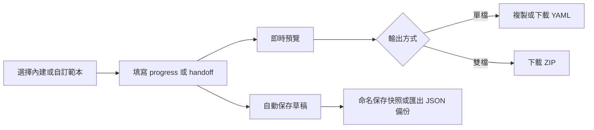

### YAML 欄位規範

**`progress.yaml`（長任務進度狀態機）**

```yaml
project: "agent-yaml-maker"                # 專案唯一識別名稱
status: "in_progress"                      # pending | in_progress | paused | completed | failed
current_phase: "phase_2_core_development"  # 當前階段識別名稱
updated_at: "2026-09-26T12:00:00.000Z"     # ISO-8601 時間戳記

milestones:                                # 階層式里程碑清單
  - id: 1
    name: "核心支付閘道串接"
    status: "in_progress"                  # pending | in_progress | completed | blocked
    completed_at: ""                       # 完成時自動填入 ISO 時間戳記
    tasks:                                 # 具體子任務 Checklist
      - task: "撰寫 Webhook 簽名驗證"
        status: "completed"                # pending | in_progress | completed | blocked
      - task: "實作冪等性交易快取"
        status: "in_progress"

artifacts:                                 # 關鍵產出檔案清單
  - path: "src/services/payment.py"
    description: "支付主處理器與回調驗證邏輯"

blockers:                                  # 阻礙與風險清單
  - issue: "第三方測試沙盒網路偶發逾時"
    severity: "medium"                     # low | medium | high | critical
    status: "investigating"                # investigating | blocked | resolved
```

**`handoff.yaml`（跨 Session／跨 Agent 移交工單）**

```yaml
handoff_id: "handoff-20260926-7f8a9b"      # 唯一交接單號
timestamp: "2026-09-26T12:00:00.000Z"      # 交接時間戳記
from_agent: "ArchitectAgent"               # 交付方角色
to_agent: "BackendDeveloperAgent"          # 接收方角色
reason: "系統架構審查完畢，交接進入編碼實作階段"

summary_of_work:                           # 已完成之關鍵工作條列
  - "完成系統架構設計與 API 規格草擬"
  - "定義資料庫 Schema 與安全存取邊界"

key_decisions:                             # 關鍵架構決策（防止後續 Agent 擅自推翻或重做）
  - "採用非同步事件隊列處理高並發 Webhook"
  - "敏感參數一律由 Vault 動態注入，禁止寫入環境設定檔"

next_steps:                                # 接手者優先執行清單
  - priority: 1                            # 數字越小優先度越高 (1~10)
    action: "依據 payment_spec.md 實作支付 Webhook 接收端點"
    target_files:
      - "src/webhooks/signature.py"
      - "src/webhooks/router.py"

constraints_and_notes:                     # 邊界約束與注意事項
  - "必須維持向前相容性，不可修改既有交易欄位型態"
  - "單元測試覆蓋率需高於 85%"
```

內建範本包含軟體開發、數據 ETL、資安合規與空白模板四種，可一鍵複製為自訂複本。

### 提示詞整合範例

可直接在給 AI Agent 的 Prompt 中要求遵循此規範：

```markdown
每次對話或任務執行前後，請嚴格遵守專案狀態機規範：
1. 讀取根目錄下的 `progress.yaml` 確認當前階段與 Milestone Checklist。
2. 任務執行完畢時，更新 `progress.yaml` 中的 tasks 狀態與 artifacts。
3. 若需切換 Session 或移交給下一位 Agent，請生成或更新 `handoff.yaml`，
   固定關鍵決策並列出接手者的 next_steps。
```

## Prompt Studio 結構化提示詞工作台

Prompt Studio 是單檔的結構化提示詞工程工作台：把提示詞拆成「情境、目標、受眾、格式」等模組化區塊個別填寫，即時組裝成標準 Markdown，並提供字元數、預估 Token 與結構區塊統計。內建 CO-STAR、CRISPE、RTF、TAG、APE、CARE、ROSES、TRACE、GRADE 與簡約三段式共 10 種經典框架，可隨任務切換。

### 組裝提示詞

1. 開啟 [`prompt-studio.html`](./agent/prompt-studio/prompt-studio.html)。
2. 在「請輸入提示詞專案名稱」欄填寫專案名稱，再從編輯區上方的「快速切換提示詞框架」或左側「常用框架 (10)」選單挑選框架。
3. 依框架顯示的結構欄位（例如 CO-STAR 的情境背景、明確目標、表達風格、語氣基調、受眾輪廓與輸出格式）逐欄輸入內容。
4. 右側「組裝結果預覽 (Markdown)」會即時產生提示詞，下方並顯示總字元數、預估 Tokens 與結構區塊數。
5. 按「一鍵複製」將組裝後的提示詞複製到剪貼簿。

### 動態變數與版本管理

- 在任一欄位以雙大括號撰寫變數，例如 `{{產品名稱}}`、`{{targetAudience}}`，支援中文、英文與底線；工具會自動抽出「偵測到動態變數」填空欄位，填入替換值後右側預覽即時更新。
- 上方「使用說明」彈窗提供變數語法與結構化提示詞四部曲說明，並可按「載入動態變數範例」直接體驗 CARE 框架的多變數範本。
- 按「儲存版本」會將目前內容寫入 IndexedDB 並產生 `v1.0`、`v2.0` 版本快照；可用右側「歷史版本快照」下拉選單還原任一版本。
- 左側「我的提示詞」列出已儲存專案，可切換載入或刪除（刪除會一併移除其版本歷史）；按「新增專案」開啟空白提示詞。
- 左下角垃圾桶按鈕會清空 IndexedDB 中的所有提示詞與歷史記錄，執行前請先確認。

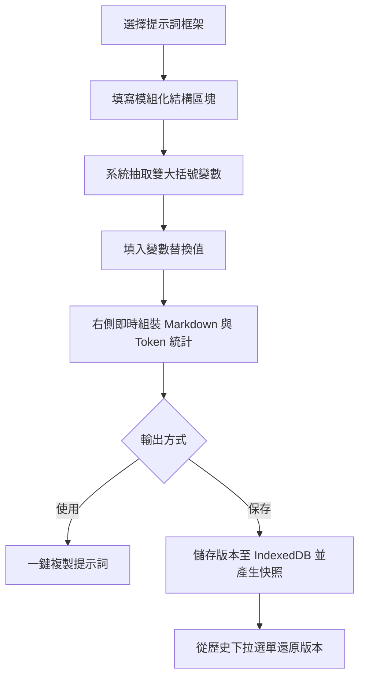

本工具從 CDN 載入 Tailwind CSS 與 Font Awesome 圖示，首次開啟需保持網路連線。所有提示詞、變數與版本快照只保存在目前瀏覽器的 IndexedDB（資料庫名稱 `PromptStudioDB`，object stores：`prompts`、`versions`），不會上傳至任何伺服器；換瀏覽器、使用無痕視窗或清除網站資料後可能無法取得，重要提示詞請先複製保存。

## 動態甘特圖與專案倒數看板

### 建立專案與任務

1. 開啟 [`dynamic_gantt_project_countdown.html`](./docs/project-gantt/dynamic_gantt_project_countdown.html)。
2. 按「新增專案」，輸入專案名稱與簡述，再按「確認儲存」。
3. 按「新增任務」，填寫任務名稱、開始日期、截止日期、負責人、狀態與完成進度。
4. 交付節點若要顯示在上方倒數區，勾選「設為重大里程碑」。
5. 按「儲存」後，可在甘特圖查看排程；點擊既有任務可編輯或刪除。

開始日期不得晚於截止日期。狀態設為「已完成」會將進度設為 100%；進度拉到 100% 也會自動改為已完成。

### 查看與篩選排程

- 以專案選單切換工作區，倒數卡片與甘特圖會同步更新。
- 用「日檢視」或「週檢視」調整時間軸密度。
- 用狀態篩選器查看未開始、進行中、已完成或已延遲的任務。
- 按「回到今天」將時間軸捲回目前日期附近。

### 備份與還原

- 「匯出備份」會下載包含所有專案與任務的 JSON 工作區檔案。
- 「匯入資料」可還原目前工具匯出的多專案備份，也相容舊版單專案任務陣列。
- 完整工作區匯入會清除目前專案與任務，再寫入備份內容。
- 「全部重設」會永久清除所有專案、任務、里程碑與甘特圖排程，並建立一個空白預設專案；執行前請先匯出備份。

### 甘特圖使用流程

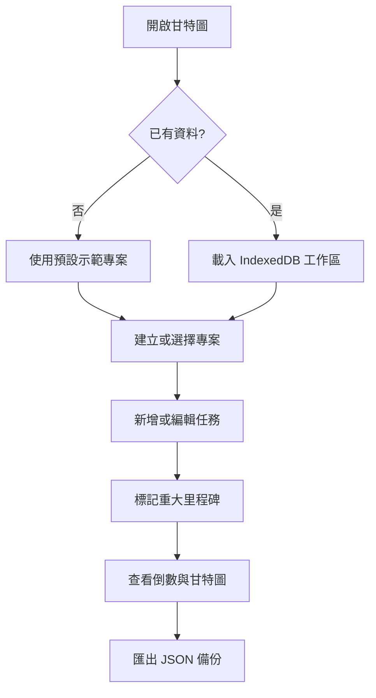

## 臺灣 LCR Mapping 與試算

### 進行試算

1. 開啟 [`LCR_Mapping_SPA.html`](./finance/lcr-mapping-calc/LCR_Mapping_SPA.html)。
2. 在「試算」頁的「HQLA 輸入」填入已完成法規上限調整後的合格高品質流動性資產總額。
3. 從業務下拉選單選擇項目，輸入餘額後按「加入明細」。係數會依 Mapping 自動帶入。
4. 在明細表檢查方向、係數與金額；不需要的項目可按刪除。
5. 查看計算結果中的總預期現金流出、總預期現金流入、可認列流入、淨現金流出、HQLA 與 LCR。

「載入示範資料」可快速填入範例；「清空明細」只會清除目前頁面的試算明細。可在「參數」頁調整 LCR 最低標準與流入認列上限。

### 查詢 Mapping 與公式

- 「Mapping 表」可用關鍵字搜尋，並依流出／流入方向及業務大類篩選。
- 「參數」頁列出預設的 LCR 最低標準 100%、流入認列上限 75%，以及第二層資產 40%、第二層 B 級 15% 的限制說明。
- 「使用說明」頁列出公式與適用限制：`LCR = HQLA ÷ 30 日淨現金流出 × 100%`。

本工具是 Mapping 摘要與試算輔助，不取代主管機關完整條文、附錄、申報表格或正式法遵判定。複合性產品仍須依對手、剩餘期間、擔保品、可取消性與重複列計規定逐案判斷，使用前請確認相關函令是否更新。

## 臺灣 NSFR 淨穩定資金比率與試算

### 進行試算

1. 開啟 [`NSFR_Mapping_SPA.html`](./finance/nsfr-mapping-calc/NSFR_Mapping_SPA.html)。頁面分成「試算」「Mapping 表」「參數」「使用說明」四個分頁。
2. 在「試算」頁的「加入明細」下拉選單選擇 ASF（可用穩定資金）或 RSF（應有穩定資金）項目，輸入帳面金額後按「加入明細」。係數會依 Mapping 自動帶入。
3. 在明細清單檢查方向、大類、係數與加權金額；可直接修改金額，或按刪除移除不需要的項目。
4. 查看計算結果中的可用穩定資金（ASF）、應有穩定資金（RSF）、淨穩定資金比率（NSFR）與資金缺口（ASF － RSF）。

「載入示範資料」可快速填入範例；「清空明細」只會清除目前頁面的明細。可在「參數」頁調整 NSFR 最低標準與內部警示門檻。

### 查詢 Mapping 與公式

- 「Mapping 表」列出全部 ASF（13 項）與 RSF（27 項）係數，可用關鍵字搜尋，並依 ASF／RSF 方向及大類篩選各項目之判斷條件與係數。
- 「參數」頁列出預設的 NSFR 最低標準 100%，以及僅供提醒使用的內部警示門檻 110%。
- 「使用說明」頁列出公式與適用限制：`NSFR ＝ 可用穩定資金（ASF） ÷ 應有穩定資金（RSF） × 100%`。

本工具是 NSFR 係數對照與試算輔助，不取代主管機關完整條文、附錄、申報表格或正式法遵判定。複合性或具選擇權之商品仍須依交易對手、剩餘期間、擔保品、風險權數、受限制狀態及是否重複列計逐案判斷；同一項目符合兩個以上類別時，應適用較高係數且不得重複計算；表外暴險、衍生性商品淨額與相互依存項目之計算較為複雜，正式申報前請回歸主管機關計算表逐項核對，並確認相關函令是否更新。係數表依金管會民國 105 年 12 月 26 日金管銀法字第 10510005801 號令訂定之版本整理；示範資料僅為操作示意，非任何實際機構資料。

### 資料保存與備份

- 明細與參數變更後會自動保存為草稿；「試算情境」可將目前明細命名後保存於瀏覽器本機（IndexedDB，資料庫名稱 `nsfr-mapping-calc`），可載入、刪除。
- 「匯出備份（JSON）」會下載包含參數、目前明細與所有情境的 `nsfr_backup_YYYYMMDDHHmmss.json`；「匯入備份（JSON）」可選擇合併或覆寫情境後還原。
- 換瀏覽器、使用無痕視窗或清除網站資料後，本機保存的資料可能無法取得，建議定期匯出備份。

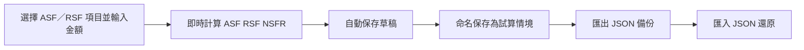

## 銀行信用風險與資本適足模擬器

此工具以資產組合參數推演不同信用壓力下的預期損失（EL）、風險性資產（RWA）與資本適足率（CAR），並提供情境比較矩陣。模型數值供情境分析與敏感度觀察，不是正式監理計算或申報結果。

### 設定資產組合與壓力情境

1. 開啟 [`bank_credit_risk_capital_adequacy_simulator.html`](./finance/basel-creditrisk-calc/bank_credit_risk_capital_adequacy_simulator.html)。
2. 輸入合格自有資本淨額、法定最低 CAR 門檻與現有提存備抵呆帳準備金。
3. 選擇「基準常態」、「經濟景氣趨緩」或「系統性金融風暴」，也可調整 PD、LGD 與 RWA 衝擊滑桿。
4. 按「新增資產組合」，輸入名稱、曝險額（EAD）、基準違約機率（PD）、違約損失率（LGD）與風險權數（RW）；既有組合可編輯或刪除，至少保留一組。
5. 查看即時更新的總覽指標、資產組合圖表、受壓後 EL 與 RWA，以及跨情境敏感度比較矩陣。

### 匯入、匯出與重設

- 按「匯出資產模型」下載目前資本、壓力因子與資產組合資料的 JSON 檔。
- 按「匯入資產模型」選擇先前匯出的 JSON；匯入後會取代目前頁面模型，請先匯出目前資料以保留副本。
- 按「還原預設」會以內建銀行信用資產模型取代目前資料。
- 模型不會自動保存；重新整理或關閉頁面後，未匯出的修改會消失。
- 頁面使用 CDN 載入 Tailwind CSS、Chart.js、Lucide 圖示與 Google Fonts，首次完整使用需能連線至這些資源。

PD、LGD、RW 與情境衝擊假設皆可調整，結果僅供內部估算及敏感度分析。正式風險衡量、資本適足判斷與監理申報，請依適用法規、銀行內部模型及核准流程覆核。

## 大額曝險與關聯戶圖譜速算器

大額曝險與關聯戶圖譜速算器是單檔的集團授信集中度檢核工具，依銀行法第 33 條之 3 的同一人、同一關係人與同一關係企業限額，將關係戶與股權關聯整理成可視化圖譜，並提供即時的法定門檻檢核、What-If 壓力試算與審查底稿輸出。所有計算都在瀏覽器端執行，不會上傳資料。

### 設定集團與關聯戶

1. 開啟 [`large-exposure-analyzer.html`](./finance/large-exposure-analyzer/large-exposure-analyzer.html)；頁面載入時會帶入「半導體」示範案例。
2. 在最上方「本行前一會計年度決算淨值 (Capital / Equity)」輸入核算基準淨值（億元）；上方法定門檻卡與右側計量錶會即時換算 5%、15% 與 40% 上限。
3. 按「集團設定」可調整集團名稱、代碼、所屬產業與行內內部預警比率。
4. 在「關聯戶成員清單」按「新增戶別」，輸入統一編號、戶名、關係身分、無擔保授信與有擔保授信金額（億元）；可用搜尋框過濾戶別，或按「清空」移除全部。
5. 在「實質控制與股權關聯」按「建立連結」，指定來源戶、目標戶、關聯類型與持股比例，建立股權穿透或實質控制關係。

### 關聯圖譜、壓力試算與底稿

- 中間「集團授信關聯圖譜 (Force-Directed Graph)」以 Canvas 力導向圖呈現戶別與關聯；可拖曳節點、滾輪縮放，並以「動力排版」暫停或恢復自動排版、「視野重設」回到初始視角。滑過節點會顯示該戶的無擔保、有擔保與合計曝險。
- 右側「What-If 壓力試算沙盒」可選擇試算對象，以滑桿模擬追加或調降無擔保／有擔保額度，即時顯示該戶模擬後總額、集團新曝險、佔淨值新比率與法規結論；按「套用至正式圖譜」把模擬結果寫回圖譜，「重設」歸零。
- 「法定門檻檢核計量錶」以長條呈現各項門檻使用率；超額時圖面下方會出現紅色警示列，可點「檢視超標明細」跳至稽核底稿。
- 底部「授信個案大額曝險審查稽核底稿 (Audit Sheet)」逐戶列出統一編號、關係身分、無擔保／有擔保／合計曝險、佔淨值比率與法規檢核狀態。
- 按「複製審查備忘錄 (Markdown)」產生含集團背景、限額基準、關聯戶明細與審查結論的底稿；按「匯出案卷 JSON」下載包含淨值、集團設定、戶別與連結的 `bank_exposure_<集團代碼>_<時間>.json` 備份。

### 匯入 CSV 與案例切換

- 按上方「匯入 CSV」可批次載入關聯戶資料，支援 Big5／CP950／UTF-8 等繁體中文編碼，也可將檔案拖放至對話框；對話框提供「下載範例 CSV」作為欄位範本。
- 案例按鈕可快速切換「半導體」「傳產家族」與「超額警戒」三種示範情境。
- 右上角可切換深／淺色外觀，主題偏好會保存在瀏覽器 `localStorage`。

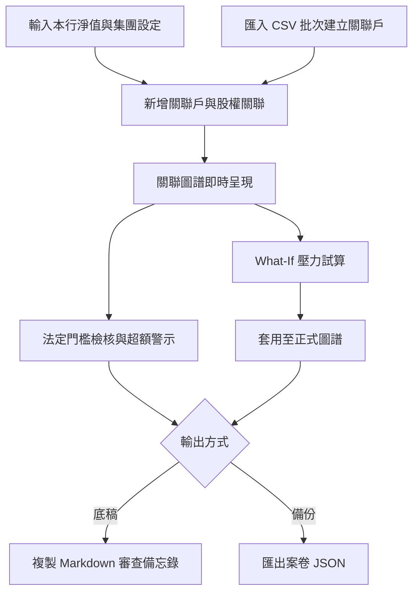

本工具使用 CDN 載入 Tailwind CSS 與 Google Fonts，首次開啟需保持網路連線。集團案卷僅保留在目前頁面記憶體，不使用 IndexedDB；重新整理或關閉頁面後需重新輸入或重新匯入。目前提供案卷 JSON 匯出但未提供 JSON 匯入，若要延續前次作業請以 CSV 重新載入戶別資料。法定限額與比率僅為試算輔助，正式授信核准仍應依銀行法、主管機關規定與內部授信政策逐案覆核。

## 銀行核心系統固定長度電文解析與管理中心

銀行核心系統固定長度電文解析與管理中心（Core-Host Fixed-Width Parser）是單檔的銀行核心主機電文工具，用來把財金、核心帳務等系統輸出的固定長度（fixed-width）字串，依電文規格逐欄拆解，或反向由欄位值組裝回標準電文。工具內建財金跨行轉帳（FISC 0100）與核心活存存提交易日誌兩組範例規格，並可自行新增、修改、複製與刪除規格；所有解析與換算都在瀏覽器端完成，不會上傳電文內容。

### 電文解析 (Parser)

1. 開啟 [`fixed-width-telegram-parser.html`](./finance/fixed-width-telegram-parser/fixed-width-telegram-parser.html)。
2. 在上方「目前電文規格 (Schema)」選擇要套用的規格，右側會顯示該規格的總長度（Bytes）。
3. 在「原始電文輸入 (RAW Telegram)」貼上電文，支援每行一筆的多筆批次；也可按「載入範例」帶入示範電文，或按「清空」清除。
4. 「中文編碼計算法」可切換 Big5（繁體中文常用 2 Bytes）、UTF-8 或 Pure ASCII，游標字元數與位元組長度會即時更新，並比對是否符合規格總長度。
5. 按「執行拆解解析」後，「欄位解析明細與檢核結果」會依規格逐欄列出內容、長度、型別與備註。解析結果可「匯出 JSON」、「匯出 CSV」，或「儲存至歷史庫」保存至瀏覽器 IndexedDB。

### 反向組裝 (Builder)

- 切換至「反向組裝 (Builder)」分頁，工具會依目前規格產生各欄位輸入框；填入數值後即時預覽組裝結果。
- 系統會依欄位設定的對齊方式、填補字元與長度自動靠左／靠右補空白或補零，並以位元組計量顯示「已用 / 總長度 Bytes」。
- 超出欄位長度時會依編碼邊界自動截斷；按「複製電文」可複製組裝後的字串，「重設表單」可清空輸入。

### 規格管理 (CRUD & CSV)

1. 切換至「規格管理 (CRUD & CSV)」分頁，可檢視所有已儲存的規格，並以卡片快速切換目前規格。
2. 按「建立新規格 (Create)」新增規格，填寫規格代號、名稱、預設編碼與備註，並在「欄位清單定義」以「插入新欄位」定義欄位代碼、中文名稱、長度（Bytes）、型別（AN／N／CH 等）、對齊方式、填補字元與備註；按「儲存規格變更 (Update)」寫回 IndexedDB。
3. 「複製當前規格」可快速衍生新規格；「刪除此規格 (Delete)」會先在確認後自 IndexedDB 永久移除。
4. 「匯出規格 CSV」可下載規格書；「匯入 CSV 規格書」支援自動偵測或強制指定 Big5／CP950、Big5-HKSCS、UTF-8、UTF-16LE 與 GBK 等編碼，處理 Excel 或主機匯出的中文亂碼；另提供「下載標準 CSV 範本」作為欄位格式參考。

### 歷史紀錄

- 「歷史紀錄」分頁列出儲存於瀏覽器的解析紀錄，含儲存時間、所屬規格、原始電文摘錄與筆數／長度。
- 每筆紀錄可「還原」至解析結果面板，或「刪除」單筆；按「清空歷史儲存」可移除全部紀錄。

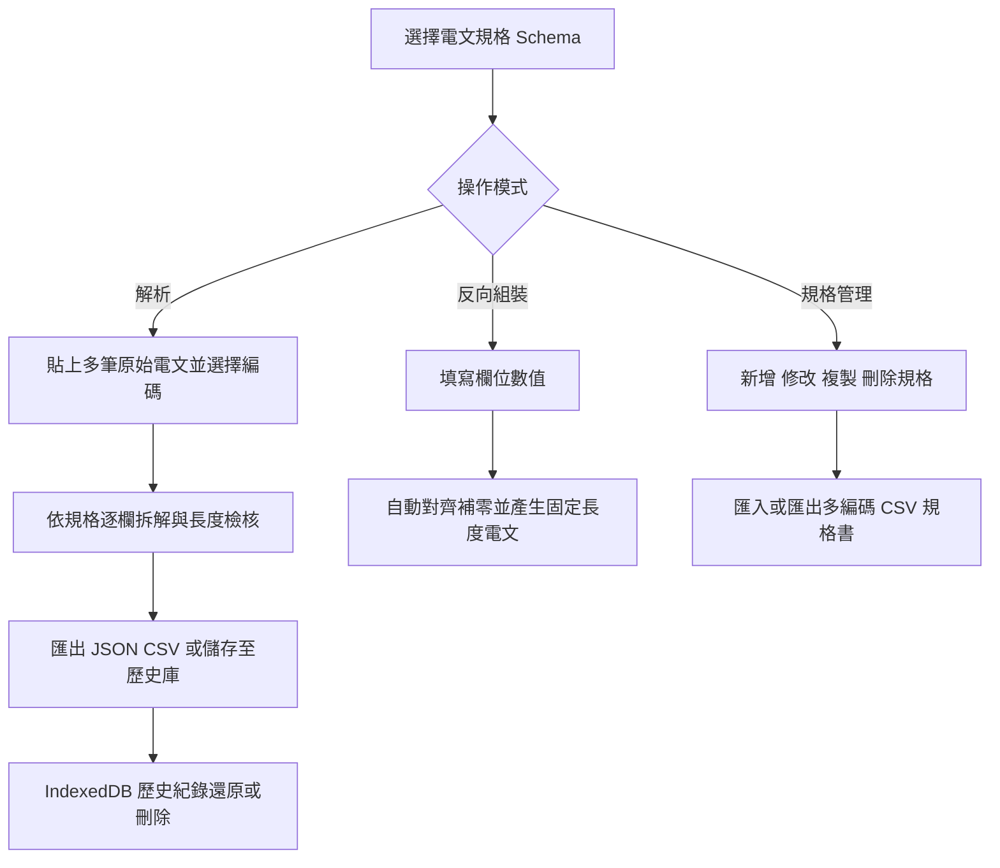

本工具從 CDN 載入 Tailwind CSS 與 Font Awesome 圖示，首次開啟需保持網路連線。電文規格與解析歷史保存在目前瀏覽器的 IndexedDB（資料庫名稱 `BankTelegramParserDB`，object stores：`schemas`、`history`）；換瀏覽器、使用無痕視窗或清除網站資料後，資料可能無法取得。位元組長度以 Big5／UTF-8 常用規則估算，若電文使用特殊轉義或非典型編碼，解析結果仍需與主機規格書人工比對。

## SQL Catalog

SQL Catalog 是單檔離線 SQL 檔案管理工具，用來建立 SQL 檔案目錄、搜尋內容並補充用途、分類、標籤與後續待辦。它只讀取與管理索引說明，不會修改 SQL 原始檔。

### 開啟目錄與掃描

1. 開啟 [`SQL_Catalog.html`](./sql/sql-catalog/SQL_Catalog.html)。
2. 按「選擇目錄」，選取 SQL 根目錄並允許編輯權限。
3. 工具會遞迴掃描子資料夾中的 `.sql` 檔案，並在根目錄建立或讀取 `sql_catalog.json`。
4. 點選清單中的 SQL 檔案，在右側編輯用途、分類、標籤、執行頻率、到期日、後續說明與備註；內容會延遲約 1 秒自動儲存。
5. 若要重新讀取檔案狀態，按「重新掃描」。SQL 內容可在右側唯讀預覽中查看，工具也會自動判斷引用表格與語法類型。

### 搜尋、篩選與匯出

- 搜尋框可查找檔名、路徑、SQL 內容、用途與後續說明；也可依資料夾、標籤、引用表格或語法類型篩選。
- 快速篩選可查看未填用途、本次有異動、待辦逾期、待辦未完成或已遺失的檔案。
- 「批次編輯」可對選取檔案批量套用分類、標籤、頻率、到期日與後續說明；刪除已遺失紀錄前請確認不再需要該索引。
- 「分類／標籤管理」可更名、合併或刪除分類與標籤；「統計」可查看資料夾與 SQL 語法類型分布。
- 「匯出」可下載全部或目前篩選結果的 CSV、Markdown 清冊、HTML 報表與 `sql_catalog.json`；「匯入 JSON（合併）」可合併其他目錄的索引說明。
- 「打包下載」會下載 SQL 原始檔的 ZIP；請先確認檔案內容與敏感資訊的分享範圍。

### 權限與瀏覽器限制

- Chrome／Edge 支援以目錄權限讀取及寫回 `sql_catalog.json`。重新開啟頁面後，可能需要再次授權上次使用的目錄。
- 不支援 File System Access API 的瀏覽器會改用目錄檔案選取，這是唯讀模式；說明只保存於瀏覽器快取，請定期使用「匯出 → 下載 sql_catalog.json」並手動放回 SQL 根目錄。
- 儲存失敗時，工具會將資料保留在目前瀏覽器的 IndexedDB 快取；修復權限後可按「儲存」，或先匯出 JSON 備份。

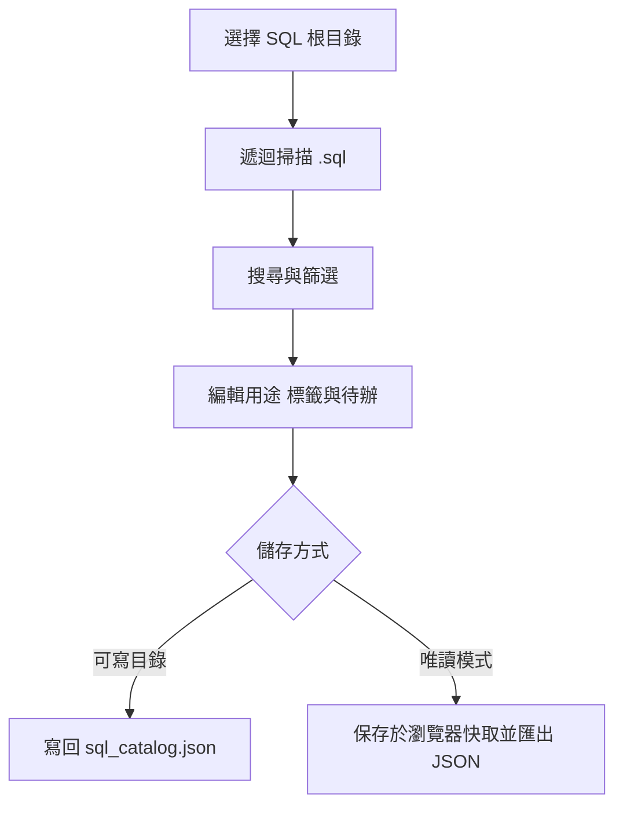

## Oracle SQL Compare

Oracle SQL Compare V2.1 是雙欄、純離線的 SQL 比對工具，適合檢查舊版與新版 Oracle SQL 的程式碼變更。可直接貼上內容、開啟檔案或將檔案拖放至「舊版／新版」窗格；支援 `.sql`、`.txt`、`.pks`、`.pkb`、`.prc`、`.fnc`、`.trg`、`.vw`、`.pls`、`.pck` 等常見副檔名。

### 比對 SQL

1. 開啟 [`sql-compare.html`](./sql/sql-compare/sql-compare.html)。
2. 將舊版 SQL 放入左側、新版 SQL 放入右側；可貼上文字、按「開啟檔案」或拖放檔案。
3. 依需求調整比對選項：忽略大小寫、空白、註解、空行，以及結尾 `;`／單獨一行的 `/`。
4. 按「比對」，在「逐行差異」查看新增、刪除、修改與移動內容。
5. 切換至「結構差異摘要」查看 SELECT、JOIN、欄位、條件、排序、GROUP BY、PL/SQL 或其他敘述的整理結果；摘要位置可點擊跳回逐行差異。

### 結果操作與快捷鍵

- 「並排」適合同時查看舊版與新版；「整合」適合依單一內容順序閱讀。
- 「僅顯示差異」可收合未變更區段；「上一個／下一個」可在差異區塊間巡覽。
- 「複製差異 (Unified)」與「複製結構摘要」會將結果放入剪貼簿；「匯出 HTML 報表」會下載可保存或分享的差異報表。
- `Ctrl+Enter` 執行比對；`F7`／`Shift+F7` 跳至下一個／上一個差異；`Alt+1`／`Alt+2` 切換逐行差異與結構摘要；`Esc` 返回編輯畫面。
- 「交換」可互換舊版與新版；「範例」會載入內建 Oracle SQL 範例；「清除」會移除目前兩側內容。

工具會將比對選項、顯示方式、編碼與目前頁籤保存於目前瀏覽器的 `localStorage`，不會上傳 SQL 內容。檔案讀取支援自動判斷 UTF-8／Big5，也可手動指定編碼；若要保留結果，請使用複製或 HTML 報表匯出。

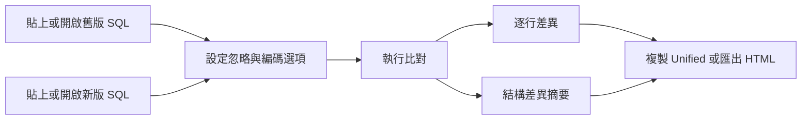

## Oracle SQL Formatter Studio

Oracle SQL Formatter Studio v1.1 是純離線的批次 SQL／PL/SQL 格式化與健檢工具。它會遞迴掃描選定資料夾中的指定副檔名，先在瀏覽器記憶體中產生格式化預覽；只有按下「寫回檔案」並確認後，才會覆寫來源檔案。

### 掃描與格式化預覽

1. 開啟 [`OracleSqlFormatter.html`](./sql/oracle-sql-formatter/OracleSqlFormatter.html)。
2. 在「副檔名」欄確認要處理的副檔名，預設為 `.sql,.pks,.pkb,.prc,.fnc,.vw,.trg`。
3. 按「選擇資料夾」。Chrome／Edge 等支援 File System Access API 的瀏覽器可取得資料夾讀寫權限；其他瀏覽器會進入唯讀相容模式。
4. 調整檔案編碼（自動偵測 UTF-8／Big5、UTF-8 或 Big5）、縮排、識別字大小寫、SQL 關鍵字／函數大小寫與 SELECT／SET 欄位逐行排列。
5. 在左側勾選要處理的檔案，按「格式化預覽」，再從「差異預覽」逐檔檢查格式化前後內容。
6. PL/SQL 檔預設使用安全模式，只調整大小寫與行尾空白；也可選擇略過 PL/SQL，避免改變其版面。

### SQL 健檢

「SQL 健檢」會依檔案逐行列出錯誤、注意與提示，涵蓋 `= NULL`、ROWNUM 與 ORDER BY 同層、LEFT JOIN 被 WHERE 轉為 INNER、無 WHERE 的 UPDATE／DELETE、舊式逗號 JOIN、`&` 未設定 `DEFINE OFF`、PL/SQL 缺少 `/`、全形符號、不可見字元、條件欄位套用函數、`SELECT *`、`NOT IN`、CROSS JOIN、`WHERE 1=1`、高風險 DDL／DCL 與寫死的密碼等規則。

- 可依嚴重度或規則篩選問題，點擊健檢明細跳至檔案位置。
- 健檢規則可個別啟用／停用，也可調整嚴重度；「全部啟用／停用／恢復預設」會立即重新整理結果。
- 若特定行或整個檔案不需要某規則，可在 SQL 加上 `-- sqlfmt:ignore RULE_ID` 或 `-- sqlfmt:ignore-file RULE_ID`；不寫規則代碼則忽略該行或檔案的全部規則。
- 「快速測試」可直接貼上單段 SQL，立即查看格式化結果與健檢問題，不必先選擇資料夾。

### 寫回、還原與匯出

- 「寫回檔案」只會處理已勾選且預覽狀態為「有變更」的檔案。執行前會要求確認；預設先將原始檔案備份到根目錄的 `_sqlfmt_backup/<時間戳>`，完成後可用「還原本次」復原本次寫回的檔案。
- 寫回前請逐檔檢查差異與健檢結果。關閉頁面、重新整理或重新選擇資料夾後，當次「還原本次」資訊不保證保留；備份目錄才是主要復原依據。
- 「匯出 ZIP」會依原相對路徑打包勾選檔案，預覽後可取得格式化副本；唯讀相容模式只能使用此方式，不會修改來源檔案。
- 「匯出報告」會產生 HTML，包含檔案狀態、編碼、變更／失敗統計、健檢規則統計與行號明細。
- 「重新掃描」會重新讀取目前資料夾；工具會略過 `_sqlfmt_backup`、`.git`、`.svn`、`node_modules` 目錄。

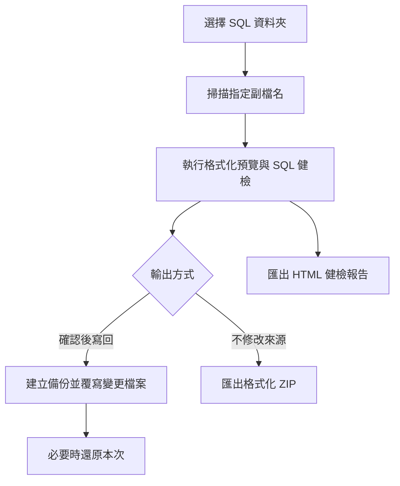

若瀏覽器不支援資料夾直接寫回，工具會使用檔案選取器載入唯讀資料；此時「寫回檔案」不可用，但仍可預覽、健檢、匯出 ZIP 與報告。格式化設定與健檢規則保存於目前瀏覽器的 `localStorage`，SQL 內容與報告均在本機處理。

## SQL／TXT 個資掃描與清除

這個工具會在瀏覽器本機遞迴掃描選定資料夾中的 `.sql` 與 `.txt` 檔案，辨識常見身分證字號、存款帳號、擔保品估價彙整序號／子號與統一編號。畫面上的命中值只會以部分遮罩呈現；工具不會將檔案上傳至外部網站。

### 掃描與檢視命中

1. 開啟 [`sql-pii-cleaner.html`](./sql/sql-pii-cleaner/sql-pii-cleaner.html)。
2. 使用新版 Chrome 或 Edge 按「選擇資料夾（可寫回）」；若瀏覽器不支援資料夾寫入，改用「選擇資料夾（唯讀相容模式）」。
3. 確認身分證、帳號、統編、彙整編號，以及日期／時間排除規則；需要時設定排除資料夾或檔名。
4. 掃描完成後點選檔案，檢查編碼、命中數量與遮罩後的行號前後文。編碼不確定時，可在表格中改選 UTF-8、Big5、GB18030 或 UTF-16 後重新掃描。
5. 勾選要處理的檔案，再選擇寫回、下載清除後 ZIP 或匯出 CSV 報告。

### 掃描項目與選項

工具預設偵測下列格式：

- **身分證字號**：依格式與檢查碼判斷，可選擇是否接受第二碼 `8`、`9`，以及是否忽略大小寫。
- **帳號**：偵測 12～14 位數字；符合 14 位時間格式時，依選項排除。
- **彙整序號**：偵測以 `61` 或 `62` 開頭的 15 位數字。
- **彙整子號**：偵測以 `6` 加英文字母開頭的 15 碼值。
- **統編**：依 8 位格式與檢查碼判斷；符合日期格式 `yyyyMMdd` 時，依選項排除。

可用選項包含身分證檢查碼、含第二碼 8／9、忽略大小寫、排除 14 位時間、統編檢查碼、排除 8 位日期，以及以逗號分隔的「排除資料夾或檔案名稱」（可用 `*` 萬用字元，例如 `_backup_*,.git`）。表格欄位可點選排序；編碼不確定時可於「編碼」欄改選 UTF-8、Big5、GB18030、UTF-16LE 或 UTF-16BE 後重新掃描該檔。

### 清除與安全注意事項

- 「清除勾選檔案並寫回」只在可寫回模式可用；啟用備份時，原始檔會先保存至來源資料夾的 `_backup_YYYYMMDDHHmmss` 目錄，並保留原本的子目錄結構。
- 清除動作會直接移除命中的位元組，不是以固定字元取代；未被引號包住的命中可能造成 SQL 語法錯誤，寫回前務必檢查並保留備份。寫回前工具會檢查檔案是否被其他程式修改，已變更者會跳過並要求重新掃描。
- 「下載清除後 ZIP」不會修改來源檔案，會產生 `sql_cleaned_YYYYMMDDHHmmss.zip`，保留相對路徑與編碼的清除副本。
- 「匯出報告（CSV）」產生 `sql_pii_report_YYYYMMDDHHmmss.csv`，只輸出遮罩後的命中明細與統計，不會輸出完整個資值。大量檔案建議分批處理，避免瀏覽器記憶體不足。

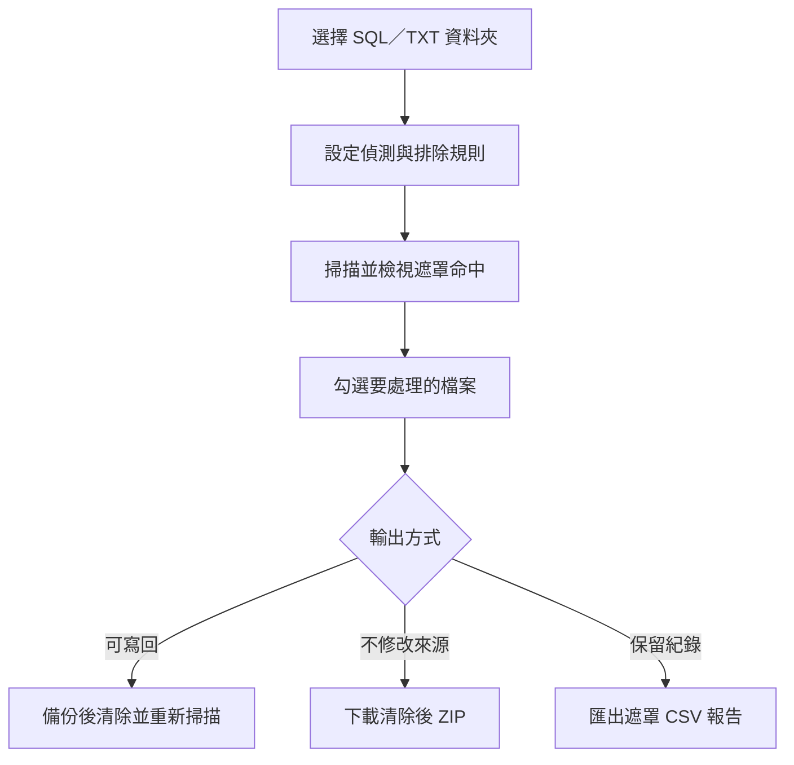

## SQL Column Lineage Analyzer

SQL Column Lineage Analyzer v1.5.1 是純離線的 Oracle SQL 欄位血緣分析器。它會在瀏覽器記憶體中解析載入的 SQL，建立資料表、CTE、View、寫入／結果物件與欄位之間的直接或間接關係；不需要後端，也不會上傳 SQL 內容。

### 載入 SQL 並分析

1. 開啟 [`SQL_Column_Lineage_Analyzer.html`](./sql/sql-lineage-analyzer/SQL_Column_Lineage_Analyzer.html)。
2. 以「載入檔案」選取一或多個 `.sql`、`.txt`、`.ddl` 檔案；也可以用「載入資料夾」遞迴載入子資料夾，或按「貼上 SQL」輸入內容。
3. 也可按「內建範例」快速載入範例；檔案可直接拖放到載入區。
4. 在左側檢查目前 SQL，按「分析」或使用 `Ctrl+Enter`。
5. 若要重新開始，按「全部清除」；此動作會移除目前載入的 SQL 與分析結果。

支援常見 Oracle SQL 結構，包括 `SELECT`、CTE、View、資料表定義、`INSERT`／`UPDATE`／`MERGE` 等寫入語句、JOIN、子查詢、集合運算，以及 PIVOT／UNPIVOT。解析器會盡可能建立欄位關係；語法不完整或不支援的語句會在「語句與訊息」頁顯示解析狀態與行號。

### 檢視血緣與欄位關係

- 「血緣圖」以物件卡片與連線呈現欄位來源；可用滑鼠拖曳畫布、滾輪縮放，切換「隱藏行內子查詢」、「完整」或「僅實體表與結果」顯示層級。
- 點選物件標題可聚焦物件，點選欄位可在右側查看運算式、直接來源、間接來源、最終來源實體表、直接下游、最終影響與條件欄位。
- 「只看選取欄位路徑」可收斂圖面；「適合視窗」與「100%」可調整視圖。血緣圖可匯出 SVG 或 PNG。
- 「欄位對照表」可依目標／來源物件、關係類型與關鍵字篩選，並查看目標欄位、來源欄位、直接／間接關係、轉換類型與運算式；可匯出 CSV、JSON 或 Mermaid。
- 「上下游追溯樹」可輸入欄位名稱或 `物件.欄位`，選擇上游、下游或上下游、追溯深度，以及是否包含間接來源與略過行內查詢。可全部展開、收合或清除重設。
- 「CTE 大綱」列出 CTE／結果物件的檔案行號、欄位數、上游物件、下游物件與未使用欄位；點選列可跳回血緣圖聚焦。
- 「語句與訊息」列出解析語句狀態與警告／錯誤；可勾選「只看警告／錯誤」縮小範圍。

### 使用流程

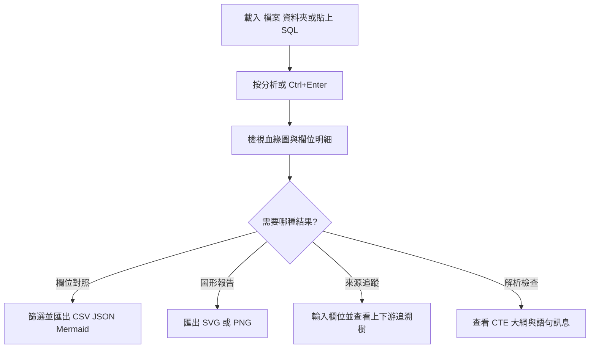

SQL、圖形與分析結果只保留在目前頁面記憶體；重新整理、關閉頁面或按「全部清除」後需要重新載入。匯出檔案可能包含原始欄位名稱、表名與運算式，分享前請確認 SQL 的敏感資訊範圍。

## MatrixPivot 表格矩陣轉置器

MatrixPivot 是單檔的表格矩陣轉置與格式轉換器：把從 Excel、Google Sheets 或 CSV／TSV 檔案取得的表格文字貼進左側，工具會即時解析成矩陣、在右側以網格預覽，並可一鍵行列轉置、清理空白與轉出工程常用格式。所有解析與轉換都在瀏覽器端完成，不會上傳內容。

### 貼上或匯入表格

1. 開啟 [`matrix-pivot.html`](./data/matrix-pivot/matrix-pivot.html)。
2. 在左側「來源資料貼入 / 匯入」貼上表格文字，或按「匯入 CSV / 檔案」選取 `.csv`、`.tsv`、`.txt`，也可將檔案直接拖放到輸入區。
3. 工具會自動推斷分隔符號（Tab、逗號、分號），並處理引號內換行與 `""` 跳脫；右側「矩陣即時網格預覽」會顯示列數、欄數與儲存格數，含換行的儲存格會標示「↵ 多行」。
4. 依需求切換「首行作為欄位表頭」：勾選時第一列視為欄位名稱，JSON 與 SQL 會以它作為鍵與欄名。
5. 可用右上「載入範例資料」快速套用內建財務報表矩陣，或按「貼上」讀取剪貼簿內容。

### 轉置、清理與搜尋

- 「一鍵行列轉置 (Transpose)」會將矩陣行列互換（`M[i][j]` → `M[j][i]`），並同步更新左側文字與右側預覽。
- 「清理空白行列」會移除全空白的列與欄；「去空格 (Trim)」會清除所有儲存格首尾空白；「清空所有內容」會清空輸入、預覽與編碼標示。
- 預覽區右上「在表格中搜尋」可即時過濾符合關鍵字的列，並顯示「過濾後顯示 N / M 列」。
- 右上角可切換深／淺色外觀。

### 格式轉換與輸出

「格式轉換與代碼產生器」提供五種分頁，會依目前矩陣即時產生結果：

- **Markdown**：自動對齊欄寬的表格；儲存格內換行會轉為 `<br>`，`|` 會跳脫。
- **JSON Array**：以欄位表頭（無表頭時為 `Col_n`）為鍵的物件陣列，純數字會轉為數值型別。
- **SQL INSERT**：以 `import_table` 為表名的逐列 `INSERT` 敘述，數值不加引號、字串會跳脫單引號。
- **HTML Table**：含 `thead`／`tbody` 的 `<table class="data-table">`，內容會做 HTML 跳脫。
- **標準 CSV**：符合 CSV 規則的逗號分隔輸出。

各分頁可切換檢視，按「複製程式碼」將內容放入剪貼簿；預覽區右下「下載為 CSV」會下載帶 BOM 的 `matrix_export_*.csv`，方便 Excel 正確顯示中文。

### 編碼與匯入注意事項

- 「編碼設定」支援自動偵測、Big5／CP950、UTF-8、UTF-16 LE 與 UTF-16 BE。自動偵測會先檢查 BOM，再以嚴格 UTF-8 驗證；若位元組不符會改用 Big5 解碼，適合 Windows 繁中 Excel 匯出的檔案。
- 匯入檔案後可從「編碼設定」重新選擇並即時重新解碼，不需重新選檔。

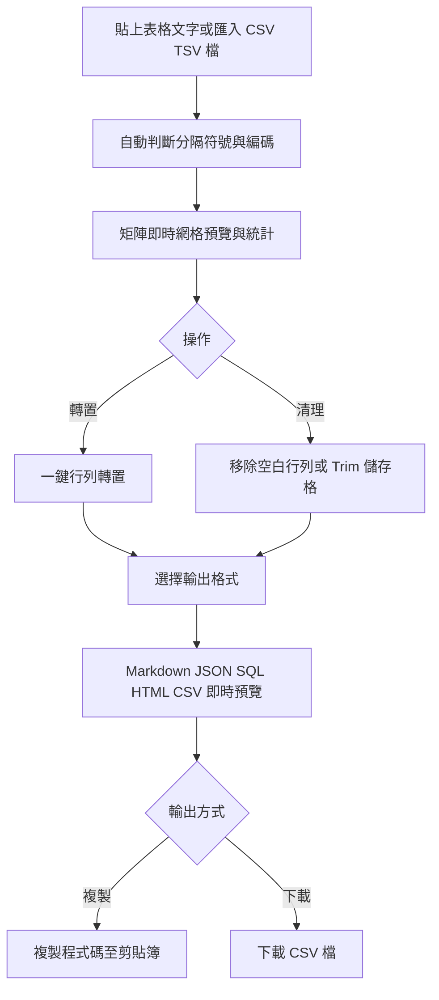

本工具從 CDN 載入 Tailwind CSS 與 Google Fonts，首次開啟需保持網路連線。內容、矩陣與輸出只保留在目前頁面記憶體，不使用 IndexedDB 或 `localStorage`；重新整理或關閉頁面後需重新貼上，重要結果請先複製或下載保存。

## API Mock & cURL 格式轉換工作室 (API Mock Studio)

API Mock Studio 是免後端、純瀏覽器端運作的 API 測試、Mock 模擬與格式轉換工具。適用於後端服務尚未就緒、第三方金融或政務介面受限於網路隔離、或是需要快速將 cURL 指令轉化為前端代碼與 OpenAPI (Swagger) 規格的開發場景。所有資料與端點集合保存在使用者的瀏覽器本機，不經過任何外部專用後端。

### 快速開始與端點管理

1. 開啟 [`api-mock-studio.html`](./data/api-mock-studio/api-mock-studio.html)。
2. 左側「端點清冊」提供集合管理，預設載入臺灣金融轉帳與 KYC 驗證端點範例；亦可由上方選單載入電子商務或 JWT 身分驗證範本。
3. 點選「＋ 新增端點」可建立空白請求，支援「複製」與「刪除」現有端點。
4. 點選「💾 匯出集合」可將當前所有端點與 Mock 回應輸出為 JSON 檔；點選「📥 匯入 JSON」可還原先前備份的集合。

### cURL 雙向解析與 Request 編輯

- **貼上 cURL 自動解析**：點選左下角「📋 貼上 cURL 解析」，貼入任意終端機 cURL 命令（支援多行 `\`、`-X`、`-H`、`-d` / `--data-raw`、`-u` 等），系統會自動拆解為 Method、URL、Headers、Params 與 Body。
- **Params 雙向同調**：在 Params 表格中增修 Key-Value，會即時自動同調到 URL 網址 Query String；反之編輯網址亦會解析回表格。
- **Headers 與 Auth 快速設定**：提供常見標頭快速按鈕（JSON、Accept、X-Request-ID），支援 Bearer Token、Basic Auth 與 API Key 認證，並自動同步至 Headers 清單。
- **Body 編輯與驗證**：支援 application/json、x-www-form-urlencoded、raw 等模式，提供「✨ 格式化 JSON」與語法即時錯誤檢查。

### 純前端 Mock 回應與真實請求測試

- **雙執行模式切換**：
  - **Mock 模擬模式**：純前台模擬回應。可自訂 HTTP 狀態碼（200 OK、201 Created、400 Bad Request、404 Not Found、422 Unprocessable、500 Server Error 等）與延遲時間（0ms、150ms、400ms、1000ms、2500ms），即時觀察狀態徽章、耗時與回傳結果。
  - **真實請求模式**：透過瀏覽器原生 `fetch` 直接對目標 URL 發送請求。若遇到同源政策阻擋，系統會自動跳出 CORS 提示與除錯建議。
- **智慧 Dummy 假資料生成器**：
  - 支援佔位符標籤：`@uuid`（標準 UUID v4）、`@taiwan_gui`（通過檢核邏輯的臺灣統編 8 碼）、`@taiwan_id`（合規臺灣身分證字號）、`@taiwan_phone`（臺灣手機門號）、`@name`（中文姓名）、`@email`、`@amount`（金額）、`@timestamp`（ISO 時間戳）、`@boolean`。
  - 點選「🎲 產生假資料實體」可一鍵將編輯器內的標籤替換為隨機數值。
  - 內建臺灣金融轉帳明細、使用者檔案、分頁列表結構與 RFC 7807 錯誤格式等範本。

### 代碼產生與規格匯出

- **多語言代碼**：於「程式碼 (Code)」分頁可一鍵複製 cURL 命令、JavaScript (fetch)、Node.js (axios)、Python (requests) 以及 MSW (Mock Service Worker Handler) 代碼。
- **OpenAPI 3.0 規範**：自動將端點路徑、查詢參數與 Mock 回應結構轉換為合規的 OpenAPI 3.0 YAML 或 JSON 規格。
- **Postman Collection v2.1**：點選「📦 匯出 Postman Collection」可直接下載標準 Postman Collection JSON 檔案並匯入 Postman。

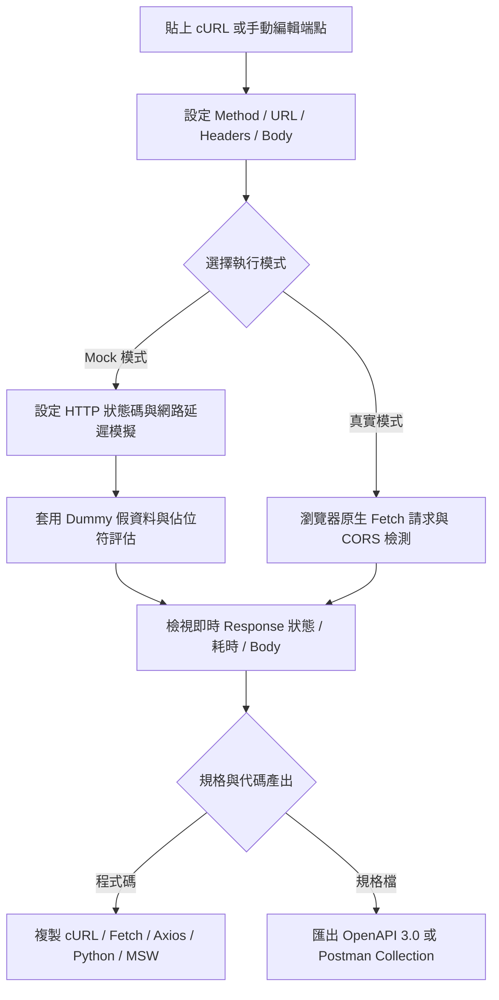

本工具從 CDN 載入 Tailwind CSS 與 Google Fonts，主要邏輯完全在瀏覽器端執行。端點清冊、作用中端點與執行偏好保存在瀏覽器的 `localStorage`（鍵值 `api_mock_studio_state_v1`）；需要備份或共用時可使用「匯出集合」下載 JSON。

## Markdown 卡片簡報工具 (Card Presenter)

Card Presenter 是單檔的卡片式投影片編輯器：可用 Markdown（含自訂的 KPI、多欄卡片與提示框區塊）撰寫內容，右側即時預覽，並以全螢幕模式播放。它也能將整份簡報匯出為完全不依賴外部資源的單一 HTML 檔。

### 編輯與預覽

1. 開啟 [`markdown_card_presenter.html`](./docs/card-presenter/markdown_card_presenter.html)。
2. 在左側編輯區輸入 Markdown；以獨立一行的 `---` 切分不同頁面。
3. 可用工具列的「📊 KPI 指標」、「🗂️ 雙欄卡片」、「💡 提示框」快速插入語法片段。
4. 右側預覽會即時更新，每張卡片右下角顯示頁碼。

支援的區塊語法：

- 標題與清單：`#`、`##`、`- `、`> ` 引言、`**粗體**`、`*斜體*`、`` `程式碼` ``。
- KPI 指標：`::: kpi [標籤] 值 [status: success|warning|danger|info]`；連續多行 KPI 會自動併排顯示。
- 多欄卡片：`::: columns 2`（或 `3`）搭配多個 `::: card [標題]`，最後以 `:::` 收合。
- 提示框：`::: callout [info|success|warning]` 之後放入內容，再以 `:::` 收合。

### 播放與匯出

- 按「▶️ 播放簡報」或 `F` 鍵進入全螢幕播放；`←`／`→`（或空白鍵）換頁，`Esc` 離開。
- 按「💾 匯出展示檔」會下載一個獨立的 HTML 檔，內含所有頁面與樣式，可離線開啟與分享。
- 深色／淺色模式可從右上角 ☀️／🌙 切換。

### 範本與保存

- 內建三個範本，可從上方範本選單套用。
- 「➕」可將目前編輯內容存為自訂範本；「🔄」可還原為系統預設範本（會清除自訂範本，但保留編輯區文字）。
- 範本與編輯草稿保存在瀏覽器 IndexedDB，主題偏好保存在 `localStorage`；換瀏覽器或清除網站資料後可能無法取得，重要簡報請先匯出 HTML。

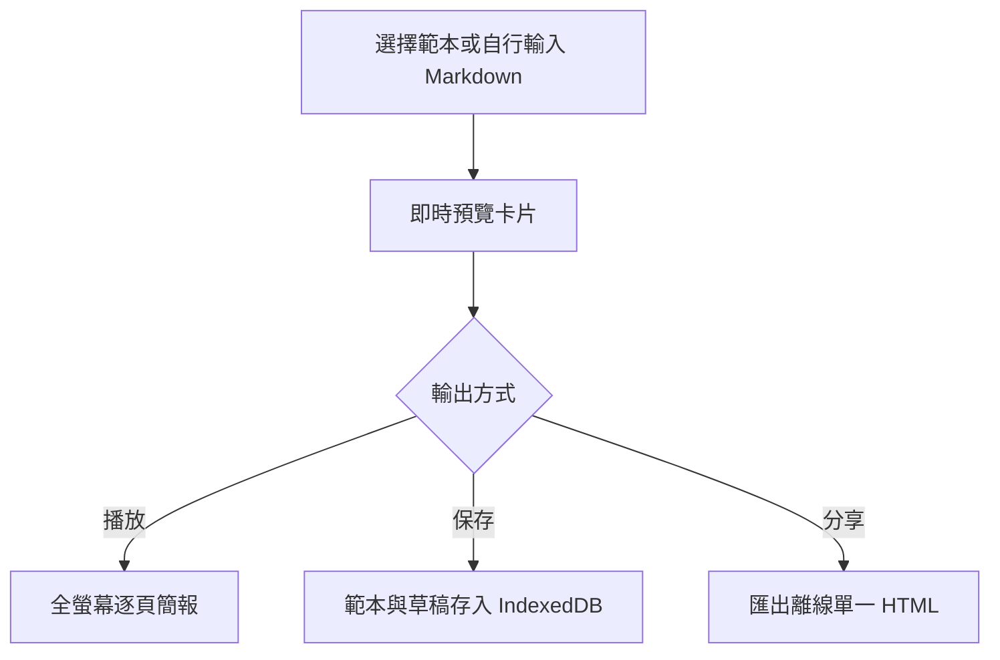

本工具的編輯介面樣式由 CDN 載入 Tailwind CSS，首次開啟需保持網路連線；但「匯出展示檔」產生的 HTML 不含任何外部依賴，可完全離線使用。

## 公文簽／函排版與 Word 匯出 (DocuFormatter)

DocuFormatter（Word 匯出版）是單檔的公文排版精靈，可依「簽」「函」或自由 Markdown 三種模式撰寫內容，於右側即時產生正式公文版面預覽，並複製純文字、複製 Word 格式或下載 `.docx` 檔。工具不修改或保存任何來源檔，所有內容只在目前頁面記憶體處理。

### 選擇公文類型與填寫內容

1. 開啟 [`DocuForm.html`](./docs/docuformatter/DocuForm.html)。
2. 在最上方「公文類型」選擇要產出的格式：
   - 「簽（主旨／說明／擬辦）」：填寫承辦單位、日期（民國年）、主旨、說明與擬辦。
   - 「函（主旨／說明／辦法）」：填寫受文者、發文字號、速別、密等及解密條件、主旨、說明與辦法。
   - 「自由 Markdown 模式」：直接輸入 Markdown，`#`、`##`、`###` 與 `-` 會分別轉為「壹、」「一、」「（一）」與「1.」等層級。
3. 按「帶入規範範例」可載入內建示範內容；開啟頁面時也會自動載入範例。
4. 「說明」與「擬辦／辦法」欄位每換一行會自動分為一項並依序加上「一、」「二、」等編號；單行內容則不加編號。以 `-`、`*` 或 `1.` 開頭時會視為項目符號並移除。

### 校正選項與遮罩

- 「標點全形化」會將半形逗號、冒號、分號、問號與驚嘆號轉為全形；緊鄰數字者不轉換。
- 「中英間距校正」會在中文與英數字之間自動補上空格。
- 「遮罩關鍵字」可輸入以逗號分隔的詞彙，預覽與匯出時會以「○○」取代，方便對外分享前去除單位名稱或人名。

### 預覽與輸出

- 右側「正式公文排版預覽」以標楷體即時呈現成品並顯示字數；相同字型與行高也會套用於 Word 匯出。
- 「複製純文字」將預覽內容複製為純文字；「複製 Word 格式」複製為保留標楷體與固定行高的富文字，可直接貼入 Word。
- 「下載 .docx」以 docx.js 產生 Word 檔，檔名依公文類型為 `簽呈_日期.docx`、`公文函稿_日期.docx` 或 `公務報告_日期.docx`。
- 兩顆複製按鈕與下載功能需要瀏覽器剪貼簿／檔案 API 以及 docx.js CDN；建議透過 `python -m http.server 8080` 後從 `http://localhost:8080/docs/docuformatter/` 開啟。

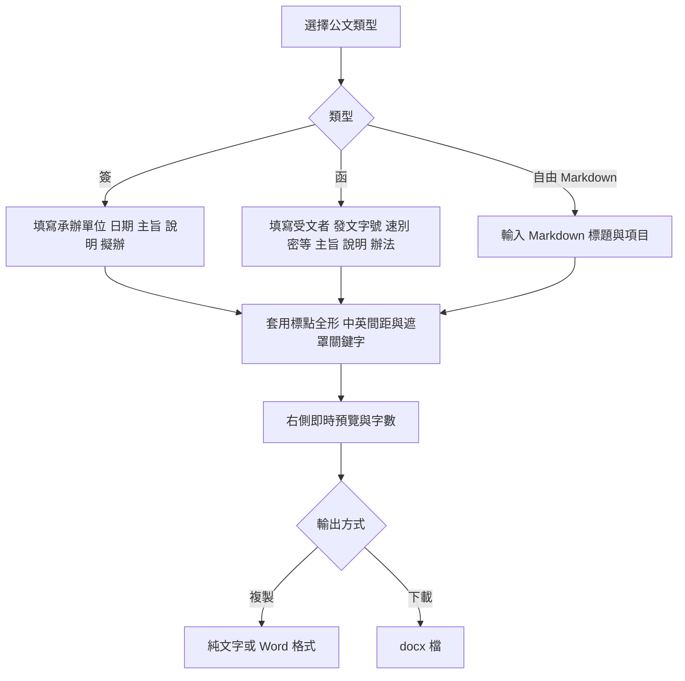

本工具不使用 IndexedDB 或 `localStorage`，關閉或重新整理頁面後內容需重新輸入；重要公文請先下載 `.docx` 或複製保存。排版僅為格式輔助，正式發文前仍應依機關文書規範覆核用語與簽核流程。

## 剪貼簿洗滌器 (Text Scrubber)

剪貼簿洗滌器是單檔的純文字淨化與脫敏工具：把從 PDF、公文或網頁複製出的雜亂文字貼進左側，工具會依勾選的規則即時在右側產生洗滌結果，包含修復斷行、清除隱形字元、統一標點與清單符號，以及遮罩臺灣常見的敏感資訊。所有處理都在瀏覽器端完成，不會上傳文字。

### 洗滌文字

1. 開啟 [`text-scrubber.html`](./docs/text-scrubber/text-scrubber.html)；頁面載入時會自動帶入一段示範的混亂文字。
2. 在左側「原文字串」貼上內容，或按「從剪貼簿貼上」。
3. 在中間「洗滌配置規則」勾選要套用的規則，右側「洗滌產出」會即時更新，並顯示字數／行數、已優化處數與省去字數。
4. 按「一鍵複製結果」將洗滌後文字複製回剪貼簿。

### 一鍵情境與洗滌規則

- 上方情境列可一鍵套用：「PDF 論文／報告接合」「AI 提詞個資嚴格脫敏」「格式純粹化（去空格符號）」「標準清單修復」，或按「載入混亂範本」重新載入示範文字。
- 斷行與空格優化：縫合中文突兀斷行、消除行首行尾空白、壓縮連續空行、英文連字號接合（例如 `commu-` 加 `nication`）。
- 字元與標點統一：清除零寬與不可見字元、統一中文引號與括號、把字型亂碼標記轉為標準 `-`。
- 本地敏感資訊遮罩：可個別勾選身分證字號、手機與市話、公司統一編號（8 碼）與電子郵件；遮罩後只保留部分字元（例如 `A123***789`、`u***r@domain.com`）。
- 「全部開啟」可一次啟用所有規則；右上角可切換深／淺色外觀。

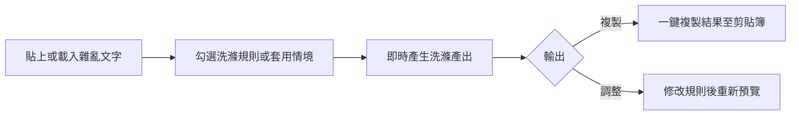

本工具使用 CDN 載入 Tailwind CSS、Phosphor Icons 與 Google Fonts，首次開啟需保持網路連線。文字與勾選規則只保留在目前頁面記憶體，不會保存或上傳；重新整理或關閉頁面後需重新貼上。個資遮罩為規則式輔助，複雜或非常見格式仍建議人工核對後再對外分享。

## Palette Lore 色彩故事盤

Palette Lore 是單檔的「意境色彩演算器」：輸入抽象意境文字（例如「北歐晨霧」「賽博初雪」），工具會依內建色相／飽和度／明度公式生成一組五色配色盤，並即時套用到實境 UI 元件模擬、WCAG 2.1 對比評測與工程端格式匯出。收藏的色盤會保存在瀏覽器 IndexedDB 典藏庫。

### 生成與調整配色

1. 開啟 [`palette-lore.html`](./design/palette-lore/palette-lore.html)。
2. 在輸入框輸入意境文字，按「生成色譜」或 `Space`；也可按「🎲 靈感」隨機切換內建意境。
3. 五個色彩槽分別對應「基底背景、卡片邊界、主視覺色、輔助過渡、點睛強調」；點擊色塊可複製 Hex，點擊調色盤圖示可自訂顏色，並可鎖定個別色塊，避免重新生成時變動。
4. 左側「實境 UI 元件模擬」會以目前色盤即時呈現卡片、按鈕與文字組合。
5. 右側「WCAG 2.1 無障礙對比評測」列出各配對組合的對比比例與 AA／AAA 檢核結果。

### 匯出與典藏

- 「工程端格式匯出」可切換 CSS、Tailwind 或 JSON，並以「複製代碼」取得內容。
- 右上角「收藏當前色盤」會將目前意境與色盤存入 IndexedDB 典藏庫；「資料庫典藏庫」按鈕可開啟清單，支援搜尋、刪除單筆與清空典藏。
- 右上角可切換深／淺色模式，工作階段與主題偏好會隨 `app_state` 保存。

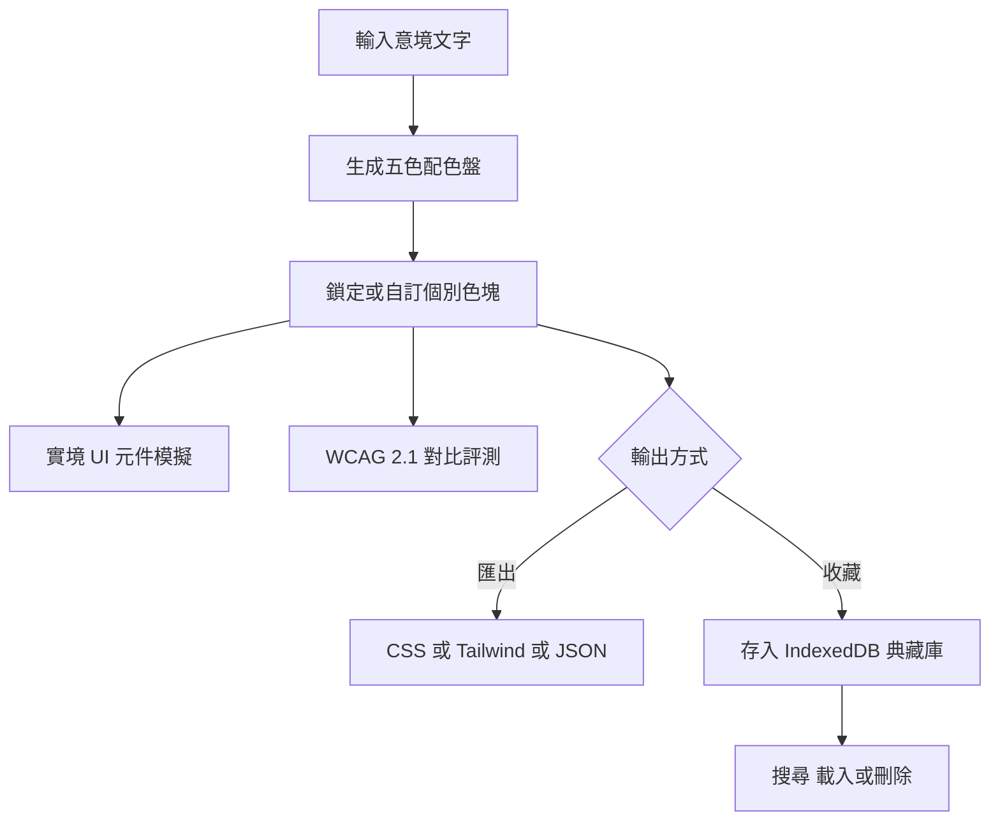

本工具使用 CDN 載入 Tailwind CSS 與 Google Fonts，首次開啟需保持網路連線。典藏庫 `PaletteLoreDB` 將資料保存在目前瀏覽器（object stores：`palettes`、`app_state`）；換瀏覽器、使用無痕視窗或清除網站資料後可能無法取得。色彩公式與 WCAG 對比僅供設計參考，正式無障礙與品牌規範仍應以實際量測與規範為準。

## 資料保存、匯出與隱私

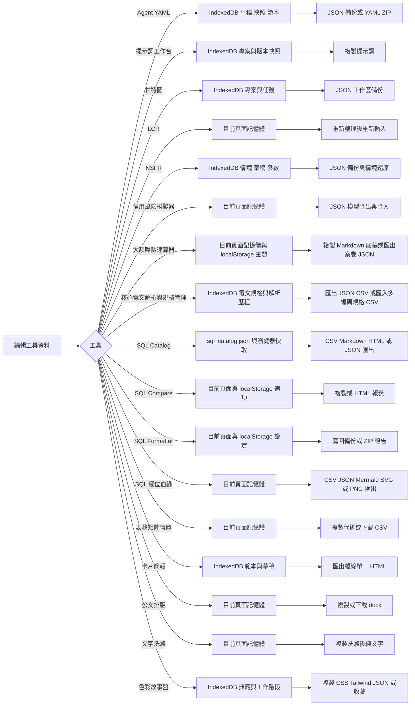

- Agent YAML Maker 與甘特圖資料保存在目前瀏覽器的 IndexedDB；換瀏覽器、使用無痕視窗或清除網站資料後，資料可能無法取得。
- Prompt Studio 會將提示詞專案、自訂變數與歷史版本快照保存在目前瀏覽器的 IndexedDB（`PromptStudioDB`）；換瀏覽器、使用無痕視窗或清除網站資料後，資料可能無法取得，重要提示詞請先複製保存。
- LCR 工具不自動保存、不上傳資料，也沒有內建匯出功能；重要結果請自行複製或列印保存。
- NSFR 工具會將情境、編輯草稿與參數保存在目前瀏覽器的 IndexedDB，並提供 JSON 匯出／匯入備份；主題偏好使用 `localStorage`。若瀏覽器不支援持久化（例如部分 `file://` 環境），資料僅保留於目前頁面，請使用「匯出備份」保存。
- 銀行信用風險模擬器不會自動保存模型；頁面重新整理或關閉後，資料會遺失。請使用 JSON 匯出／匯入保留或移轉模型。該頁也會從 CDN 載入前端資源。
- 大額曝險與關聯戶圖譜速算器不會自動保存集團案卷；頁面重新整理或關閉後資料會遺失。可在底部按「複製審查備忘錄 (Markdown)」或「匯出案卷 JSON」保留內容；該頁也會從 CDN 載入 Tailwind CSS 與 Google Fonts，並以 `localStorage` 記憶深／淺色主題。
- 銀行核心系統固定長度電文解析與管理中心會將電文規格與解析歷程保存在目前瀏覽器的 IndexedDB（`BankTelegramParserDB`，object stores：`schemas`、`history`）；換瀏覽器、使用無痕視窗或清除網站資料後，規格與歷史可能無法取得。解析結果可匯出 JSON／CSV，規格可匯入／匯出多編碼 CSV，重要規格請先匯出備份。
- SQL Catalog 會讀取使用者選定目錄中的 SQL 檔案，索引說明預設寫入該目錄的 `sql_catalog.json`；不支援目錄寫入時則保存於目前瀏覽器的 IndexedDB 快取。工具沒有遠端同步或後端上傳功能。
- Oracle SQL Compare 與 Oracle SQL Formatter Studio 都在瀏覽器本機處理 SQL；前者不修改來源檔案，後者只有在使用者確認「寫回檔案」時才會覆寫，且預設先建立 `_sqlfmt_backup` 備份。
- SQL／TXT 個資清除工具只在目前頁面記憶體中處理檔案；關閉或重新整理後需重新選取資料夾。可寫回模式會依設定建立 `_backup_時間` 備份，唯讀模式請使用 ZIP 保存結果。
- SQL Column Lineage Analyzer 只在目前頁面記憶體中解析 SQL 與建立血緣結果；不使用 IndexedDB 或 `localStorage`，關閉、重新整理或清除頁面後需重新載入。CSV、JSON、Mermaid、SVG 與 PNG 都是由使用者主動下載的輸出檔。
- Markdown 卡片簡報工具會將範本與編輯草稿保存在目前瀏覽器的 IndexedDB，主題偏好使用 `localStorage`；「匯出展示檔」產生完全離線的單一 HTML，但編輯介面樣式仍由 CDN 載入 Tailwind CSS。
- 公文簽／函排版工具不使用 IndexedDB 或 `localStorage`，內容只保留在目前頁面記憶體；輸出為剪貼簿或使用者主動下載的 `.docx` 檔，關閉或重新整理後需重新輸入。
- 剪貼簿洗滌器也不使用 IndexedDB 或 `localStorage`，文字與勾選規則只在目前頁面記憶體處理；輸出為複製到剪貼簿的純文字，關閉或重新整理後需重新貼上。
- MatrixPivot 表格矩陣轉置器不使用 IndexedDB 或 `localStorage`，貼上的表格、轉置結果與格式輸出只在目前頁面記憶體處理；輸出為複製到剪貼簿的代碼或使用者主動下載的 CSV 檔，重新整理或關閉頁面後需重新輸入。
- API Mock & cURL 格式轉換工作室 (API Mock Studio) 使用瀏覽器 `localStorage`（鍵值 `api_mock_studio_state_v1`）保存端點清冊、作用中端點與執行偏好；提供「匯出集合」下載 JSON 檔，可備份或跨裝置匯入還原。
- Palette Lore 色彩故事盤會將收藏的色盤與工作階段（含主題偏好）保存在目前瀏覽器的 IndexedDB（`PaletteLoreDB`）；輸出為複製的 CSS／Tailwind／JSON 代碼。換瀏覽器、使用無痕視窗或清除網站資料後，典藏可能無法取得。
- 本專案沒有內建後端同步。外部 CDN 只提供部分工具（Agent YAML Maker、甘特圖、銀行信用風險模擬器、銀行核心系統固定長度電文解析與管理中心、Markdown 卡片簡報工具、公文簽／函排版工具、MatrixPivot 表格矩陣轉置器、API Mock Studio 與色彩故事盤）所需的樣式、圖示或函式庫，不代表使用者資料會上傳至本專案伺服器。
- 需要跨電腦或防止瀏覽器資料遺失時，請優先使用工具提供的 JSON、YAML 或 ZIP 匯出功能。

## 技術棧與離線範圍

本節依目前各入口頁面的實際程式整理。專案由多個獨立 HTML 頁面組成，使用 HTML5、CSS3、原生 JavaScript 與響應式版面；沒有統一的建置／打包流程、根目錄 `package.json` 或專用後端。各工具由各自的 HTML 頁面獨立實作：部分頁面使用 CDN 載入外部函式庫，且各工具自行決定資料保存方式。

### 外部資源與離線需求

- Agent YAML Maker：從 CDN 載入 Tailwind CSS、js-yaml、JSZip 與 Google Fonts。
- Prompt Studio 結構化提示詞工作台：從 CDN 載入 Tailwind CSS 與 Font Awesome 圖示。
- 動態甘特圖與專案倒數：從 CDN 載入 Tailwind CSS 與 Lucide 圖示。
- 銀行信用風險與資本適足模擬器：從 CDN 載入 Tailwind CSS、Chart.js、Lucide 圖示與 Google Fonts。
- 大額曝險與關聯戶圖譜速算器：從 CDN 載入 Tailwind CSS 與 Google Fonts。
- 銀行核心系統固定長度電文解析與管理中心：從 CDN 載入 Tailwind CSS 與 Font Awesome 圖示。
- Markdown 卡片簡報工具：編輯介面從 CDN 載入 Tailwind CSS；「匯出展示檔」產生的單一 HTML 不含外部依賴。
- 公文簽／函排版與 Word 匯出：從 CDN 載入 Tailwind CSS 與 docx.js。
- 剪貼簿洗滌器 (Text Scrubber)：從 CDN 載入 Tailwind CSS、Phosphor Icons 與 Google Fonts。
- MatrixPivot 表格矩陣轉置器：從 CDN 載入 Tailwind CSS 與 Google Fonts。
- API Mock & cURL 格式轉換工作室：從 CDN 載入 Tailwind CSS 與 Google Fonts。
- Palette Lore 色彩故事盤：從 CDN 載入 Tailwind CSS 與 Google Fonts。
- 其他入口的主要邏輯在瀏覽器執行，不依賴上述共用外部函式庫；SQL Column Lineage Analyzer 也不依賴外部 CDN。

Agent YAML Maker、Prompt Studio、甘特圖、信用風險模擬器、大額曝險與關聯戶圖譜速算器、銀行核心系統固定長度電文解析與管理中心、Markdown 卡片簡報工具、公文簽／函排版工具、剪貼簿洗滌器、MatrixPivot 表格矩陣轉置器、API Mock Studio 與色彩故事盤若無法取得 CDN 資源，可能出現樣式、圖示、圖表或相關功能缺漏。其他工具的本機功能可在無網路時使用，但選取資料夾、讀寫檔案等能力仍受瀏覽器支援與 `file://` 安全限制影響；SQL Catalog、SQL Formatter 與個資清除工具建議使用 Chrome 或 Edge，並依畫面提示授權資料夾。

### 瀏覽器資料保存

- Agent YAML Maker 使用 IndexedDB（資料庫名稱 `AgentYamlMakerDB`，版本 2）保存草稿、快照與範本，並以 `localStorage` 記憶主題；甘特圖使用 IndexedDB 保存專案與任務。
- Prompt Studio 使用 IndexedDB（資料庫名稱 `PromptStudioDB`，object stores：`prompts`、`versions`）保存提示詞專案與歷史版本快照。
- Markdown 卡片簡報工具使用 IndexedDB 保存範本與編輯草稿，並以 `localStorage` 記憶主題偏好。
- NSFR 優先使用 IndexedDB，無法使用時退回 `localStorage`，再退回目前頁面記憶體。
- SQL Catalog 將目錄說明寫入使用者選定根目錄的 `sql_catalog.json`，並以 IndexedDB 保存瀏覽器快取與設定。
- SQL Compare、SQL Formatter 與 NSFR 主題等偏好／選項會使用 `localStorage`。
- LCR 與信用風險模擬器不會自動保存試算資料；其他未列出的臨時分析內容則依各工具說明於目前頁面處理。
- 大額曝險與關聯戶圖譜速算器不使用 IndexedDB；集團案卷只在目前頁面處理，僅以 `localStorage` 記憶深／淺色主題。
- 銀行核心系統固定長度電文解析與管理中心使用 IndexedDB（資料庫名稱 `BankTelegramParserDB`；object stores：`schemas`、`history`）保存電文規格與解析歷程。
- 公文簽／函排版工具不使用 IndexedDB 或 `localStorage`，內容只在目前頁面處理，重新整理後需重新輸入。
- 剪貼簿洗滌器不使用 IndexedDB 或 `localStorage`，文字與勾選規則只在目前頁面處理。
- MatrixPivot 表格矩陣轉置器不使用 IndexedDB 或 `localStorage`，表格與輸出只在目前頁面處理，重新整理後需重新輸入。
- API Mock & cURL 格式轉換工作室使用 `localStorage`（鍵值 `api_mock_studio_state_v1` 與 `api_mock_studio_theme`）保存端點清冊、操作狀態與深淺主題。
- Palette Lore 色彩故事盤使用 IndexedDB（資料庫名稱 `PaletteLoreDB`；object stores：`palettes`、`app_state`）典藏色盤與工作階段／主題。

本機處理表示主要計算與檔案操作在瀏覽器端執行，不代表每個入口都能完全離線啟動，也不代表瀏覽器資料會自動同步或備份。重要資料請使用各工具提供的匯出功能另存檔案。

## 常見問題

### 開啟後畫面樣式不完整或按鈕沒有作用

確認瀏覽器可以連線到工具引用的 CDN（Agent YAML Maker、甘特圖與銀行信用風險模擬器）；也可改用 `python -m http.server 8080` 後從 `http://localhost:8080/` 開啟。LCR 與 NSFR 工具為純離線、不依賴 CDN，若仍異常，請確認開啟的是對應子資料夾（`finance/lcr-mapping-calc` 或 `finance/nsfr-mapping-calc`）內的入口檔。

### 甘特圖或 Agent YAML 的資料不見了

確認使用同一個瀏覽器、同一種一般視窗，且沒有清除網站資料。甘特圖請用 JSON 匯入還原；Agent YAML Maker 請使用資料庫 JSON 備份或快照還原。

### 看不到甘特圖倒數卡片

只有勾選「設為重大里程碑」的任務才會顯示在上方倒數區；請編輯任務並確認勾選狀態與截止日期。

### YAML 匯入或 JSON 還原失敗

請確認檔案是由對應工具匯出的完整檔案，沒有被截斷或手動改壞。Agent YAML Maker 的資料庫備份可選擇合併或覆寫；甘特圖完整工作區匯入會取代現有工作區。

### Prompt Studio 的提示詞或版本不見了

確認使用同一個瀏覽器與一般視窗，且沒有清除網站資料；提示詞、變數與版本快照存放在瀏覽器 IndexedDB（`PromptStudioDB`），不會同步到其他裝置。若要保留組裝結果，請先用「一鍵複製」取出提示詞。若頁面樣式或圖示缺漏，請確認可連線至 CDN（Tailwind CSS 與 Font Awesome）。

### LCR 結果與預期不同

檢查 HQLA 是否為完成上限調整後的淨額、業務方向與係數是否正確，以及流入上限與最低標準是否符合目前採用的規範。必要時回到「Mapping 表」核對適用條件。

### NSFR 結果與預期不同

檢查 ASF／RSF 各項目是否歸類正確、係數是否適用，以及金額是否為基準日之帳面金額；必要時回到「Mapping 表」核對判斷條件與剩餘期間。

### NSFR 情境載入後覆蓋了目前明細

載入情境前工具會先確認；若誤覆蓋，可從 JSON 匯出備份還原，或重新加入明細。

### 大額曝險速算器的資料重新整理後不見了

該工具不會自動保存集團案卷，資料只保留在目前頁面。請在底部按「匯出案卷 JSON」下載備份，或按「複製審查備忘錄 (Markdown)」留下文字底稿。目前版本提供案卷 JSON 匯出但未提供匯入，若要重建可改用「匯入 CSV」批次載入戶別資料。

### 大額曝險的法定上限與預期不同

5%／15%／40% 是依輸入的「本行前一會計年度決算淨值」即時換算，請確認淨值單位為億元且數值正確；行內內部預警比率可在「集團設定」調整。試算結果僅為輔助，正式判定仍應依銀行法第 33 條之 3、主管機關規定與內部授信政策逐案覆核。

### 電文解析結果與主機規格書不同或出現亂碼

先確認「目前電文規格 (Schema)」與「中文編碼計算法」是否與來源一致：Big5／CP950 的中文字佔 2 Bytes，UTF-8 為變長度，選錯編碼會使位元組長度與欄位切點偏移。若匯入 CSV 規格書出現亂碼，請在「CSV 來源編碼」改選 Big5／CP950、Big5-HKSCS、UTF-16LE 或 GBK 後重新匯入。位元組長度為常用規則估算，特殊轉義或非典型編碼仍需與規格書人工比對。

### 電文規格或歷史紀錄不見了

確認使用同一個瀏覽器與一般視窗，且沒有清除網站資料；電文規格與解析歷程存放在瀏覽器 IndexedDB（`BankTelegramParserDB`），不會同步到其他裝置。資料遺失時，可用先前匯出的規格 CSV 重新匯入。

### SQL Catalog 無法選取或儲存目錄

請改用 Chrome 或 Edge，透過靜態檔案伺服器開啟頁面並重新授權目錄。若只能使用唯讀模式，請在每次編輯後匯出 `sql_catalog.json`；該模式不會直接寫回 SQL 根目錄。

### SQL Catalog 顯示檔案已遺失

請確認檔案仍位於原本的根目錄與相對路徑，再按「重新掃描」。若檔案已永久移除，可在批次編輯中移除已遺失紀錄；這只會刪除索引，不會復原或刪除原始檔。

### SQL Compare 的結果與預期不同

檢查是否勾選了忽略大小寫、空白、註解、空行或結尾分隔符；這些選項會改變比對結果。若需要確認原始文字差異，請關閉相關忽略選項，並確認兩份檔案的編碼設定正確。

### SQL Formatter 無法寫回檔案

請使用支援 File System Access API 的 Chrome／Edge，並透過「選擇資料夾」重新授予讀寫權限。若仍使用唯讀相容模式，請改以「匯出 ZIP」取得格式化副本；唯讀模式不會修改來源檔案。

### SQL Formatter 預覽沒有變更

確認檔案已勾選，且格式化設定沒有被保存的舊設定覆蓋；設定變更後必須重新按「格式化預覽」。若檔案是 PL/SQL，預設安全模式只調整大小寫，或目前已選擇略過 PL/SQL，也可能看不到版面變化。

### SQL Formatter 寫回前要如何復原

預設設定會在根目錄建立 `_sqlfmt_backup/<時間戳>`；同一頁工作階段可按「還原本次」。若已關閉頁面或重新整理，請從備份目錄手動還原，並先確認備份檔案與原始相對路徑。

### SQL／TXT 個資清除工具如何避免誤判或遺失原檔

先調整日期／時間排除選項與檢查碼規則，再查看遮罩後的命中前後文；不要未檢查就直接寫回。建議保留「寫回前備份」，或改用「下載清除後 ZIP」在副本上驗證。工具只掃描 `.sql` 與 `.txt`，且不會自動修正清除後可能產生的 SQL 語法問題。

### SQL Column Lineage Analyzer 沒有解析出完整血緣

先到「語句與訊息」查看錯誤或警告及對應行號，再確認 SQL 語法完整、別名與欄位名稱沒有歧義。若欄位名稱在多個物件中重複，請在「上下游追溯樹」使用 `物件.欄位` 指定起點；必要時降低追溯深度或關閉「略過行內查詢」後重新查看。分析器是靜態解析輔助工具，不能取代資料庫實際執行計畫或人工審查。

### Card Presenter 開啟後沒有樣式

編輯介面樣式由 CDN 載入 Tailwind CSS，請確認瀏覽器可連線至網路，或改以 `python -m http.server 8080` 後從 `http://localhost:8080/docs/card-presenter/` 開啟。若只是要分享簡報，按「匯出展示檔」取得的單一 HTML 不含外部依賴，可離線開啟。

### Card Presenter 的範本或草稿不見了

確認使用同一個瀏覽器與一般視窗，且沒有清除網站資料；範本與草稿存放在瀏覽器 IndexedDB。若資料遺失，可重新套用內建範本，或改用「匯出展示檔」保存成品。

### DocuFormatter 無法複製或下載 .docx

確認瀏覽器可連線至 CDN（Tailwind CSS 與 docx.js）。「複製純文字」「複製 Word 格式」使用瀏覽器剪貼簿 API，建議透過 `python -m http.server 8080` 後從 `http://localhost:8080/docs/docuformatter/` 開啟；在 `file://` 或未授權剪貼簿時可能失敗，可改用「下載 .docx」。

### DocuFormatter 的排版結果與預期不同

檢查「標點全形化」「中英間距校正」與「遮罩關鍵字」的設定；「說明」與「擬辦／辦法」每個換行都會自成一項並加上「一、」「二、」編號，若不需編號請改為單行。修改左側欄位時右側預覽會即時更新，可據此逐步比對。

## 維護者驗證

本專案是免建置的靜態 HTML／CSS／JavaScript 專案，沒有統一的 npm 測試指令。實際頁面同時使用原生 HTML／CSS／Vanilla JavaScript；Agent YAML Maker、Prompt Studio、甘特圖、信用風險模擬器、大額曝險與關聯戶圖譜速算器、銀行核心系統固定長度電文解析與管理中心、Markdown 卡片簡報工具、公文簽／函排版工具、剪貼簿洗滌器、MatrixPivot 表格矩陣轉置器與 API Mock Studio 透過 CDN 載入部分資源，這是目前程式現況。若要達成完全離線的共通標準，仍需另行移除或內嵌這些 CDN 依賴。修改文件後可先執行：

```powershell
git diff --check -- README.md
```

若修改網頁程式，請分別在現代瀏覽器開啟十九個入口，至少確認：Agent YAML Maker 可切換兩個 YAML 分頁並下載檔案、Prompt Studio 可切換 10 種框架／輸入含 `{{變數}}` 的區塊以抽出填空欄位／儲存版本並從歷史下拉選單還原、甘特圖可建立專案與任務並重新整理後保留資料、LCR 可加入明細並更新計算結果、NSFR 可加入 ASF／RSF 明細並計算 NSFR 且能保存與載入情境、信用風險模擬器可新增資產組合／切換壓力情境／匯出並匯入 JSON、大額曝險與關聯戶圖譜速算器可設定淨值與集團／新增關聯戶與股權連結／檢視圖譜與法定門檻檢核／執行 What-If 壓力試算並複製底稿或匯出案卷 JSON、SQL Catalog 可選取目錄／掃描 SQL／編輯說明並匯出 `sql_catalog.json`、SQL Compare 可載入兩份 SQL 並產生逐行與結構摘要、Oracle SQL Formatter 可掃描資料夾／預覽格式化／執行健檢並以 ZIP 或寫回方式輸出、SQL／TXT 個資工具可掃描命中／產生遮罩報告並以 ZIP 或備份後寫回輸出、SQL Column Lineage Analyzer 可載入或貼上 SQL／執行分析／查看血緣圖與上下游追溯，並匯出 CSV、JSON、Mermaid、SVG 或 PNG、MatrixPivot 表格矩陣轉置器可貼上或匯入表格／執行行列轉置／切換 Markdown、JSON、SQL、HTML 與 CSV 輸出並複製或下載 CSV、API Mock Studio 可切換端點／貼上 cURL 解析／執行 Mock 模擬與延遲測試／產生 Dummy 假資料／匯出 OpenAPI 3.0 與 Postman Collection、Markdown 卡片簡報工具可輸入 Markdown／切分頁面／全螢幕播放／套用與儲存範本，並匯出可離線開啟的單一 HTML、公文簽／函排版工具可切換簽／函／自由 Markdown 三種模式／檢視即時預覽／複製純文字與 Word 格式並下載 `.docx`、剪貼簿洗滌器可貼上文字／勾選洗滌規則或套用情境／複製洗滌結果並確認個資遮罩、Palette Lore 色彩故事盤可輸入意境／生成色盤／鎖定與自訂色塊／檢視 WCAG 對比／匯出 CSS、Tailwind 或 JSON，並收藏與刪除 IndexedDB 典藏、銀行核心系統固定長度電文解析與管理中心可選擇電文規格／貼上多筆電文解析並匯出 JSON 與 CSV／切換反向組裝產生固定長度電文／新增或匯入多編碼 CSV 規格並保存解析歷程。SQL Catalog、SQL Formatter 與個資工具的目錄權限及瀏覽器相容性仍需實機驗證。
