# SPA 網頁小工具使用者操作手冊

本專案提供三十三個可在瀏覽器中直接使用的單頁網頁工具，涵蓋 AI Agent YAML 狀態與交接檔、結構化提示詞工程工作台、專案排程（動態甘特圖與 WBS 甘特排程器）、專案時程與處理流程紀錄（事件、流程紀錄、附件與到期提醒）、會議人力成本即時看板（燃燒速率與產出 vs 成本評估卡）、臺灣 LCR／NSFR 試算、銀行信用風險與資本適足情境試算、大額曝險與關聯戶圖譜速算、金融金額中文大寫轉換、核心主機固定長度電文解析與規格管理、核心系統與電文錯誤碼排查對照、公文簽／函排版與 Word 匯出、Markdown 卡片簡報、剪貼簿文字洗滌與個資脫敏、文件字數與閱讀時間統計、規格書版本比對與審查、離線速記便箋、色彩故事盤、狀態機與業務流程拓撲建模與模擬、表格矩陣轉置與格式轉換、CSV 格式清理（支援 Big5／CP950 讀寫）、API Mock 與 cURL 雙向轉換、資料品質稽核（CSV／Excel 匯入、欄位剖析與六構面規則檢核）、資料關聯探索（CSV／TSV 匯入、自動推測主外鍵與 ER 圖）、截圖 OCR 知識庫（截圖貼上、Tesseract OCR 與全文檢索），以及 SQL 目錄、比對、格式化、個資清除、欄位血緣分析與 SQL 沙箱測試。工具不需要本專案專用後端；建議從根目錄的入口大廳 [`index.html`](./index.html) 依分類進入，或直接開啟對應的 HTML 入口。

## 目錄

- [快速開始](#快速開始)
- [專案結構](#專案結構)
- [整體使用流程](#整體使用流程)
- [工具總覽](#工具總覽)
- [Agent YAML Maker](#agent-yaml-maker)
- [Prompt Studio 結構化提示詞工作台](#prompt-studio-結構化提示詞工作台)
- [動態甘特圖與專案倒數看板](#動態甘特圖與專案倒數看板)
- [WBS 甘特排程器](#wbs-甘特排程器)
- [專案時程暨處理流程紀錄系統](#專案時程暨處理流程紀錄系統)
- [離線速記便箋](#離線速記便箋)
- [臺灣 LCR Mapping 與試算](#臺灣-lcr-mapping-與試算)
- [臺灣 NSFR 淨穩定資金比率與試算](#臺灣-nsfr-淨穩定資金比率與試算)
- [銀行信用風險與資本適足模擬器](#銀行信用風險與資本適足模擬器)
- [大額曝險與關聯戶圖譜速算器](#大額曝險與關聯戶圖譜速算器)
- [金融金額中文大寫轉換器](#金融金額中文大寫轉換器)
- [銀行核心系統固定長度電文解析與管理中心](#銀行核心系統固定長度電文解析與管理中心)
- [核心系統與電文錯誤碼排查對照台](#核心系統與電文錯誤碼排查對照台)
- [SQL Catalog](#sql-catalog)
- [Oracle SQL Compare](#oracle-sql-compare)
- [Oracle SQL Formatter Studio](#oracle-sql-formatter-studio)
- [SQL／TXT 個資掃描與清除](#sqltxt-個資掃描與清除)
- [SQL Column Lineage Analyzer](#sql-column-lineage-analyzer)
- [SQL Lab](#sql-lab)
- [MatrixPivot 表格矩陣轉置器](#matrixpivot-表格矩陣轉置器)
- [CSV 格式清理器](#csv-格式清理器)
- [API Mock & cURL 格式轉換工作室 (API Mock Studio)](#api-mock--curl-格式轉換工作室-api-mock-studio)
- [截圖 OCR 知識庫](#截圖-ocr-知識庫)
- [資料品質稽核中心](#資料品質稽核中心)
- [資料關聯探索器](#資料關聯探索器)
- [Markdown 卡片簡報工具 (Card Presenter)](#markdown-卡片簡報工具-card-presenter)
- [公文簽／函排版與 Word 匯出 (DocuFormatter)](#公文簽函排版與-word-匯出-docuformatter)
- [剪貼簿洗滌器 (Text Scrubber)](#剪貼簿洗滌器-text-scrubber)
- [文件字數與閱讀時間統計](#文件字數與閱讀時間統計)
- [會議燃燒成本看板](#會議燃燒成本看板)
- [SpecDiff 規格書比對工具](#specdiff-規格書比對工具)
- [Palette Lore 色彩故事盤](#palette-lore-色彩故事盤)
- [StateFlow 動態狀態機與業務流程拓撲模擬器](#stateflow-動態狀態機與業務流程拓撲模擬器)
- [資料保存、匯出與隱私](#資料保存匯出與隱私)
- [技術棧與離線範圍](#技術棧與離線範圍)
- [常見問題](#常見問題)
- [維護者驗證](#維護者驗證)

## 快速開始

1. 下載或複製本專案。
2. 建議先開啟根目錄的入口大廳 [`index.html`](./index.html)，以分類卡片瀏覽並進入全部工具；也可直接開啟下列任一入口：
   - [`agent/agent-yaml-maker/index.html`](./agent/agent-yaml-maker/index.html)
   - [`agent/prompt-studio/prompt-studio.html`](./agent/prompt-studio/prompt-studio.html)
   - [`docs/project-gantt/dynamic_gantt_project_countdown.html`](./docs/project-gantt/dynamic_gantt_project_countdown.html)
   - [`docs/wbs-gantt/wbs-gantt.html`](./docs/wbs-gantt/wbs-gantt.html)
   - [`docs/project-tracker/project-tracker.html`](./docs/project-tracker/project-tracker.html)
   - [`docs/scratchpad/scratchpad.html`](./docs/scratchpad/scratchpad.html)
   - [`finance/lcr-mapping-calc/LCR_Mapping_SPA.html`](./finance/lcr-mapping-calc/LCR_Mapping_SPA.html)
   - [`finance/nsfr-mapping-calc/NSFR_Mapping_SPA.html`](./finance/nsfr-mapping-calc/NSFR_Mapping_SPA.html)
   - [`finance/basel-creditrisk-calc/bank_credit_risk_capital_adequacy_simulator.html`](./finance/basel-creditrisk-calc/bank_credit_risk_capital_adequacy_simulator.html)
   - [`finance/large-exposure-analyzer/large-exposure-analyzer.html`](./finance/large-exposure-analyzer/large-exposure-analyzer.html)
   - [`finance/chinese-amount-uppercase/chinese-amount-uppercase.html`](./finance/chinese-amount-uppercase/chinese-amount-uppercase.html)
   - [`finance/fixed-width-telegram-parser/fixed-width-telegram-parser.html`](./finance/fixed-width-telegram-parser/fixed-width-telegram-parser.html)
   - [`finance/bank-error-code-resolver/bank-error-code-resolver.html`](./finance/bank-error-code-resolver/bank-error-code-resolver.html)
   - [`sql/sql-catalog/SQL_Catalog.html`](./sql/sql-catalog/SQL_Catalog.html)
   - [`sql/sql-compare/sql-compare.html`](./sql/sql-compare/sql-compare.html)
   - [`sql/oracle-sql-formatter/OracleSqlFormatter.html`](./sql/oracle-sql-formatter/OracleSqlFormatter.html)
   - [`sql/sql-pii-cleaner/sql-pii-cleaner.html`](./sql/sql-pii-cleaner/sql-pii-cleaner.html)
   - [`sql/sql-lineage-analyzer/SQL_Column_Lineage_Analyzer.html`](./sql/sql-lineage-analyzer/SQL_Column_Lineage_Analyzer.html)
   - [`sql/sql-lab/sql-lab.html`](./sql/sql-lab/sql-lab.html)
   - [`data/matrix-pivot/matrix-pivot.html`](./data/matrix-pivot/matrix-pivot.html)
   - [`data/csv-cleaner/csv-cleaner.html`](./data/csv-cleaner/csv-cleaner.html)
   - [`data/api-mock-studio/api-mock-studio.html`](./data/api-mock-studio/api-mock-studio.html)
   - [`data/screenshot-ocr-kb/screenshot-ocr-kb.html`](./data/screenshot-ocr-kb/screenshot-ocr-kb.html)
   - [`data/data-quality-audit/data-quality-audit.html`](./data/data-quality-audit/data-quality-audit.html)
   - [`data/data-relationship-explorer/data-relationship-explorer.html`](./data/data-relationship-explorer/data-relationship-explorer.html)
   - [`docs/card-presenter/markdown_card_presenter.html`](./docs/card-presenter/markdown_card_presenter.html)
   - [`docs/docuformatter/DocuForm.html`](./docs/docuformatter/DocuForm.html)
   - [`docs/text-scrubber/text-scrubber.html`](./docs/text-scrubber/text-scrubber.html)
   - [`docs/word-counter/word-counter.html`](./docs/word-counter/word-counter.html)
   - [`docs/meeting-burn-rate/meeting-burn-rate.html`](./docs/meeting-burn-rate/meeting-burn-rate.html)
   - [`docs/spec-diff/SpecDiff.html`](./docs/spec-diff/SpecDiff.html)
   - [`design/palette-lore/palette-lore.html`](./design/palette-lore/palette-lore.html)
   - [`diagram/stateflow/stateflow.html`](./diagram/stateflow/stateflow.html)
3. 使用瀏覽器頁面中的表單、按鈕與分頁完成操作。

本專案沒有建置或打包步驟，也沒有根目錄 `package.json`。若瀏覽器限制 `file://` 頁面的部分功能，可在專案根目錄啟動任一靜態檔案伺服器，例如：

```powershell
python -m http.server 8080
```

再開啟 `http://localhost:8080/`，並進入上述子目錄。Agent YAML Maker、Prompt Studio、甘特圖、銀行信用風險模擬器、大額曝險與關聯戶圖譜速算器、銀行核心系統固定長度電文解析與管理中心、核心系統與電文錯誤碼排查對照台、Markdown 卡片簡報工具、公文簽／函排版工具、剪貼簿洗滌器、MatrixPivot 表格矩陣轉置器、CSV 格式清理器、API Mock Studio 與色彩故事盤會從 CDN 載入部分樣式或函式庫；若要完整使用，首次開啟時請保持網路連線。LCR、NSFR、金融金額中文大寫轉換器、WBS 甘特排程器、專案時程暨處理流程紀錄系統、資料品質稽核中心、資料關聯探索器、離線速記便箋、文件字數與閱讀時間統計工具、會議燃燒成本看板、StateFlow 動態狀態機與業務流程拓撲模擬器、SpecDiff 規格書比對工具、截圖 OCR 知識庫與 SQL Catalog 不依賴外部函式庫，可直接離線開啟（截圖 OCR 知識庫首次使用需先匯入一次本機的 Tesseract 引擎檔，之後即完全離線）；SQL Catalog 的「選擇目錄」功能建議使用 Chrome 或 Edge。

本專案的「免建置」不等於每個頁面都能在完全斷網下完整使用：Agent YAML Maker 需要從 CDN 載入 Tailwind CSS、js-yaml 與 JSZip，Prompt Studio 需要從 CDN 載入 Tailwind CSS 與 Font Awesome 圖示，甘特圖與 Markdown 卡片簡報工具需要從 CDN 載入 Tailwind CSS，公文簽／函排版工具需要從 CDN 載入 Tailwind CSS 與 docx.js，大額曝險與關聯戶圖譜速算器需要從 CDN 載入 Tailwind CSS 與 Google Fonts，銀行核心系統固定長度電文解析與管理中心需要從 CDN 載入 Tailwind CSS 與 Font Awesome 圖示，核心系統與電文錯誤碼排查對照台需要從 CDN 載入 Tailwind CSS、Phosphor Icons 與 SheetJS，剪貼簿洗滌器需要從 CDN 載入 Tailwind CSS、Phosphor Icons 與 Google Fonts，MatrixPivot 表格矩陣轉置器需要從 CDN 載入 Tailwind CSS 與 Google Fonts，CSV 格式清理器需要從 CDN 載入 iconv-lite（僅 Big5／CP950 功能需要），API Mock Studio 需要從 CDN 載入 Tailwind CSS 與 Google Fonts，色彩故事盤需要從 CDN 載入 Tailwind CSS 與 Google Fonts，SQL Lab 選用 SQLite 引擎時需要從 CDN 載入 sql.js 與其 wasm 檔（內建引擎可離線使用）。若這些資源尚未載入，頁面可能缺少樣式或部分功能；請改用可連線的環境，或先以瀏覽器快取及靜態伺服器測試。SQL 比對、SQL 格式化、SQL／TXT 個資清除與文件字數與閱讀時間統計工具則以瀏覽器本機處理檔案，不會將內容上傳至本專案後端。

## 專案結構

```text
my-spa-tools/
├─ index.html                    入口大廳（分類卡片、搜尋、連結使用手冊）
├─ README.md                     本使用手冊
├─ agent/
│  ├─ agent-yaml-maker/          Agent YAML Maker（index.html + app.js + styles.css）
│  └─ prompt-studio/             Prompt Studio 結構化提示詞工作台
├─ finance/                      臺灣監理試算與核心電文解析
│  ├─ lcr-mapping-calc/
│  ├─ nsfr-mapping-calc/
│  ├─ basel-creditrisk-calc/
│  ├─ large-exposure-analyzer/
│  ├─ chinese-amount-uppercase/  金融金額中文大寫轉換器
│  ├─ fixed-width-telegram-parser/
│  └─ bank-error-code-resolver/  核心系統與電文錯誤碼排查對照台
├─ sql/                          SQL 工具
│  ├─ sql-catalog/
│  ├─ sql-compare/
│  ├─ oracle-sql-formatter/
│  ├─ sql-pii-cleaner/
│  ├─ sql-lineage-analyzer/
│  └─ sql-lab/                    SQL Lab 離線 SQL 測試工具（沙箱、匯入與測試案例）
├─ data/                         資料工具
│  ├─ matrix-pivot/
│  ├─ csv-cleaner/
│  ├─ api-mock-studio/
│  ├─ data-quality-audit/         資料品質稽核中心（CSV／Excel 匯入、欄位剖析與規則檢核）
│  ├─ data-relationship-explorer/ 資料關聯探索器（主外鍵推測、ER 圖與路徑／影響分析）
│  └─ screenshot-ocr-kb/          截圖 OCR 知識庫（Tesseract OCR、集合與操作流程）
├─ docs/                         文書與簡報
│  ├─ project-gantt/
│  ├─ card-presenter/
│  ├─ docuformatter/
│  ├─ text-scrubber/
│  ├─ word-counter/              文件字數與閱讀時間統計
│  ├─ wbs-gantt/                 WBS 甘特排程器（WBS 相依、假日／補班日）
│  ├─ project-tracker/           專案時程暨處理流程紀錄系統（事件、流程紀錄、附件與提醒）
│  ├─ scratchpad/                離線速記便箋（Markdown 便箋、標籤與回收筒）
│  ├─ meeting-burn-rate/         會議燃燒成本看板（即時人力成本與產出評估卡）
│  └─ spec-diff/                 SpecDiff 規格書比對工具（版本比對與審查標註）
├─ design/                       設計工具
│  └─ palette-lore/
└─ diagram/                      流程與圖表建模
   └─ stateflow/                 StateFlow 動態狀態機與業務流程拓撲模擬器（DSL、拓撲圖、模擬與診斷）
```

各工具以獨立子資料夾存放單一入口 HTML；`agent-yaml-maker` 另含 `app.js` 與 `styles.css`，`screenshot-ocr-kb` 另含 `download_ocr_engine.bat`（OCR 引擎檔下載輔助，非執行必要）。資料夾依「Agent／金融試算／SQL／資料工具／文書與簡報／設計工具／流程與圖表建模」七類歸類，HTML 檔名維持工具原名。

## 整體使用流程

```mermaid
flowchart TD
    A[選擇網頁工具] --> B{工具類型}
    B -->|Agent 狀態與交接| C[填寫 YAML 表單]
    B -->|提示詞工程| AE[選擇框架並填寫結構區塊]
    B -->|專案排程| D[建立專案與任務]
    B -->|WBS 排程| WG[設定 WBS 任務 工期與前置相依]
    B -->|專案時程與流程紀錄| PT[建立專案 事件與處理流程紀錄]
    B -->|LCR 試算| E[輸入 HQLA 與業務明細]
    B -->|NSFR 試算| K[輸入 ASF 與 RSF 明細]
    B -->|信用風險壓力試算| U[設定資本 資產與壓力情境]
    B -->|大額曝險與關聯戶試算| AL[設定集團 關聯戶與曝險明細]
    B -->|金額中文大寫轉換| MA[輸入阿拉伯數字金額並選擇幣別抬頭]
    B -->|核心電文解析與組裝| TP[選擇電文規格並貼上多筆電文]
    B -->|電文錯誤碼排查| ER[搜尋或匯入錯誤碼並查閱處置 SOP]
    B -->|SQL 管理| I[選擇 SQL 根目錄]
    B -->|SQL 版本比對| M[貼上或開啟舊版與新版 SQL]
    B -->|SQL 格式化與健檢| N[選擇 SQL 資料夾]
    B -->|SQL 個資清除| Q[選擇 SQL／TXT 資料夾]
    B -->|SQL 欄位血緣分析| S[載入或貼上 SQL]
    B -->|SQL 沙箱測試| SL[建立工作區並匯入 CSV SQL 或 SQLite]
    B -->|表格轉置與格式轉換| AP[貼上或匯入 CSV TSV 表格文字]
    B -->|CSV 格式清理| CC[匯入 CSV 或貼上 Excel 內容並勾選清理規則]
    B -->|API 測試與 Mock 模擬| AR[貼上 cURL 或手動編輯端點]
    B -->|截圖 OCR 知識庫| OK[貼上 拖曳或匯入截圖並辨識文字]
    B -->|資料品質稽核| DQ[匯入 CSV 或 Excel 並選擇稽核範本]
    B -->|資料關聯探索| DR2[匯入多個 CSV 或 TSV 並按分析]
    B -->|文字洗滌與個資脫敏| Y[貼上雜亂文字並勾選洗滌規則]
    B -->|便箋速記| SP[新增便箋 標籤與 Markdown 內容]
    B -->|字數統計與閱讀時間| WC[貼上或匯入純文字檔並選擇編碼]
    B -->|規格書版本比對| SD[匯入舊版與新版規格書]
    B -->|會議成本看板| MC[設定人數 時薪級距 預計時長與議程檢核]
    B -->|配色設計| W[輸入意境文字生成色盤]
    B -->|狀態機與流程拓撲建模| HG[以 DSL 定義狀態 轉換 動作與條件]
    C --> F[預覽並下載 YAML 或 ZIP]
    AE --> AF[填入變數並複製組裝結果]
    D --> G[查看甘特圖與里程碑倒數]
    WG --> WH[檢視工作天排程與甘特圖 並匯出 CSV JSON]
    PT --> PU[檢視列表 甘特 月曆並維護流程紀錄 附件與提醒]
    PT --> PV[匯出備份 JSON 與匯出 ics 提醒]
    E --> H[查看流出 流入與 LCR]
    K --> L[查看 ASF RSF 與 NSFR]
    U --> V[查看預期損失 RWA 與 CAR]
    AL --> AM[檢核集中度 股權穿透與 What-If 壓力]
    MA --> MB[複製中文大寫 純中文或英文金額]
    TP --> TQ[依規格拆解欄位或反向組裝電文並匯出 JSON CSV]
    ER --> ES[檢視原因 SOP 與對客話術並匯出 Excel]
    I --> J[掃描 檢索與編輯說明]
    M --> O[查看逐行與結構差異]
    N --> P[預覽格式化 健檢並匯出或寫回]
    Q --> R[掃描命中並匯出清除副本或寫回]
    S --> T[分析血緣圖、欄位對照與上下游追溯]
    SL --> SM[執行查詢 檢視結果並執行測試案例]
    AP --> AQ[轉置矩陣並複製或下載 Markdown JSON SQL HTML CSV]
    CC --> CD[預覽清理結果並選擇 UTF-8 或 Big5／CP950 下載]
    AR --> AS[模擬延遲 回應狀態 產生 Dummy 與匯出代碼 OpenAPI]
    OK --> OL[全文檢索截圖並匯出流程 Word 或備份 ZIP]
    DQ --> DR[檢視問題明細與評等並匯出報告 原始列或清理後資料]
    DR2 --> DS2[檢視主外鍵 欄位相依與 ER 圖並匯出 DDL Mermaid 或報表]
    W --> X[檢視 WCAG 對比並匯出色碼或收藏]
    HG --> HH[檢視拓撲圖 執行流程模擬並診斷死胡同 孤島與黑洞循環]
    Y --> Z[複製洗滌後的乾淨文字]
    SP --> SQ[全文搜尋 標籤篩選 預覽並匯出 JSON]
    WC --> WD[檢視中英字數 段落句數 閱讀時間與高頻詞]
    SD --> SE[檢視差異並逐筆標註審查狀態 影響模組與備註]
    MC --> MC2[開始計時 即時累積成本並勾選議程產出]
    MC2 --> MC3[產生評估卡 PNG 與文字摘要並寫入歷史]
```

## 工具總覽

| 工具 | 入口 | 適合用途 | 資料保存方式 |
| --- | --- | --- | --- |
| Agent YAML Maker | [`agent/agent-yaml-maker/index.html`](./agent/agent-yaml-maker/index.html) | 建立 `progress.yaml`、`handoff.yaml`、範本與快照 | 瀏覽器 IndexedDB；主題偏好使用 `localStorage` |
| Prompt Studio 結構化提示詞工作台 | [`agent/prompt-studio/prompt-studio.html`](./agent/prompt-studio/prompt-studio.html) | 以 10 種經典框架模組化組裝提示詞，抽取 `{{變數}}`、估算 Token 並保存版本快照 | 瀏覽器 IndexedDB（`PromptStudioDB`：`prompts` 專案與 `versions` 版本快照） |
| 動態甘特圖與專案倒數 | [`docs/project-gantt/dynamic_gantt_project_countdown.html`](./docs/project-gantt/dynamic_gantt_project_countdown.html) | 管理多個專案、任務、進度與重大里程碑 | 瀏覽器 IndexedDB |
| 專案時程暨處理流程紀錄系統 | [`docs/project-tracker/project-tracker.html`](./docs/project-tracker/project-tracker.html) | 以專案為單位管理事件、處理流程紀錄、附件與連結，提供列表／甘特／月曆三種檢視、逾期與到期提醒（可匯出 `.ics`），並支援人員管理與 CSV 匯出入 | 瀏覽器 IndexedDB（`ProjectTrackerDB`：`projects`、`persons`、`events`、`processLogs`、`attachments`、`reminderLogs`、`settings`）；提供整庫與單一專案 JSON 匯出／匯入 |
| WBS 甘特排程器 | [`docs/wbs-gantt/wbs-gantt.html`](./docs/wbs-gantt/wbs-gantt.html) | 以 WBS 與前置任務相依推算工作天排程，自動跳過假日／補班日並繪製甘特圖，支援多專案與 CSV／JSON 匯出入 | 瀏覽器 IndexedDB（`wbsGanttDB`：`kv`）；支援匯出 CSV／JSON 備份 |
| 離線速記便箋 | [`docs/scratchpad/scratchpad.html`](./docs/scratchpad/scratchpad.html) | 以卡片管理便箋、標籤與全文搜尋，內建 Markdown 編輯／雙欄即時預覽、置頂、卡片配色、回收筒、圖片貼上與 JSON 備份 | 瀏覽器 IndexedDB（`OfflineScratchpadDB`）；支援匯出／匯入 JSON 與批次匯出 Markdown |
| 臺灣 LCR Mapping 與試算 | [`finance/lcr-mapping-calc/LCR_Mapping_SPA.html`](./finance/lcr-mapping-calc/LCR_Mapping_SPA.html) | 查詢業務係數並計算現金流與 LCR | 僅保留在目前頁面，重新整理會清除 |
| 臺灣 NSFR 淨穩定資金比率與試算 | [`finance/nsfr-mapping-calc/NSFR_Mapping_SPA.html`](./finance/nsfr-mapping-calc/NSFR_Mapping_SPA.html) | 查詢 ASF／RSF 係數並計算 NSFR | IndexedDB 優先，必要時退回 `localStorage` 或僅保留於目前頁面 |
| 銀行信用風險與資本適足模擬器 | [`finance/basel-creditrisk-calc/bank_credit_risk_capital_adequacy_simulator.html`](./finance/basel-creditrisk-calc/bank_credit_risk_capital_adequacy_simulator.html) | 編輯信貸資產組合，觀察壓力情境下預期損失、RWA 與 CAR 敏感度 | 只保留在目前頁面；可匯出／匯入 JSON 模型 |
| 大額曝險與關聯戶圖譜速算器 | [`finance/large-exposure-analyzer/large-exposure-analyzer.html`](./finance/large-exposure-analyzer/large-exposure-analyzer.html) | 檢核集團授信集中度、關係人股權穿透與 What-If 壓力情境下的大額曝險，並匯出審查底稿 | 只保留在目前頁面；可匯出案卷 JSON，主題偏好使用 `localStorage` |
| 金融金額中文大寫轉換器 | [`finance/chinese-amount-uppercase/chinese-amount-uppercase.html`](./finance/chinese-amount-uppercase/chinese-amount-uppercase.html) | 將阿拉伯數字金額即時轉為繁體中文大寫，切換新臺幣／美金／人民幣／日圓／歐元抬頭，並輸出純中文大寫與英文大寫金額 | 只保留在目前頁面記憶體；輸出為複製到剪貼簿的文字，重新整理後需重新輸入 |
| 銀行核心系統固定長度電文解析與管理中心 | [`finance/fixed-width-telegram-parser/fixed-width-telegram-parser.html`](./finance/fixed-width-telegram-parser/fixed-width-telegram-parser.html) | 依電文規格解析或反向組裝銀行核心主機固定長度電文，以 Big5／UTF-8 計算位元組並維護規格 | 瀏覽器 IndexedDB（`BankTelegramParserDB`：`schemas` 規格、`history` 解析歷程） |
| 核心系統與電文錯誤碼排查對照台 | [`finance/bank-error-code-resolver/bank-error-code-resolver.html`](./finance/bank-error-code-resolver/bank-error-code-resolver.html) | 集中維護核心主機、財金跨行（FISC）、SWIFT 與批次錯誤碼，查閱處理 SOP、對客話術與權責窗口，並支援 Excel 匯入匯出與系統類別管理 | 瀏覽器 IndexedDB（`BankErrorCodesDB`：`error_codes` 錯誤碼、`system_categories` 系統類別）；可匯出 Excel |
| SQL Catalog | [`sql/sql-catalog/SQL_Catalog.html`](./sql/sql-catalog/SQL_Catalog.html) | 掃描 SQL 根目錄、搜尋內容、維護用途與標籤、匯出清冊 | 根目錄 `sql_catalog.json`；瀏覽器 IndexedDB 作為快取與設定保存 |
| Oracle SQL Compare | [`sql/sql-compare/sql-compare.html`](./sql/sql-compare/sql-compare.html) | 比對兩份 Oracle SQL 的逐行內容與結構差異 | SQL 只在目前頁面處理；比對選項保存於瀏覽器 `localStorage` |
| Oracle SQL Formatter Studio | [`sql/oracle-sql-formatter/OracleSqlFormatter.html`](./sql/oracle-sql-formatter/OracleSqlFormatter.html) | 批次格式化 SQL／PL/SQL、執行健檢、預覽差異並匯出或寫回 | 檔案在瀏覽器本機處理；設定與健檢規則保存於 `localStorage` |
| SQL／TXT 個資掃描與清除 | [`sql/sql-pii-cleaner/sql-pii-cleaner.html`](./sql/sql-pii-cleaner/sql-pii-cleaner.html) | 掃描常見身分證字號、帳號、統編與擔保品編號，產生清除副本或寫回 | 檔案只在目前頁面記憶體處理，不保存掃描結果 |
| SQL Column Lineage Analyzer | [`sql/sql-lineage-analyzer/SQL_Column_Lineage_Analyzer.html`](./sql/sql-lineage-analyzer/SQL_Column_Lineage_Analyzer.html) | 分析 Oracle SQL 欄位來源、轉換、上下游影響與 CTE 結構，匯出血緣資料 | SQL 與分析結果只在目前頁面記憶體處理，不保存或上傳 |
| SQL Lab | [`sql/sql-lab/sql-lab.html`](./sql/sql-lab/sql-lab.html) | 在瀏覽器內開 SQL 沙箱：內建引擎或 SQLite（sql.js）、多工作區、查詢與執行計畫、結構瀏覽、CSV／SQL／SQLite 匯入、片段與歷史，並可建立比對預期結果的測試案例 | 瀏覽器 IndexedDB（`sql-lab`：`workspaces`、`history`、`snippets`、`testcases`、`testruns`、`settings`）；提供完整備份 JSON 匯出／匯入 |
| MatrixPivot 表格矩陣轉置器 | [`data/matrix-pivot/matrix-pivot.html`](./data/matrix-pivot/matrix-pivot.html) | 貼上或匯入 CSV／TSV 表格，即時轉置矩陣、清理空白與 Trim，並輸出 Markdown、JSON、SQL INSERT、HTML 或 CSV | 內容與輸出只保留在目前頁面記憶體；可複製代碼或下載 CSV |
| CSV 格式清理器 | [`data/csv-cleaner/csv-cleaner.html`](./data/csv-cleaner/csv-cleaner.html) | 清理 CSV 的空白、不可見字元、全形英數、金額千分位與民國／西元日期，支援 UTF-8、UTF-16、Big5 與 CP950 讀寫 | 內容與輸出只保留在目前頁面記憶體；可下載 CSV 檔 |
| API Mock & cURL 格式轉換工作室 | [`data/api-mock-studio/api-mock-studio.html`](./data/api-mock-studio/api-mock-studio.html) | 貼上 cURL 雙向解析、純前端 Mock 模擬與延遲測試、臺灣金融 Dummy 假資料生成、產生多語言程式碼並匯出 OpenAPI 3.0 與 Postman 集合 | 端點清冊與當前設定保存在瀏覽器 `localStorage`；支援 JSON 匯入／匯出 |
| 截圖 OCR 知識庫 | [`data/screenshot-ocr-kb/screenshot-ocr-kb.html`](./data/screenshot-ocr-kb/screenshot-ocr-kb.html) | 貼上、拖曳或匯入截圖並以 Tesseract OCR 辨識文字，建立可全文檢索的截圖知識庫，支援標籤、集合、操作流程文件（Word／PDF）與時間軸 | 瀏覽器 IndexedDB（`snap-ocr-kb`：`images`、`thumbs`、`notes`、`collections`、`workflows`、`assets`、`settings`）；可匯出 ZIP 備份 |
| 資料品質稽核中心 | [`data/data-quality-audit/data-quality-audit.html`](./data/data-quality-audit/data-quality-audit.html) | 匯入 CSV／Excel（自動偵測編碼與分隔符號）並剖析欄位，以六大品質構面規則稽核，產生問題明細、維度分數與 A–E 評等，支援例外清單、批次趨勢比對與報告／清理後資料匯出 | 瀏覽器 IndexedDB（`dqa_center`：`datasets`、`rows`、`profiles`、`templates`、`runs`、`issues`、`holidays`、`settings`）；提供完整備份 JSON 匯出／匯入 |
| 資料關聯探索器 | [`data/data-relationship-explorer/data-relationship-explorer.html`](./data/data-relationship-explorer/data-relationship-explorer.html) | 匯入多個 CSV／TSV（自動偵測編碼與分隔符號），推測主鍵、外鍵關聯與欄位相依，繪製互動式 ER 圖，並提供資料表路徑查詢、影響分析、代碼字典與 JOIN／孤兒值 SQL 產生 | 瀏覽器 IndexedDB（`DataRelationshipExplorer`：`workspaces`、`tables`、`rows`、`profiles`、`relations`、`fds`、`layouts`）；主題與上次工作區使用 `localStorage`，並提供工作區 JSON 匯出／匯入 |
| Markdown 卡片簡報工具 | [`docs/card-presenter/markdown_card_presenter.html`](./docs/card-presenter/markdown_card_presenter.html) | 以 Markdown 撰寫卡片式投影片、即時預覽、全螢幕播放，並匯出離線單一 HTML | 瀏覽器 IndexedDB（範本與草稿）；主題偏好使用 `localStorage` |
| 公文簽／函排版與 Word 匯出 (DocuFormatter) | [`docs/docuformatter/DocuForm.html`](./docs/docuformatter/DocuForm.html) | 以表單或 Markdown 撰寫簽／函公文、校正標點與中英間距，並匯出 Word 文件 | 只保留在目前頁面記憶體；輸出為剪貼簿或 `.docx` 檔 |
| 剪貼簿洗滌器 (Text Scrubber) | [`docs/text-scrubber/text-scrubber.html`](./docs/text-scrubber/text-scrubber.html) | 修復 PDF 斷行與隱形字元、統一標點與清單符號，並遮罩身分證、電話、統編與電子郵件等敏感資訊 | 文字與勾選規則只在目前頁面記憶體處理，不保存 |
| 文件字數與閱讀時間統計 | [`docs/word-counter/word-counter.html`](./docs/word-counter/word-counter.html) | 統計中英字數、字元、段落與句數，估算閱讀時間並列出英文高頻詞，支援多種檔案編碼 | 內容只在目前頁面記憶體處理；閱讀速度與編碼偏好使用 `localStorage` |
| 會議燃燒成本看板 | [`docs/meeting-burn-rate/meeting-burn-rate.html`](./docs/meeting-burn-rate/meeting-burn-rate.html) | 依與會者人數與時薪級距即時累積會議人力成本，搭配議程產出檢核，會後產生「產出 vs 成本」PNG 評估卡與歷史比較 | 設定與常用組合使用 `localStorage`；會議紀錄使用瀏覽器 IndexedDB（`MeetingBurnRateDB`：`meetings`），並可匯出 CSV／JSON 備份 |
| SpecDiff 規格書比對工具 | [`docs/spec-diff/SpecDiff.html`](./docs/spec-diff/SpecDiff.html) | 匯入 docx／txt／Markdown 規格書的舊版與新版，比對新增、修改、刪除與搬移的段落，逐筆標註審查狀態、影響模組與備註，並匯出 HTML 差異報告與 CSV | 瀏覽器 IndexedDB（`SpecDiffDB`：`documents`、`projects`、`reviews`、`settings`）；無法使用時退回記憶體，並提供整庫備份 JSON 匯出／還原 |
| Palette Lore 色彩故事盤 | [`design/palette-lore/palette-lore.html`](./design/palette-lore/palette-lore.html) | 以抽象意境文字生成五色配色盤，附實境 UI 模擬、WCAG 對比評測與 CSS／Tailwind／JSON 匯出 | 瀏覽器 IndexedDB（`PaletteLoreDB`：`palettes` 典藏與 `app_state` 工作階段／主題） |
| StateFlow 動態狀態機與業務流程拓撲模擬器 | [`diagram/stateflow/stateflow.html`](./diagram/stateflow/stateflow.html) | 以極簡 DSL 定義狀態、轉換、動作與條件，繪製可分層佈局的流程拓撲圖，執行互動式流程模擬並診斷死胡同、孤島與黑洞循環，匯出 SVG 向量圖 | 編輯中的 DSL 草稿與自訂範本使用瀏覽器 `localStorage`；提供範本庫 JSON 匯出／匯入 |

## Agent YAML Maker

### 建立進度看板或交接工單

1. 開啟 [`agent/agent-yaml-maker/index.html`](./agent/agent-yaml-maker/index.html)。
2. 從上方範本選單選擇內建範本：軟體開發、數據分析與 ETL、規格與安全文檔，或空白模板。
3. 在「進度看板 (`progress.yaml`)」分頁填寫專案、狀態、目前階段、里程碑、工件與阻礙事項。
4. 切換到「代理交接 (`handoff.yaml`)」分頁，填寫交接單號、交付方、接收方、交接原因、已完成工作、關鍵決策、下一步與限制條件。
5. 右側預覽會即時產生 YAML；手機版可用「編輯表單」與「即時預覽」切換檢視。

### 預覽與匯出

- 按「複製」將目前分頁的 YAML 複製到剪貼簿。
- 按「下載 `.yaml`」下載目前的 `progress.yaml` 或 `handoff.yaml`。
- 按「打包 ZIP」一次下載兩個 YAML 檔案。
- 按「匯入 YAML」貼上內容或選取既有 YAML 檔；工具會辨識檔案類型並還原至對應表單。

### 範本、草稿與快照

- 「存為範本」可將目前內容建立為自訂範本。
- 範本管理中心可套用、編輯資訊、以目前畫面覆寫、複製內建範本或刪除自訂範本。
- 編輯內容會自動保存為目前草稿；「存為快照」可建立命名版本，之後可載入、下載或刪除。
- 「資料庫」維護中心可匯出 JSON 備份，也可選擇合併匯入或覆寫還原。

### 重要注意事項

- 「覆寫還原」會清除目前 IndexedDB 中的自訂範本與歷史快照；執行前請先匯出備份。
- 「清空並重設資料庫」會刪除自訂範本、快照與未保存草稿，且無法復原。
- 主題切換會記憶在目前瀏覽器；清除網站資料後需要重新設定。

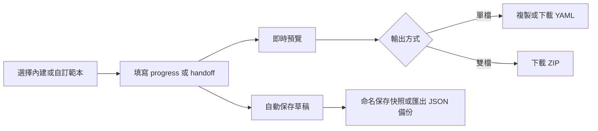

### YAML 欄位規範

**`progress.yaml`（長任務進度狀態機）**

```yaml
project: "agent-yaml-maker"                # 專案唯一識別名稱
status: "in_progress"                      # pending | in_progress | paused | completed | failed
current_phase: "phase_2_core_development"  # 當前階段識別名稱
updated_at: "2026-09-26T12:00:00.000Z"     # ISO-8601 時間戳記

milestones:                                # 階層式里程碑清單
  - id: 1
    name: "核心支付閘道串接"
    status: "in_progress"                  # pending | in_progress | completed | blocked
    completed_at: ""                       # 完成時自動填入 ISO 時間戳記
    tasks:                                 # 具體子任務 Checklist
      - task: "撰寫 Webhook 簽名驗證"
        status: "completed"                # pending | in_progress | completed | blocked
      - task: "實作冪等性交易快取"
        status: "in_progress"

artifacts:                                 # 關鍵產出檔案清單
  - path: "src/services/payment.py"
    description: "支付主處理器與回調驗證邏輯"

blockers:                                  # 阻礙與風險清單
  - issue: "第三方測試沙盒網路偶發逾時"
    severity: "medium"                     # low | medium | high | critical
    status: "investigating"                # investigating | blocked | resolved
```

**`handoff.yaml`（跨 Session／跨 Agent 移交工單）**

```yaml
handoff_id: "handoff-20260926-7f8a9b"      # 唯一交接單號
timestamp: "2026-09-26T12:00:00.000Z"      # 交接時間戳記
from_agent: "ArchitectAgent"               # 交付方角色
to_agent: "BackendDeveloperAgent"          # 接收方角色
reason: "系統架構審查完畢，交接進入編碼實作階段"

summary_of_work:                           # 已完成之關鍵工作條列
  - "完成系統架構設計與 API 規格草擬"
  - "定義資料庫 Schema 與安全存取邊界"

key_decisions:                             # 關鍵架構決策（防止後續 Agent 擅自推翻或重做）
  - "採用非同步事件隊列處理高並發 Webhook"
  - "敏感參數一律由 Vault 動態注入，禁止寫入環境設定檔"

next_steps:                                # 接手者優先執行清單
  - priority: 1                            # 數字越小優先度越高 (1~10)
    action: "依據 payment_spec.md 實作支付 Webhook 接收端點"
    target_files:
      - "src/webhooks/signature.py"
      - "src/webhooks/router.py"

constraints_and_notes:                     # 邊界約束與注意事項
  - "必須維持向前相容性，不可修改既有交易欄位型態"
  - "單元測試覆蓋率需高於 85%"
```

內建範本包含軟體開發、數據 ETL、資安合規與空白模板四種，可一鍵複製為自訂複本。

### 提示詞整合範例

可直接在給 AI Agent 的 Prompt 中要求遵循此規範：

```markdown
每次對話或任務執行前後，請嚴格遵守專案狀態機規範：
1. 讀取根目錄下的 `progress.yaml` 確認當前階段與 Milestone Checklist。
2. 任務執行完畢時，更新 `progress.yaml` 中的 tasks 狀態與 artifacts。
3. 若需切換 Session 或移交給下一位 Agent，請生成或更新 `handoff.yaml`，
   固定關鍵決策並列出接手者的 next_steps。
```

## Prompt Studio 結構化提示詞工作台

Prompt Studio 是單檔的結構化提示詞工程工作台：把提示詞拆成「情境、目標、受眾、格式」等模組化區塊個別填寫，即時組裝成標準 Markdown，並提供字元數、預估 Token 與結構區塊統計。內建 CO-STAR、CRISPE、RTF、TAG、APE、CARE、ROSES、TRACE、GRADE 與簡約三段式共 10 種經典框架，可隨任務切換。

### 組裝提示詞

1. 開啟 [`prompt-studio.html`](./agent/prompt-studio/prompt-studio.html)。
2. 在「請輸入提示詞專案名稱」欄填寫專案名稱，再從編輯區上方的「快速切換提示詞框架」或左側「常用框架 (10)」選單挑選框架。
3. 依框架顯示的結構欄位（例如 CO-STAR 的情境背景、明確目標、表達風格、語氣基調、受眾輪廓與輸出格式）逐欄輸入內容。
4. 右側「組裝結果預覽 (Markdown)」會即時產生提示詞，下方並顯示總字元數、預估 Tokens 與結構區塊數。
5. 按「一鍵複製」將組裝後的提示詞複製到剪貼簿。

### 動態變數與版本管理

- 在任一欄位以雙大括號撰寫變數，例如 `{{產品名稱}}`、`{{targetAudience}}`，支援中文、英文與底線；工具會自動抽出「偵測到動態變數」填空欄位，填入替換值後右側預覽即時更新。
- 上方「使用說明」彈窗提供變數語法與結構化提示詞四部曲說明，並可按「載入動態變數範例」直接體驗 CARE 框架的多變數範本。
- 按「儲存版本」會將目前內容寫入 IndexedDB 並產生 `v1.0`、`v2.0` 版本快照；可用右側「歷史版本快照」下拉選單還原任一版本。
- 左側「我的提示詞」列出已儲存專案，可切換載入或刪除（刪除會一併移除其版本歷史）；按「新增專案」開啟空白提示詞。
- 左下角垃圾桶按鈕會清空 IndexedDB 中的所有提示詞與歷史記錄，執行前請先確認。

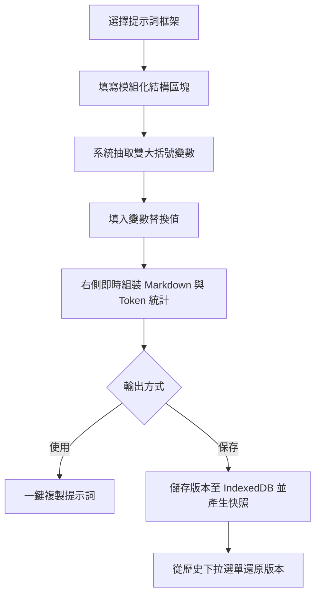

本工具從 CDN 載入 Tailwind CSS 與 Font Awesome 圖示，首次開啟需保持網路連線。所有提示詞、變數與版本快照只保存在目前瀏覽器的 IndexedDB（資料庫名稱 `PromptStudioDB`，object stores：`prompts`、`versions`），不會上傳至任何伺服器；換瀏覽器、使用無痕視窗或清除網站資料後可能無法取得，重要提示詞請先複製保存。

## 動態甘特圖與專案倒數看板

### 建立專案與任務

1. 開啟 [`dynamic_gantt_project_countdown.html`](./docs/project-gantt/dynamic_gantt_project_countdown.html)。
2. 按「新增專案」，輸入專案名稱與簡述，再按「確認儲存」。
3. 按「新增任務」，填寫任務名稱、開始日期、截止日期、負責人、狀態與完成進度。
4. 交付節點若要顯示在上方倒數區，勾選「設為重大里程碑」。
5. 按「儲存」後，可在甘特圖查看排程；點擊既有任務可編輯或刪除。

開始日期不得晚於截止日期。狀態設為「已完成」會將進度設為 100%；進度拉到 100% 也會自動改為已完成。

### 查看與篩選排程

- 以專案選單切換工作區，倒數卡片與甘特圖會同步更新。
- 用「日檢視」或「週檢視」調整時間軸密度。
- 用狀態篩選器查看未開始、進行中、已完成或已延遲的任務。
- 按「回到今天」將時間軸捲回目前日期附近。

### 備份與還原

- 「匯出備份」會下載包含所有專案與任務的 JSON 工作區檔案。
- 「匯入資料」可還原目前工具匯出的多專案備份，也相容舊版單專案任務陣列。
- 完整工作區匯入會清除目前專案與任務，再寫入備份內容。
- 「全部重設」會永久清除所有專案、任務、里程碑與甘特圖排程，並建立一個空白預設專案；執行前請先匯出備份。

### 甘特圖使用流程

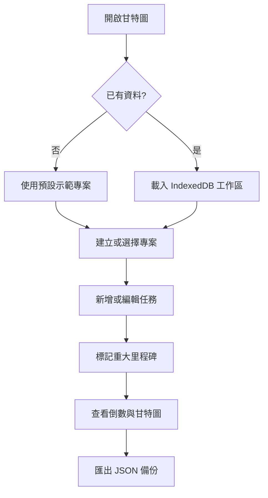

## WBS 甘特排程器

WBS 甘特排程器（離線版）是單檔、純離線的專案排程工具，以工作分解結構（WBS）搭配任務清單、工期與前置相依，推算每個任務的開始與結束日，並自動跳過週末與假日、計入補班日，最後繪製出逐日甘特圖。支援多專案管理與回收區，所有資料都存放在瀏覽器的 IndexedDB，不會上傳。

### 建立專案與任務

1. 開啟 [`wbs-gantt.html`](./docs/wbs-gantt/wbs-gantt.html)；首次載入會建立一個「範例專案」。
2. 上方工具列可切換「專案」、以「＋ 新增專案」建立新專案，並設定「專案起日」作為排程的最早起點。
3. 按「＋ 新增任務」逐列填寫 WBS 編號、任務名稱、工期（工作天）、前置ID、指定起日與負責人；工期 `0` 代表里程碑，畫面上以橙色 ◆ 標示。
4. 有前置任務時，會從前置任務結束日的「次一工作天」開始；「指定起日」為「不早於」（not earlier than）限制，不會早於該日。
5. 「更多 → 專案管理」可重新命名專案、刪除專案（移至回收區）或開啟「回收區」還原與永久刪除。

### 假日、補班日與行事曆

- 右側「假日」清單每行一個日期（`yyyy-mm-dd`）；「補班日」代表週末需上班的日期；「週六日休息」勾選與否決定週末是否計為工作日。
- 日期格式支援 `2026-10-26`、`2026/10/26`、`20261026` 等；檔案的 UTF-8／Big5 會自動判斷。
- 「📂 匯入假日檔」支援政府行政機關辦公日曆表 CSV（含「是否放假」欄）、純文字／CSV（每行含日期即視為假日，含「補班」則視為補班日）與 JSON（`{"hol":[...],"work":[...]}` 或日期陣列）；匯入時可選擇合併或取代現有清單。

### 排程計算與甘特圖

- 任務表右側的「開始」「結束」欄會即時計算；下方摘要顯示整體起始、結束日期與工作天數，並標示循環相依或前置ID錯誤的筆數。
- 甘特圖以逐日格線呈現，藍色為任務、橙色為里程碑、綠色為補班日、紅色為假日、灰色為週末，並以紅色外框標示「今天」。
- 若出現「循環相依」或「前置ID錯誤」，請檢查前置ID是否指向不存在的任務或形成迴圈。

### 匯出與備份

- 「匯出 Excel(CSV)」下載含 ID、WBS、任務名稱、工期、前置ID、負責人、開始與結束的 CSV（含 BOM，Excel 可直接開啟）。
- 「匯出目前專案 JSON」下載單一專案內容；「備份全部專案」下載所有專案的備份檔（`wbs_projects_backup.json`）。
- 「匯入 JSON」可還原單一專案或全部專案備份；「匯入 Excel(CSV)」依標準欄位新增一個專案。
- 「重設目前專案」會將目前專案的任務與排程設定還原為預設值；「回收區」的永久刪除無法復原。

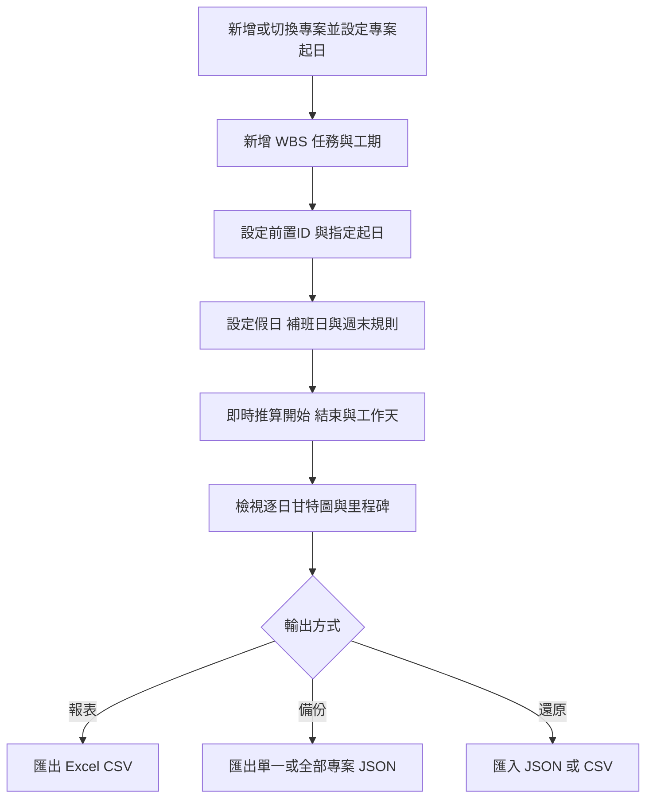

本工具完全離線，不使用任何 CDN 或外部函式庫；資料保存在目前瀏覽器的 IndexedDB（資料庫名稱 `wbsGanttDB`，object store `kv`），並以 CSV／JSON 匯出備份。排程結果為工作天推算輔助，正式專案時程仍應依團隊行事曆與資源配置人工確認。

## 專案時程暨處理流程紀錄系統

專案時程暨處理流程紀錄系統是單檔、純離線的專案追蹤工具，以「專案 → 事件 → 處理流程」三層結構管理時程，並提供列表、甘特圖與月曆三種檢視。每個事件可指派提出人與處理人員，設定狀態、優先度、標籤與提醒天數，並逐筆累積處理歷程、附件與參考連結。所有資料都存放在瀏覽器的 IndexedDB，不會上傳。

### 建立專案與事件

1. 開啟 [`project-tracker.html`](./docs/project-tracker/project-tracker.html)；首次使用可按畫面中央的「載入範例資料」快速瀏覽示範，或按「＋ 新增專案」建立自己的專案（也可用「⬆ 匯入專案」帶入先前匯出的檔案）。
2. 專案欄位包含名稱、代號、狀態、開始／結束日期、代表色與說明；左側清單可依狀態或關鍵字篩選，並以進度條顯示完成率與逾期件數。
3. 進入專案後按「＋ 新增事件」，填寫標題、狀態、優先度、開始／截止日、提出人、處理人員、說明、標籤與提醒天數。
4. 專案頁上方可切換「☰ 列表」「▤ 甘特」「▦ 月曆」三種檢視，並以狀態、處理人員、截止日區間與關鍵字篩選；列表標題可點擊排序，逾期與即將到期的事件會以顏色標示。

### 處理流程紀錄與附件

- 事件詳情提供「處理流程」分頁，可逐筆新增流程紀錄（紀錄日期、處理人員、內容與狀態變更），以時間軸形式保留事件的處理歷程。
- 「附件」分頁可拖曳上傳檔案（內容存放於 IndexedDB），或記錄本機路徑／超連結（例如 `C:\Docs\規格書.docx`、`\\server\share\專案A\`、`https://…`），並可複製路徑、開啟或下載檔案。
- 專案刪除採二次確認，並會串聯刪除其事件、處理歷程、附件與提醒紀錄；刪除前建議先匯出備份。

### 提醒與行事曆

- 每個事件可設定提醒天數（預設 7／3／1 天）；網頁開啟時會自動檢查逾期與即將到期事件（每 30 分鐘一次，切回分頁時也會檢查），頁首會顯示未讀提醒數。
- 提醒中心可將單一事件或全部未完成事件匯出為 `.ics` 行事曆檔，匯入 Outlook 後由 Outlook 負責提醒（關閉網頁後不會主動提醒）；也可用「寄提醒信」以 Outlook 開啟預填郵件。
- 專案頁的「📅 .ics」按鈕可匯出該專案未完成事件的到期提醒。

### 人員管理與匯出入

- 「👥 人員」維護姓名、公司、部門、Email、電話、備註與啟用狀態，供事件指派提出人與處理人員。
- 人員清單可用「⬇ 匯出 CSV」（含 BOM，Excel 可直接開啟）與「⬆ 匯入 CSV」批次維護。
- 「⚙ 設定／備份」提供「💾 匯出全部（JSON，含附件）」整庫備份，以及「匯入備份」（可選合併或覆蓋）；單一專案可在專案頁按「💾 匯出專案」下載，再以「⬆ 匯入專案」選擇建立為新專案或取代同 ID 專案還原。

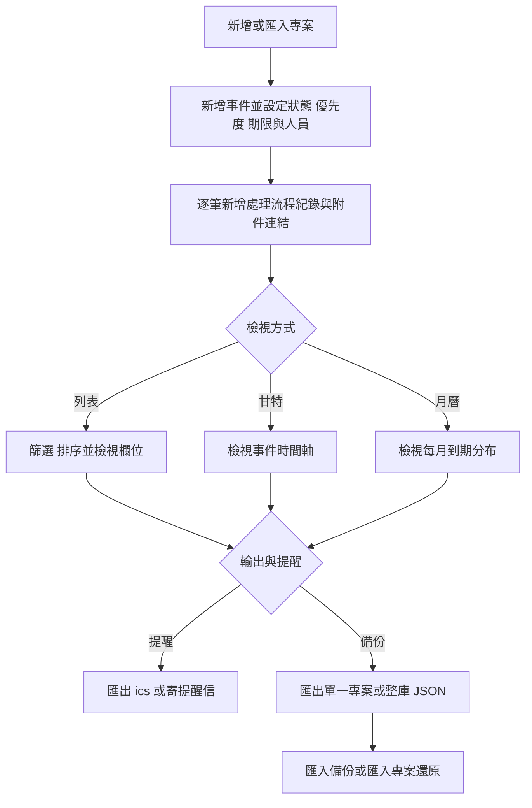

本工具完全離線，不使用任何 CDN 或外部函式庫；資料保存在目前瀏覽器的 IndexedDB（資料庫名稱 `ProjectTrackerDB`，object stores：`projects`、`persons`、`events`、`processLogs`、`attachments`、`reminderLogs`、`settings`）。若瀏覽器不支援 IndexedDB，頁面會提示改用 Chrome 或 Edge，且資料僅保留於目前頁面。換瀏覽器、使用無痕視窗或清除網站資料後資料可能無法取得，重要內容請定期以「匯出全部」保存備份。

## 離線速記便箋

離線速記便箋（Offline Scratchpad）是單檔、100% 離線的便箋與筆記工具，以卡片牆管理便箋，支援標籤、全文搜尋、置頂與卡片配色，內建 Markdown 編輯、雙欄即時預覽與字數統計；可將內容備份為 JSON 或匯出 Markdown。所有資料都存放在瀏覽器的 IndexedDB，不會上傳。

### 新增與管理便箋

1. 開啟 [`scratchpad.html`](./docs/scratchpad/scratchpad.html)。
2. 按右上「新增便箋」（或 `Ctrl+N`）開啟編輯視窗，輸入標題、標籤與內容。
3. 在編輯視窗可切換「編輯模式」、「雙欄即時預覽」與「Markdown 預覽」三種檢視；底部顯示字元、詞數與預估閱讀時間。
4. 編輯視窗上方可選擇卡片顏色（預設／琥珀／翠綠／天藍／紫／玫瑰）、置頂便箋，或將便箋「移至回收筒」。
5. 便箋卡片可置頂顯示於最前方；標籤列可點選篩選，搜尋框（或按 `/` 聚焦）可對標題、內文與標籤做全文搜尋。

### Markdown 與圖片

- 內容支援 Markdown 語法，雙欄模式會即時渲染預覽。
- 可直接拖曳或 `Ctrl+V` 貼上截圖，圖片會嵌入便箋內容。

### 匯出、備份與還原

- 右上選單「匯出備份 (JSON)」下載全部便箋的 JSON 備份；「匯入備份 (JSON)」可還原先前備份。
- 「批次匯出全部 Markdown」將所有便箋匯出為 Markdown；單一便箋也可在編輯視窗匯出 Markdown。
- 「清空資源回收筒」會永久刪除回收筒中的便箋，執行前請先確認。

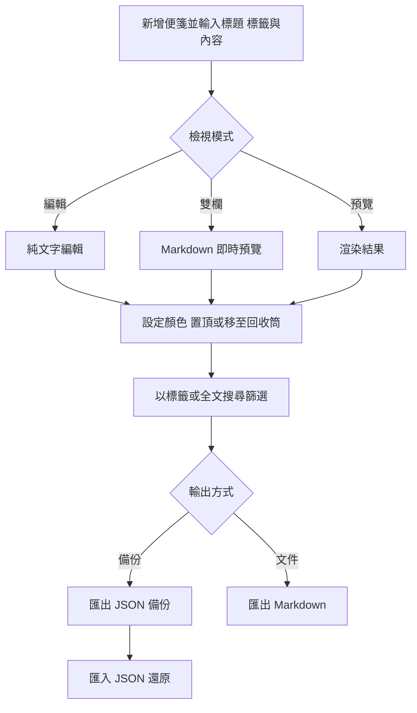

本工具完全離線，不使用任何 CDN 或外部函式庫。便箋與介面設定（含深／淺色主題）保存在目前瀏覽器的 IndexedDB（資料庫名稱 `OfflineScratchpadDB`，object stores：`notes`、`settings`）；換瀏覽器、使用無痕視窗或清除網站資料後資料可能無法取得，重要內容請使用「匯出備份 (JSON)」或匯出 Markdown 保存。

## 臺灣 LCR Mapping 與試算

### 進行試算

1. 開啟 [`LCR_Mapping_SPA.html`](./finance/lcr-mapping-calc/LCR_Mapping_SPA.html)。
2. 在「試算」頁的「HQLA 輸入」填入已完成法規上限調整後的合格高品質流動性資產總額。
3. 從業務下拉選單選擇項目，輸入餘額後按「加入明細」。係數會依 Mapping 自動帶入。
4. 在明細表檢查方向、係數與金額；不需要的項目可按刪除。
5. 查看計算結果中的總預期現金流出、總預期現金流入、可認列流入、淨現金流出、HQLA 與 LCR。

「載入示範資料」可快速填入範例；「清空明細」只會清除目前頁面的試算明細。可在「參數」頁調整 LCR 最低標準與流入認列上限。

### 查詢 Mapping 與公式

- 「Mapping 表」可用關鍵字搜尋，並依流出／流入方向及業務大類篩選。
- 「參數」頁列出預設的 LCR 最低標準 100%、流入認列上限 75%，以及第二層資產 40%、第二層 B 級 15% 的限制說明。
- 「使用說明」頁列出公式與適用限制：`LCR = HQLA ÷ 30 日淨現金流出 × 100%`。

本工具是 Mapping 摘要與試算輔助，不取代主管機關完整條文、附錄、申報表格或正式法遵判定。複合性產品仍須依對手、剩餘期間、擔保品、可取消性與重複列計規定逐案判斷，使用前請確認相關函令是否更新。

## 臺灣 NSFR 淨穩定資金比率與試算

### 進行試算

1. 開啟 [`NSFR_Mapping_SPA.html`](./finance/nsfr-mapping-calc/NSFR_Mapping_SPA.html)。頁面分成「試算」「Mapping 表」「參數」「使用說明」四個分頁。
2. 在「試算」頁的「加入明細」下拉選單選擇 ASF（可用穩定資金）或 RSF（應有穩定資金）項目，輸入帳面金額後按「加入明細」。係數會依 Mapping 自動帶入。
3. 在明細清單檢查方向、大類、係數與加權金額；可直接修改金額，或按刪除移除不需要的項目。
4. 查看計算結果中的可用穩定資金（ASF）、應有穩定資金（RSF）、淨穩定資金比率（NSFR）與資金缺口（ASF － RSF）。

「載入示範資料」可快速填入範例；「清空明細」只會清除目前頁面的明細。可在「參數」頁調整 NSFR 最低標準與內部警示門檻。

### 查詢 Mapping 與公式

- 「Mapping 表」列出全部 ASF（13 項）與 RSF（27 項）係數，可用關鍵字搜尋，並依 ASF／RSF 方向及大類篩選各項目之判斷條件與係數。
- 「參數」頁列出預設的 NSFR 最低標準 100%，以及僅供提醒使用的內部警示門檻 110%。
- 「使用說明」頁列出公式與適用限制：`NSFR ＝ 可用穩定資金（ASF） ÷ 應有穩定資金（RSF） × 100%`。

本工具是 NSFR 係數對照與試算輔助，不取代主管機關完整條文、附錄、申報表格或正式法遵判定。複合性或具選擇權之商品仍須依交易對手、剩餘期間、擔保品、風險權數、受限制狀態及是否重複列計逐案判斷；同一項目符合兩個以上類別時，應適用較高係數且不得重複計算；表外暴險、衍生性商品淨額與相互依存項目之計算較為複雜，正式申報前請回歸主管機關計算表逐項核對，並確認相關函令是否更新。係數表依金管會民國 105 年 12 月 26 日金管銀法字第 10510005801 號令訂定之版本整理；示範資料僅為操作示意，非任何實際機構資料。

### 資料保存與備份

- 明細與參數變更後會自動保存為草稿；「試算情境」可將目前明細命名後保存於瀏覽器本機（IndexedDB，資料庫名稱 `nsfr-mapping-calc`），可載入、刪除。
- 「匯出備份（JSON）」會下載包含參數、目前明細與所有情境的 `nsfr_backup_YYYYMMDDHHmmss.json`；「匯入備份（JSON）」可選擇合併或覆寫情境後還原。
- 換瀏覽器、使用無痕視窗或清除網站資料後，本機保存的資料可能無法取得，建議定期匯出備份。

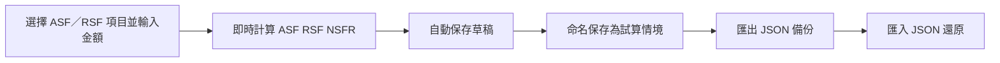

## 銀行信用風險與資本適足模擬器

此工具以資產組合參數推演不同信用壓力下的預期損失（EL）、風險性資產（RWA）與資本適足率（CAR），並提供情境比較矩陣。模型數值供情境分析與敏感度觀察，不是正式監理計算或申報結果。

### 設定資產組合與壓力情境

1. 開啟 [`bank_credit_risk_capital_adequacy_simulator.html`](./finance/basel-creditrisk-calc/bank_credit_risk_capital_adequacy_simulator.html)。
2. 輸入合格自有資本淨額、法定最低 CAR 門檻與現有提存備抵呆帳準備金。
3. 選擇「基準常態」、「經濟景氣趨緩」或「系統性金融風暴」，也可調整 PD、LGD 與 RWA 衝擊滑桿。
4. 按「新增資產組合」，輸入名稱、曝險額（EAD）、基準違約機率（PD）、違約損失率（LGD）與風險權數（RW）；既有組合可編輯或刪除，至少保留一組。
5. 查看即時更新的總覽指標、資產組合圖表、受壓後 EL 與 RWA，以及跨情境敏感度比較矩陣。

### 匯入、匯出與重設

- 按「匯出資產模型」下載目前資本、壓力因子與資產組合資料的 JSON 檔。
- 按「匯入資產模型」選擇先前匯出的 JSON；匯入後會取代目前頁面模型，請先匯出目前資料以保留副本。
- 按「還原預設」會以內建銀行信用資產模型取代目前資料。
- 模型不會自動保存；重新整理或關閉頁面後，未匯出的修改會消失。
- 頁面使用 CDN 載入 Tailwind CSS、Chart.js、Lucide 圖示與 Google Fonts，首次完整使用需能連線至這些資源。

PD、LGD、RW 與情境衝擊假設皆可調整，結果僅供內部估算及敏感度分析。正式風險衡量、資本適足判斷與監理申報，請依適用法規、銀行內部模型及核准流程覆核。

## 大額曝險與關聯戶圖譜速算器

大額曝險與關聯戶圖譜速算器是單檔的集團授信集中度檢核工具，依銀行法第 33 條之 3 的同一人、同一關係人與同一關係企業限額，將關係戶與股權關聯整理成可視化圖譜，並提供即時的法定門檻檢核、What-If 壓力試算與審查底稿輸出。所有計算都在瀏覽器端執行，不會上傳資料。

### 設定集團與關聯戶

1. 開啟 [`large-exposure-analyzer.html`](./finance/large-exposure-analyzer/large-exposure-analyzer.html)；頁面載入時會帶入「半導體」示範案例。
2. 在最上方「本行前一會計年度決算淨值 (Capital / Equity)」輸入核算基準淨值（億元）；上方法定門檻卡與右側計量錶會即時換算 5%、15% 與 40% 上限。
3. 按「集團設定」可調整集團名稱、代碼、所屬產業與行內內部預警比率。
4. 在「關聯戶成員清單」按「新增戶別」，輸入統一編號、戶名、關係身分、無擔保授信與有擔保授信金額（億元）；可用搜尋框過濾戶別，或按「清空」移除全部。
5. 在「實質控制與股權關聯」按「建立連結」，指定來源戶、目標戶、關聯類型與持股比例，建立股權穿透或實質控制關係。

### 關聯圖譜、壓力試算與底稿

- 中間「集團授信關聯圖譜 (Force-Directed Graph)」以 Canvas 力導向圖呈現戶別與關聯；可拖曳節點、滾輪縮放，並以「動力排版」暫停或恢復自動排版、「視野重設」回到初始視角。滑過節點會顯示該戶的無擔保、有擔保與合計曝險。
- 右側「What-If 壓力試算沙盒」可選擇試算對象，以滑桿模擬追加或調降無擔保／有擔保額度，即時顯示該戶模擬後總額、集團新曝險、佔淨值新比率與法規結論；按「套用至正式圖譜」把模擬結果寫回圖譜，「重設」歸零。
- 「法定門檻檢核計量錶」以長條呈現各項門檻使用率；超額時圖面下方會出現紅色警示列，可點「檢視超標明細」跳至稽核底稿。
- 底部「授信個案大額曝險審查稽核底稿 (Audit Sheet)」逐戶列出統一編號、關係身分、無擔保／有擔保／合計曝險、佔淨值比率與法規檢核狀態。
- 按「複製審查備忘錄 (Markdown)」產生含集團背景、限額基準、關聯戶明細與審查結論的底稿；按「匯出案卷 JSON」下載包含淨值、集團設定、戶別與連結的 `bank_exposure_<集團代碼>_<時間>.json` 備份。

### 匯入 CSV 與案例切換

- 按上方「匯入 CSV」可批次載入關聯戶資料，支援 Big5／CP950／UTF-8 等繁體中文編碼，也可將檔案拖放至對話框；對話框提供「下載範例 CSV」作為欄位範本。
- 案例按鈕可快速切換「半導體」「傳產家族」與「超額警戒」三種示範情境。
- 右上角可切換深／淺色外觀，主題偏好會保存在瀏覽器 `localStorage`。

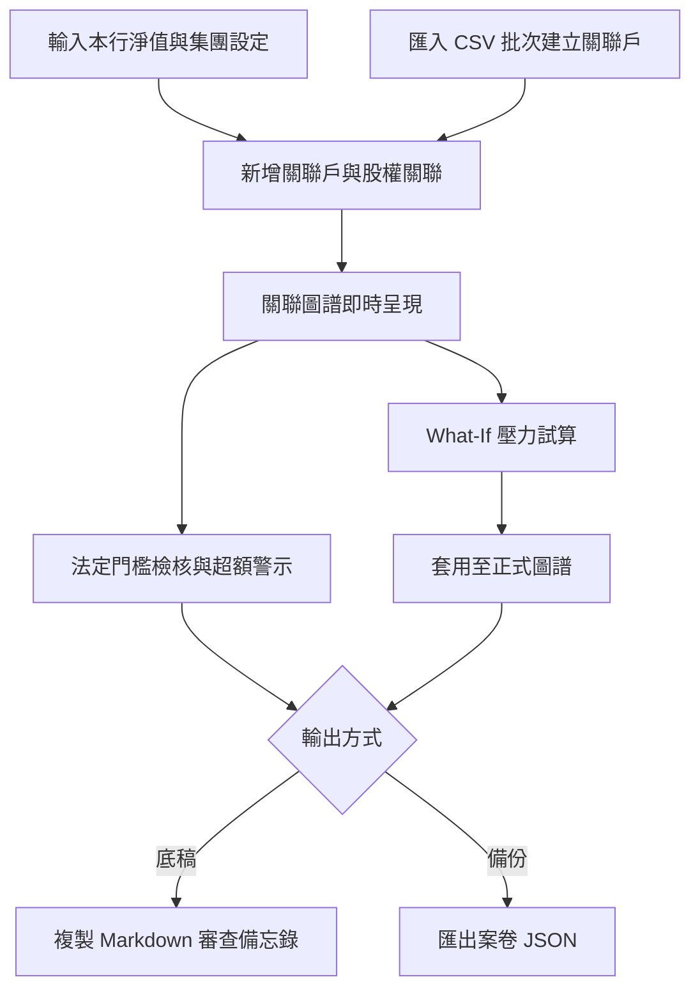

本工具使用 CDN 載入 Tailwind CSS 與 Google Fonts，首次開啟需保持網路連線。集團案卷僅保留在目前頁面記憶體，不使用 IndexedDB；重新整理或關閉頁面後需重新輸入或重新匯入。目前提供案卷 JSON 匯出但未提供 JSON 匯入，若要延續前次作業請以 CSV 重新載入戶別資料。法定限額與比率僅為試算輔助，正式授信核准仍應依銀行法、主管機關規定與內部授信政策逐案覆核。

## 金融金額中文大寫轉換器

金融金額中文大寫轉換器是單檔、100% 離線的銀行出納小工具：輸入阿拉伯數字金額，畫面會即時產生繁體中文大寫金額，並可切換新臺幣、美金、人民幣、日圓、歐元抬頭或無幣別前綴，另可同時輸出純中文大寫與英文大寫金額。適合開立支票、本票、取款條、存款憑條與內部會計傳票時使用；所有運算都在瀏覽器端完成，沒有外部網路傳輸。

### 轉換金額

1. 開啟 [`chinese-amount-uppercase.html`](./finance/chinese-amount-uppercase/chinese-amount-uppercase.html)。
2. 在最上方「幣別抬頭」下拉選單選擇新臺幣 (NTD)、美金 (USD)、人民幣 (RMB)、日圓 (JPY)、歐元 (EUR) 或「無幣別前綴」。
3. 在「輸入金額 (阿拉伯數字)」欄位鍵入金額（例如 `1234567.89`）；欄位右上方會同步顯示千分位格式，欄位內的清除圖示可一鍵清空。
4. 輸出卡片會即時更新，按卡片上的「複製」按鈕即可將該段文字放入剪貼簿（成功時顯示「已複製！」）。
5. 兩個預設勾選的選項可調整輸出：「結尾加上「整」字」控制金額是否附加「整」；「顯示英文金額」會額外產生英文大寫金額卡片。預設幣別抬頭為新臺幣 (NTD)。

金額需為有效的阿拉伯數字，且不可超過 9999 兆；格式不符或超出上限時，欄位下方會顯示對應提示。

### 幣別抬頭與輸出格式

- **中文大寫金額 (繁體正規防偽)**：主要輸出，依所選幣別加上抬頭（例如「新臺幣」），適用於銀行支票、本票、取款條、存款憑條與內部會計傳票。
- **純中文大寫 (無幣別抬頭)**：不含幣別前綴，適用於表單已預印「新臺幣」或特殊表格欄位；選擇「無幣別前綴」時不重複顯示。
- **英文大寫金額 (English Words)**：預設即會顯示（可取消「顯示英文金額」隱藏），適用於外匯水單、信用狀 (L/C) 與國際貿易匯款 (TT)。

### 快速累加與快捷鍵

- 「快速累加」提供 `+1萬`、`+5萬`、`+10萬`、`+50萬`、`+100萬` 與 `+1000萬` 按鈕，可連續點擊疊加金額；右側「清除 (Esc)」可快速歸零。
- 「常用驗證案例」提供 `10 (壹拾元)`、`10,005 (零伍)`、`1 億元` 與 `角分測試` 四個範例，方便快速核對輸出規則。
- 在任何時候按 `Esc` 可清空目前輸入。

### 防偽書寫重點

畫面下方的「臺灣金融業大寫書寫與防偽重點說明」整理四項常見規範：正字大寫防變造（一律使用「壹、貳、參、拾」）、「壹拾」規範（十元須寫「壹拾元整」）、「整」字用法（無角分或僅有角而無分時加註「整」），以及連續零處理（多個零連續出現時依法僅書寫一個「零」）。

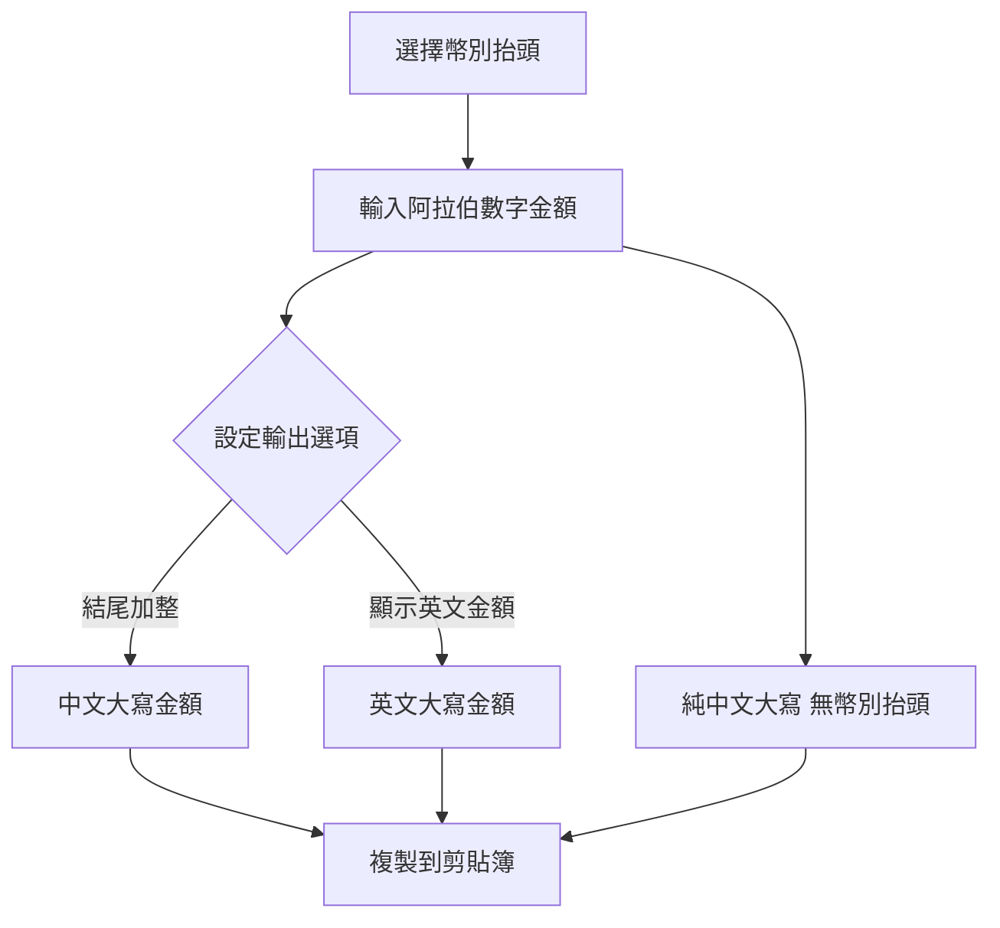

本工具完全離線，不使用任何 CDN、外部函式庫、IndexedDB 或 `localStorage`；金額與輸出只保留在目前頁面記憶體，重新整理或關閉頁面後需重新輸入。大寫轉換結果為輔助格式，正式票據與傳票開立前仍應依行內規範與主管機關規定人工覆核。

## 銀行核心系統固定長度電文解析與管理中心

銀行核心系統固定長度電文解析與管理中心（Core-Host Fixed-Width Parser）是單檔的銀行核心主機電文工具，用來把財金、核心帳務等系統輸出的固定長度（fixed-width）字串，依電文規格逐欄拆解，或反向由欄位值組裝回標準電文。工具內建財金跨行轉帳（FISC 0100）與核心活存存提交易日誌兩組範例規格，並可自行新增、修改、複製與刪除規格；所有解析與換算都在瀏覽器端完成，不會上傳電文內容。

### 電文解析 (Parser)

1. 開啟 [`fixed-width-telegram-parser.html`](./finance/fixed-width-telegram-parser/fixed-width-telegram-parser.html)。
2. 在上方「目前電文規格 (Schema)」選擇要套用的規格，右側會顯示該規格的總長度（Bytes）。
3. 在「原始電文輸入 (RAW Telegram)」貼上電文，支援每行一筆的多筆批次；也可按「載入範例」帶入示範電文，或按「清空」清除。
4. 「中文編碼計算法」可切換 Big5（繁體中文常用 2 Bytes）、UTF-8 或 Pure ASCII，游標字元數與位元組長度會即時更新，並比對是否符合規格總長度。
5. 按「執行拆解解析」後，「欄位解析明細與檢核結果」會依規格逐欄列出內容、長度、型別與備註。解析結果可「匯出 JSON」、「匯出 CSV」，或「儲存至歷史庫」保存至瀏覽器 IndexedDB。

### 反向組裝 (Builder)

- 切換至「反向組裝 (Builder)」分頁，工具會依目前規格產生各欄位輸入框；填入數值後即時預覽組裝結果。
- 系統會依欄位設定的對齊方式、填補字元與長度自動靠左／靠右補空白或補零，並以位元組計量顯示「已用 / 總長度 Bytes」。
- 超出欄位長度時會依編碼邊界自動截斷；按「複製電文」可複製組裝後的字串，「重設表單」可清空輸入。

### 規格管理 (CRUD & CSV)

1. 切換至「規格管理 (CRUD & CSV)」分頁，可檢視所有已儲存的規格，並以卡片快速切換目前規格。
2. 按「建立新規格 (Create)」新增規格，填寫規格代號、名稱、預設編碼與備註，並在「欄位清單定義」以「插入新欄位」定義欄位代碼、中文名稱、長度（Bytes）、型別（AN／N／CH 等）、對齊方式、填補字元與備註；按「儲存規格變更 (Update)」寫回 IndexedDB。
3. 「複製當前規格」可快速衍生新規格；「刪除此規格 (Delete)」會先在確認後自 IndexedDB 永久移除。
4. 「匯出規格 CSV」可下載規格書；「匯入 CSV 規格書」支援自動偵測或強制指定 Big5／CP950、Big5-HKSCS、UTF-8、UTF-16LE 與 GBK 等編碼，處理 Excel 或主機匯出的中文亂碼；另提供「下載標準 CSV 範本」作為欄位格式參考。

### 歷史紀錄

- 「歷史紀錄」分頁列出儲存於瀏覽器的解析紀錄，含儲存時間、所屬規格、原始電文摘錄與筆數／長度。
- 每筆紀錄可「還原」至解析結果面板，或「刪除」單筆；按「清空歷史儲存」可移除全部紀錄。

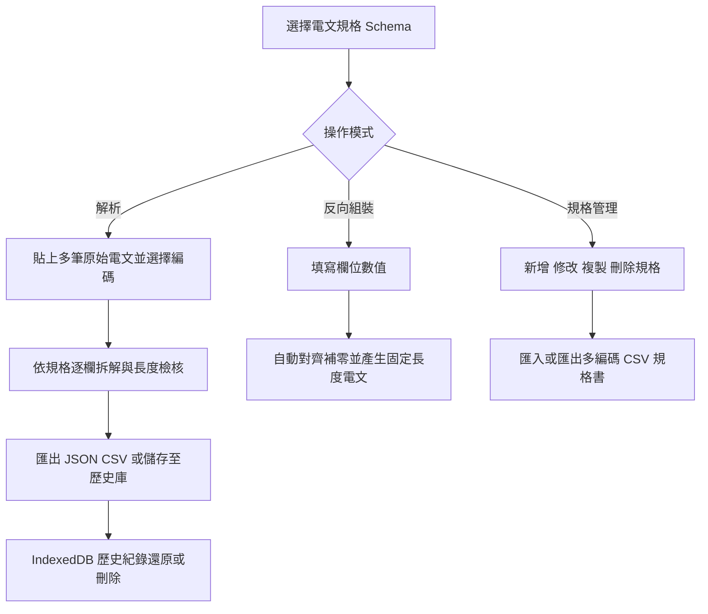

本工具從 CDN 載入 Tailwind CSS 與 Font Awesome 圖示，首次開啟需保持網路連線。電文規格與解析歷史保存在目前瀏覽器的 IndexedDB（資料庫名稱 `BankTelegramParserDB`，object stores：`schemas`、`history`）；換瀏覽器、使用無痕視窗或清除網站資料後，資料可能無法取得。位元組長度以 Big5／UTF-8 常用規則估算，若電文使用特殊轉義或非典型編碼，解析結果仍需與主機規格書人工比對。

## 核心系統與電文錯誤碼排查對照台

核心系統與電文錯誤碼排查對照台是單檔的銀行錯誤碼知識庫與排查工作台，集中整理核心主機、財金跨行（FISC）、SWIFT、票據交割（ACH）與核心批次等系統的錯誤碼、回應碼與拒絕原因，並為每個代碼附上詳細原因、維運處置 SOP、對客標準回覆話術與權責窗口。可透過 Excel 批次匯入既有錯誤碼清單，或直接在畫面上維護；所有資料都存放在瀏覽器的 IndexedDB，不會上傳。

### 查詢與檢視錯誤碼

1. 開啟 [`bank-error-code-resolver.html`](./finance/bank-error-code-resolver/bank-error-code-resolver.html)；首次載入會帶入財金、SWIFT、核心批次與票據等示範資料。
2. 在搜尋框輸入代碼（例如 `4001`、`AC01`）、電文名稱、錯誤原因、SOP 或權責窗口等關鍵字，清單會即時跨欄位比對並更新「符合篩選」筆數。
3. 使用「系統類別」與「嚴重度」下拉選單（FATAL／ERROR／WARN／INFO）縮小範圍。
4. 點選左側清單任一列，右側「詳細原因描述」、「維運處置 SOP (Runbook)」、「對客標準回覆話術」與「權責窗口」會同步顯示。
5. 按話術區的「複製話術」可將對客說明放入剪貼簿。

### 新增、編輯與 Excel 匯入匯出

- 按頁首「新增代碼」開啟表單，或點右側詳情卡的編輯圖示修改目前代碼；刪除圖示會先確認再自 IndexedDB 永久移除該筆。
- 按「匯入 Excel」可上傳 `.xlsx`、`.xls` 或 `.csv`；工具會辨識中文或英文欄位標題，遇到未知系統會自動建立類別。確認預覽筆數後按「確認寫入資料庫」。
- 頁首「下載範本」或匯入視窗的「下載匯入範本檔」可取得標準 Excel 範本；「資料庫維護」（齒輪圖示）可「匯出完整資料為 Excel」、「重設為銀行預設範例庫」或「清空本機所有錯誤碼」。

### 系統類別管理

- 按頁首「系統類別管理」可新增、編輯或刪除系統類別（識別 Key 與顯示名稱）。
- 已有代碼歸屬的類別會限制刪除，以避免資料失去關聯；類別異動後，篩選選單與匯入對應會即時更新。

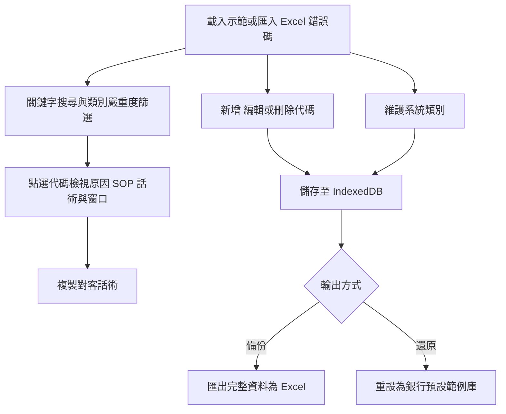

本工具從 CDN 載入 Tailwind CSS、Phosphor Icons 與 SheetJS（xlsx），首次開啟需保持網路連線。錯誤碼與系統類別保存在目前瀏覽器的 IndexedDB（資料庫名稱 `BankErrorCodesDB`，object stores：`error_codes`、`system_categories`）；換瀏覽器、使用無痕視窗或清除網站資料後，資料可能無法取得，重要資料請先匯出 Excel 備份。內建 SOP 與話術為示範內容，正式維運與對客回覆仍應依行內最新作業規範與核准口徑覆核。

## SQL Catalog

SQL Catalog 是單檔離線 SQL 檔案管理工具，用來建立 SQL 檔案目錄、搜尋內容並補充用途、分類、標籤與後續待辦。它只讀取與管理索引說明，不會修改 SQL 原始檔。

### 開啟目錄與掃描

1. 開啟 [`SQL_Catalog.html`](./sql/sql-catalog/SQL_Catalog.html)。
2. 按「選擇目錄」，選取 SQL 根目錄並允許編輯權限。
3. 工具會遞迴掃描子資料夾中的 `.sql` 檔案，並在根目錄建立或讀取 `sql_catalog.json`。
4. 點選清單中的 SQL 檔案，在右側編輯用途、分類、標籤、執行頻率、到期日、後續說明與備註；內容會延遲約 1 秒自動儲存。
5. 若要重新讀取檔案狀態，按「重新掃描」。SQL 內容可在右側唯讀預覽中查看，工具也會自動判斷引用表格與語法類型。

### 搜尋、篩選與匯出

- 搜尋框可查找檔名、路徑、SQL 內容、用途與後續說明；也可依資料夾、標籤、引用表格或語法類型篩選。
- 快速篩選可查看未填用途、本次有異動、待辦逾期、待辦未完成或已遺失的檔案。
- 「批次編輯」可對選取檔案批量套用分類、標籤、頻率、到期日與後續說明；刪除已遺失紀錄前請確認不再需要該索引。
- 「分類／標籤管理」可更名、合併或刪除分類與標籤；「統計」可查看資料夾與 SQL 語法類型分布。
- 「匯出」可下載全部或目前篩選結果的 CSV、Markdown 清冊、HTML 報表與 `sql_catalog.json`；「匯入 JSON（合併）」可合併其他目錄的索引說明。
- 「打包下載」會下載 SQL 原始檔的 ZIP；請先確認檔案內容與敏感資訊的分享範圍。

### 權限與瀏覽器限制

- Chrome／Edge 支援以目錄權限讀取及寫回 `sql_catalog.json`。重新開啟頁面後，可能需要再次授權上次使用的目錄。
- 不支援 File System Access API 的瀏覽器會改用目錄檔案選取，這是唯讀模式；說明只保存於瀏覽器快取，請定期使用「匯出 → 下載 sql_catalog.json」並手動放回 SQL 根目錄。
- 儲存失敗時，工具會將資料保留在目前瀏覽器的 IndexedDB 快取；修復權限後可按「儲存」，或先匯出 JSON 備份。

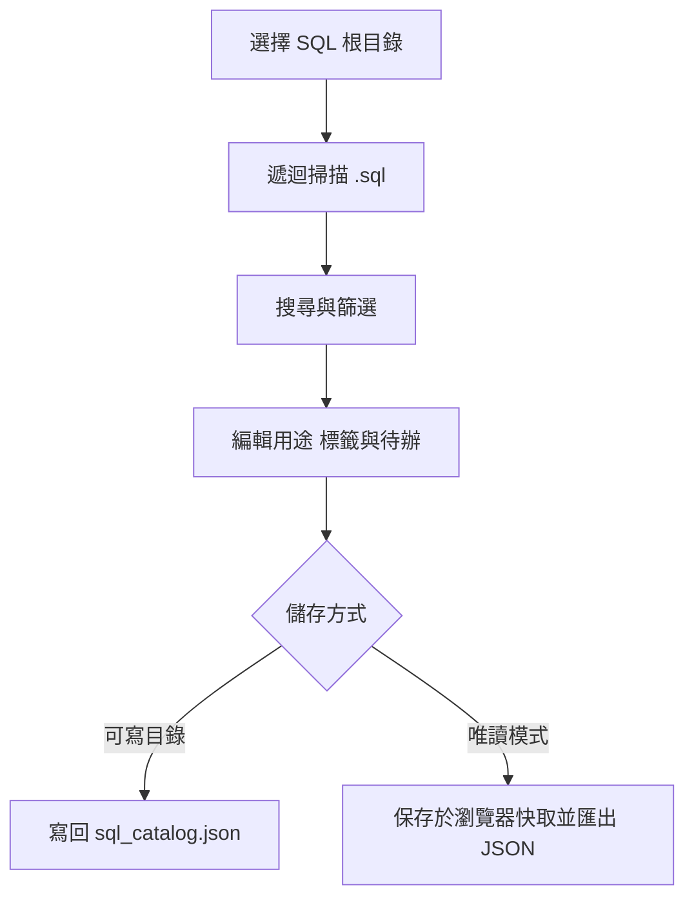

## Oracle SQL Compare

Oracle SQL Compare V2.1 是雙欄、純離線的 SQL 比對工具，適合檢查舊版與新版 Oracle SQL 的程式碼變更。可直接貼上內容、開啟檔案或將檔案拖放至「舊版／新版」窗格；支援 `.sql`、`.txt`、`.pks`、`.pkb`、`.prc`、`.fnc`、`.trg`、`.vw`、`.pls`、`.pck` 等常見副檔名。

### 比對 SQL

1. 開啟 [`sql-compare.html`](./sql/sql-compare/sql-compare.html)。
2. 將舊版 SQL 放入左側、新版 SQL 放入右側；可貼上文字、按「開啟檔案」或拖放檔案。
3. 依需求調整比對選項：忽略大小寫、空白、註解、空行，以及結尾 `;`／單獨一行的 `/`。
4. 按「比對」，在「逐行差異」查看新增、刪除、修改與移動內容。
5. 切換至「結構差異摘要」查看 SELECT、JOIN、欄位、條件、排序、GROUP BY、PL/SQL 或其他敘述的整理結果；摘要位置可點擊跳回逐行差異。

### 結果操作與快捷鍵

- 「並排」適合同時查看舊版與新版；「整合」適合依單一內容順序閱讀。
- 「僅顯示差異」可收合未變更區段；「上一個／下一個」可在差異區塊間巡覽。
- 「複製差異 (Unified)」與「複製結構摘要」會將結果放入剪貼簿；「匯出 HTML 報表」會下載可保存或分享的差異報表。
- `Ctrl+Enter` 執行比對；`F7`／`Shift+F7` 跳至下一個／上一個差異；`Alt+1`／`Alt+2` 切換逐行差異與結構摘要；`Esc` 返回編輯畫面。
- 「交換」可互換舊版與新版；「範例」會載入內建 Oracle SQL 範例；「清除」會移除目前兩側內容。

工具會將比對選項、顯示方式、編碼與目前頁籤保存於目前瀏覽器的 `localStorage`，不會上傳 SQL 內容。檔案讀取支援自動判斷 UTF-8／Big5，也可手動指定編碼；若要保留結果，請使用複製或 HTML 報表匯出。

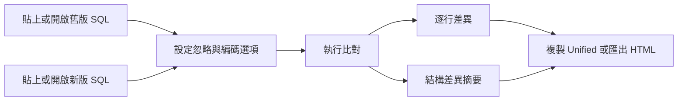

## Oracle SQL Formatter Studio

Oracle SQL Formatter Studio v1.1 是純離線的批次 SQL／PL/SQL 格式化與健檢工具。它會遞迴掃描選定資料夾中的指定副檔名，先在瀏覽器記憶體中產生格式化預覽；只有按下「寫回檔案」並確認後，才會覆寫來源檔案。

### 掃描與格式化預覽

1. 開啟 [`OracleSqlFormatter.html`](./sql/oracle-sql-formatter/OracleSqlFormatter.html)。
2. 在「副檔名」欄確認要處理的副檔名，預設為 `.sql,.pks,.pkb,.prc,.fnc,.vw,.trg`。
3. 按「選擇資料夾」。Chrome／Edge 等支援 File System Access API 的瀏覽器可取得資料夾讀寫權限；其他瀏覽器會進入唯讀相容模式。
4. 調整檔案編碼（自動偵測 UTF-8／Big5、UTF-8 或 Big5）、縮排、識別字大小寫、SQL 關鍵字／函數大小寫與 SELECT／SET 欄位逐行排列。
5. 在左側勾選要處理的檔案，按「格式化預覽」，再從「差異預覽」逐檔檢查格式化前後內容。
6. PL/SQL 檔預設使用安全模式，只調整大小寫與行尾空白；也可選擇略過 PL/SQL，避免改變其版面。

### SQL 健檢

「SQL 健檢」會依檔案逐行列出錯誤、注意與提示，涵蓋 `= NULL`、ROWNUM 與 ORDER BY 同層、LEFT JOIN 被 WHERE 轉為 INNER、無 WHERE 的 UPDATE／DELETE、舊式逗號 JOIN、`&` 未設定 `DEFINE OFF`、PL/SQL 缺少 `/`、全形符號、不可見字元、條件欄位套用函數、`SELECT *`、`NOT IN`、CROSS JOIN、`WHERE 1=1`、高風險 DDL／DCL 與寫死的密碼等規則。

- 可依嚴重度或規則篩選問題，點擊健檢明細跳至檔案位置。
- 健檢規則可個別啟用／停用，也可調整嚴重度；「全部啟用／停用／恢復預設」會立即重新整理結果。
- 若特定行或整個檔案不需要某規則，可在 SQL 加上 `-- sqlfmt:ignore RULE_ID` 或 `-- sqlfmt:ignore-file RULE_ID`；不寫規則代碼則忽略該行或檔案的全部規則。
- 「快速測試」可直接貼上單段 SQL，立即查看格式化結果與健檢問題，不必先選擇資料夾。

### 寫回、還原與匯出

- 「寫回檔案」只會處理已勾選且預覽狀態為「有變更」的檔案。執行前會要求確認；預設先將原始檔案備份到根目錄的 `_sqlfmt_backup/<時間戳>`，完成後可用「還原本次」復原本次寫回的檔案。
- 寫回前請逐檔檢查差異與健檢結果。關閉頁面、重新整理或重新選擇資料夾後，當次「還原本次」資訊不保證保留；備份目錄才是主要復原依據。
- 「匯出 ZIP」會依原相對路徑打包勾選檔案，預覽後可取得格式化副本；唯讀相容模式只能使用此方式，不會修改來源檔案。
- 「匯出報告」會產生 HTML，包含檔案狀態、編碼、變更／失敗統計、健檢規則統計與行號明細。
- 「重新掃描」會重新讀取目前資料夾；工具會略過 `_sqlfmt_backup`、`.git`、`.svn`、`node_modules` 目錄。

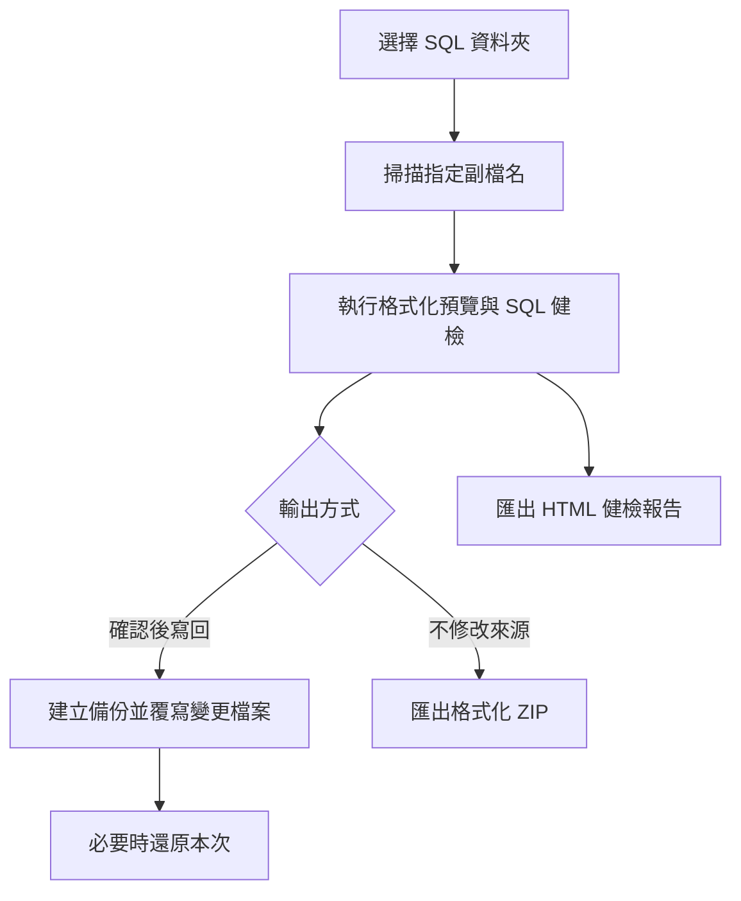

若瀏覽器不支援資料夾直接寫回，工具會使用檔案選取器載入唯讀資料；此時「寫回檔案」不可用，但仍可預覽、健檢、匯出 ZIP 與報告。格式化設定與健檢規則保存於目前瀏覽器的 `localStorage`，SQL 內容與報告均在本機處理。

## SQL／TXT 個資掃描與清除

這個工具會在瀏覽器本機遞迴掃描選定資料夾中的 `.sql` 與 `.txt` 檔案，辨識常見身分證字號、存款帳號、擔保品估價彙整序號／子號與統一編號。畫面上的命中值只會以部分遮罩呈現；工具不會將檔案上傳至外部網站。

### 掃描與檢視命中

1. 開啟 [`sql-pii-cleaner.html`](./sql/sql-pii-cleaner/sql-pii-cleaner.html)。
2. 使用新版 Chrome 或 Edge 按「選擇資料夾（可寫回）」；若瀏覽器不支援資料夾寫入，改用「選擇資料夾（唯讀相容模式）」。
3. 確認身分證、帳號、統編、彙整編號，以及日期／時間排除規則；需要時設定排除資料夾或檔名。
4. 掃描完成後點選檔案，檢查編碼、命中數量與遮罩後的行號前後文。編碼不確定時，可在表格中改選 UTF-8、Big5、GB18030 或 UTF-16 後重新掃描。
5. 勾選要處理的檔案，再選擇寫回、下載清除後 ZIP 或匯出 CSV 報告。

### 掃描項目與選項

工具預設偵測下列格式：

- **身分證字號**：依格式與檢查碼判斷，可選擇是否接受第二碼 `8`、`9`，以及是否忽略大小寫。
- **帳號**：偵測 12～14 位數字；符合 14 位時間格式時，依選項排除。
- **彙整序號**：偵測以 `61` 或 `62` 開頭的 15 位數字。
- **彙整子號**：偵測以 `6` 加英文字母開頭的 15 碼值。
- **統編**：依 8 位格式與檢查碼判斷；符合日期格式 `yyyyMMdd` 時，依選項排除。

可用選項包含身分證檢查碼、含第二碼 8／9、忽略大小寫、排除 14 位時間、統編檢查碼、排除 8 位日期，以及以逗號分隔的「排除資料夾或檔案名稱」（可用 `*` 萬用字元，例如 `_backup_*,.git`）。表格欄位可點選排序；編碼不確定時可於「編碼」欄改選 UTF-8、Big5、GB18030、UTF-16LE 或 UTF-16BE 後重新掃描該檔。

### 清除與安全注意事項

- 「清除勾選檔案並寫回」只在可寫回模式可用；啟用備份時，原始檔會先保存至來源資料夾的 `_backup_YYYYMMDDHHmmss` 目錄，並保留原本的子目錄結構。
- 清除動作會直接移除命中的位元組，不是以固定字元取代；未被引號包住的命中可能造成 SQL 語法錯誤，寫回前務必檢查並保留備份。寫回前工具會檢查檔案是否被其他程式修改，已變更者會跳過並要求重新掃描。
- 「下載清除後 ZIP」不會修改來源檔案，會產生 `sql_cleaned_YYYYMMDDHHmmss.zip`，保留相對路徑與編碼的清除副本。
- 「匯出報告（CSV）」產生 `sql_pii_report_YYYYMMDDHHmmss.csv`，只輸出遮罩後的命中明細與統計，不會輸出完整個資值。大量檔案建議分批處理，避免瀏覽器記憶體不足。

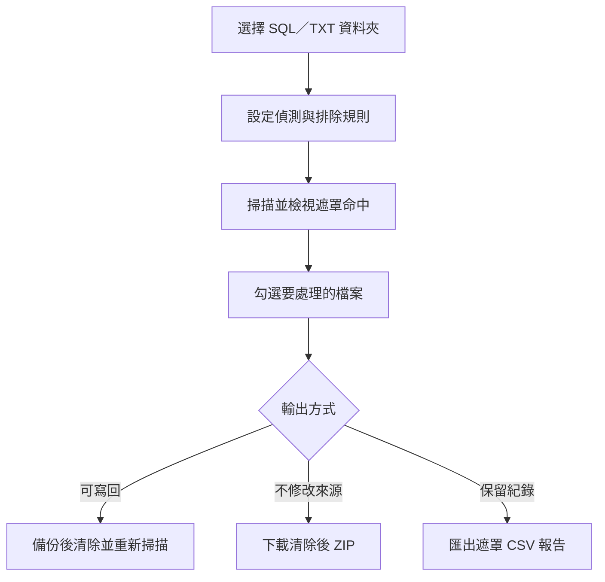

## SQL Column Lineage Analyzer

SQL Column Lineage Analyzer v1.5.1 是純離線的 Oracle SQL 欄位血緣分析器。它會在瀏覽器記憶體中解析載入的 SQL，建立資料表、CTE、View、寫入／結果物件與欄位之間的直接或間接關係；不需要後端，也不會上傳 SQL 內容。

### 載入 SQL 並分析

1. 開啟 [`SQL_Column_Lineage_Analyzer.html`](./sql/sql-lineage-analyzer/SQL_Column_Lineage_Analyzer.html)。
2. 以「載入檔案」選取一或多個 `.sql`、`.txt`、`.ddl` 檔案；也可以用「載入資料夾」遞迴載入子資料夾，或按「貼上 SQL」輸入內容。
3. 也可按「內建範例」快速載入範例；檔案可直接拖放到載入區。
4. 在左側檢查目前 SQL，按「分析」或使用 `Ctrl+Enter`。
5. 若要重新開始，按「全部清除」；此動作會移除目前載入的 SQL 與分析結果。

支援常見 Oracle SQL 結構，包括 `SELECT`、CTE、View、資料表定義、`INSERT`／`UPDATE`／`MERGE` 等寫入語句、JOIN、子查詢、集合運算，以及 PIVOT／UNPIVOT。解析器會盡可能建立欄位關係；語法不完整或不支援的語句會在「語句與訊息」頁顯示解析狀態與行號。

### 檢視血緣與欄位關係

- 「血緣圖」以物件卡片與連線呈現欄位來源；可用滑鼠拖曳畫布、滾輪縮放，切換「隱藏行內子查詢」、「完整」或「僅實體表與結果」顯示層級。
- 點選物件標題可聚焦物件，點選欄位可在右側查看運算式、直接來源、間接來源、最終來源實體表、直接下游、最終影響與條件欄位。
- 「只看選取欄位路徑」可收斂圖面；「適合視窗」與「100%」可調整視圖。血緣圖可匯出 SVG 或 PNG。
- 「欄位對照表」可依目標／來源物件、關係類型與關鍵字篩選，並查看目標欄位、來源欄位、直接／間接關係、轉換類型與運算式；可匯出 CSV、JSON 或 Mermaid。
- 「上下游追溯樹」可輸入欄位名稱或 `物件.欄位`，選擇上游、下游或上下游、追溯深度，以及是否包含間接來源與略過行內查詢。可全部展開、收合或清除重設。
- 「CTE 大綱」列出 CTE／結果物件的檔案行號、欄位數、上游物件、下游物件與未使用欄位；點選列可跳回血緣圖聚焦。
- 「語句與訊息」列出解析語句狀態與警告／錯誤；可勾選「只看警告／錯誤」縮小範圍。

### 使用流程

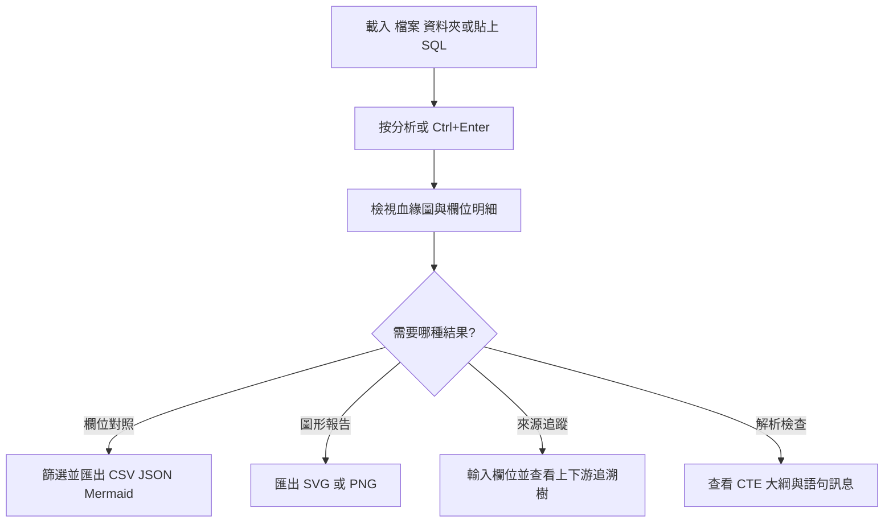

SQL、圖形與分析結果只保留在目前頁面記憶體；重新整理、關閉頁面或按「全部清除」後需要重新載入。匯出檔案可能包含原始欄位名稱、表名與運算式，分享前請確認 SQL 的敏感資訊範圍。

## SQL Lab

SQL Lab 是單檔的 SQL 沙箱與測試工作台：在自己的瀏覽器裡建立多個工作區（資料庫），以 SQL 建表塞資料、查詢、看執行計畫，把 CSV／SQL 腳本／SQLite 檔匯入成資料庫，並可把重要的查詢存成片段、留存執行歷史，或寫成「預期結果比對」的測試案例。資料預設在瀏覽器本機，不會上傳。

執行引擎有兩種：

- **內建引擎**：純 JavaScript 實作，開檔即用、不需要網路，支援常用 SQLite 語法（JOIN、子查詢、CTE／遞迴、GROUP BY、視窗函數、UNION、檢視、交易與日期函數等），適合邏輯驗證與教學。
- **SQLite 引擎**：從 CDN 下載官方 sql.js（SQLite 編譯成 WebAssembly），支援觸發器、`ON CONFLICT`、真實索引與執行計畫。下載一次後會快取在瀏覽器 IndexedDB，之後可離線使用；也可改用手動載入本機的 `sql-wasm.js` 與 `sql-wasm.wasm`。

### 建立工作區與資料

1. 開啟 [`sql-lab.html`](./sql/sql-lab/sql-lab.html)；首次載入會建立示範工作區，內含部門、員工、帳戶與交易等範例資料表、一個檢視與示範查詢。
2. 上方選單可切換工作區；「設定 → 工作區」可新增工作區、更名、複製、匯出、轉為 SQLite（已載入 SQLite 時）與刪除。
3. 在「編輯器」以 SQL 建立資料表與資料，或到「匯入」把檔案變成資料表。

### 編輯器與查詢

- 工具列提供「▶ 執行」（`Ctrl+Enter`／`F5`；有選取範圍時只執行選取內容）、「▷ 執行游標所在敘述」（`Ctrl+Shift+Enter`）、「執行計畫」、「格式化」（`Ctrl+Shift+F`）與「大小寫」（切換關鍵字轉大寫）。
- 左側結構樹列出資料表與檢視：單擊名稱開啟選單（插入名稱、`SELECT *`、列出全部欄位、`COUNT(*)`、INSERT 範本、複製名稱），雙擊查詢前 100 筆，點欄位名稱可插入編輯區；「◀ 收合結構」可收起側欄。
- 結果區以分頁呈現多個結果集與「訊息」分頁，可點欄位標題排序，並「匯出 CSV」、「複製（Tab 分隔）」或「複製為 INSERT」。
- 「存為片段」「存為測試案例」可把目前的 SQL（或選取範圍）保存下來；「開啟 .sql」「下載 .sql」可讀寫本機檔案。

### 匯入 CSV、SQL 與 SQLite

1. 切換到「匯入」，把 `.csv`、`.tsv`、`.txt` 或 `.sql` 拖進框線區域，或點擊選擇檔案。
2. CSV／TSV 會先解析並顯示預覽（前 50 筆），可調整「編碼」（自動偵測、UTF-8、Big5／CP950、Big5-HKSCS、UTF-16 LE／BE、GB18030）、「分隔符號」、「第一列是欄位名稱」、資料表名稱、每個欄位的型別（TEXT／INTEGER／REAL／NUMERIC），以及匯入模式（建立新表／取代／附加到既有資料表）。
3. 按「匯入」即依設定建立資料表並分批寫入；空字串會匯入為 `NULL`。
4. `.sql` 腳本可「在目前工作區執行」或「載入到編輯器」；`.sqlite`／`.db` 與工作區 JSON 則從「設定 → 工作區」的「匯入工作區檔」載入。

### 結構、片段與歷史

- 「結構」頁列出所有資料表（欄位、型別、主鍵、NOT NULL 與索引）與檢視定義，可逐表「預覽」、「產生 SELECT」、「產生 INSERT 範本」、「匯出 CSV」、「刪除」，並可「下載 SQL Dump」或「複製全部 DDL」。
- 「片段」頁保存常用 SQL，支援標題、標籤、說明與全文搜尋，可「帶入編輯器」或直接「執行」，並可匯出／匯入 JSON。
- 「歷史」頁自動記錄每次執行（保留最近 1000 筆），可依關鍵字、成功／失敗與目前工作區篩選，並「載入」、「重新執行」或「存為片段」。

### 測試案例

1. 「測試」頁以套件分組管理案例，每個案例都在**工作區的複本**或**空白資料庫**上執行，不會改動原本的資料。
2. 案例流程為：① 前置 SQL（建表、塞測試資料）→ ② 待測 SQL（以最後一個查詢結果比對）→ ③ 預期結果 → ④ 執行結果。
3. 可勾選「忽略列順序」、「忽略大小寫」、「忽略前後空白」、「比對欄位名稱」並設定「數值容許誤差」；差異表會逐列標示「＝ 相同」、「－ 缺少」、「＋ 多出」、「≠ 不同」。
4. 按「以實際結果設為預期」可快速建立基準，或用「以 CSV 編輯」手動輸入預期結果（`\N` 表示 `NULL`）。可「全部執行」或「執行套件」，並用「執行紀錄」查看歷史結果、「匯出報告 CSV」輸出報告。

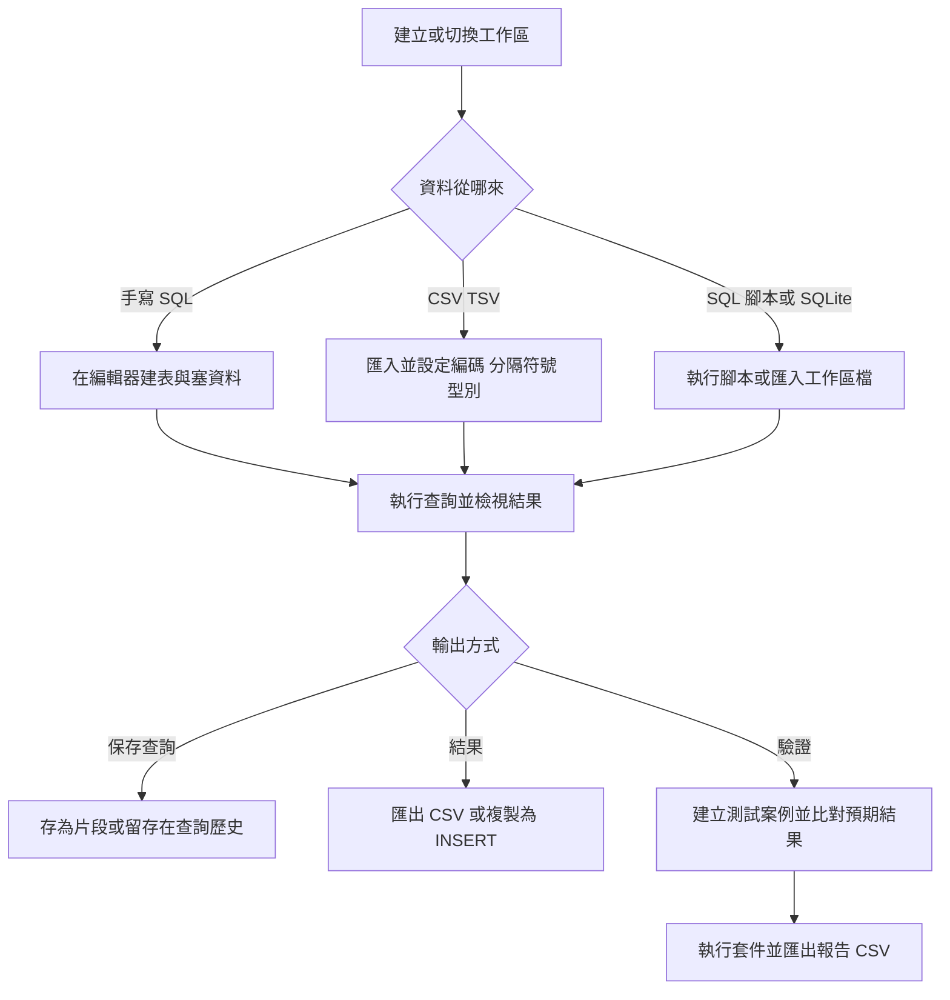

本工具主要從 CDN 載入 sql.js（版本預設 1.10.3，來源可選 jsDelivr、cdnjs 或 unpkg）與其 WebAssembly 檔，且**只在選用 SQLite 引擎時才需要**；內建引擎不需網路。下載後的 sql.js 會快取在瀏覽器 IndexedDB，之後即使離線也能使用 SQLite 引擎。工作區資料、片段、查詢歷史、測試案例、執行紀錄與介面設定都存放在瀏覽器 IndexedDB（資料庫名稱 `sql-lab`，object stores：`workspaces`、`history`、`snippets`、`testcases`、`testruns`、`settings`）；換瀏覽器、使用無痕視窗或清除網站資料後資料可能無法取得，請用「設定 → 備份與還原」的「下載完整備份」保存，日後以「從備份還原」帶回。內建引擎以常用 SQLite 語法實作，特殊函數或邊界行為仍可能與正式 SQLite 或商用資料庫不同，正式 SQL 仍請回到目標資料庫驗證。

## MatrixPivot 表格矩陣轉置器

MatrixPivot 是單檔的表格矩陣轉置與格式轉換器：把從 Excel、Google Sheets 或 CSV／TSV 檔案取得的表格文字貼進左側，工具會即時解析成矩陣、在右側以網格預覽，並可一鍵行列轉置、清理空白與轉出工程常用格式。所有解析與轉換都在瀏覽器端完成，不會上傳內容。

### 貼上或匯入表格

1. 開啟 [`matrix-pivot.html`](./data/matrix-pivot/matrix-pivot.html)。
2. 在左側「來源資料貼入 / 匯入」貼上表格文字，或按「匯入 CSV / 檔案」選取 `.csv`、`.tsv`、`.txt`，也可將檔案直接拖放到輸入區。
3. 工具會自動推斷分隔符號（Tab、逗號、分號），並處理引號內換行與 `""` 跳脫；右側「矩陣即時網格預覽」會顯示列數、欄數與儲存格數，含換行的儲存格會標示「↵ 多行」。
4. 依需求切換「首行作為欄位表頭」：勾選時第一列視為欄位名稱，JSON 與 SQL 會以它作為鍵與欄名。
5. 可用右上「載入範例資料」快速套用內建財務報表矩陣，或按「貼上」讀取剪貼簿內容。

### 轉置、清理與搜尋

- 「一鍵行列轉置 (Transpose)」會將矩陣行列互換（`M[i][j]` → `M[j][i]`），並同步更新左側文字與右側預覽。
- 「清理空白行列」會移除全空白的列與欄；「去空格 (Trim)」會清除所有儲存格首尾空白；「清空所有內容」會清空輸入、預覽與編碼標示。
- 預覽區右上「在表格中搜尋」可即時過濾符合關鍵字的列，並顯示「過濾後顯示 N / M 列」。
- 右上角可切換深／淺色外觀。

### 格式轉換與輸出

「格式轉換與代碼產生器」提供五種分頁，會依目前矩陣即時產生結果：

- **Markdown**：自動對齊欄寬的表格；儲存格內換行會轉為 `<br>`，`|` 會跳脫。
- **JSON Array**：以欄位表頭（無表頭時為 `Col_n`）為鍵的物件陣列，純數字會轉為數值型別。
- **SQL INSERT**：以 `import_table` 為表名的逐列 `INSERT` 敘述，數值不加引號、字串會跳脫單引號。
- **HTML Table**：含 `thead`／`tbody` 的 `<table class="data-table">`，內容會做 HTML 跳脫。
- **標準 CSV**：符合 CSV 規則的逗號分隔輸出。

各分頁可切換檢視，按「複製程式碼」將內容放入剪貼簿；預覽區右下「下載為 CSV」會下載帶 BOM 的 `matrix_export_*.csv`，方便 Excel 正確顯示中文。

### 編碼與匯入注意事項

- 「編碼設定」支援自動偵測、Big5／CP950、UTF-8、UTF-16 LE 與 UTF-16 BE。自動偵測會先檢查 BOM，再以嚴格 UTF-8 驗證；若位元組不符會改用 Big5 解碼，適合 Windows 繁中 Excel 匯出的檔案。
- 匯入檔案後可從「編碼設定」重新選擇並即時重新解碼，不需重新選檔。

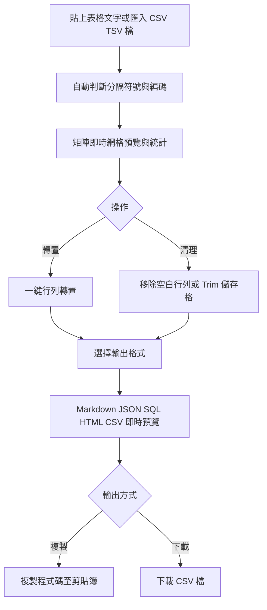

本工具從 CDN 載入 Tailwind CSS 與 Google Fonts，首次開啟需保持網路連線。內容、矩陣與輸出只保留在目前頁面記憶體，不使用 IndexedDB 或 `localStorage`；重新整理或關閉頁面後需重新貼上，重要結果請先複製或下載保存。

## CSV 格式清理器

CSV 格式清理器是單檔的 CSV 清理工具，適合把核心主機、Excel 或財金系統匯出的 CSV 整理成可直接使用的檔案。讀入時會自動辨識 UTF-8、UTF-16、Big5 與 CP950；清理後可匯出 UTF-8、UTF-8（含 BOM）、Big5 或 CP950。所有處理都在瀏覽器內完成，不會上傳資料。

### 讀入 CSV 或貼上內容

1. 開啟 [`csv-cleaner.html`](./data/csv-cleaner/csv-cleaner.html)。
2. 在「1. 來源資料」點選或拖放 `.csv`、`.txt`、`.tsv` 檔；也可在文字框貼上內容後按「使用貼上內容」，從 Excel 複製的儲存格會以 Tab 分隔。
3. 「檔案編碼」預設為「自動偵測」：先檢查 BOM，再以嚴格 UTF-8 驗證，不符合時改以 Big5 解讀。若中文仍然亂碼，請手動改選 UTF-8、Big5、CP950 或 UTF-16 LE／BE。
4. 「分隔符號」預設自動偵測（逗號、Tab、直線 `|`），判斷有誤時可手動指定。

注意：沒有 BOM 的 UTF-16 無法自動判斷，請手動選擇。自動偵測會把 CP950 歸為 Big5，少數罕見字若顯示不對，請改選 CP950。

### 清理規則

- **去除前後空白**：移除每個儲存格首尾的空白（含全形空白）。
- **合併內部連續空白**：兩個以上的空白合併為一個（預設關閉）。
- **移除不可見字元**：零寬空白、BOM、軟斷字與控制字元會被移除；不換行空白轉為一般空白。
- **全形英數字轉半形**：只轉換全形英文字母與數字，例如 `ＡＢＣ１２３` 轉為 `ABC123`；中文標點與括號保持不變。
- **移除金額千分位逗號**：只處理完整符合 `1,234,567.89` 格式的儲存格。
- **刪除全空白列**：清理後所有欄位都是空白的列會被移除。
- **日期統一格式**：可選擇不轉換、西元 `YYYY-MM-DD`、西元 `YYYY/MM/DD`、西元 `YYYYMMDD` 或民國 `yyy/MM/DD`。可辨識的格式包括民國 `112/01/31`、`112.1.31`、`1120131`，以及西元 `2023/1/31`、`2023-01-31`、`20230131`。日期不存在（例如 `2023-02-29`）或格式不完整的儲存格不會被轉換。

清理只依儲存格內容判斷，不會參考欄位名稱。7 位數字 `1120131` 會被視為民國日期，若某個編號剛好符合格式也會被轉換，因此「日期統一格式」預設為不轉換，請確認資料後再開啟。

### 預覽與統計

「3. 清理結果預覽」會顯示原始列數、保留列數、刪除的空白列、變更儲存格數、欄數與分隔符號。被清理的儲存格以黃色底色標示，滑鼠移到儲存格上可看原始值。預覽最多顯示 200 列，匯出時仍包含全部資料。

### 匯出與 Big5／CP950 注意事項

1. 在「4. 匯出」選擇輸出編碼與檔名，再按「下載 CSV」。
2. 輸出換行為 CRLF；欄位含逗號、雙引號或換行時會自動加上雙引號。
3. 選擇 Big5 或 CP950 時，工具會逐一檢查每個字元能否無損轉換。若有無法對應的字元（例如部分圈碼、`㈱`、CJK 擴充字），會列出字元與出現次數，並停用下載按鈕，直到修改來源或勾選「允許以 ? 取代無法編碼的字元」。
4. Big5 與 CP950 的字元對應不完全相同，例如「①」在 CP950 無法對應、在 Big5 可以對應。請依接收系統指定的編碼選擇。

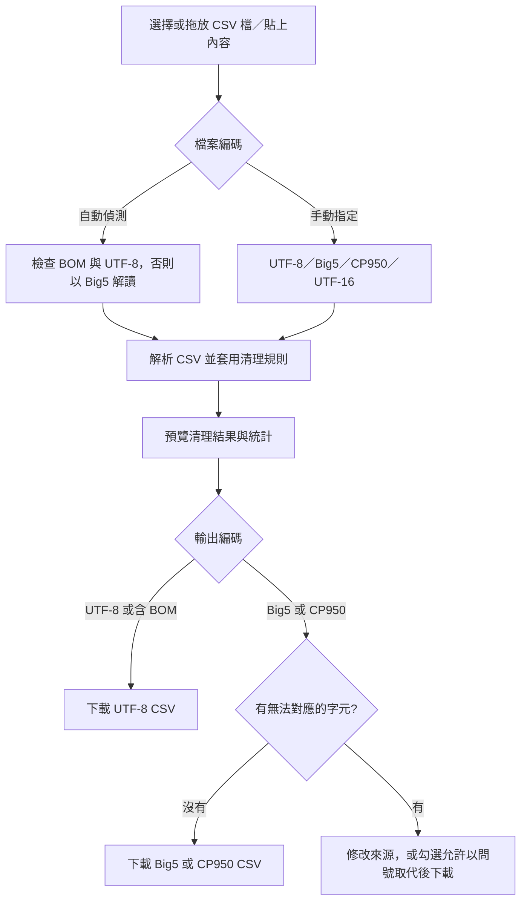

本工具從 CDN 載入 iconv-lite 0.6.3（jsDelivr），用於 Big5／CP950 的編碼、解碼與無損檢查。若函式庫無法載入，頁面會提示：UTF-8、UTF-16 與瀏覽器內建的 Big5 讀取仍可使用，CP950 讀取會改以 Big5 處理，Big5 與 CP950 匯出則會被停用。首次開啟需保持網路連線。

## API Mock & cURL 格式轉換工作室 (API Mock Studio)

API Mock Studio 是免後端、純瀏覽器端運作的 API 測試、Mock 模擬與格式轉換工具。適用於後端服務尚未就緒、第三方金融或政務介面受限於網路隔離、或是需要快速將 cURL 指令轉化為前端代碼與 OpenAPI (Swagger) 規格的開發場景。所有資料與端點集合保存在使用者的瀏覽器本機，不經過任何外部專用後端。

### 快速開始與端點管理

1. 開啟 [`api-mock-studio.html`](./data/api-mock-studio/api-mock-studio.html)。
2. 左側「端點清冊」提供集合管理，預設載入臺灣金融轉帳與 KYC 驗證端點範例；亦可由上方選單載入電子商務或 JWT 身分驗證範本。
3. 點選「＋ 新增端點」可建立空白請求，支援「複製」與「刪除」現有端點。
4. 點選「💾 匯出集合」可將當前所有端點與 Mock 回應輸出為 JSON 檔；點選「📥 匯入 JSON」可還原先前備份的集合。

### cURL 雙向解析與 Request 編輯

- **貼上 cURL 自動解析**：點選左下角「📋 貼上 cURL 解析」，貼入任意終端機 cURL 命令（支援多行 `\`、`-X`、`-H`、`-d` / `--data-raw`、`-u` 等），系統會自動拆解為 Method、URL、Headers、Params 與 Body。
- **Params 雙向同調**：在 Params 表格中增修 Key-Value，會即時自動同調到 URL 網址 Query String；反之編輯網址亦會解析回表格。
- **Headers 與 Auth 快速設定**：提供常見標頭快速按鈕（JSON、Accept、X-Request-ID），支援 Bearer Token、Basic Auth 與 API Key 認證，並自動同步至 Headers 清單。
- **Body 編輯與驗證**：支援 application/json、x-www-form-urlencoded、raw 等模式，提供「✨ 格式化 JSON」與語法即時錯誤檢查。

### 純前端 Mock 回應與真實請求測試

- **雙執行模式切換**：
  - **Mock 模擬模式**：純前台模擬回應。可自訂 HTTP 狀態碼（200 OK、201 Created、400 Bad Request、404 Not Found、422 Unprocessable、500 Server Error 等）與延遲時間（0ms、150ms、400ms、1000ms、2500ms），即時觀察狀態徽章、耗時與回傳結果。
  - **真實請求模式**：透過瀏覽器原生 `fetch` 直接對目標 URL 發送請求。若遇到同源政策阻擋，系統會自動跳出 CORS 提示與除錯建議。
- **智慧 Dummy 假資料生成器**：
  - 支援佔位符標籤：`@uuid`（標準 UUID v4）、`@taiwan_gui`（通過檢核邏輯的臺灣統編 8 碼）、`@taiwan_id`（合規臺灣身分證字號）、`@taiwan_phone`（臺灣手機門號）、`@name`（中文姓名）、`@email`、`@amount`（金額）、`@timestamp`（ISO 時間戳）、`@boolean`。
  - 點選「🎲 產生假資料實體」可一鍵將編輯器內的標籤替換為隨機數值。
  - 內建臺灣金融轉帳明細、使用者檔案、分頁列表結構與 RFC 7807 錯誤格式等範本。

### 代碼產生與規格匯出

- **多語言代碼**：於「程式碼 (Code)」分頁可一鍵複製 cURL 命令、JavaScript (fetch)、Node.js (axios)、Python (requests) 以及 MSW (Mock Service Worker Handler) 代碼。
- **OpenAPI 3.0 規範**：自動將端點路徑、查詢參數與 Mock 回應結構轉換為合規的 OpenAPI 3.0 YAML 或 JSON 規格。
- **Postman Collection v2.1**：點選「📦 匯出 Postman Collection」可直接下載標準 Postman Collection JSON 檔案並匯入 Postman。

```mermaid
flowchart TD
    A[貼上 cURL 或手動編輯端點] --> B[設定 Method / URL / Headers / Body]
    B --> C{選擇執行模式}
    C -->|Mock 模式| D[設定 HTTP 狀態碼與網路延遲模擬]
    C -->|真實模式| E[瀏覽器原生 Fetch 請求與 CORS 檢測]
    D --> F[套用 Dummy 假資料與佔位符評估]
    F --> G[檢視即時 Response 狀態 / 耗時 / Body]
    E --> G
    G --> H{規格與代碼產出}
    H -->|程式碼| I[複製 cURL / Fetch / Axios / Python / MSW]
    H -->|規格檔| J[匯出 OpenAPI 3.0 或 Postman Collection]
```

本工具從 CDN 載入 Tailwind CSS 與 Google Fonts，主要邏輯完全在瀏覽器端執行。端點清冊、作用中端點與執行偏好保存在瀏覽器的 `localStorage`（鍵值 `api_mock_studio_state_v1`）；需要備份或共用時可使用「匯出集合」下載 JSON。

## 截圖 OCR 知識庫

截圖 OCR 知識庫是單檔、完全離線的截圖管理與文字檢索工具：把螢幕擷取的圖片貼上、拖曳或匯入後，以內建的 Tesseract 引擎辨識出文字，再將圖片、OCR 文字、標題、分類、標籤與備註整理成可全文檢索的知識庫。適合蒐集報表畫面、錯誤訊息、系統操作步驟或需求討論截圖，之後用關鍵字就能找回當時的畫面與文字。所有辨識與資料都在瀏覽器本機完成，不會上傳。

### 匯入引擎並開始收集截圖

1. 開啟 [`screenshot-ocr-kb.html`](./data/screenshot-ocr-kb/screenshot-ocr-kb.html)。首次使用時，工具會自動開啟「⚙ OCR 引擎設定」。
2. 按「選擇引擎檔案…」一次多選主程式、Worker、核心（檔名含 `.wasm.js`）與語言檔（`chi_tra`、`eng` 的 `.traineddata` 或 `.traineddata.gz`）後匯入；檔案會存入本機瀏覽器資料庫，之後不必再匯入。下載來源列在設定視窗的「引擎檔案下載來源」。若手邊是 Windows 且可連網，也可執行本工具子資料夾內的 `data/screenshot-ocr-kb/download_ocr_engine.bat`（需系統內建 `curl.exe`），它會把主程式、Worker、核心與 `chi_tra`／`eng` 語言檔一併下載到該資料夾，方便一次選取匯入。
3. 在「辨識語言」勾選要用於辨識的語言（依勾選順序組合）；也可勾選「匯入圖片後自動 OCR」、「小圖先放大 2 倍再辨識」與「灰階化，深色背景自動反白」。按「執行 OCR 測試」可先確認引擎是否可用。
4. 以 `Win`+`Shift`+`S` 截圖後回到本頁按 `Ctrl`+`V` 貼上，或把圖片檔拖曳進視窗，或按「＋ 匯入圖片」多選；完全相同的圖片會自動略過。辨識中的圖片會在縮圖右上顯示狀態徽章。

### 搜尋與檢視

- 搜尋框（按 `/` 可快速聚焦）會即時比對 OCR 文字、標題、備註、分類與標籤，全形／半形與大小寫視為相同。支援 `LCR 現金流入`（兩個詞都要出現）、`#錯誤`（限定標籤）與 `-測試`（排除）等語法。
- 以「卡片」或「清單」檢視切換版面；點擊任一項目開啟檢視器，命中的文字會在原圖上以黃框標示，可用 `←`／`→` 切換前後張、`Ctrl`+滾輪縮放。
- 在檢視器可重新 OCR、框選區域 OCR、對分享圖加上文字標註或遮蔽區域、下載原圖、複製 OCR 文字，或依內容加入「建議標籤」。文字標註與黑色遮蔽只作用在匯出的分享 PNG，原圖保持不變。

### 集合、操作流程與時間軸

- 從側欄建立「集合」，一張截圖可加入多個集合；刪除集合不會刪除截圖。
- 「操作流程」可把多張截圖組成帶步驟說明的文件，並在預覽視窗「下載 Word」或「列印／另存 PDF」。
- 「時間軸」依截圖建立日期分組，點選項目可直接開啟圖片。
- 「找近似重複」只列出相似候選供檢視，不會自動合併或刪除。

### 匯出備份與資料保存

- 按「匯出備份」將全部圖片、縮圖、筆記、集合、流程與設定打包為 ZIP；「還原備份」可從 ZIP 還原。
- 資料保存在目前瀏覽器、這個頁面來源的 IndexedDB（資料庫名稱 `snap-ocr-kb`，object stores：`images`、`thumbs`、`notes`、`collections`、`workflows`、`assets`、`settings`），不會上傳。
- 換瀏覽器、清除瀏覽資料，或在部分環境下移動本 HTML 檔位置，都可能看不到原本的資料；請定期「匯出備份」。點右下角儲存空間文字可要求瀏覽器「固定保存」，降低被自動清除的風險。

```mermaid
flowchart TD
    A[首次匯入 OCR 引擎檔至 IndexedDB] --> B[貼上 拖曳或匯入截圖]
    B --> C[Tesseract 辨識文字並產生縮圖]
    C --> D[編輯標題 分類 標籤與備註]
    D --> E{要怎麼用}
    E -->|檢索| F[全文搜尋並在檢視器高亮命中]
    E -->|整理| G[加入集合或依日期看時間軸]
    E -->|文件| H[組成操作流程並輸出 Word 或 PDF]
    F --> I[匯出分享圖 複製文字或下載原圖]
    G --> J[匯出 ZIP 備份或還原備份]
    H --> J
    I --> J
```

本工具完全離線，JSZip 已內嵌，Tesseract.js 則由使用者一次匯入引擎檔並存放於 IndexedDB，執行時不會連網（設定視窗列出的 CDN 網址，或子資料夾內的 `download_ocr_engine.bat`，都只是方便在可連網的電腦先行下載引擎檔）。辨識準確度受截圖清晰度、字級與語言檔影響，小字或深色底畫面可開啟放大與灰階化選項改善；OCR 結果為輔助，重要內容仍請對照原圖人工確認。

## 資料品質稽核中心

資料品質稽核中心是單檔、完全離線的資料品質檢核工具：匯入 CSV／TSV／TXT 或 Excel（`.xlsx`／`.xlsm`）後，工具會剖析每個欄位的型態、空值、重複值與分布，接著用「規則範本」執行稽核，產生問題明細、六大品質構面分數與 A–E 評等。適合在資料交換、上線前或批次匯入前做例行品檢。所有解析與稽核都在瀏覽器本機完成，資料儲存在 IndexedDB，不會上傳。

### 匯入資料集

1. 開啟 [`data-quality-audit.html`](./data/data-quality-audit/data-quality-audit.html)。
2. 在「📥 資料匯入」把檔案拖曳進來，或點擊選擇檔案；CSV／TSV／TXT 會自動偵測編碼（UTF-8／BOM／UTF-16／Big5）與分隔符號並以串流解析，Excel 則可選擇工作表。
3. 預覽前 20 列並確認資料集名稱、編碼、分隔符號、第一列是否為標題與略過列數後，按「確認匯入」。相同名稱的資料集視為同一資料來源的不同批次。
4. 匯入進度可即時看到並可中途取消；匯入後結構異常（欄位數不符）的列會被標記。

### 欄位剖析與規則管理

- 「🔎 欄位剖析」整理各欄位的推斷型態、空值／假空值、相異值排行、數值統計（平均、最小／最大、負值、零）、文字長度與全形半形混用等，做為訂定規則的依據。
- 「📐 規則管理」以範本為單位維護規則；內建檢核包含結構異常、假空值、整列重複、型態不符、前後空白、全形半形混用、類別變體與數值異常值（Z-score 或 IQR）。
- 自訂規則類型有必填、唯一（可複合鍵）、型態、長度、數值範圍、代碼清單、正規表示式、跨欄比較、條件必填、進階運算式、檢查碼（統一編號／身分證）、日期有效性、日期缺口與跨資料集參照；每條規則可設定維度、嚴重度與「允許問題率」，並可「以目前資料集試算」。
- 例外清單可排除特定欄位值（例如測試資料），例外於下次稽核生效。範本可新增、複製、更名、匯出／匯入 JSON，或直接使用預設的「僅內建檢核」。

### 執行稽核與結果

1. 在頁首選擇資料集與範本後按「▶ 執行稽核」。工具支援 Web Worker 背景模式（頁首會顯示「⚙ 背景模式」或「⚙ 相容模式」），過程中會顯示進度並可取消。
2. 「✅ 稽核結果」顯示總分與 A–E 等級、六大構面分數、不通過原因、各規則命中排行與規則彙總（命中數、比率、門檻、判定、例外數）。
3. 問題明細可依規則、欄位與嚴重度篩選並分頁；點選某一列可檢視該列的原始整列資料與所有問題，「＋例外」可將該項目加入範本例外清單。
4. 可匯出「問題明細 CSV」「問題列原始資料」「HTML 稽核報告」與「清理後資料」CSV（後者只套用去空白、全形轉半形與假空值轉空白，不會修改原資料）。

### 批次比對、設定與備份

- 「📈 批次比對」依範本列出歷次稽核的分數趨勢折線圖與表格，並可任選兩個批次逐項比較總分、構面分數、筆數與各規則命中差異。
- 「⚙️ 設定」可調整假空值字詞、異常值方法（Z-score／IQR）與門檻、每頁筆數、預設判定標準，並維護假日檔（供日期缺口規則判斷營業日）。
- 「匯出完整備份 JSON」可備份全部資料集、剖析、範本、稽核紀錄、問題、假日與設定；「匯入備份（覆蓋）」可還原；「清除所有資料」會清空全部內容且無法復原。

```mermaid
flowchart TD
    A[匯入 CSV 或 Excel 並確認編碼與標題] --> B[欄位剖析 檢視型態與分布]
    B --> C[以範本維護規則與例外]
    C --> D[執行稽核 背景處理並可取消]
    D --> E[檢視總分 構面分數與問題明細]
    E --> F{輸出方式}
    F -->|問題| G[匯出問題明細 CSV 或問題列原始資料]
    F -->|報告| H[匯出 HTML 稽核報告]
    F -->|修正| I[匯出清理後資料 CSV]
    E --> J[批次比對分數趨勢與規則差異]
    J --> K[匯出或匯入完整備份 JSON]
```

本工具完全離線，內建 CSV／XLSX 解析（XLSX 以瀏覽器原生 `DecompressionStream` 解壓，不依賴外部函式庫）；資料保存在目前瀏覽器的 IndexedDB（資料庫名稱 `dqa_center`，object stores：`datasets`、`rows`、`profiles`、`templates`、`runs`、`issues`、`holidays`、`settings`），不會上傳。稽核結果為資料品檢輔助，規則與門檻仍應依業務定義調整；問題明細上限為 20 萬筆，達上限時畫面會標示。

## 資料關聯探索器

資料關聯探索器（Data Relationship Explorer）是單檔、完全離線的資料結構探索工具：把多個 CSV／TSV 資料表匯入後，工具會剖析欄位、推測主鍵、以值域包含率推測外鍵關聯、找出欄位相依（函數相依），畫出可互動的 ER 圖，並提供資料表之間的路徑查詢、欄位影響分析與代碼字典。適合在沒有 ER 模型文件的舊系統上，從實際資料反推資料表的關聯樣貌。所有分析都在瀏覽器本機進行，資料儲存在 IndexedDB，不會上傳。

### 匯入資料表與工作區

1. 開啟 [`data-relationship-explorer.html`](./data/data-relationship-explorer/data-relationship-explorer.html)；空白畫面可按「載入範例資料（放款系統）」先看效果。
2. 按「📥 匯入」或直接把多個檔案拖曳進視窗；支援 `.csv`／`.tsv`／`.txt`，可一次多選。編碼預設自動偵測（UTF-8、UTF-8 BOM、Big5／CP950、Big5-HKSCS、UTF-16 LE／BE、GB18030），分隔符號也會自動判斷（逗號、Tab、直線、分號），兩者都可逐檔手動修正並預覽前 100 列。
3. 確認匯入後，同名資料表會**取代**原有資料（保留已人工審核過的外鍵關聯）；畫面會提示重複名稱。左側「資料表」清單以勾選控制該表是否顯示於 ER 圖。
4. 上方可切換與新增／更名／刪除「工作區」，用來分開不同系統或不同批次的資料。

### 分析與各分頁

1. 按「⚙️ 分析」開始推測；分析以 Web Worker 在背景執行（不支援時自動退回主執行緒），過程有進度條並可取消。頁首的「門檻」是信心分數門檻（預設 70）。
2. 分頁依序為「總覽」「欄位剖析」「主鍵」「外鍵關聯」「欄位相依」「ER 圖」「路徑查詢」「影響分析」「代碼與日期」。
3. 「主鍵」列出候選主鍵（唯一性、空值率、型態）並可手動指定；手動指定後重新分析會採用該主鍵。
4. 「外鍵關聯」列出推測關聯並顯示狀態（已確認／待確認）、來源與目標、基數、信心分數、值域包含率、孤兒值數量與類型；可「在 ER 圖標示」「產生 JOIN SQL」「產生孤兒值查詢 SQL」「匯出孤兒值 CSV」，也可手動新增關聯或調整包含率門檻。
5. 「欄位相依」找出欄位之間的函數相依；「路徑查詢」可在兩張表之間找出最多 N 段的串接路徑；「影響分析」以指定欄位往上游或下游追蹤至指定深度，並可匯出影響清單 CSV。
6. 「代碼與日期」自動辨識「代碼 ↔ 名稱」的對照欄位（可匯出代碼表 CSV），並輔助檢查日期欄位。

### ER 圖與匯出

- 「ER 圖」以 SVG 繪製（可縮放、拖曳、重新排版），可標示已確認／推測（虛線）關聯、聚焦特定資料表，並直接匯出 SVG、PNG 或 Mermaid `erDiagram`。
- 「📤 匯出」選單提供：Mermaid erDiagram、SQL DDL（Oracle／SQL Server／SQLite，可選擇是否含未確認關聯）、Excel 分析報告（`.xls`）、Markdown 關聯說明文件、ER 圖 SVG／PNG、一鍵產生分析報告（HTML）。
- 「匯出工作區 JSON」可備份整個工作區，「匯入工作區 JSON」可還原（同名時自動加上「（匯入）」）；「載入範例資料（放款系統）」可產生示範用的四張關聯資料表。
- 「⚙ 設定」可調整信心門檻、空值字串清單、是否 Trim、空白視為空值與民國年日期辨識等，設定依工作區保存。

```mermaid
flowchart TD
    A[匯入多個 CSV 或 TSV 並確認編碼與分隔符號] --> B[按分析 於背景推測主鍵 外鍵與欄位相依]
    B --> C[檢視欄位剖析與候選主鍵 必要時手動指定]
    C --> D[檢視外鍵關聯 信心 包含率與孤兒值]
    D --> E{要怎麼用}
    E -->|結構圖| F[互動式 ER 圖並匯出 SVG PNG 或 Mermaid]
    E -->|查詢| G[產生 JOIN SQL 或孤兒值查詢與 CSV]
    E -->|追蹤| H[路徑查詢或影響分析並匯出清單]
    E -->|交付| I[匯出 DDL Excel Markdown 或 HTML 報告]
    D --> J[匯出或匯入工作區 JSON]
```

本工具完全離線，不使用任何 CDN 或外部函式庫（分析引擎內嵌於頁面，並以 Web Worker 執行；ER 圖與圖表皆為原生 SVG）。資料保存在目前瀏覽器的 IndexedDB（資料庫名稱 `DataRelationshipExplorer`，object stores：`workspaces`、`tables`、`rows`、`profiles`、`relations`、`fds`、`layouts`），主題與上次開啟的工作區使用 `localStorage`（鍵值 `dre_theme`、`dre_lastWs`），不會上傳。推測結果（尤其外鍵與欄位相依）是依資料值域統計的輔助判斷，仍應搭配系統規格或 DBA 人工確認；換瀏覽器或清除網站資料後資料可能無法取得，請以「匯出工作區 JSON」保存。

## Markdown 卡片簡報工具 (Card Presenter)

Card Presenter 是單檔的卡片式投影片編輯器：可用 Markdown（含自訂的 KPI、多欄卡片與提示框區塊）撰寫內容，右側即時預覽，並以全螢幕模式播放。它也能將整份簡報匯出為完全不依賴外部資源的單一 HTML 檔。

### 編輯與預覽

1. 開啟 [`markdown_card_presenter.html`](./docs/card-presenter/markdown_card_presenter.html)。
2. 在左側編輯區輸入 Markdown；以獨立一行的 `---` 切分不同頁面。
3. 可用工具列的「📊 KPI 指標」、「🗂️ 雙欄卡片」、「💡 提示框」快速插入語法片段。
4. 右側預覽會即時更新，每張卡片右下角顯示頁碼。

支援的區塊語法：

- 標題與清單：`#`、`##`、`- `、`> ` 引言、`**粗體**`、`*斜體*`、`` `程式碼` ``。
- KPI 指標：`::: kpi [標籤] 值 [status: success|warning|danger|info]`；連續多行 KPI 會自動併排顯示。
- 多欄卡片：`::: columns 2`（或 `3`）搭配多個 `::: card [標題]`，最後以 `:::` 收合。
- 提示框：`::: callout [info|success|warning]` 之後放入內容，再以 `:::` 收合。

### 播放與匯出

- 按「▶️ 播放簡報」或 `F` 鍵進入全螢幕播放；`←`／`→`（或空白鍵）換頁，`Esc` 離開。
- 按「💾 匯出展示檔」會下載一個獨立的 HTML 檔，內含所有頁面與樣式，可離線開啟與分享。
- 深色／淺色模式可從右上角 ☀️／🌙 切換。

### 範本與保存

- 內建三個範本，可從上方範本選單套用。
- 「➕」可將目前編輯內容存為自訂範本；「🔄」可還原為系統預設範本（會清除自訂範本，但保留編輯區文字）。
- 範本與編輯草稿保存在瀏覽器 IndexedDB，主題偏好保存在 `localStorage`；換瀏覽器或清除網站資料後可能無法取得，重要簡報請先匯出 HTML。

```mermaid
flowchart TD
    A[選擇範本或自行輸入 Markdown] --> B[即時預覽卡片]
    B --> C{輸出方式}
    C -->|播放| D[全螢幕逐頁簡報]
    C -->|保存| E[範本與草稿存入 IndexedDB]
    C -->|分享| F[匯出離線單一 HTML]
```

本工具的編輯介面樣式由 CDN 載入 Tailwind CSS，首次開啟需保持網路連線；但「匯出展示檔」產生的 HTML 不含任何外部依賴，可完全離線使用。

## 公文簽／函排版與 Word 匯出 (DocuFormatter)

DocuFormatter（Word 匯出版）是單檔的公文排版精靈，可依「簽」「函」或自由 Markdown 三種模式撰寫內容，於右側即時產生正式公文版面預覽，並複製純文字、複製 Word 格式或下載 `.docx` 檔。工具不修改或保存任何來源檔，所有內容只在目前頁面記憶體處理。

### 選擇公文類型與填寫內容

1. 開啟 [`DocuForm.html`](./docs/docuformatter/DocuForm.html)。
2. 在最上方「公文類型」選擇要產出的格式：
   - 「簽（主旨／說明／擬辦）」：填寫承辦單位、日期（民國年）、主旨、說明與擬辦。
   - 「函（主旨／說明／辦法）」：填寫受文者、發文字號、速別、密等及解密條件、主旨、說明與辦法。
   - 「自由 Markdown 模式」：直接輸入 Markdown，`#`、`##`、`###` 與 `-` 會分別轉為「壹、」「一、」「（一）」與「1.」等層級。
3. 按「帶入規範範例」可載入內建示範內容；開啟頁面時也會自動載入範例。
4. 「說明」與「擬辦／辦法」欄位每換一行會自動分為一項並依序加上「一、」「二、」等編號；單行內容則不加編號。以 `-`、`*` 或 `1.` 開頭時會視為項目符號並移除。

### 校正選項與遮罩

- 「標點全形化」會將半形逗號、冒號、分號、問號與驚嘆號轉為全形；緊鄰數字者不轉換。
- 「中英間距校正」會在中文與英數字之間自動補上空格。
- 「遮罩關鍵字」可輸入以逗號分隔的詞彙，預覽與匯出時會以「○○」取代，方便對外分享前去除單位名稱或人名。

### 預覽與輸出

- 右側「正式公文排版預覽」以標楷體即時呈現成品並顯示字數；相同字型與行高也會套用於 Word 匯出。
- 「複製純文字」將預覽內容複製為純文字；「複製 Word 格式」複製為保留標楷體與固定行高的富文字，可直接貼入 Word。
- 「下載 .docx」以 docx.js 產生 Word 檔，檔名依公文類型為 `簽呈_日期.docx`、`公文函稿_日期.docx` 或 `公務報告_日期.docx`。
- 兩顆複製按鈕與下載功能需要瀏覽器剪貼簿／檔案 API 以及 docx.js CDN；建議透過 `python -m http.server 8080` 後從 `http://localhost:8080/docs/docuformatter/` 開啟。

```mermaid
flowchart TD
    A[選擇公文類型] --> B{類型}
    B -->|簽| C[填寫承辦單位 日期 主旨 說明 擬辦]
    B -->|函| D[填寫受文者 發文字號 速別 密等 主旨 說明 辦法]
    B -->|自由 Markdown| E[輸入 Markdown 標題與項目]
    C --> F[套用標點全形 中英間距與遮罩關鍵字]
    D --> F
    E --> F
    F --> G[右側即時預覽與字數]
    G --> H{輸出方式}
    H -->|複製| I[純文字或 Word 格式]
    H -->|下載| J[docx 檔]
```

本工具不使用 IndexedDB 或 `localStorage`，關閉或重新整理頁面後內容需重新輸入；重要公文請先下載 `.docx` 或複製保存。排版僅為格式輔助，正式發文前仍應依機關文書規範覆核用語與簽核流程。

## 剪貼簿洗滌器 (Text Scrubber)

剪貼簿洗滌器是單檔的純文字淨化與脫敏工具：把從 PDF、公文或網頁複製出的雜亂文字貼進左側，工具會依勾選的規則即時在右側產生洗滌結果，包含修復斷行、清除隱形字元、統一標點與清單符號，以及遮罩臺灣常見的敏感資訊。所有處理都在瀏覽器端完成，不會上傳文字。

### 洗滌文字

1. 開啟 [`text-scrubber.html`](./docs/text-scrubber/text-scrubber.html)；頁面載入時會自動帶入一段示範的混亂文字。
2. 在左側「原文字串」貼上內容，或按「從剪貼簿貼上」。
3. 在中間「洗滌配置規則」勾選要套用的規則，右側「洗滌產出」會即時更新，並顯示字數／行數、已優化處數與省去字數。
4. 按「一鍵複製結果」將洗滌後文字複製回剪貼簿。

### 一鍵情境與洗滌規則

- 上方情境列可一鍵套用：「PDF 論文／報告接合」「AI 提詞個資嚴格脫敏」「格式純粹化（去空格符號）」「標準清單修復」，或按「載入混亂範本」重新載入示範文字。
- 斷行與空格優化：縫合中文突兀斷行、消除行首行尾空白、壓縮連續空行、英文連字號接合（例如 `commu-` 加 `nication`）。
- 字元與標點統一：清除零寬與不可見字元、統一中文引號與括號、把字型亂碼標記轉為標準 `-`。
- 本地敏感資訊遮罩：可個別勾選身分證字號、手機與市話、公司統一編號（8 碼）與電子郵件；遮罩後只保留部分字元（例如 `A123***789`、`u***r@domain.com`）。
- 「全部開啟」可一次啟用所有規則；右上角可切換深／淺色外觀。

```mermaid
flowchart LR
    A[貼上或載入雜亂文字] --> B[勾選洗滌規則或套用情境]
    B --> C[即時產生洗滌產出]
    C --> D{輸出}
    D -->|複製| E[一鍵複製結果至剪貼簿]
    D -->|調整| F[修改規則後重新預覽]
```

本工具使用 CDN 載入 Tailwind CSS、Phosphor Icons 與 Google Fonts，首次開啟需保持網路連線。文字與勾選規則只保留在目前頁面記憶體，不會保存或上傳；重新整理或關閉頁面後需重新貼上。個資遮罩為規則式輔助，複雜或非常見格式仍建議人工核對後再對外分享。

## 文件字數與閱讀時間統計

文件字數與閱讀時間統計是單檔、純離線的文字統計工具：把文字貼進輸入框，或匯入 `.txt`、`.md`、`.csv` 等純文字檔，工具會即時統計中文與英文字數、字元數、段落與句數，估算閱讀時間，並列出英文高頻詞。所有內容都在瀏覽器本機處理，不會上傳。

### 輸入文字或匯入檔案

1. 開啟 [`word-counter.html`](./docs/word-counter/word-counter.html)。
2. 直接在「文字輸入」區貼上或輸入文字；統計結果會即時更新。
3. 或將純文字檔拖放到上方框線區域，或按「選擇檔案」選取 `.txt`、`.md`、`.csv`、`.log` 等檔案（副檔名不限，避免漏掉 `.csv`、`.log`）。
4. 載入檔案後，輸入區下方會顯示偵測到的編碼與檔案大小；展開「內容預覽（前 200 字）」可確認解讀是否正確。

### 檔案編碼與自動偵測

- 「檔案編碼」預設為「自動偵測」：先檢查 BOM（UTF-8、UTF-16 LE／BE），再以嚴格 UTF-8 驗證；若不符合，則在 Big5 與 GB18030 之間以常用字頻率評分擇一，適合 Windows 繁中或簡中系統匯出的檔案。
- 可手動指定 UTF-8、UTF-16 LE／BE、Big5／CP950、Big5-HKSCS、GBK（CP936）、GB18030、Shift_JIS、EUC-KR 或 Windows-1252（西歐 ANSI）後立即重新解碼，不需重新選檔。
- 瀏覽器沒有獨立的 `cp950` 解碼器，選「Big5（CP950）」時會以 Big5 處理；少數罕用字或造字可能有微小差異。
- 若無法可靠判斷，狀態列會顯示提醒，並以推測的編碼解讀；請對照內容預覽確認。
- 貼上文字時不會套用檔案編碼設定，直接以瀏覽器解讀後的字元統計。

### 統計指標與閱讀時間

- 統計項目包含中文字數（漢字，不含中文標點）、英文詞數、數字串、總字數（中文＋英文詞）、字元數（含／不含空白）、段落數（以空行分隔）、句數（以 `。！？!?` 與句尾英文句點估算）、行數與非空行數。
- 「中文閱讀速度」與「英文閱讀速度」預設為 400 字／分鐘與 230 詞／分鐘，可自行調整，並會保存在瀏覽器 `localStorage`。
- 閱讀時間同時計入中文與英文，顯示為「約 N 分 M 秒」。
- 「目標字數」可輸入數值並選擇「下限（至少）」或「上限（至多）」，畫面會顯示進度條、達成狀態與差額，方便對照報告或簡報的篇幅限制。
- 「英文高頻詞 Top 20」會列出出現次數最多的英文單字，並過濾常見停用詞（the、and、of 等）；中文不做斷詞。

### 複製與清除

- 按「📋 複製統計摘要」會將所有指標與高頻詞以純文字複製到剪貼簿。
- 按「🗑 清除」會清空輸入、預覽與檔案資訊，設定值（閱讀速度、編碼、目標）仍會保留。

```mermaid
flowchart TD
    A[貼上文字或匯入純文字檔] --> B{檔案編碼}
    B -->|自動偵測| C[檢查 BOM／UTF-8／Big5 與 GB18030 評分]
    B -->|手動指定| D[UTF-8／UTF-16／Big5／GBK／GB18030 等]
    C --> E[即時統計中英字數 字元 段落與句數]
    D --> E
    E --> F[估算閱讀時間]
    E --> G[列出英文高頻詞 Top 20]
    E --> H[對照目標字數上下限]
    E --> I{輸出}
    I -->|複製| J[複製統計摘要至剪貼簿]
    I -->|重設| K[清除輸入與預覽]
```

本工具完全離線，不使用任何 CDN 或外部函式庫；文字與上傳檔案只在目前頁面記憶體處理，不會保存或上傳。閱讀速度、編碼偏好與目標設定會以 `localStorage`（鍵值 `word_counter_prefs_v1`）記憶在目前瀏覽器，清除網站資料後需重新設定。字數計算為工具輔助，正式篇幅規範仍應依單位要求人工確認。

## 會議燃燒成本看板

「會議燃燒成本看板」把會議時間直接換算成人力成本：先設定與會者人數與時薪級距，按下「開始會議」後畫面會像計程車錶一樣即時累積金額，超時會轉為警示色並顯示「超時加碼」；會議中可同步勾選議程產出檢核清單，結束時一鍵產生「產出 vs 成本評估卡」。

### 設定與會者與成本

1. 開啟 [`docs/meeting-burn-rate/meeting-burn-rate.html`](./docs/meeting-burn-rate/meeting-burn-rate.html)。
2. 在「與會者與成本設定」表格輸入各級距（預設高階主管／中階主管／基層人員）的「人數」與「平均時薪 (NTD/hr)」；可按「＋ 新增級距」加入自訂級距，或按 ✕ 刪除。
3. 表格右側會即時顯示每個級距的每小時小計與占比，上方晶片則顯示與會總人數、每小時總成本與加權平均時薪。
4. 「常用組合（Preset）」可將目前的級距組合命名儲存（例如「週會」），日後以「套用」快速切換。
5. 設定會議名稱、預計議程時長與超時預警門檻（預設在時長 80% 時轉為警示色）。
6. 「評等標準（產出 × 成本加權分數）」可調整產出權重、超時容忍、超時歸零點與良好／持平門檻；下方提示會即時顯示換算公式與「依目前議程與超時會得到幾分」，按「回預設」可回復 60%／5%／50%／85 分／65 分。

### 進行會議並記錄產出

1. 按「▶ 開始會議」，大錶即時顯示已燃燒金額、每秒與每分鐘成本、已進行時間、每人平均成本、每小時成本與超時加碼。
2. 時間達預警門檻時金額轉為黃色，超過預計時長時轉為紅色，並顯示超時分鐘數與加碼金額。
3. 會議中可按「⏸ 暫停／▶ 繼續」處理中場休息；暫停期間不累積成本。
4. 在「議程產出檢核清單」新增議程項目與預期產出，完成時勾選，產出率會即時顯示於標題與進度條。
5. 按「■ 結束並產生評估卡」，系統會停止計時、寫入歷史紀錄並產生評估卡。
6. 若要放棄本次計時，可按「↺ 重設」回到待開始狀態；重設不會寫入紀錄。

### 評估卡、歷史與匯出

- 評估卡包含總人力成本、人均成本、會議時長、每分鐘／每小時成本、超時加碼、成本結構（各級距占比）與議程逐項達成狀態，並以「產出率 × 超時比例」的加權分數給出評等（良好／持平／浪費），卡片與文字摘要都會印出該場使用的評等標準。
- 「⬇ 下載評估卡 PNG」會在瀏覽器端以 Canvas 繪製卡片並下載圖片，可直接貼到群組；「⧉ 複製文字摘要」則輸出純文字版本供會議紀錄或郵件使用。
- 歷史紀錄區列出每場會議的時間、名稱、人數、時長、總成本、人均、產出率、評等與分數，並顯示與上一場及歷史平均的比較；可從單列重新檢視評估卡或刪除該筆紀錄。
- 支援「⬇ 匯出 CSV」（含 UTF-8 BOM，可直接以 Excel 開啟，欄位含評等與評等分數）與「⬇ 備份 JSON」；「⬆ 匯入 JSON」可還原先前備份的紀錄，也可「清空歷史」。

### 評等怎麼算

評等是 0–100 分的加權分數，再依門檻轉成名稱（門檻與權重都可調整）：

```text
綜合分數 = 產出率 × 產出權重 + 成本分 × 成本權重
成本分   = 100 − 超出容忍的超時比例 ÷（超時歸零點 − 超時容忍） × 100
```

| 預設值 | 說明 |
| --- | --- |
| 產出權重 60% | 產出率＝已勾選完成的議程數 ÷ 議程總數；成本權重固定為 100% 減此值 |
| 超時容忍 5% | 超出計畫時長 5% 以內不扣成本分 |
| 超時歸零點 50% | 超時達計畫時長 50% 時成本分為 0（介於容忍與歸零點之間線性遞減） |
| 良好門檻 85 分 | 綜合分數 85 分以上為「良好」 |
| 持平門檻 65 分 | 65 分以上為「持平」，未達者為「浪費」；未設定議程項目時為「無法評估」 |

超時比例＝超時時間 ÷ 計畫時長，因為分子分母同乘每小時成本，數值上等於「超時成本 ÷ 計畫成本」，所以評等同時反映了時間與成本。另外，議程項目少於 3 項時會在評語中標註「樣本偏少」，提醒該評等的樣本不足。

歷史紀錄與匯入的紀錄都會用**目前**的評等標準重算分數與評等，因此調整標準後，舊紀錄的評等會跟著改變（原始成本、時長與產出資料不受影響）。

```mermaid
flowchart TD
    A[設定人數與時薪級距] --> B[設定會議名稱 預計時長與議程檢核]
    B --> B2[設定評等標準 權重與門檻]
    B2 --> C[按下開始會議 即時累積成本]
    C --> D{時間狀態}
    D -->|達預警門檻| E[金額轉為黃色警示]
    D -->|超過預計時長| F[金額轉為紅色並顯示超時加碼]
    C --> G[暫停或繼續計時]
    C --> H[勾選議程產出 累計產出率]
    C --> I[結束會議]
    I --> J[產生評估卡與評等]
    J --> K[下載 PNG 或複製文字摘要]
    J --> L[寫入 IndexedDB 歷史紀錄]
    L --> N[以目前評等標準重算評等與分數]
    N --> M[檢視比較或匯出 CSV JSON]
```

本工具完全離線，不使用任何 CDN 或外部函式庫；金額計算、評估卡繪製與圖片輸出都在瀏覽器端完成，不會上傳。設定與常用組合以 `localStorage`（鍵值 `meeting_burn_rate_settings_v1`）記憶；會議紀錄保存在瀏覽器 IndexedDB（`MeetingBurnRateDB`，object store `meetings`），若瀏覽器無法使用 IndexedDB（例如部分 `file://` 環境），紀錄會退回只保留於本次頁面，此時請改用 CSV 或 JSON 匯出保存。時薪級距為使用者自填的估算值，成本數字僅供會議效率參考，不代表實際薪資或會計成本。

## SpecDiff 規格書比對工具

SpecDiff 是單檔、100% 離線的規格書版本比對與審查工具：把同一份規格書的舊版與新版放進來，工具會以章節為單位比對出新增、修改、刪除與搬移的段落，讓你在畫面上逐筆標註審查結果（是否需要改程式、改測試、待確認），最後輸出 HTML 差異報告與 CSV 影響清單。所有解析、比對與標註都在瀏覽器端完成，不會上傳文件。

### 建立專案與匯入版本

1. 開啟 [`SpecDiff.html`](./docs/spec-diff/SpecDiff.html)；上方可切換或「＋專案」新增專案，每個專案各自維護自己的版本清單。
2. 按「匯入版本」開啟對話框，把 `.docx`／`.txt`／`.md`／`.markdown`／`.csv`／`.tsv` 拖進框線區域或按「選擇檔案」（可一次多選），也可直接在下方貼上規格書內容；Markdown 的 `#` 標題與 `|` 表格會自動辨識。
3. 填入版本名稱（例如 `v1.3`；多檔匯入時以檔名為版本名）；`.txt`／`.md` 可指定文字編碼（自動偵測、UTF-8、Big5、UTF-16 LE／BE）。
4. `.docx` 以 Word 的「標題 1～9」樣式判斷章節；純文字則可用「3.2.1 標題」「第一章」「第一節」等格式，或在設定中開啟「無標題樣式時，依文字判斷章節」。

### 比對與檢視

1. 在標題列選擇「舊版」與「新版」，按「⇄」可交換兩者，按「比對」開始比對。
2. 中央提供四種檢視：
   - **左右並排**：舊版與新版逐列對照，新增／修改／刪除／搬移各有底色與行內標示。
   - **合併檢視**：以單欄依序呈現變更，適合逐筆閱讀。
   - **變更清單**：只列出變更，可依類型（新增／修改／刪除／移動）、審查狀態與模組篩選，並「批次設為」指定狀態後「套用到篩選結果」。
   - **需求編號**：依設定的需求編號格式（預設可辨識如 `LN01`、`RPT02` 之類的編號）彙整對應的變更。
3. 左側「章節大綱」列出各章節與其變更筆數（可勾「僅變更」只看有變動的章節），點擊即跳到該章；「顯示全部內容」可切換是否顯示未變更的上下文。
4. 標題列搜尋框（`Ctrl+F`，按 `Enter` 跳到下一筆）可跨內文、章節、需求編號與備註搜尋。

### 比對選項

在「⚙ 比對選項與設定」中可調整：

- **正規化（比對時忽略）**：空白／換行／Tab、全形半形差異、標點符號、英文大小寫、段首章節與項目編號。
- **比對演算法**：修改判定門檻（相似度達門檻視為「修改」，否則拆成刪除＋新增）、偵測段落搬移（含搬移後小幅修改）、以文字判斷章節。
- **顯示**：未勾「顯示全部內容」時，變更前後保留的上下文段數、需求編號格式（正規表示式）、深色模式。

按「套用」生效，「還原預設」可回復內建設定。

### 審查標註與匯出

1. 點選任一變更後，右側「變更明細」可設定**審查狀態**（快捷鍵 `0`～`4`：未審／無影響／需改程式／需改測試／待確認）、**影響模組**（多個以逗號分隔，例如 `LN01, RPT02`）與**備註**，並顯示該筆差異內容。
2. 底部狀態列會即時統計新增／修改／刪除／移動筆數、已審筆數（`已審 N/M`）與需改程式筆數；`F7`／`F8` 可在變更間前後移動，`Alt+H` 回到主畫面。
3. 「匯出 ▾」提供：**HTML 差異報告**（可直接保存或分享的單檔報告）、**變更清單 CSV**、**影響清單 CSV（依模組）**，以及**整庫備份 JSON** 與**還原／合併 JSON**。

```mermaid
flowchart TD
    A[建立專案] --> B{版本從哪來}
    B -->|docx| C[依 Word 標題樣式解析章節]
    B -->|txt md csv| D[依編碼解析並判斷標題]
    B -->|貼上文字| E[辨識 Markdown 標題與表格]
    C --> F[選擇舊版與新版並比對]
    D --> F
    E --> F
    F --> G{檢視方式}
    G -->|左右並排或合併檢視| H[閱讀差異內容]
    G -->|變更清單或需求編號| I[依類型 狀態 模組篩選]
    H --> J[逐筆標註審查狀態 影響模組與備註]
    I --> J
    J --> K{輸出方式}
    K -->|報告| L[匯出 HTML 差異報告]
    K -->|清單| M[匯出變更清單或影響清單 CSV]
    K -->|備份| N[匯出或還原整庫 JSON]
```

本工具完全離線，不使用任何 CDN 或外部函式庫；`.docx` 解析、比對與報告產生都在瀏覽器端完成。專案、版本文件、審查標註與設定保存在瀏覽器 IndexedDB（資料庫名稱 `SpecDiffDB`，object stores：`documents`、`projects`、`reviews`、`settings`）；若瀏覽器無法使用 IndexedDB（例如部分 `file://` 環境），工具會改用記憶體儲存並在畫面提示，關閉頁面後資料即遺失，此時請以「整庫備份 JSON」保存。換瀏覽器、使用無痕視窗或清除網站資料後資料可能無法取得，建議定期備份。差異判斷為輔助工具，正式規格變更仍應由人工覆核。

## Palette Lore 色彩故事盤

Palette Lore 是單檔的「意境色彩演算器」：輸入抽象意境文字（例如「北歐晨霧」「賽博初雪」），工具會依內建色相／飽和度／明度公式生成一組五色配色盤，並即時套用到實境 UI 元件模擬、WCAG 2.1 對比評測與工程端格式匯出。收藏的色盤會保存在瀏覽器 IndexedDB 典藏庫。

### 生成與調整配色

1. 開啟 [`palette-lore.html`](./design/palette-lore/palette-lore.html)。
2. 在輸入框輸入意境文字，按「生成色譜」或 `Space`；也可按「🎲 靈感」隨機切換內建意境。
3. 五個色彩槽分別對應「基底背景、卡片邊界、主視覺色、輔助過渡、點睛強調」；點擊色塊可複製 Hex，點擊調色盤圖示可自訂顏色，並可鎖定個別色塊，避免重新生成時變動。
4. 左側「實境 UI 元件模擬」會以目前色盤即時呈現卡片、按鈕與文字組合。
5. 右側「WCAG 2.1 無障礙對比評測」列出各配對組合的對比比例與 AA／AAA 檢核結果。

### 匯出與典藏

- 「工程端格式匯出」可切換 CSS、Tailwind 或 JSON，並以「複製代碼」取得內容。
- 右上角「收藏當前色盤」會將目前意境與色盤存入 IndexedDB 典藏庫；「資料庫典藏庫」按鈕可開啟清單，支援搜尋、刪除單筆與清空典藏。
- 右上角可切換深／淺色模式，工作階段與主題偏好會隨 `app_state` 保存。

```mermaid
flowchart TD
    A[輸入意境文字] --> B[生成五色配色盤]
    B --> C[鎖定或自訂個別色塊]
    C --> D[實境 UI 元件模擬]
    C --> E[WCAG 2.1 對比評測]
    C --> F{輸出方式}
    F -->|匯出| G[CSS 或 Tailwind 或 JSON]
    F -->|收藏| H[存入 IndexedDB 典藏庫]
    H --> I[搜尋 載入或刪除]
```

本工具使用 CDN 載入 Tailwind CSS 與 Google Fonts，首次開啟需保持網路連線。典藏庫 `PaletteLoreDB` 將資料保存在目前瀏覽器（object stores：`palettes`、`app_state`）；換瀏覽器、使用無痕視窗或清除網站資料後可能無法取得。色彩公式與 WCAG 對比僅供設計參考，正式無障礙與品牌規範仍應以實際量測與規範為準。

## StateFlow 動態狀態機與業務流程拓撲模擬器

StateFlow 是單檔、100% 離線的狀態機與業務流程建模工具：以極簡 DSL 描述狀態與轉換，畫面會即時把流程畫成可分層佈局的拓撲圖，並可沿著轉換逐步「走訪」流程、檢查拓撲中是否藏有死胡同、孤島或走不到終點的黑洞循環。所有解析、繪圖與模擬都在瀏覽器端完成，不會上傳內容。

### 以 DSL 定義流程

1. 開啟 [`stateflow.html`](./diagram/stateflow/stateflow.html)；首次載入會帶入內建的「金融核貸審查與多階段覆核」範本。
2. 在左側「流程定義 (DSL)」編輯器輸入狀態與轉換，語法如下：
   - `@initial: 起始狀態`：指定初始狀態。若未宣告，會以第一筆轉換的來源狀態作為初始狀態。
   - `@terminal: 終點A, 終點B`：以逗號列出終點狀態。
   - `@name: 流程名稱`／`@desc: 流程描述`：設定流程標題與說明（選填）。
   - `來源 -> 目標 : 觸發動作 [條件備註]`：定義一筆轉換；箭頭也可寫成 `-->` 或 `=>`，動作與中括號條件為選填，未填動作時預設為 `proceed`。
3. 以 `//` 或 `#` 開頭的整行視為註解。解析錯誤會顯示在編輯器下方的「語法解析錯誤」面板並標出行號；編輯器右上角顯示目前行數。
4. 編輯內容會在停止輸入後自動保存為草稿，重新整理後仍會回復；按編輯器上方「重設」可還原為目前範本的原始內容。

### 檢視與操作拓撲圖

- 中間畫布會依轉換關係自動分層佈局，並以不同樣式標示初始狀態、終點狀態與目前模擬停留的狀態。
- 按住滑鼠拖曳可平移畫布、滾輪縮放、直接拖動節點微調位置；左上角工具列提供放大、縮小與一鍵適應畫布。
- 上方「重整佈局」會清除手動調整的位置並重新自動排版；右上角可切換深／淺色主題，偏好會保存在瀏覽器。

### 流程模擬器

1. 切換到右側「流程模擬器」分頁，上方顯示目前停留的狀態與狀態標籤（例如運行中、已抵達終點、意外死胡同）。
2. 「可用轉移動作」會列出目前狀態可出發的所有轉換，點擊任一動作即可前進，畫布與狀態同步更新。
3. 「上一步」可回退一步、「隨機探索」會隨機選擇一個可用動作前進、「重新開始」回到初始狀態。
4. 下方「執行軌跡」逐步記錄走過的狀態與動作，並顯示累計步數。

### 拓撲診斷

「拓撲診斷」分頁會檢查整張流程圖並列出問題，分頁標題上的紅色數字為問題總數；上方健康總覽卡會摘要節點、轉換、死胡同與孤島數量。問題類型包含：

- `缺少有效初始狀態`（error）：未定義 `@initial`，或指定的初始狀態不存在於任何轉換中。
- `死胡同節點`（error）：非終點狀態卻沒有任何可出發的動作，流程進入後會卡死。
- `孤島／不可達狀態`（warning）：從初始狀態無法透過任何路徑抵達。
- `黑洞循環／無終點路徑`（warning）：進入後再也走不到任何終點狀態。
- `重複定義的轉換`（warning）：同一個來源、目標與動作重複定義。
- `自環轉換`（info）：動作把狀態轉回自己。

### 範本庫與匯出

- 上方「業務範本」下拉選單分為「自訂範本」與「系統預設範本」兩群；按「儲存」會把編輯器內容寫回目前範本，按「重設」則還原該範本的原始內容。
- 「新增」可建立自訂範本並直接編輯；「範本庫」開啟管理視窗，可搜尋、編輯、複製、刪除範本，並以「匯出 JSON」備份或「匯入 JSON」還原，另有「恢復系統原始範本」。
- 按「匯出 SVG」下載目前拓撲圖的向量檔（檔名取自目前範本名稱）；按「複製 DSL」把編輯器內容放入剪貼簿。

```mermaid
flowchart TD
    A[以 DSL 定義狀態 轉換 動作與條件] --> B[即時解析並繪製分層拓撲圖]
    B --> C{檢視方式}
    C -->|模擬| D[沿可用動作逐步走訪流程]
    D --> E[上一步 隨機探索或重新開始]
    C -->|診斷| F[檢查死胡同 孤島 黑洞循環與自環]
    B --> G{輸出方式}
    G -->|圖形| H[匯出 SVG 向量圖]
    G -->|文字| I[複製 DSL]
    G -->|範本| J[匯出或匯入範本庫 JSON]
```

本工具完全離線，不使用任何 CDN 或外部函式庫（樣式與程式皆已內嵌於單一 HTML），開啟後即可使用。編輯中的 DSL 草稿、自訂範本、目前範本與主題偏好保存在瀏覽器 `localStorage`（鍵值 `stateflow_saved_dsl`、`stateflow_templates_v2`、`stateflow_active_template_id`、`stateflow_theme`）；換瀏覽器、使用無痕視窗或清除網站資料後資料可能無法取得，重要流程請用「複製 DSL」或「匯出 JSON」保存。拓撲診斷為靜態圖形檢查，只能發現結構性問題，流程語意是否正確仍需人工覆核。

## 資料保存、匯出與隱私

```mermaid
flowchart LR
    A[編輯工具資料] --> B{工具}
    B -->|Agent YAML| C[IndexedDB 草稿 快照 範本]
    B -->|提示詞工作台| AE[IndexedDB 專案與版本快照]
    B -->|甘特圖| D[IndexedDB 專案與任務]
    B -->|WBS 甘特排程器| WG[IndexedDB 專案與任務]
    B -->|專案時程與流程紀錄| PT[IndexedDB 專案 事件 流程紀錄 附件與提醒]
    B -->|LCR| E[目前頁面記憶體]
    B -->|NSFR| K[IndexedDB 情境 草稿 參數]
    B -->|信用風險模擬器| U[目前頁面記憶體]
    B -->|大額曝險速算器| AK[目前頁面記憶體與 localStorage 主題]
    B -->|金額中文大寫轉換| MU[目前頁面記憶體]
    B -->|核心電文解析與規格管理| AT[IndexedDB 電文規格與解析歷程]
    B -->|電文錯誤碼排查| AZ[IndexedDB 錯誤碼與系統類別]
    B -->|SQL Catalog| I[sql_catalog.json 與瀏覽器快取]
    B -->|SQL Compare| M[目前頁面與 localStorage 選項]
    B -->|SQL Formatter| N[目前頁面與 localStorage 設定]
    B -->|SQL 欄位血緣| R[目前頁面記憶體]
    B -->|SQL 沙箱測試| SJ[IndexedDB 工作區 片段 歷史與測試案例]
    B -->|表格矩陣轉置| AG[目前頁面記憶體]
    B -->|截圖 OCR 知識庫| OK[IndexedDB 截圖 縮圖 筆記 集合 流程與引擎檔]
    B -->|資料品質稽核| DQ[IndexedDB 資料集 剖析 範本 紀錄與問題]
    B -->|資料關聯探索| DRE[IndexedDB 工作區 資料表 剖析 關聯與相依]
    B -->|卡片簡報| W[IndexedDB 範本與草稿]
    B -->|公文排版| Y[目前頁面記憶體]
    B -->|文字洗滌| AC[目前頁面記憶體]
    B -->|字數統計| WB[目前頁面記憶體與 localStorage 偏好]
    B -->|便箋速記| SP[IndexedDB 便箋與設定]
    B -->|會議成本看板| CB[IndexedDB 會議紀錄與 localStorage 設定]
    B -->|規格書比對| SD2[IndexedDB 專案 版本 審查標註與設定]
    B -->|色彩故事盤| AA[IndexedDB 典藏與工作階段]
    B -->|狀態機與流程拓撲建模| SF[localStorage 草稿 範本與主題]
    C --> F[JSON 備份或 YAML ZIP]
    D --> G[JSON 工作區備份]
    WG --> WJ[匯出 CSV 或 JSON 備份]
    PT --> PW[匯出專案或整庫 JSON 與 ics 提醒]
    E --> H[重新整理後重新輸入]
    K --> L[JSON 備份與情境還原]
    U --> V[JSON 模型匯出與匯入]
    AK --> AN[複製 Markdown 底稿或匯出案卷 JSON]
    MU --> MV[複製中文大寫 純中文或英文金額]
    AT --> AY[匯出 JSON CSV 或匯入多編碼規格 CSV]
    AZ --> BA[匯出完整資料為 Excel 或重設預設範例庫]
    I --> J[CSV Markdown HTML 或 JSON 匯出]
    M --> O[複製或 HTML 報表]
    N --> P[寫回備份或 ZIP 報告]
    R --> S[CSV JSON Mermaid SVG 或 PNG 匯出]
    SJ --> SK[匯出完整備份 JSON 或報告 CSV]
    AG --> AH[複製代碼或下載 CSV]
    OK --> OM[匯出分享圖 ZIP 備份或流程 Word PDF]
    DQ --> DN[匯出問題 CSV 報告 HTML 清理後資料或整庫 JSON]
    DRE --> DO[匯出工作區 JSON 或 DDL Mermaid ER 圖與分析報表]
    W --> X[匯出離線單一 HTML]
    Y --> Z[複製或下載 docx]
    AC --> AD[複製洗滌後純文字]
    WB --> WE[複製統計摘要]
    SP --> SR[匯出 JSON 備份或 Markdown]
    CB --> CS[匯出 CSV 或 JSON 備份]
    SD2 --> SW[匯出 HTML 差異報告 CSV 或整庫 JSON]
    AA --> AB[複製 CSS Tailwind JSON 或收藏]
    SF --> ST[複製 DSL 或匯出 SVG 與範本庫 JSON]
    AE --> AF[複製提示詞]
```

- Agent YAML Maker 與甘特圖資料保存在目前瀏覽器的 IndexedDB；換瀏覽器、使用無痕視窗或清除網站資料後，資料可能無法取得。
- WBS 甘特排程器會將所有專案與回收區資料保存在目前瀏覽器的 IndexedDB（`wbsGanttDB`）；換瀏覽器、使用無痕視窗或清除網站資料後，資料可能無法取得，請使用「備份全部專案」或「匯出 Excel(CSV)」保留副本。
- 專案時程暨處理流程紀錄系統會將專案、人員、事件、處理流程紀錄、附件與提醒紀錄保存在目前瀏覽器的 IndexedDB（`ProjectTrackerDB`，object stores：`projects`、`persons`、`events`、`processLogs`、`attachments`、`reminderLogs`、`settings`）；換瀏覽器、使用無痕視窗或清除網站資料後資料可能無法取得。上傳的附件內容也存放於 IndexedDB，體積較大時請注意瀏覽器儲存配額；請以「匯出全部（JSON，含附件）」或「匯出專案」保存備份，並可用「匯入備份」或「匯入專案」還原。
- Prompt Studio 會將提示詞專案、自訂變數與歷史版本快照保存在目前瀏覽器的 IndexedDB（`PromptStudioDB`）；換瀏覽器、使用無痕視窗或清除網站資料後，資料可能無法取得，重要提示詞請先複製保存。
- LCR 工具不自動保存、不上傳資料，也沒有內建匯出功能；重要結果請自行複製或列印保存。
- NSFR 工具會將情境、編輯草稿與參數保存在目前瀏覽器的 IndexedDB，並提供 JSON 匯出／匯入備份；主題偏好使用 `localStorage`。若瀏覽器不支援持久化（例如部分 `file://` 環境），資料僅保留於目前頁面，請使用「匯出備份」保存。
- 銀行信用風險模擬器不會自動保存模型；頁面重新整理或關閉後，資料會遺失。請使用 JSON 匯出／匯入保留或移轉模型。該頁也會從 CDN 載入前端資源。
- 大額曝險與關聯戶圖譜速算器不會自動保存集團案卷；頁面重新整理或關閉後資料會遺失。可在底部按「複製審查備忘錄 (Markdown)」或「匯出案卷 JSON」保留內容；該頁也會從 CDN 載入 Tailwind CSS 與 Google Fonts，並以 `localStorage` 記憶深／淺色主題。
- 金融金額中文大寫轉換器不使用 IndexedDB 或 `localStorage`，金額與輸出只在目前頁面記憶體處理，且完全不需要網路；輸出為複製到剪貼簿的中文大寫、純中文大寫或英文大寫金額，關閉或重新整理後需重新輸入。
- 銀行核心系統固定長度電文解析與管理中心會將電文規格與解析歷程保存在目前瀏覽器的 IndexedDB（`BankTelegramParserDB`，object stores：`schemas`、`history`）；換瀏覽器、使用無痕視窗或清除網站資料後，規格與歷史可能無法取得。解析結果可匯出 JSON／CSV，規格可匯入／匯出多編碼 CSV，重要規格請先匯出備份。
- 核心系統與電文錯誤碼排查對照台會將錯誤碼與系統類別保存在目前瀏覽器的 IndexedDB（`BankErrorCodesDB`，object stores：`error_codes`、`system_categories`）；換瀏覽器、使用無痕視窗或清除網站資料後，資料可能無法取得。可用「匯出完整資料為 Excel」備份，匯入支援 `.xlsx`／`.xls`／`.csv`，重要資料請先匯出保存。
- SQL Catalog 會讀取使用者選定目錄中的 SQL 檔案，索引說明預設寫入該目錄的 `sql_catalog.json`；不支援目錄寫入時則保存於目前瀏覽器的 IndexedDB 快取。工具沒有遠端同步或後端上傳功能。
- Oracle SQL Compare 與 Oracle SQL Formatter Studio 都在瀏覽器本機處理 SQL；前者不修改來源檔案，後者只有在使用者確認「寫回檔案」時才會覆寫，且預設先建立 `_sqlfmt_backup` 備份。
- SQL／TXT 個資清除工具只在目前頁面記憶體中處理檔案；關閉或重新整理後需重新選取資料夾。可寫回模式會依設定建立 `_backup_時間` 備份，唯讀模式請使用 ZIP 保存結果。
- SQL Column Lineage Analyzer 只在目前頁面記憶體中解析 SQL 與建立血緣結果；不使用 IndexedDB 或 `localStorage`，關閉、重新整理或清除頁面後需重新載入。CSV、JSON、Mermaid、SVG 與 PNG 都是由使用者主動下載的輸出檔。
- SQL Lab 會將工作區（含 SQLite 二進位內容）、查詢歷史、片段、測試案例、執行紀錄與介面設定保存在目前瀏覽器的 IndexedDB（`sql-lab`，object stores：`workspaces`、`history`、`snippets`、`testcases`、`testruns`、`settings`）；換瀏覽器、使用無痕視窗或清除網站資料後資料可能無法取得，請以「下載完整備份」保存並用「從備份還原」帶回。sql.js 的 Wasm 檔也會快取在同一瀏覽器，選用 SQLite 引擎時第一次需能連線 CDN，或改用本機 `sql-wasm.js`／`sql-wasm.wasm` 載入。
- Markdown 卡片簡報工具會將範本與編輯草稿保存在目前瀏覽器的 IndexedDB，主題偏好使用 `localStorage`；「匯出展示檔」產生完全離線的單一 HTML，但編輯介面樣式仍由 CDN 載入 Tailwind CSS。
- 公文簽／函排版工具不使用 IndexedDB 或 `localStorage`，內容只保留在目前頁面記憶體；輸出為剪貼簿或使用者主動下載的 `.docx` 檔，關閉或重新整理後需重新輸入。
- 剪貼簿洗滌器也不使用 IndexedDB 或 `localStorage`，文字與勾選規則只在目前頁面記憶體處理；輸出為複製到剪貼簿的純文字，關閉或重新整理後需重新貼上。
- 文件字數與閱讀時間統計不使用 IndexedDB，文字與匯入檔案只在目前頁面記憶體處理，閱讀速度、編碼偏好與目標設定以 `localStorage`（鍵值 `word_counter_prefs_v1`）記憶；輸出為複製到剪貼簿的統計摘要，關閉或重新整理後需重新貼上或匯入。
- 會議燃燒成本看板會將級距組合、常用組合（Preset）、議程檢核清單、會議參數與評等標準保存在目前瀏覽器的 `localStorage`（鍵值 `meeting_burn_rate_settings_v1`），並將每場會議的紀錄保存在 IndexedDB（`MeetingBurnRateDB`，object store `meetings`）；換瀏覽器、使用無痕視窗或清除網站資料後資料可能無法取得，請以「匯出 CSV」或「備份 JSON」保存。若瀏覽器無法使用 IndexedDB（例如部分 `file://` 環境），紀錄僅保留於本次頁面，評估卡 PNG 仍需自行下載保存。
- SpecDiff 規格書比對工具會將專案、版本文件、審查標註與設定保存在目前瀏覽器的 IndexedDB（`SpecDiffDB`，object stores：`documents`、`projects`、`reviews`、`settings`）；若瀏覽器無法使用 IndexedDB（例如部分 `file://` 環境），會改用記憶體儲存並在畫面提示，關閉頁面後資料即遺失。請以「整庫備份 JSON」保存、用「還原／合併 JSON」帶回；匯出的 HTML 差異報告與 CSV 都是由使用者主動下載的檔案。
- 離線速記便箋會將所有便箋與介面設定（含深／淺色主題）保存在目前瀏覽器的 IndexedDB（`OfflineScratchpadDB`）；換瀏覽器、使用無痕視窗或清除網站資料後資料可能無法取得，重要內容請以「匯出備份 (JSON)」或匯出 Markdown 保存。
- CSV 格式清理器不使用 IndexedDB 或 `localStorage`，讀入的內容與清理結果只在目前頁面記憶體處理，輸出為使用者主動下載的 CSV 檔。
- MatrixPivot 表格矩陣轉置器不使用 IndexedDB 或 `localStorage`，貼上的表格、轉置結果與格式輸出只在目前頁面記憶體處理；輸出為複製到剪貼簿的代碼或使用者主動下載的 CSV 檔，重新整理或關閉頁面後需重新輸入。
- API Mock & cURL 格式轉換工作室 (API Mock Studio) 使用瀏覽器 `localStorage`（鍵值 `api_mock_studio_state_v1`）保存端點清冊、作用中端點與執行偏好；提供「匯出集合」下載 JSON 檔，可備份或跨裝置匯入還原。
- 截圖 OCR 知識庫會將圖片、縮圖、OCR 文字筆記、集合、操作流程與引擎檔保存在目前瀏覽器的 IndexedDB（`snap-ocr-kb`，object stores：`images`、`thumbs`、`notes`、`collections`、`workflows`、`assets`、`settings`）；換瀏覽器、使用無痕視窗、清除網站資料或移動本 HTML 檔位置後可能無法取得。請定期以「匯出備份」下載 ZIP 保存、用「還原備份」帶回；分享圖與流程 Word 檔都是使用者主動匯出的檔案。
- 資料品質稽核中心會將資料集、原始列、欄位剖析、規則範本、稽核紀錄、問題明細、假日檔與設定保存在目前瀏覽器的 IndexedDB（`dqa_center`，object stores：`datasets`、`rows`、`profiles`、`templates`、`runs`、`issues`、`holidays`、`settings`）；換瀏覽器、使用無痕視窗或清除網站資料後資料可能無法取得，請以「匯出完整備份 JSON」保存、用「匯入備份」帶回（匯入會覆蓋目前所有資料）。問題明細 CSV、問題列原始資料、HTML 報告與清理後資料 CSV 都是使用者主動下載的檔案。
- 資料關聯探索器會將工作區、資料表、原始列、欄位剖析、關聯、欄位相依與 ER 圖版面保存在目前瀏覽器的 IndexedDB（`DataRelationshipExplorer`，object stores：`workspaces`、`tables`、`rows`、`profiles`、`relations`、`fds`、`layouts`），主題與上次工作區使用 `localStorage`（`dre_theme`、`dre_lastWs`）；換瀏覽器、使用無痕視窗或清除網站資料後資料可能無法取得，請以「匯出工作區 JSON」保存、用「匯入工作區 JSON」帶回。ER 圖 SVG／PNG、Mermaid、DDL、Excel、Markdown、HTML 報告與各類 SQL／CSV 都是使用者主動下載的檔案。
- Palette Lore 色彩故事盤會將收藏的色盤與工作階段（含主題偏好）保存在目前瀏覽器的 IndexedDB（`PaletteLoreDB`）；輸出為複製的 CSS／Tailwind／JSON 代碼。換瀏覽器、使用無痕視窗或清除網站資料後，典藏可能無法取得。
- StateFlow 動態狀態機與業務流程拓撲模擬器不使用 IndexedDB，編輯中的 DSL 草稿、自訂範本、目前範本與主題偏好以 `localStorage`（鍵值 `stateflow_saved_dsl`、`stateflow_templates_v2`、`stateflow_active_template_id`、`stateflow_theme`）保存在目前瀏覽器；輸出為複製到剪貼簿的 DSL 或使用者主動下載的 SVG 與範本庫 JSON，換瀏覽器或清除網站資料後需重新輸入或匯入。
- 本專案沒有內建後端同步。外部 CDN 只提供部分工具（Agent YAML Maker、甘特圖、銀行信用風險模擬器、銀行核心系統固定長度電文解析與管理中心、核心系統與電文錯誤碼排查對照台、Markdown 卡片簡報工具、公文簽／函排版工具、MatrixPivot 表格矩陣轉置器、CSV 格式清理器、API Mock Studio、色彩故事盤與 SQL Lab 的 SQLite 引擎）所需的樣式、圖示或函式庫，不代表使用者資料會上傳至本專案伺服器。
- 需要跨電腦或防止瀏覽器資料遺失時，請優先使用工具提供的 JSON、YAML 或 ZIP 匯出功能。

## 技術棧與離線範圍

本節依目前各入口頁面的實際程式整理。專案由多個獨立 HTML 頁面組成，使用 HTML5、CSS3、原生 JavaScript 與響應式版面；沒有統一的建置／打包流程、根目錄 `package.json` 或專用後端。各工具由各自的 HTML 頁面獨立實作：部分頁面使用 CDN 載入外部函式庫，且各工具自行決定資料保存方式。

### 外部資源與離線需求

- Agent YAML Maker：從 CDN 載入 Tailwind CSS、js-yaml、JSZip 與 Google Fonts。
- Prompt Studio 結構化提示詞工作台：從 CDN 載入 Tailwind CSS 與 Font Awesome 圖示。
- 動態甘特圖與專案倒數：從 CDN 載入 Tailwind CSS 與 Lucide 圖示。
- WBS 甘特排程器：純離線，不使用任何外部資源。
- 專案時程暨處理流程紀錄系統：純離線，不使用任何外部資源（甘特圖、月曆與提醒皆以原生 JavaScript 實作）。
- 離線速記便箋：純離線，不使用任何外部資源。
- 銀行信用風險與資本適足模擬器：從 CDN 載入 Tailwind CSS、Chart.js、Lucide 圖示與 Google Fonts。
- 大額曝險與關聯戶圖譜速算器：從 CDN 載入 Tailwind CSS 與 Google Fonts。
- 銀行核心系統固定長度電文解析與管理中心：從 CDN 載入 Tailwind CSS 與 Font Awesome 圖示。
- 核心系統與電文錯誤碼排查對照台：從 CDN 載入 Tailwind CSS、Phosphor Icons 與 SheetJS（xlsx）。
- Markdown 卡片簡報工具：編輯介面從 CDN 載入 Tailwind CSS；「匯出展示檔」產生的單一 HTML 不含外部依賴。
- 公文簽／函排版與 Word 匯出：從 CDN 載入 Tailwind CSS 與 docx.js。
- 剪貼簿洗滌器 (Text Scrubber)：從 CDN 載入 Tailwind CSS、Phosphor Icons 與 Google Fonts。
- 金融金額中文大寫轉換器：純離線，樣式與邏輯（內嵌 Tailwind 與打包後的 React）皆已內嵌於單一 HTML，不使用任何外部資源。
- 文件字數與閱讀時間統計：純離線，不使用任何外部資源。
- 會議燃燒成本看板：純離線，不使用任何外部資源（評估卡以 Canvas 在瀏覽器端繪製）。
- MatrixPivot 表格矩陣轉置器：從 CDN 載入 Tailwind CSS 與 Google Fonts。
- CSV 格式清理器：從 CDN 載入 iconv-lite 0.6.3，僅 Big5／CP950 的編碼與解碼需要。
- API Mock & cURL 格式轉換工作室：從 CDN 載入 Tailwind CSS 與 Google Fonts。
- 截圖 OCR 知識庫：純離線，JSZip 已內嵌於單一 HTML；Tesseract.js 引擎檔（主程式、Worker、核心與語言檔）由使用者一次匯入並存放於瀏覽器 IndexedDB，執行時不連網。
- 資料品質稽核中心：純離線，內建 CSV 與 XLSX（含 ZIP 解壓）解析，不使用任何外部資源（圖表以原生 SVG 繪製）。
- 資料關聯探索器：純離線，不使用任何外部資源（分析引擎以內嵌的 Web Worker 執行，ER 圖與圖表皆為原生 SVG）。
- Palette Lore 色彩故事盤：從 CDN 載入 Tailwind CSS 與 Google Fonts。
- StateFlow 動態狀態機與業務流程拓撲模擬器：純離線，樣式與邏輯（內嵌 Tailwind 與打包後的 JavaScript）皆已內嵌於單一 HTML，不使用任何外部資源。
- SQL Lab：內建引擎為純離線；選用 SQLite 引擎時從 CDN 載入 sql.js（預設 1.10.3；可選 jsDelivr、cdnjs 或 unpkg）與 `sql-wasm.wasm`，下載後快取於瀏覽器 IndexedDB，也可改由本機 `sql-wasm.js`／`sql-wasm.wasm` 載入。
- SpecDiff 規格書比對工具：純離線，不使用任何外部資源（`.docx` 解析與差異比對皆以原生 JavaScript 實作）。
- 其他入口的主要邏輯在瀏覽器執行，不依賴上述共用外部函式庫；金融金額中文大寫轉換器、SQL Column Lineage Analyzer、WBS 甘特排程器、專案時程暨處理流程紀錄系統、資料品質稽核中心、資料關聯探索器、離線速記便箋、文件字數與閱讀時間統計、會議燃燒成本看板、StateFlow 動態狀態機與業務流程拓撲模擬器、截圖 OCR 知識庫與 SpecDiff 規格書比對工具也不依賴外部 CDN。

Agent YAML Maker、Prompt Studio、甘特圖、信用風險模擬器、大額曝險與關聯戶圖譜速算器、銀行核心系統固定長度電文解析與管理中心、核心系統與電文錯誤碼排查對照台、Markdown 卡片簡報工具、公文簽／函排版工具、剪貼簿洗滌器、MatrixPivot 表格矩陣轉置器、CSV 格式清理器（Big5／CP950 功能）、API Mock Studio、色彩故事盤與 SQL Lab（SQLite 引擎）若無法取得 CDN 資源，可能出現樣式、圖示、圖表或相關功能缺漏；SQL Lab 的內建引擎不受影響，仍可正常使用。其他工具的本機功能可在無網路時使用，但選取資料夾、讀寫檔案等能力仍受瀏覽器支援與 `file://` 安全限制影響；SQL Catalog、SQL Formatter 與個資清除工具建議使用 Chrome 或 Edge，並依畫面提示授權資料夾。

### 瀏覽器資料保存

- Agent YAML Maker 使用 IndexedDB（資料庫名稱 `AgentYamlMakerDB`，版本 2）保存草稿、快照與範本，並以 `localStorage` 記憶主題；甘特圖使用 IndexedDB 保存專案與任務。
- WBS 甘特排程器使用 IndexedDB（資料庫名稱 `wbsGanttDB`，object store `kv`）保存專案、回收區與目前作用中專案，並提供 CSV／JSON 匯出備份。
- 專案時程暨處理流程紀錄系統使用 IndexedDB（資料庫名稱 `ProjectTrackerDB`；object stores：`projects`、`persons`、`events`、`processLogs`、`attachments`、`reminderLogs`、`settings`）保存專案、人員、事件、處理流程、附件與提醒紀錄，並提供整庫與單一專案 JSON 匯出／匯入。
- 離線速記便箋使用 IndexedDB（資料庫名稱 `OfflineScratchpadDB`，object stores：`notes`、`settings`）保存便箋與介面設定（含深／淺色主題），並提供 JSON 匯出／匯入與 Markdown 匯出。
- Prompt Studio 使用 IndexedDB（資料庫名稱 `PromptStudioDB`，object stores：`prompts`、`versions`）保存提示詞專案與歷史版本快照。
- Markdown 卡片簡報工具使用 IndexedDB 保存範本與編輯草稿，並以 `localStorage` 記憶主題偏好。
- NSFR 優先使用 IndexedDB，無法使用時退回 `localStorage`，再退回目前頁面記憶體。
- SQL Catalog 將目錄說明寫入使用者選定根目錄的 `sql_catalog.json`，並以 IndexedDB 保存瀏覽器快取與設定。
- SQL Compare、SQL Formatter 與 NSFR 主題等偏好／選項會使用 `localStorage`。
- LCR 與信用風險模擬器不會自動保存試算資料；其他未列出的臨時分析內容則依各工具說明於目前頁面處理。
- 大額曝險與關聯戶圖譜速算器不使用 IndexedDB；集團案卷只在目前頁面處理，僅以 `localStorage` 記憶深／淺色主題。
- 銀行核心系統固定長度電文解析與管理中心使用 IndexedDB（資料庫名稱 `BankTelegramParserDB`；object stores：`schemas`、`history`）保存電文規格與解析歷程。
- 核心系統與電文錯誤碼排查對照台使用 IndexedDB（資料庫名稱 `BankErrorCodesDB`；object stores：`error_codes`、`system_categories`）保存錯誤碼與系統類別，並提供 Excel 匯入／匯出。
- 公文簽／函排版工具不使用 IndexedDB 或 `localStorage`，內容只在目前頁面處理，重新整理後需重新輸入。
- 金融金額中文大寫轉換器不使用 IndexedDB 或 `localStorage`，金額與輸出只在目前頁面處理，重新整理後需重新輸入。
- 剪貼簿洗滌器不使用 IndexedDB 或 `localStorage`，文字與勾選規則只在目前頁面處理。
- 文件字數與閱讀時間統計不使用 IndexedDB；文字與匯入檔案只在目前頁面處理，閱讀速度、編碼偏好與目標設定以 `localStorage`（鍵值 `word_counter_prefs_v1`）記憶。
- 會議燃燒成本看板以 `localStorage`（鍵值 `meeting_burn_rate_settings_v1`）保存級距、常用組合、議程檢核與會議參數，並以 IndexedDB（資料庫名稱 `MeetingBurnRateDB`；object store `meetings`）保存會議紀錄；無法使用 IndexedDB 時僅保留於目前頁面，並可匯出 CSV／JSON 備份。
- MatrixPivot 表格矩陣轉置器不使用 IndexedDB 或 `localStorage`，表格與輸出只在目前頁面處理，重新整理後需重新輸入。
- CSV 格式清理器的 Big5／CP950 功能依賴 CDN；CDN 無法載入時，Big5 與 CP950 匯出會停用，請改用 UTF-8 或 UTF-8（含 BOM）匯出。
- API Mock & cURL 格式轉換工作室使用 `localStorage`（鍵值 `api_mock_studio_state_v1` 與 `api_mock_studio_theme`）保存端點清冊、操作狀態與深淺主題。
- 截圖 OCR 知識庫使用 IndexedDB（資料庫名稱 `snap-ocr-kb`；object stores：`images`、`thumbs`、`notes`、`collections`、`workflows`、`assets`、`settings`）保存截圖、縮圖、OCR 文字、集合、操作流程與引擎檔；提供 ZIP 備份匯出／還原。
- 資料品質稽核中心使用 IndexedDB（資料庫名稱 `dqa_center`；object stores：`datasets`、`rows`、`profiles`、`templates`、`runs`、`issues`、`holidays`、`settings`）保存資料集、原始列、欄位剖析、規則範本、稽核紀錄、問題明細、假日檔與設定；提供完整備份 JSON 匯出／匯入。
- 資料關聯探索器使用 IndexedDB（資料庫名稱 `DataRelationshipExplorer`；object stores：`workspaces`、`tables`、`rows`、`profiles`、`relations`、`fds`、`layouts`）保存工作區、資料表、原始列、剖析、關聯、欄位相依與 ER 圖版面，並以 `localStorage`（`dre_theme`、`dre_lastWs`）記憶主題與上次工作區；提供工作區 JSON 匯出／匯入。
- Palette Lore 色彩故事盤使用 IndexedDB（資料庫名稱 `PaletteLoreDB`；object stores：`palettes`、`app_state`）典藏色盤與工作階段／主題。
- StateFlow 動態狀態機與業務流程拓撲模擬器不使用 IndexedDB，僅以 `localStorage`（鍵值 `stateflow_saved_dsl`、`stateflow_templates_v2`、`stateflow_active_template_id`、`stateflow_theme`）保存草稿、自訂範本與主題偏好。
- SQL Lab 使用 IndexedDB（資料庫名稱 `sql-lab`；object stores：`workspaces`、`history`、`snippets`、`testcases`、`testruns`、`settings`）保存工作區、查詢歷史、片段、測試案例、執行紀錄與介面設定，並快取 sql.js 的 Wasm 檔；提供完整備份 JSON 匯出／匯入。
- SpecDiff 規格書比對工具使用 IndexedDB（資料庫名稱 `SpecDiffDB`；object stores：`documents`、`projects`、`reviews`、`settings`）保存版本文件、專案、審查標註與設定；IndexedDB 無法使用時退回記憶體儲存，並提供整庫備份 JSON 匯出／還原。

本機處理表示主要計算與檔案操作在瀏覽器端執行，不代表每個入口都能完全離線啟動，也不代表瀏覽器資料會自動同步或備份。重要資料請使用各工具提供的匯出功能另存檔案。

## 常見問題

### 開啟後畫面樣式不完整或按鈕沒有作用

確認瀏覽器可以連線到工具引用的 CDN（Agent YAML Maker、甘特圖與銀行信用風險模擬器）；也可改用 `python -m http.server 8080` 後從 `http://localhost:8080/` 開啟。LCR 與 NSFR 工具為純離線、不依賴 CDN，若仍異常，請確認開啟的是對應子資料夾（`finance/lcr-mapping-calc` 或 `finance/nsfr-mapping-calc`）內的入口檔。

### 甘特圖或 Agent YAML 的資料不見了

確認使用同一個瀏覽器、同一種一般視窗，且沒有清除網站資料。甘特圖請用 JSON 匯入還原；Agent YAML Maker 請使用資料庫 JSON 備份或快照還原。

### 看不到甘特圖倒數卡片

只有勾選「設為重大里程碑」的任務才會顯示在上方倒數區；請編輯任務並確認勾選狀態與截止日期。

### WBS 甘特排程器的排程結果與預期不同

先確認「專案起日」「週六日休息」與假日／補班日清單是否正確。有前置任務時，排程會從前置任務結束的次一工作天開始，「指定起日」僅為「不早於」限制；若出現「循環相依」或「前置ID錯誤」，請檢查前置ID是否指向不存在的任務或形成迴圈。匯入假日檔時可於對話框選擇合併或取代現有清單。

### 專案時程暨處理流程紀錄系統的專案或事件不見了

確認使用同一個瀏覽器與一般視窗，且沒有清除網站資料；專案、人員、事件、處理流程與附件都存放在瀏覽器 IndexedDB（`ProjectTrackerDB`），不會同步到其他裝置。若資料遺失，請用「⚙ 設定／備份」的「匯入備份」還原，或先用先前「💾 匯出專案」的檔案以「⬆ 匯入專案」帶回。刪除專案會串聯刪除其事件、處理歷程與附件且無法復原，執行前請先匯出備份。

### 專案時程暨處理流程紀錄系統沒有跳出到期提醒

提醒只在網頁開啟時檢查（每 30 分鐘一次，切回分頁時也會檢查）；關閉網頁後不會主動通知。若需要可靠的到期提醒，請在事件的提醒功能或提醒中心匯出 `.ics` 後匯入 Outlook，由 Outlook 負責提醒（Outlook 通常只採用第一組提醒）。也請確認事件的「截止日」與「提醒天數」已設定。

### 離線速記便箋的便箋不見了

確認使用同一個瀏覽器與一般視窗，且沒有清除網站資料；便箋與介面設定存放在瀏覽器 IndexedDB（`OfflineScratchpadDB`），不會同步到其他裝置。「移至回收筒」的便箋可在回收筒還原，但「清空資源回收筒」後無法復原。建議定期用「匯出備份 (JSON)」保存，或匯出 Markdown。

### YAML 匯入或 JSON 還原失敗

請確認檔案是由對應工具匯出的完整檔案，沒有被截斷或手動改壞。Agent YAML Maker 的資料庫備份可選擇合併或覆寫；甘特圖完整工作區匯入會取代現有工作區。

### Prompt Studio 的提示詞或版本不見了

確認使用同一個瀏覽器與一般視窗，且沒有清除網站資料；提示詞、變數與版本快照存放在瀏覽器 IndexedDB（`PromptStudioDB`），不會同步到其他裝置。若要保留組裝結果，請先用「一鍵複製」取出提示詞。若頁面樣式或圖示缺漏，請確認可連線至 CDN（Tailwind CSS 與 Font Awesome）。

### LCR 結果與預期不同

檢查 HQLA 是否為完成上限調整後的淨額、業務方向與係數是否正確，以及流入上限與最低標準是否符合目前採用的規範。必要時回到「Mapping 表」核對適用條件。

### NSFR 結果與預期不同

檢查 ASF／RSF 各項目是否歸類正確、係數是否適用，以及金額是否為基準日之帳面金額；必要時回到「Mapping 表」核對判斷條件與剩餘期間。

### NSFR 情境載入後覆蓋了目前明細

載入情境前工具會先確認；若誤覆蓋，可從 JSON 匯出備份還原，或重新加入明細。

### 大額曝險速算器的資料重新整理後不見了

該工具不會自動保存集團案卷，資料只保留在目前頁面。請在底部按「匯出案卷 JSON」下載備份，或按「複製審查備忘錄 (Markdown)」留下文字底稿。目前版本提供案卷 JSON 匯出但未提供匯入，若要重建可改用「匯入 CSV」批次載入戶別資料。

### 大額曝險的法定上限與預期不同

5%／15%／40% 是依輸入的「本行前一會計年度決算淨值」即時換算，請確認淨值單位為億元且數值正確；行內內部預警比率可在「集團設定」調整。試算結果僅為輔助，正式判定仍應依銀行法第 33 條之 3、主管機關規定與內部授信政策逐案覆核。

### 電文解析結果與主機規格書不同或出現亂碼

先確認「目前電文規格 (Schema)」與「中文編碼計算法」是否與來源一致：Big5／CP950 的中文字佔 2 Bytes，UTF-8 為變長度，選錯編碼會使位元組長度與欄位切點偏移。若匯入 CSV 規格書出現亂碼，請在「CSV 來源編碼」改選 Big5／CP950、Big5-HKSCS、UTF-16LE 或 GBK 後重新匯入。位元組長度為常用規則估算，特殊轉義或非典型編碼仍需與規格書人工比對。

### 電文規格或歷史紀錄不見了

確認使用同一個瀏覽器與一般視窗，且沒有清除網站資料；電文規格與解析歷程存放在瀏覽器 IndexedDB（`BankTelegramParserDB`），不會同步到其他裝置。資料遺失時，可用先前匯出的規格 CSV 重新匯入。

### 錯誤碼資料或系統類別不見了

確認使用同一個瀏覽器與一般視窗，且沒有清除網站資料；錯誤碼與系統類別存放在瀏覽器 IndexedDB（`BankErrorCodesDB`），不會同步到其他裝置。資料遺失時，可用「匯入 Excel」重新載入，或從先前「匯出完整資料為 Excel」的備份還原；已有代碼歸屬的系統類別也會被限制刪除，以免資料失去關聯。

### SQL Catalog 無法選取或儲存目錄

請改用 Chrome 或 Edge，透過靜態檔案伺服器開啟頁面並重新授權目錄。若只能使用唯讀模式，請在每次編輯後匯出 `sql_catalog.json`；該模式不會直接寫回 SQL 根目錄。

### SQL Catalog 顯示檔案已遺失

請確認檔案仍位於原本的根目錄與相對路徑，再按「重新掃描」。若檔案已永久移除，可在批次編輯中移除已遺失紀錄；這只會刪除索引，不會復原或刪除原始檔。

### SQL Compare 的結果與預期不同

檢查是否勾選了忽略大小寫、空白、註解、空行或結尾分隔符；這些選項會改變比對結果。若需要確認原始文字差異，請關閉相關忽略選項，並確認兩份檔案的編碼設定正確。

### SQL Formatter 無法寫回檔案

請使用支援 File System Access API 的 Chrome／Edge，並透過「選擇資料夾」重新授予讀寫權限。若仍使用唯讀相容模式，請改以「匯出 ZIP」取得格式化副本；唯讀模式不會修改來源檔案。

### SQL Formatter 預覽沒有變更

確認檔案已勾選，且格式化設定沒有被保存的舊設定覆蓋；設定變更後必須重新按「格式化預覽」。若檔案是 PL/SQL，預設安全模式只調整大小寫，或目前已選擇略過 PL/SQL，也可能看不到版面變化。

### SQL Formatter 寫回前要如何復原

預設設定會在根目錄建立 `_sqlfmt_backup/<時間戳>`；同一頁工作階段可按「還原本次」。若已關閉頁面或重新整理，請從備份目錄手動還原，並先確認備份檔案與原始相對路徑。

### SQL／TXT 個資清除工具如何避免誤判或遺失原檔

先調整日期／時間排除選項與檢查碼規則，再查看遮罩後的命中前後文；不要未檢查就直接寫回。建議保留「寫回前備份」，或改用「下載清除後 ZIP」在副本上驗證。工具只掃描 `.sql` 與 `.txt`，且不會自動修正清除後可能產生的 SQL 語法問題。

### SQL Column Lineage Analyzer 沒有解析出完整血緣

先到「語句與訊息」查看錯誤或警告及對應行號，再確認 SQL 語法完整、別名與欄位名稱沒有歧義。若欄位名稱在多個物件中重複，請在「上下游追溯樹」使用 `物件.欄位` 指定起點；必要時降低追溯深度或關閉「略過行內查詢」後重新查看。分析器是靜態解析輔助工具，不能取代資料庫實際執行計畫或人工審查。

### Card Presenter 開啟後沒有樣式

編輯介面樣式由 CDN 載入 Tailwind CSS，請確認瀏覽器可連線至網路，或改以 `python -m http.server 8080` 後從 `http://localhost:8080/docs/card-presenter/` 開啟。若只是要分享簡報，按「匯出展示檔」取得的單一 HTML 不含外部依賴，可離線開啟。

### Card Presenter 的範本或草稿不見了

確認使用同一個瀏覽器與一般視窗，且沒有清除網站資料；範本與草稿存放在瀏覽器 IndexedDB。若資料遺失，可重新套用內建範本，或改用「匯出展示檔」保存成品。

### DocuFormatter 無法複製或下載 .docx

確認瀏覽器可連線至 CDN（Tailwind CSS 與 docx.js）。「複製純文字」「複製 Word 格式」使用瀏覽器剪貼簿 API，建議透過 `python -m http.server 8080` 後從 `http://localhost:8080/docs/docuformatter/` 開啟；在 `file://` 或未授權剪貼簿時可能失敗，可改用「下載 .docx」。

### DocuFormatter 的排版結果與預期不同

檢查「標點全形化」「中英間距校正」與「遮罩關鍵字」的設定；「說明」與「擬辦／辦法」每個換行都會自成一項並加上「一、」「二、」編號，若不需編號請改為單行。修改左側欄位時右側預覽會即時更新，可據此逐步比對。

### 文件字數統計匯入後出現亂碼

請在「檔案編碼」改選正確的編碼（UTF-8、UTF-16 LE／BE、Big5／CP950、Big5-HKSCS、GBK、GB18030 等）後即時重新解碼，不需重新選檔。沒有 BOM 的 UTF-16 無法自動判斷，需手動指定；Big5 與 GBK 皆可解碼時，自動偵測以常用字頻率評分，仍可能誤判少數檔案，請展開「內容預覽」核對後手動調整。

### 文件字數統計的閱讀時間與預期不同

閱讀時間由「中文閱讀速度」與「英文閱讀速度」兩個欄位決定，預設為 400 字／分鐘與 230 詞／分鐘；可依需求調整，設定會保存在瀏覽器 `localStorage`。中文字數只計算漢字（不含中文標點與空白），英文以連續字母為一個詞，數字串另計，因此與其他工具的字數定義可能不同。

### 會議燃燒成本看板的歷史紀錄不見了

會議紀錄存放在瀏覽器 IndexedDB（`MeetingBurnRateDB`），換瀏覽器、使用無痕視窗或清除網站資料後會無法取得；請用「⬇ 備份 JSON」保存、日後以「⬆ 匯入 JSON」還原。若以 `file://` 直接開啟時瀏覽器不允許 IndexedDB，紀錄會只保留在本次頁面（畫面會提示），此時請改用「⬇ 匯出 CSV」。

### 會議燃燒成本看板的金額看起來不對

金額＝（與會者人數 × 平均時薪）÷ 3600 × 已計時秒數，因此請先確認各級距的「人數」與「平均時薪」是否正確；暫停期間不會累積。時薪欄位為自填估算值，工具不會知道實際薪資，成本數字僅供會議效率參考。

### 會議燃燒成本看板的評等和上次不一樣

評等是由「產出率 × 超時比例」換算的加權分數，歷史紀錄與匯入的紀錄都會用**目前**的評等標準重新計算，因此只要調整過「評等標準」，舊紀錄的評等與分數就會跟著改變（成本、時長與產出資料本身不變）。若希望同一批會議用同一套標準比較，請在開始比較前先把標準調好，或按「回預設」統一使用預設值；評估卡與文字摘要都會印出該場使用的標準，可用來確認標準是否一致。

### 截圖 OCR 知識庫的 OCR 一直失敗或沒有引擎

首次使用需在「⚙ OCR 引擎設定」一次匯入主程式、Worker、核心（檔名須含 `.wasm.js`）與語言檔（`chi_tra`、`eng`）。語言檔從 `tessdata_fast`（或較準確但較大的 `tessdata_best`）取得 `.traineddata` 或 `.traineddata.gz`；匯入後可按「執行 OCR 測試」確認。小字或深色底畫面可勾選「小圖先放大 2 倍」與「灰階化，深色背景自動反白」。

### 截圖 OCR 知識庫的資料不見了

截圖與 OCR 文字存放於瀏覽器 IndexedDB（`snap-ocr-kb`），換瀏覽器、使用無痕視窗、清除網站資料，或在部分環境下移動本 HTML 檔位置，都可能看不到原本的資料。請以「匯出備份」下載 ZIP 保存、用「還原備份」帶回；也可點右下角儲存空間文字要求瀏覽器「固定保存」，降低被自動清除的風險。

### 資料品質稽核中心匯入後出現亂碼或欄位錯位

請在「匯入設定」改選正確的編碼（UTF-8、Big5／Big5-HKSCS、UTF-16 LE／BE、GB18030）與分隔符號（逗號、Tab、直線、分號）後重新確認預覽；預覽中的 `�` 字元數量可協助判斷編碼是否正確。舊版 `.xls` 不在支援範圍，請先在 Excel 另存為 `.xlsx` 或 CSV。若欄位數不符（結構異常）的列特別多，通常是分隔符號或引號格式選錯。

### 資料品質稽核中心的資料集或稽核結果不見了

確認使用同一個瀏覽器與一般視窗，且沒有清除網站資料；資料集、原始列、剖析、規則範本、稽核紀錄與問題明細都存放在瀏覽器 IndexedDB（`dqa_center`），不會同步到其他裝置。請用「匯出完整備份 JSON」保存、以「匯入備份（覆蓋）」還原；「清除所有資料」無法復原。另外問題明細有 20 萬筆上限，超過時畫面會標示，建議分批或先縮小資料範圍。

### 資料品質稽核中心的稽核結果與預期不同

總分與維度分數由各規則的命中率、嚴重度加權後換算（A ≥ 95、B ≥ 85、C ≥ 70、D ≥ 50，其餘 E），請先確認範本中的規則、允許問題率與「最低通過分數」設定。數值異常值規則受「異常值方法（Z-score／IQR）與門檻」影響；日期缺口規則會參考「設定」中的假日檔。命中但屬於已知可接受的項目，可在範本加入例外清單後重新稽核。

### 資料關聯探索器匯入後出現亂碼或欄位錯位

請在匯入視窗逐檔改選正確的「編碼」（UTF-8、Big5／CP950、Big5-HKSCS、UTF-16 LE／BE、GB18030）與分隔符號（逗號、Tab、直線、分號）後重新預覽；工具會自動偵測，但少數檔案仍需手動指定。若欄位數明顯不符，通常是分隔符號或含引號欄位判讀錯誤，可先以 CSV 格式清理器整理後再匯入。

### 資料關聯探索器沒有推測出外鍵關聯

外鍵推測是依「子表欄位值域被父表候選主鍵包含」的統計結果，並以頁首「門檻」（信心分數，預設 70）篩選。請先確認兩張表的主鍵是否正確（可在「主鍵」分頁手動指定後重新分析），再視情況調低門檻或關閉「只顯示信心 ≥ 門檻」；資料量太少或值域重疊不足時，也可能無法推測出關聯，可改用手動新增關聯。

### 資料關聯探索器的資料表或工作區不見了

確認使用同一個瀏覽器與一般視窗，且沒有清除網站資料；工作區、資料表、剖析與關聯都存放在瀏覽器 IndexedDB（`DataRelationshipExplorer`），主題與上次工作區記在 `localStorage`，都不會同步到其他裝置。請以「匯出工作區 JSON」保存、用「匯入工作區 JSON」還原。同名資料表再次匯入時會取代原資料（但保留已審核的關聯）。

## 維護者驗證

本專案是免建置的靜態 HTML／CSS／JavaScript 專案，沒有統一的 npm 測試指令。實際頁面同時使用原生 HTML／CSS／Vanilla JavaScript；Agent YAML Maker、Prompt Studio、甘特圖、信用風險模擬器、大額曝險與關聯戶圖譜速算器、銀行核心系統固定長度電文解析與管理中心、核心系統與電文錯誤碼排查對照台、Markdown 卡片簡報工具、公文簽／函排版工具、剪貼簿洗滌器、MatrixPivot 表格矩陣轉置器、CSV 格式清理器、API Mock Studio 與 SQL Lab 透過 CDN 載入部分資源，這是目前程式現況。若要達成完全離線的共通標準，仍需另行移除或內嵌這些 CDN 依賴。修改文件後可先執行：

```powershell
git diff --check -- README.md
```

若修改網頁程式，請分別在現代瀏覽器開啟三十三個入口，至少確認：Agent YAML Maker 可切換兩個 YAML 分頁並下載檔案、Prompt Studio 可切換 10 種框架／輸入含 `{{變數}}` 的區塊以抽出填空欄位／儲存版本並從歷史下拉選單還原、甘特圖可建立專案與任務並重新整理後保留資料、WBS 甘特排程器可設定專案起日與 WBS 任務／前置相依並檢視工作天與甘特圖／匯出 CSV 與 JSON、專案時程暨處理流程紀錄系統可新增專案與事件並設定狀態／優先度／期限與人員／新增處理流程紀錄與附件（含路徑連結）／切換列表、甘特與月曆檢視並以狀態、處理人員與關鍵字篩選／匯出專案或整庫 JSON 並匯入還原／匯出 `.ics` 提醒與維護人員 CSV、離線速記便箋可新增便箋與標籤／切換 Markdown 預覽與雙欄模式／搜尋與置頂／匯出與匯入 JSON 並匯出 Markdown、LCR 可加入明細並更新計算結果、NSFR 可加入 ASF／RSF 明細並計算 NSFR 且能保存與載入情境、信用風險模擬器可新增資產組合／切換壓力情境／匯出並匯入 JSON、大額曝險與關聯戶圖譜速算器可設定淨值與集團／新增關聯戶與股權連結／檢視圖譜與法定門檻檢核／執行 What-If 壓力試算並複製底稿或匯出案卷 JSON、金融金額中文大寫轉換器可切換幣別抬頭與「結尾加整」／「顯示英文金額」選項／輸入金額檢視中文大寫、純中文大寫與英文大寫輸出並複製、SQL Catalog 可選取目錄／掃描 SQL／編輯說明並匯出 `sql_catalog.json`、SQL Compare 可載入兩份 SQL 並產生逐行與結構摘要、Oracle SQL Formatter 可掃描資料夾／預覽格式化／執行健檢並以 ZIP 或寫回方式輸出、SQL／TXT 個資工具可掃描命中／產生遮罩報告並以 ZIP 或備份後寫回輸出、SQL Column Lineage Analyzer 可載入或貼上 SQL／執行分析／查看血緣圖與上下游追溯，並匯出 CSV、JSON、Mermaid、SVG 或 PNG、SQL Lab 可新增與切換工作區／在編輯器執行查詢與檢視結果並匯出 CSV／以結構樹插入查詢與檢視資料庫結構並下載 SQL Dump／以 CSV、SQL 腳本或 SQLite 檔匯入資料／保存與搜尋片段及查詢歷史／建立含預期結果的測試案例並執行套件與匯出報告 CSV／重新整理後確認工作區與設定仍在、MatrixPivot 表格矩陣轉置器可貼上或匯入表格／執行行列轉置／切換 Markdown、JSON、SQL、HTML 與 CSV 輸出並複製或下載 CSV、API Mock Studio 可切換端點／貼上 cURL 解析／執行 Mock 模擬與延遲測試／產生 Dummy 假資料／匯出 OpenAPI 3.0 與 Postman Collection、CSV 格式清理器可讀入 UTF-8 與 Big5 檔案／切換清理規則並檢視預覽／匯出 CP950 時確認無法對應字元的提示，Markdown 卡片簡報工具可輸入 Markdown／切分頁面／全螢幕播放／套用與儲存範本，並匯出可離線開啟的單一 HTML、公文簽／函排版工具可切換簽／函／自由 Markdown 三種模式／檢視即時預覽／複製純文字與 Word 格式並下載 `.docx`、剪貼簿洗滌器可貼上文字／勾選洗滌規則或套用情境／複製洗滌結果並確認個資遮罩、文件字數與閱讀時間統計可貼上文字或匯入 UTF-8／Big5 等多編碼檔案／檢視中英字數、段落句數與閱讀時間／設定目標字數並複製統計摘要、Palette Lore 色彩故事盤可輸入意境／生成色盤／鎖定與自訂色塊／檢視 WCAG 對比／匯出 CSS、Tailwind 或 JSON，並收藏與刪除 IndexedDB 典藏、StateFlow 動態狀態機與業務流程拓撲模擬器可切換內建與自訂範本／以 DSL 定義狀態、動作與條件並即時繪製拓撲圖／拖曳節點、縮放畫布與重整佈局／執行流程模擬並使用「上一步」「隨機探索」「重新開始」／切換拓撲診斷確認死胡同、孤島、黑洞循環與自環等問題並顯示問題數／新增、編輯、複製與刪除範本並匯出與匯入範本庫 JSON／匯出 SVG 與複製 DSL／重新整理後確認草稿與自訂範本仍在、銀行核心系統固定長度電文解析與管理中心可選擇電文規格／貼上多筆電文解析並匯出 JSON 與 CSV／切換反向組裝產生固定長度電文／新增或匯入多編碼 CSV 規格並保存解析歷程、核心系統與電文錯誤碼排查對照台可搜尋與篩選錯誤碼／新增編輯與刪除代碼／維護系統類別／匯入 Excel 並匯出完整資料、會議燃燒成本看板可設定人數與時薪級距（含新增與刪除級距、儲存與套用常用組合）／開始、暫停與結束計時並檢視超時加碼／勾選議程產出率／下載 PNG 評估卡與複製文字摘要／調整評等標準（產出權重、超時容忍、容忍與門檻）並確認提示文字、卡片與歷史分數同步更新且「回預設」可還原／重新整理後確認設定與 IndexedDB 紀錄仍在，並匯出 CSV 與 JSON 後再匯入還原（確認匯入後評等與分數依現行標準重算）、截圖 OCR 知識庫可先至「⚙ OCR 引擎設定」匯入主程式、Worker、核心與語言檔並執行 OCR 測試／以 `Ctrl`+`V` 貼上或匯入截圖（確認完全相同的圖片會自動略過）並辨識文字／以關鍵字、`#標籤` 與 `-排除` 語法搜尋並在檢視器確認命中高亮／編輯標題、分類、標籤與備註並加入集合／框選區域 OCR、文字標註、遮蔽區域與匯出分享圖／建立操作流程並下載 Word 或列印 PDF／匯出 ZIP 備份後再還原／重新整理後確認 IndexedDB（`snap-ocr-kb`）資料仍在、資料品質稽核中心可拖曳或選擇 CSV／TSV／TXT／XLSX 匯入並以自動偵測的編碼與分隔符號預覽確認／查看欄位剖析的型態、空值與分布／建立範本與規則（含必填、唯一、型別、範例清單、正規式、跨欄比較、檢查碼、日期缺口與跨資料集參照）並加入例外／執行稽核時可顯示進度與取消並產生總分、維度分數與 A–E 評等／在問題明細篩選分頁並點選列檢視原始資料／匯出問題明細 CSV、問題列原始資料、HTML 報告與清理後資料 CSV／以批次比對檢視分數趨勢與兩批次差異／匯出完整備份 JSON 後再匯入還原、資料關聯探索器可匯入多個 CSV／TSV 並逐檔確認編碼與分隔符號／按分析後檢視主鍵候選、外鍵關聯（信心、包含率與孤兒值）與欄位相依／在 ER 圖標示關聯並匯出 SVG 或 PNG／產生 JOIN SQL 與孤兒值查詢 SQL 並匯出孤兒值 CSV／以路徑查詢與影響分析追蹤欄位並匯出清單／匯出 Mermaid、DDL（Oracle、SQL Server、SQLite）、Excel、Markdown 與 HTML 報告／匯出工作區 JSON 後再匯入還原、SpecDiff 規格書比對工具可新增專案與匯入 docx／txt／Markdown 多個版本（或貼上文字）／選擇舊版與新版比對並切換左右並排、合併檢視、變更清單與需求編號四種檢視／依類型、審查狀態與模組篩選並批次套用狀態／逐筆設定審查狀態、影響模組與備註並以 F7／F8 導覽／調整比對選項（正規化、修改門檻、搬移偵測）後重新比對／匯出 HTML 差異報告與變更清單／影響清單 CSV／匯出整庫 JSON 後還原，並確認 IndexedDB 無法使用時會退回記憶體儲存並提示。SQL Catalog、SQL Formatter 與個資工具的目錄權限及瀏覽器相容性仍需實機驗證。
